# Panduan Pemeliharaan & Arsitektur Data SIMAS SMAGESA
Dokumen ini merupakan panduan teknis operasional untuk memelihara aplikasi SIMAS (Sistem Informasi Manajemen Sekolah) SMAGESA agar tetap dapat berkelanjutan (*sustainable*), efisien dari segi kuota database, dan mudah dipelihara di masa depan. Untuk spesifikasi fungsional dan aturan bisnis lengkap setiap modul, rujuk [PRD_SIMAS.md](PRD_SIMAS.md) sebagai Single Source of Truth (SSOT).

---

## 1. Arsitektur Aliran Data Global (SSOT)

SIMAS SMAGESA menggunakan arsitektur tri-platform yang menggabungkan tiga teknologi cloud database untuk efisiensi maksimal dan 0 over-budget:
1. **Cloudflare D1 Serverless SQL (`simas-smagesa-d1`)**: Master Tunggal Data Siswa, Master GTK, Kedisiplinan BK, Perwalian, Catatan Rapor, Alur Permisi, Laboratorium, Sarpras Terpadu, Jurnal Mengajar KBM Guru, LMS Sekolah, E-Kinerja Guru & Tendik, Buku Kenangan (Yearbook), Game PID, Peminatan Siswa, Push Notifikasi, dan Konfigurasi Edge. Menyediakan latensi sangat rendah di edge dan kuota 5.000.000 read/hari gratis (0 beban Firestore Read).
2. **Supabase PostgreSQL (`elrmzlicuuglnoeedusr`)**: Modul bertransaksi tinggi: Perpustakaan 8 tabel + 3 Views OPAC, Keuangan SPP & Kas Komite / RKAS, Penilaian Guru Mapel, Presensi Harian Siswa & Guru, Jejak Audit Keamanan Terpusat (`audit_logs`, `login_history`), Pengaduan/Masukan, E-Voting Duta SMAGESA, serta Suka Duka Guru/Staf.
3. **Google Firebase (Firestore `smagesa` & Auth)**: Otentikasi Akun Login Staf/Guru (`users`), Kunci Biometrik WebAuthn & Gemini API Key Vault (`user_secrets`), Sakelar Emergency Real-time Maintenance Mode (`settings/system_config`), Credential Gateway WA (`settings/wa_config`), Sesi Tunggal Siswa (`student_sessions`), Log Mutasi Siswa (`class_transfers`), dan Kapsul Waktu (`kapsul_waktu`).

### Diagram Keterhubungan & Alur Data Multi-Database

```mermaid
graph TD
    %% Cloudflare D1 Core
    subgraph D1_CORE [Cloudflare D1 Serverless SQL 'simas-smagesa-d1']
        D_Siswa[(students - Master Siswa)]
        D_GTK[(gtk - Master Guru/Tendik)]
        D_BK[(records, bk_actions, student_aggregates)]
        D_Wali[(guru_wali_assignments & notes)]
        D_Jurnal[(jurnal_guru & master_mapel)]
        D_Labs[(labs & lab_bookings)]
        D_Sarpras[(sarpras_* & inventory_*)]
        D_LMS[(lms_topics, modules, materials, quiz)]
        D_Kinerja[(employee_* & work_weeks / work_logs)]
        D_Yearbook[(yearbook_profiles, messages, archives)]
        D_PID[(pid_games - Game Edukatif)]
        D_Agenda[(calendar_events & agenda_documents)]
        D_Notif[(fcm_tokens & notification_jobs)]
    end

    %% Firebase Core
    subgraph SIMAS_FS [Firebase Firestore 'smagesa']
        M_User[(users - Akun Login & RBAC)]
        M_Secrets[(user_secrets - Passkey WebAuthn & Vault)]
        M_Config[(settings - Pengaturan Global & Emergency)]
        M_Session[(student_sessions - Single Device Session)]
    end

    %% Supabase SQL
    subgraph SIMAS_SQL [Supabase 'elrmzlicuuglnoeedusr']
        Lib[(lib_* - Perpustakaan 8 Tabel & Views)]
        Fin[(finance_* & rkas_komite_*)]
        Nilai[(guru_mapel_* - Buku Nilai Mapel)]
        Pres[(siswa_presensi & guru_presensi)]
        Audit[(audit_logs & login_history - Telemetri)]
        SD[(sukaduka_* - Kas & Iuran)]
        Duta[(duta_* - E-Voting)]
        Saran[(masukkan_saran - Aspirasi)]
    end

    %% Relasi Auth & API Gateway
    M_User -->|Otentikasi JWT & Role| D1_CORE
    M_User -->|Otentikasi JWT & Role| SIMAS_SQL

    %% Hubungan Relasional D1
    D_Siswa -->|NIS| D_BK
    D_Siswa -->|NIS| D_Wali
    D_Siswa -->|NIS| D_LMS
    D_Siswa -->|NIS| D_Yearbook
    D_GTK -->|ID Guru| D_Jurnal
    D_GTK -->|Teacher ID| D_Wali
    D_GTK -->|GTK ID| D_Kinerja

    %% Hubungan Relasional Supabase
    D_Siswa -->|NIS| Pres
    D_Siswa -->|NIS| Fin
    D_Siswa -->|NIS| Nilai
    D_GTK -->|ID Guru| SD
    M_User -->|UID| Audit

    style D1_CORE fill:#fed7aa,stroke:#f97316,stroke-width:2px
    style SIMAS_FS fill:#bbf,stroke:#3b82f6,stroke-width:2px
    style SIMAS_SQL fill:#bfb,stroke:#22c55e,stroke-width:2px
```



---

## 2. Struktur Database & Matriks Retensi Data

### A. Google Cloud Firestore (Root Collections)
Seluruh konfigurasi jalur Firestore didefinisikan dalam file [js/config.js](js/config.js).

| Kategori | Nama Collection | Deskripsi | Retensi Data |
| :--- | :--- | :--- | :--- |
| **Pengguna** | `users` | Akun staf/guru dan perannya (Admin, Guru, Wali Kelas, dll). | Permanen |
| **Keamanan** | `user_secrets` | Kunci FIDO2 Passkey WebAuthn & Gemini API Key Vault (BYOK). | Permanen |
| **Pengaturan** | `settings` | `system_config` (Emergency switch & AI model), `wa_config` (Gateway WA). | Permanen |
| **Sesi & Audit** | `student_sessions`, `class_transfers` | Sesi aktif siswa (anti multi-login) & jejak mutasi kelas. | Dinamis / Reset Tahunan |
| **Fitur Publik** | `kapsul_waktu`, `public_words` | Kapsul waktu alumni dan kata publik animasi live. | Permanen |

### B. Cloudflare D1 Serverless SQL Tables (`simas-smagesa-d1`)
Dikelola melalui Worker API Gateway `simas-smagesa-api` dan skema [cloudflare/schema.sql](cloudflare/schema.sql).

| Tabel D1 | Deskripsi | Retensi Data (Cron Harian 02:00 WITA) |
| :--- | :--- | :--- |
| `students`, `gtk` | Master tunggal siswa & GTK (Guru, Staf, Tenaga Kependidikan) | Permanen / Reset Tahunan |
| `records`, `student_aggregates` | Catatan pelanggaran, prestasi, & agregat poin BK | Reset Tahunan (Alumni) |
| `bk_actions`, `violation_types` | Tindakan BK & katalog master jenis pelanggaran | Reset Tahunan / Permanen |
| `guru_wali_assignments`, `guru_wali_notes` | Relasi siswa asuh & jurnal pembinaan guru wali | Reset Tahunan (Alumni) |
| `walikelas_notes`, `permisi_requests` | Catatan rapor wali kelas & izin permisi 2 tahap | Reset Tahunan (Alumni) |
| `labs`, `master_lokasi`, `master_mapel` | Master lab, ruang mengajar, & mata pelajaran | Permanen (Master Data) |
| `lab_bookings` | Jadwal & reservasi peminjaman laboratorium | **3 Tahun** |
| `inventory_*`, `sarpras_*` | Aset laboratorium, inventaris sarpras, kondisi & log pemeliharaan | Permanen / **5 Tahun** (Log Audit) |
| `jurnal_guru` | Jurnal mengajar guru, refleksi, GPS, & presensi KBM | **3 Tahun** |
| `lms_topics`, `lms_modules`, `lms_materials`, `lms_progress`, `lms_discussions`, `lms_quiz_attempts` | Modul pembelajaran digital, kuis, dan diskusi kelas | **3 Tahun** (Masa Studi SMA) |
| `employee_*` | E-Kinerja Tendik (SK, tugas pokok, penugasan, aktivitas harian, histori) | **3 Tahun** |
| `work_weeks`, `weekly_plan_versions`, `work_logs` | E-Kinerja Guru (Rencana mingguan, segmen jam, log harian, refleksi) | **3 Tahun** |
| `yearbook_profiles`, `yearbook_messages`, `yearbook_archives` | Profil buku kenangan kelas XII, pesan kesan, dan arsip PDF | Permanen |
| `rapor_scores`, `pid_games` | Nilai e-rapor kelas XII & database game PID | Reset Tahunan / Permanen |
| `peminatan_config`, `peminatan_responses` | Kuesioner dan respon peminatan siswa | Permanen / Reset Tahunan |
| `calendar_events`, `agenda_documents` | Kalender kegiatan sekolah & arsip berkas Drive | **3 Tahun** / Permanen |
| `fcm_tokens` | Token push notification perangkat pengguna | Dinamis / Auto-prune saat invalid |
| `notification_jobs`, `notification_deliveries` | Outbox broadcast notifikasi & detail log per device | **90 Hari - Seluruh Status** |
| `notification_channel_log` | Log deduplikasi/idempotensi pesan WA & Telegram | **90 Hari** |
| `login_history`, `audit_logs` | Riwayat login & jejak audit keamanan edge | **30 Hari / 90 Hari** |
| `auth_rate_limits`, `webauthn_challenges` | Rate limit login & challenge kriptografi Passkey | Auto-clear / **24 Jam** |
| `webauthn_credentials`, `system_settings` | Kunci FIDO2 Passkey & konfigurasi sistem edge | Permanen |

### C. Supabase PostgreSQL Tables
Dikelola melalui script migrasi SQL di folder [supabase/migrations/](supabase/migrations).

| Modul | Tabel Supabase | Deskripsi | Retensi Data (pg_cron) |
|---|---|---|---|
| **Presensi Siswa** | `siswa_presensi`, `siswa_presensi_harian` | Rekap kehadiran harian siswa per kelas | **3 Tahun** (Masa Studi SMA) - Tanggal 1 pkl 02:00 WITA |
| **Presensi Guru** | `guru_presensi` | Log kehadiran & jam mengajar guru | **3 Tahun** - Tanggal 1 pkl 02:05 WITA |
| **Duta SHAKTI** | `duta_suara_masuk`<br>`duta_kandidat` | Rekam jejak voting masuk per NIS<br>Profil kandidat duta | **6 Bulan** - Tanggal 1 pkl 02:10 WITA<br>Permanen (Master Data) |
| **Kotak Saran** | `masukkan_saran` | Aspirasi, kritik, dan aduan sekolah | **1 Tahun** (Selesai/Ditolak) / **2 Tahun** (Arsip) - Tanggal 1 pkl 02:15 WITA |
| **Nilai Guru Mapel** | `guru_mapel_gradebooks`<br>`guru_mapel_components`, `scores`, `summaries` | Master buku nilai mapel per rombel<br>Komponen bobot, nilai siswa, & capaian | **3 Tahun** - Tanggal 1 pkl 02:20 WITA<br>Terhapus otomatis via CASCADE |
| **Keuangan SPP & Komite** | `finance_transactions`, `cashflow`, `daily_summary`<br>`finance_closings`, `finance_config`<br>`rkas_komite_headers`, `rkas_komite_items` | Pembayaran SPP, arus kas, ringkasan kasir<br>Tutup buku kas tahunan & master tarif SPP<br>Rencana Kerja Anggaran Sekolah (RKAS) Komite | **5 Tahun** (Standar Audit) - Tanggal 1 pkl 02:25 WITA<br>Permanen (Audit & Konfigurasi) |
| **Suka Duka Guru** | `sukaduka_kas`, `sukaduka_iuran`<br>`sukaduka_closings`, `sukaduka_config` | Kas sosial guru & riwayat iuran wajib<br>Tutup buku tahunan & master tarif duka | **5 Tahun** - Tanggal 1 pkl 02:30 WITA<br>Permanen (Saldo & Konfigurasi) |
| **Perpustakaan** | `lib_pengunjung`<br>`lib_bebas_pustaka`<br>`lib_sirkulasi`<br>`lib_buku`, `lib_eksemplar`<br>`lib_kategori_ddc`, `lib_hari_libur`, `lib_config` | Buku tamu kehadiran perpustakaan<br>Surat bebas pustaka alumni kelas XII<br>Peminjaman buku (kembali & denda lunas)<br>Master katalog bibliografi & eksemplar aset fisik<br>Master referensi DDC, libur, & konfigurasi | **3 Tahun** - Tanggal 1 pkl 02:35 WITA<br>**3 Tahun** - Tanggal 1 pkl 02:35 WITA<br>**3 Tahun (Hanya yg Lunas)** - Tanggal 1 pkl 02:35 WITA<br>Permanen (Soft-Delete `archived_at`)<br>Permanen (Master Data & Konfigurasi) |
| **Views OPAC** | `lib_opac_buku`, `eksemplar`, `hari_libur` | Katalog virtual publik pencarian buku | N/A (Virtual View SQL tanpa baris fisik) |
| **Audit Log Terpusat** | `audit_logs`, `login_history` | Jejak audit keamanan & telemetri autentikasi | **90 Hari** / **30 Hari** |

---

## 3. Strategi Penghematan Kuota (Sustainability)

Untuk mencegah agar batas kuota gratis Firebase (50.000 read/hari) dan Supabase tidak terlampaui:

### A. Optimasi Firestore Read & Write
1. **Offline Caching Aktif**:
   Di [js/config.js](js/config.js), inisialisasi Firestore menggunakan `persistentLocalCache` dengan multi-tab manager:
   ```javascript
   const db = initializeFirestore(app, {
     localCache: persistentLocalCache({ tabManager: persistentMultipleTabManager() })
   });
   ```
   Ini memastikan data yang jarang berubah (seperti daftar siswa atau setelan sekolah) diambil dari cache lokal browser alih-alih melakukan *fetch* baru dari Firestore pada setiap reload halaman.
2. **Serverless Edge SQL & Client Caching (Spark Free Tier)**:
   Kalkulasi poin dan data agregat siswa dikelola via Cloudflare D1 SQL Serverless (`cfClient`) dan Supabase PostgreSQL. Hal ini memastikan operasional tetap 100% berada pada paket gratis Firebase Spark tanpa ketergantungan pada Cloud Functions (Blaze Plan).
3. **Gunakan Single-Document Config**:
   Simpan konfigurasi global dalam dokumen tunggal (misal `settings/finance_config` atau `settings/rapor_config`) daripada menyebarkannya ke banyak dokumen kecil.

### B. Mencegah Penangguhan (*Pause*) Database Supabase
Supabase Free Tier otomatis akan menghentikan (*pause*) proyek database jika tidak ada aktivitas selama 7 hari berturut-turut. Untuk mencegah hal ini, SIMAS dilengkapi dengan:
* **Cloudflare Worker Scheduled Cron Keep-Alive (`performAutoCleanup` in `cloudflare/worker.js`):**
  - Berjalan otomatis setiap hari pada pukul **02:00 WITA / 18:00 UTC** melalui cron trigger Cloudflare Worker (`0 18 * * *`).
  - Melakukan request `GET` ringan ke API REST Supabase pada tabel `sukaduka_config` untuk memastikan database Supabase tetap siaga (*always-on*) 24/7 tanpa risiko ter-pause saat masa libur sekolah panjang.
  - Status kesehatan dapat dipantau langsung via endpoint `GET /api/supabase/ping` atau `GET /api/health?supabase=true`.

---

## 4. Pemeliharaan Rutin & Siklus Rilis

### A. Reset Data Menjelang Tahun Ajaran Baru
Saat memasuki tahun ajaran baru, lakukan proses pembersihan data lama agar ukuran database tidak membengkak secara eksponensial.
* Lakukan backup/export seluruh koleksi Firestore ke format CSV/JSON sebelum melakukan pembersihan.
* Jalankan fitur **Reset Tahunan** yang disediakan di dashboard administratif (mengosongkan poin kredit pelanggaran, menaikkan kelas siswa, dan mengarsipkan data alumni).

### B. Pembaruan Skema Database Supabase
Jika ada perubahan struktur tabel pada Supabase:
1. Tulis perubahan di file SQL baru di folder `supabase/migrations/`.
2. Saat perubahan di-*push* ke repositori GitHub, workflow `.github/workflows/supabase-migrations.yml` akan memicu deployment skema baru ke proyek produksi menggunakan Supabase CLI secara otomatis.

### C. Prosedur Pembaruan Versi Aplikasi
Setiap kali Anda selesai melakukan perbaikan kode, penambahan fitur, atau refactoring, **wajib untuk menaikkan nomor versi aplikasi** pada file [package.json](package.json) dan menyinkronkannya:
```powershell
npm run sync:version
```
Format versi harian (`YY.MM.DD.REV`):
* **YY**: Dua digit tahun terakhir (misal `26` untuk 2026).
* **MM**: Bulan rilis (misal `10` untuk Oktober).
* **DD**: Hari rilis (misal `28` untuk tanggal 28).
* **REV**: Nomor revisi pada hari tersebut (misal `7` jika revisi ke-7 pada hari tersebut).

Pembaruan versi ini penting untuk melacak riwayat rilis dan membantu memecahkan cache browser lama pengguna agar langsung mendapatkan pembaruan frontend terbaru.
