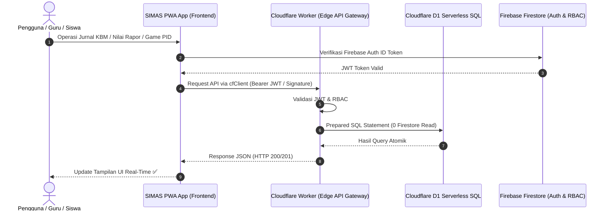

# Product Requirement Document (PRD) - SIMAS - SHAKTI

| Metadata | Detail |
|---|---|
| **Nama Produk** | **SIMAS - SHAKTI** (Sistem Manajemen Informasi SMAGESA SHAKTI - SMA Negeri 1 Abang) |
| **Versi Aplikasi** | `v1.2.629` / `[26.11.02.3]` - 2026-11-02 (Menyesuaikan `package.json` & `CHANGELOG.md`) |
| **Status Dokumen** | **v1.2.629** - **Infrastruktur Situs Demo Mandiri & Pipeline Auto-Sync Multi-Repo (`scripts/sync-demo-repo.mjs`, `.github/workflows/sync-demo.yml`, `school.demo.json`, `package.json`, `PRD_SIMAS.md`, `CHANGELOG.md`):** Merilis ekosistem situs demo publik terisolasi penuh (SMA Negeri Nusantara - SMANTARA CERDAS) pada repositori mandiri `komangpurna/simas-demo` yang terhubung ke Firebase Project `simas-demo-5ead3`, Cloudflare Worker & D1 Database `simas-demo-api` / `simas-demo-db`, Cloudflare R2 bucket terpisah, dan Supabase demo terisolasi (`wwvtthoeknizglicrhor`), serta membangun pipeline auto-sync otomatis via GitHub Actions dan skrip npm `sync:demo` untuk menjamin keselarasan 100% kode tanpa merusak basis data produksi SMAGESA. |


| **Prinsip Data** | **Single Source of Truth (SSOT)** - **Cloudflare D1 Serverless SQL** sebagai Master Tunggal Data Siswa (`students`), Master GTK & Tenaga Kependidikan (`gtk`), Master Kedisiplinan BK (`records`, `student_aggregates`, `bk_actions`, `violation_types`), Perwalian Siswa (`guru_wali_assignments`, `guru_wali_notes`), Catatan Rapor Wali Kelas (`walikelas_notes`), Alur Permisi 2 Tahap Siswa (`permisi_requests`), Master Laboratorium & Jadwal Peminjaman (`labs`, `lab_bookings`), Inventarisasi Laboratorium (`inventory_categories`, `inventory_locations`, `inventory_items`, `inventory_condition_history`), Ekosistem Sarana & Prasarana Terpadu (`sarpras_rooms`, `sarpras_inventory_items`, `sarpras_condition_history`, `sarpras_reports`, `sarpras_rkas_items`, `sarpras_loans`, `sarpras_bmhp_items`, `sarpras_bmhp_transactions`, `sarpras_maintenance_logs`, `sarpras_maintenance_schedules`), Jurnal Mengajar Guru (`jurnal_guru`, `master_mapel`, `master_lokasi`, `master_teachers`), Nilai & Konfigurasi E-Rapor (`rapor_scores`), Modul Terpadu LMS Sekolah (`lms_topics`, `lms_modules`, `lms_materials`, `lms_progress`, `lms_discussions`, `lms_quiz_attempts`), Buku Kenangan Kelas XII & Arsip Master PDF (`yearbook_profiles`, `yearbook_messages`, `yearbook_archives`), Konfigurasi Sistem Edge (`system_settings`: `login_config`, `login_videos`, `metadata_classes`, `metadata`, `push_config`, `finance_rates`, `finance_config`, `rapor_config`, `schedule_config`), Game Edukatif PID (`pid_games`), Konfigurasi & Respon Kuesioner Peminatan Siswa (`peminatan_config`, `peminatan_responses`), Agenda Kegiatan (`calendar_events`, `agenda_documents`), E-Kinerja Tendik & Penugasan Tugas Pokok (`employee_task_groups`, `employee_task_items`, `employee_assignments`, `employee_activities`, `employee_absences`), E-Kinerja Guru (`work_weeks`, `weekly_plan_versions`, `plan_activities`, `plan_time_segments`, `work_logs`, `work_log_segments`, `plan_log_links`), Push Notifikasi & Kotak Masuk Pengguna (`fcm_tokens`, `notification_jobs`, `notification_deliveries`), serta `auth_rate_limits` via `cfClient` dan REST API Cloudflare Worker (0 Firestore Read & Write); **Firebase Firestore `smagesa`** sebagai pengelola Akun Login Pengguna & RBAC (`users`), Passkey WebAuthn (`user_secrets`), Emergency Real-time Switch (`settings/system_config`), dan Credential Vault (`settings/wa_config`); **Supabase PostgreSQL** untuk Telemetri & Log Jejak Audit Keamanan Terpusat (`login_history`, `audit_logs` mencakup Audit Global, E-Kinerja & Koreksi Aktivitas Pegawai), Perpustakaan 8 tabel (`lib_buku`, `lib_eksemplar`, `lib_sirkulasi`, `lib_pengunjung`, `lib_bebas_pustaka`, `lib_config`, `lib_kategori_ddc`, `lib_hari_libur`) + 3 Views OPAC, Keuangan SPP, Kas & RKAS Komite (`finance_transactions`, `finance_cashflow`, `finance_closings`, `finance_daily_summary`, `finance_config`, `rkas_komite_headers`, `rkas_komite_items`), Penilaian Guru Mapel (`guru_mapel_gradebooks`, `guru_mapel_components`, `guru_mapel_scores`, `guru_mapel_summaries`), Presensi Guru Harian (`guru_presensi`), Presensi Siswa Multi-Tahun (`siswa_presensi_harian`, `siswa_presensi`), Aspirasi & Aduan Sekolah (`masukkan_saran`), Duta SMAGESA (`duta_kandidat`, `duta_suara_masuk`), serta Suka Duka (`sukaduka_config`, `sukaduka_kas`, `sukaduka_iuran`). Seluruh konfigurasi dan instansiasi terpusat di `js/config.js` |
| **Lokasi File Dokumen** | Root Repository: `PRD_SIMAS.md` |

---

## 1. Visi, Tujuan & Cakupan Produk

### 1.1 Visi Sekolah
> **"Terwujudnya Peserta Didik yang SHAKTI (Sehat, Humanis, Agamais, Kreatif, Terampil, Inovatif) Berwawasan Lingkungan."**

Menjadikan **SIMAS - SHAKTI** sebagai sistem pusat (*central hub*) ekosistem digital SMA Negeri 1 Abang yang mendukung ketercapaian Visi SHAKTI dan budaya berwawasan lingkungan. Sistem ini terpadu, aman, hemat resource/kuota, dan mudah diakses oleh seluruh civitas akademika (Siswa, Guru, Wali Kelas, Guru BK, Staf Keuangan, dan Pengelola Sekolah).

### 1.2 Tujuan Utama
1. **Pusat Data Terpusat (SSOT):** Menjamin seluruh data master terpusat di satu sumber data utama (Master Siswa, Master Guru/PTK, Rapor, Perwalian, Kedisiplinan, LMS, dan Jurnal di Cloudflare D1 SQL; User Akun & Auth di Firestore `smagesa`), dan disinkronisasikan secara efisien ke subsistem lain (Game Portal, Duta, Suka Duka, Modul Keuangan, Modul Perpustakaan).
2. **Otomatisasi & Digitasi Layanan Sekolah:** Memfasilitasi absensi digital, pencatatan poin pelanggaran/prestasi (BK), perwalian kelas, rekapitulasi nilai rapor, pembelajaran digital LMS, hingga pengelolaan transaksi keuangan (SPP & Kas Komite / Suka Duka) dan sirkulasi peminjaman buku perpustakaan.
3. **Efisiensi Infrastruktur (Zero Over-Budget):** Menerapkan teknik pemanggilan data hemat kuota read Firestore dan mengalihkan modul bertransaksi tinggi (seperti LMS, Perpustakaan, Keuangan SPP, Buku Kas Komite, Penilaian Guru Mapel, Suka Duka, Presensi Harian Siswa & Guru, Masukan/Saran) ke Supabase PostgreSQL serta Cloudflare D1 SQL dengan indexing optimal.
4. **Keamanan Berstandar Tinggi:** Memenuhi standar OWASP Top 10 serta menuju pertahanan ASVS (Application Security Verification Standard) Level 1 & Level 2.

### 1.3 Domain & URL Akses Utama Aplikasi (Primary Application Access Links)

Aplikasi **SIMAS - SHAKTI** dan seluruh subsistem ekosistem SMAGESA ALL disebarkan (*deployed*) dan dapat diakses publik melalui URL/Domain utama berikut:

| Kategori Domain | URL Akses Utama | Keterangan & Tujuan Akses |
|---|---|---|
| **Domain Produksi Utama (Primary SSOT)** | `https://smagesa.web.app` | Domain produksi aplikasi SIMAS - SHAKTI & PWA Scope Terpusat (Dideploy otomatis saat push/merge ke branch `main`). |
| **Domain Testing / Staging Resmi** | `https://sman1abang.web.app` | Domain staging/testing aktif untuk validasi fitur (Dideploy otomatis saat commit/push ke branch `testing`). |
| **Domain Brand Product** | `https://simas-shakti.web.app` | Domain alias produk resmi (Otomatis 301 Redirect ke `smagesa.web.app`). |
| **Domain Firebase Fallback** | `https://smagesa.firebaseapp.com`<br>`https://simas-shakti.firebaseapp.com` | Domain standar Firebase Hosting (Otomatis Canonical Redirect ke produksi). |
| **Subsistem Jurnal Mengajar** | `https://smagesa.web.app/jurnal.html` | Aplikasi Jurnal Mengajar SMAGESA (Terintegrasi PWA SIMAS & Cloudflare D1 SSOT). |
| **Subsistem Portal Game Arcade** | `https://komangpurna.web.app` | Portal Game Edukatif PID SMAGESA (Hosting Statis `starlink-galaxy`). |
| **Portofolio & Web Pengembang (IKP)** | `https://komangpurna.web.app` | Website profil dan portofolio pengembang SIMAS - SHAKTI (Ditautkan pada teks `(IKP)` footer halaman login & SSOT `SCHOOL_CONFIG.developerWebsite`). |
| **Subsistem Koperasi SSA** | `https://sedana-shakti-amerta.web.app` | Layanan Koperasi Sedana Shakti Amerta Sekolah. |

### 1.4 Identitas & Alamat Resmi Sekolah (SSOT `SCHOOL_CONFIG`)

Konfigurasi identitas sekolah disentralisasi secara tunggal pada `js/school-config.js` (`window.SCHOOL_CONFIG`) dan disebarkan ke seluruh antarmuka web, berkas cetak dokumen/rapor, kartu tanda siswa, dan API backend:
- **Nama Sekolah:** SMA Negeri 1 Abang (`schoolName`) / SMAGESA (`schoolShortName`)
- **NPSN:** 50103632 (`schoolNPSN`)
- **Alamat Resmi Lengkap:** `Jl. Ida Ketut Jelantik, Desa Tista, Kecamatan Abang, Karangasem, Bali` (`schoolAddress` / `schoolAddressFull`)
- **Alamat Resmi Pendek / Jalan:** `Jl. Ida Ketut Jelantik, Desa Tista, Kecamatan Abang` (`schoolAddressShort` / `schoolStreetAddress`)
- **Kecamatan / Kabupaten / Provinsi / Kode Pos:** Kecamatan Abang (`schoolCity`), Bali (`schoolProvince`), 80852 (`schoolPostalCode`)
- **Website Resmi Sekolah:** `https://sman1abang.sch.id` (`schoolWebsite`)

### 1.5 Distribusi Aplikasi Android Penuh (Trusted Web Activity - TWA)

Untuk meningkatkan aksesibilitas bagi civitas akademika tanpa memecah arsitektur Single Source of Truth (SSOT), aplikasi web SIMAS dibungkus menjadi aplikasi Android penuh:
1. **Identitas Aplikasi Android:**
   - **Nama Aplikasi:** SIMAS SMAGESA / SIMAS - SHAKTI
   - **Package ID:** `id.sch.sman1abang.simas`
   - **Tampilan:** Standalone Fullscreen (Tanpa browser address bar).
2. **Digital Asset Links (`.well-known/assetlinks.json`):**
   - Mengaitkan hak cipta domain `https://smagesa.web.app` dengan package `id.sch.sman1abang.simas` melalui SHA-256 certificate fingerprint keystore.
   - Konfigurasi hosting `firebase.json` dikonfigurasi untuk mengecualikan `.well-known/**` dari daftar ignore dan memberikan header `Content-Type: application/json`.
3. **Efisiensi & Nol Duplikasi:**
   - Aplikasi Android berjalan langsung di atas instance web SIMAS produksi, sehingga setiap pembaruan sistem langsung aktif di HP pengguna tanpa perlu kompilasi ulang APK.
   - Beban kuota database (Cloudflare D1 & Supabase) tetap 100% terkendali mengikuti strategi caching multi-tier yang sudah berjalan.
4. **Keamanan & Manajemen Kredensial:**
   - Berkas `android.keystore` diproteksi ketat pada `.gitignore` dan daftar ignore `firebase.json` agar tidak bocor ke repositori git publik maupun hosting web.
   - Mendukung injeksi keystore produksi aman melalui GitHub Secret `secrets.ANDROID_KEYSTORE_BASE64` untuk kompilasi cloud yang menghasilkan fingerprint persis sama dengan Digital Asset Links.
5. **Otomasi Build Cloud Non-Interaktif di GitHub Actions:**
   - Setup SDK memakai `android-actions/setup-android@v3` dengan `packages: 'platform-tools'` agar tidak memasang paket bawaan `tools` yang tidak tersedia. Action menerima lisensi resmi Android SDK melalui `accept-android-sdk-licenses: true` dengan `log-accepted-android-sdk-licenses: false`, tanpa menulis hash lisensi manual atau bergantung pada path `cmdline-tools/latest`.
   - Pra-konfigurasi `~/.bubblewrap/config.json` memakai `$JAVA_HOME` dan `$ANDROID_HOME` agar Bubblewrap CLI menggunakan SDK yang sama tanpa wizard instalasi interaktif.
   - Regenerasi struktur proyek Android (`app/`, `build.gradle`) secara otomatis dari `twa-manifest.json` melalui `bubblewrap update --skipVersionUpgrade` sebelum mengompilasi APK dan AAB siap unduh via artifacts.

---

## 2. Ekosistem Arsitektur & Sumber Data (SSOT)

Sistem SIMAS terhubung dalam satu jaringan ekosistem **SMAGESA ALL**:

```mermaid
graph TD
    subgraph D1_CORE ["1. Cloudflare D1 SQL (Master SSOT & Edge API - 'simas-smagesa-d1')"]
        D1_Data["- Master Siswa (students - 48 Atribut Dapodik)\n- Master Guru / PTK (teachers - 21 Kolom Dapodik & SIMAS)\n- Kedisiplinan BK (records, student_aggregates, bk_actions, violation_types)\n- Modul Pembelajaran LMS (lms_topics, lms_materials, lms_progress, lms_discussions)\n- Perwalian & Catatan Siswa (guru_wali_assignments, guru_wali_notes)\n- Catatan Rapor Wali Kelas (walikelas_notes)\n- Alur Permisi 2 Tahap (permisi_requests)\n- E-Rapor & Jadwal XML (rapor_scores)\n- Konfigurasi Sistem Edge (system_settings)\n- Jurnal Mengajar KBM (jurnal_guru, master_mapel, master_lokasi)\n- Laboratorium & Agenda (labs, lab_bookings, calendar_events, agenda_documents)\n- Peminatan & Game (peminatan_config, peminatan_responses, pid_games)\n- Push Notifikasi & Telemetri (fcm_tokens, notification_*, login_history, audit_logs)"]
    end

    subgraph FS_CORE ["2. Firebase Firestore 'smagesa' (Auth & Emergency Core)"]
        FS_Master["- Akun Pengguna & RBAC (users, user_secrets)\n- Emergency Realtime Switch (settings/system_config)\n- Credential Vault Super Admin (settings/wa_config)"]
    end

    subgraph SB_CORE ["3. Supabase PostgreSQL 'elrmzlicuuglnoeedusr' (High-Transaction)"]
        SB_Sub["- Perpustakaan 8 Tabel + 3 Views (lib_buku, lib_eksemplar, lib_sirkulasi, lib_pengunjung, lib_bebas_pustaka, lib_config, lib_kategori_ddc, lib_hari_libur)\n- Keuangan SPP, Kas & RKAS Komite (finance_transactions, finance_cashflow, finance_closings, finance_daily_summary, finance_config, rkas_komite_headers, rkas_komite_items)\n- Penilaian Guru Mapel (guru_mapel_gradebooks, guru_mapel_components, guru_mapel_scores, guru_mapel_summaries)\n- Presensi Siswa & Guru Harian (guru_presensi, siswa_presensi, siswa_presensi_harian)\n- Pengaduan & Aspirasi (masukkan_saran)\n- E-Voting Duta SMAGESA (duta_kandidat, duta_suara_masuk)\n- Dana Sosial Suka Duka (sukaduka_config, sukaduka_kas, sukaduka_iuran)"]
    end

    D1_CORE <-->|Edge API Gateway / cfClient| FS_CORE
    FS_CORE <-->|Secure Token Proxy / Supabase JS| SB_CORE
```



### Status Arsip Firestore
Koleksi berawalan `z_` maupun `Z_` dipensiunkan dari koneksi aplikasi. Tidak ada alias koleksi arsip di `PATHS`, panel migrasi presensi dari arsip, maupun skrip migrasi/pengarsipan lama yang membaca atau menulis koleksi tersebut. Akses client tetap ditolak oleh aturan default-deny Firestore. Presensi menggunakan Supabase; modul lain mengikuti SSOT D1/Supabase masing-masing. Perubahan ini tidak menghapus data arsip dan tidak menyatakan bahwa isi arsip telah dicocokkan ulang dengan database produksi.

### 2.1 Strategi Optimasi Query, Partial Index & Caching Multi-Tier Cloudflare D1
Untuk menjamin aplikasi selalu beroperasi dalam batas kuota gratis (*Free Tier Cloudflare D1: 5.000.000 rows read/hari*) dan mencegah latensi tinggi akibat *full table scan*, diterapkan arsitektur optimasi berikut:
1. **Partial Index SQLite Berkinerja Tinggi:**
   - Tabel `records`:
     - `idx_records_active_cat_date_ts ON records(category, date DESC, timestamp DESC) WHERE status = 'active'`
     - `idx_records_active_class_cat_date ON records(student_class, category, date DESC, timestamp DESC) WHERE status = 'active'`
     - `idx_records_active_date_cat ON records(date, category) WHERE status = 'active'` (Covering index untuk agregat stats tanpa disk scan baris)
     - `idx_records_active_nis_ts ON records(student_nis, timestamp DESC) WHERE status = 'active'`
     - `idx_records_active_ts ON records(timestamp DESC) WHERE status = 'active'` (Eliminasi scan 371:1 & filesort memori pada riwayat feed global `ORDER BY timestamp DESC LIMIT ? OFFSET ?`)
     - `idx_records_active_cat_ts ON records(category, timestamp DESC) WHERE status = 'active'` (Eliminasi scan 95:1 pada filter kategori BK)
     - `idx_records_active_class_ts ON records(student_class, timestamp DESC) WHERE status = 'active'` (Optimasi filter rombel kelas)
     - `idx_records_active_class_cat_ts ON records(student_class, category, timestamp DESC) WHERE status = 'active'` (Optimasi filter rombel + kategori)
   - `GET /api/records` mengunci indeks timestamp yang sesuai dengan filter kelas/kategori hanya bila tidak ada filter tanggal/NIS, agar indeks lama `(status, date)` tidak memicu pengurutan seluruh catatan aktif. Query tanggal/NIS tetap memakai pilihan query planner. Jika indeks belum terpasang, query asli digunakan kembali tanpa mengubah data. Filter, urutan timestamp, pagination, dan format respons tetap dipertahankan.
   - Tabel `jurnal_guru`:
     - `idx_jurnal_tgl_created ON jurnal_guru(tanggal DESC, created_at DESC)` (Eliminasi filesort memori)
     - `idx_jurnal_kelas_tgl_created ON jurnal_guru(kelas, tanggal DESC, created_at DESC)` (Optimasi filter rombel)
     - `idx_jurnal_guru_mapel_kelas_tgl_created ON jurnal_guru(guru, mapel, kelas, tanggal DESC, created_at DESC)` (Eliminasi scan ratio 30:1 & temp filesort histori topik terakhir)
     - `idx_jurnal_guru_kelas_tgl_created ON jurnal_guru(guru, kelas, tanggal DESC, created_at DESC)` (Fallback histori topik tanpa mapel)
   - Tabel `guru_wali_assignments`:
     - `idx_guru_wali_class_name ON guru_wali_assignments(student_class ASC, student_name ASC)`
2. **Standardisasi Filter Kesetaraan (`status = 'active'`):**
   - Menghindari penggunaan operator pertidaksamaan `status != 'deleted'` pada klausa `WHERE`. SQLite B-Tree tidak dapat melakukan range scan pada kolom-kolom berikutnya setelah pertidaksamaan, sehingga diwajibkan menggunakan kondisi kesetaraan `status = 'active'` yang cocok 100% dengan partial index.
3. **Atomic Merge Metadata Timestamp di `system_settings`:**
   - Menyimpan timestamp `lastUpdateStudents`, `lastUpdateTeachers`, dan `aggregateVersion` dalam key `metadata`. Endpoint mutasi `/api/settings/:key` melakukan shallow merge (`{ ...existing, ...incoming }`) agar pembaruan data siswa tidak menghapus timestamp guru, dan sebaliknya.
   - Worker otomatis menyelaraskan timestamp di sisi server saat terjadi mutasi data siswa atau GTK.
4. **Caching Multi-Tier (Memory -> IndexedDB / SessionStorage -> Edge Cache):**
   - **Data Siswa & GTK:** Di-cache persisten di browser via `IndexedDB` dan `localStorage`. Jika server metadata menunjukkan data belum berubah atau timestamp tidak tersedia, client memprioritaskan cache lokal dan tidak menembak D1.
   - **Bundle Master Jurnal:** Disimpan di `sessionStorage` dengan TTL 15 menit dan in-memory worker cache 10 menit dengan respon `Cache-Control` teroptimasi.
5. **Mekanisme Resiliensi Client & Exponential Backoff Auto-Retry (`cfClient`):**
   - Menangani gangguan sesaat (*transient error*) dari arsitektur Durable Objects Cloudflare D1 (seperti `D1_ERROR: D1 DB storage operation exceeded timeout which caused object to be reset` dan error gateway 502/503/504) secara otomatis dan transparan di layer `CloudflareClient.request()`.
   - Menerapkan *exponential backoff with jitter* (maksimal 2x retry, total 3x percobaan) untuk seluruh pemanggilan *idempotent* (khususnya query `GET`).
   - Menerapkan *localStorage fallback* pada modul seperti E-Laboratorium (`loadLabs`) dan *graceful fallback* pada inisialisasi push notification (`setupPushNotifications`), menjamin User Experience (UX) tetap lancar tanpa menampilkan error pop-up atau antarmuka yang rusak saat backend D1 mengalami pemulihan sesaat.

---

## 3. Matriks Peran & Hak Akses Pengguna (RBAC)

**Pengelompokan sidebar:** Kelompok **Agenda dan Dokumen** berurutan Kalender Agenda, Agenda Pegawai, Dokumen, Data Siswa, lalu Data GTK (menu key `guru`). Kelompok **Data Master** dihapus. Setiap submenu tetap disaring menggunakan izin per menu dari gabungan peran pengguna; keanggotaan dalam kelompok tidak memberikan izin tambahan. Izin akses halaman dan urutan kelompok lain tetap berlaku seperti sebelumnya, pada desktop maupun mobile.

**Pencarian Menu Sidebar (Hybrid & RBAC Parity):**
Sidebar desktop dan drawer menu mobile dilengkapi kolom pencarian terpadu (*real-time live filter*) dengan shortcut keyboard global `Ctrl+K` / `⌘K` dan `/`.
- **Otorisasi & Keamanan Berbasis Peran (RBAC Parity):** Indeks pencarian dan riwayat "Terakhir Dibuka" (maks. 3 menu) 100% bersumber dari `allowedKeys` hasil evaluasi `initLayout()`. Menu di luar hak akses peran aktif tidak pernah masuk ke DOM, atribut pencarian, maupun riwayat sehingga mustahil diakses atau dicari. Riwayat "Terakhir Dibuka" disimpan terisolasi per-UID akun (`simas_recent_menus_${uid}`), selalu divalidasi silang (*intersection*) terhadap `allowedKeys` terkini, dan otomatis dibersihkan saat pergantian akun maupun *logout*.
- **Hemat Sumber Daya & Keamanan DOM:** Berjalan 100% di memori browser klien (*client-side filtering*, 0 pembacaan Firestore, Supabase, maupun D1). Input pencarian mematuhi aturan desain SMAGESA (tanpa leading icon penutup teks di sisi kiri input, tombol pembersih `✕` di sisi kanan). Auto-expand grup accordion saat ada kecocokan dan restorasi otomatis saat pencarian di-clear. Input pada sidebar ciut (`w-20`) otomatis mengecil menjadi ikon tombol pencarian yang melebarkan sidebar saat ditekan.

Kelompok **Kesiswaan & BK** berurutan Ruang BK, Data Kredit Poin, Hasil Peminatan, Kapsul Waktu, lalu Admin Duta SHAKTI. Kelompok **Lainnya** dihapus. Ruang BK hanya muncul paling atas bagi pengguna yang memiliki izin menu tersebut; pemindahan Kapsul Waktu dan Duta SHAKTI tidak memperluas hak akses keduanya.

> 📌 **PENTING - Arsitektur Multi-Role (Primary Role & Additional Roles):**
> Arsitektur SIMAS - SHAKTI mendukung skema **Multi-Role** (properti `role` sebagai **Role Utama** dan array `additionalRoles: [...]` sebagai **Role Tambahan / Tugas Rangkap** pada dokumen pengguna). 
> - **Role Utama (`role`):** Peran dasar akun pengguna yang dipilih via dropdown form `users.html` (`super_admin`, `kepala_sekolah`, `staff`, `admin_perpus`, `admin_lks`, `guru_mapel`, `admin_pks`, `admin_kelas`). Akun Siswa reguler (`siswa`) tidak dibuat via Manajemen User, melainkan login mandiri berbasis NIS via Portal Siswa.
> - **Role Tambahan (`additionalRoles`):** Ditambahkan sebagai tugas rangkap opsional untuk akun Guru/Staff via checkbox form (`admin_perpus`, `admin_lks`, `wakasek_kurikulum`, `kesiswaan`, `humas`, `sarpras`, `kepala_lab`, `admin_spp`, `admin_sukaduka`, `admin_duta`, `wali_kelas`, `guru_bk`). Hak akses sistem secara otomatis mengombinasikan (*merge*) izin dari seluruh role yang dimiliki akun tersebut.

| Kelompok Role | Peran (Nama Tampilan) | Role Key Resmi Kode | Kategori Pendaftaran | Deskripsi Peran & Hak Akses Utama | Modul Terkait |
|---|---|---|---|---|---|
| **Role Utama** | **Super Admin** | `super_admin` | Primary (`role`) | Pengelola penuh sistem sekolah, manajer user, backup, restore, integrasi DB | Semua Halaman (`dashboard`, `users`, `settings`, `integrasi`, `library/*`, `penjualan-buku.html`) |
| **Role Utama** | **Kepala Sekolah** | `kepala_sekolah` | Primary (`role`) | Dashboard analitik eksekutif, view-only monitoring seluruh modul sekolah | `dashboard.html`, `monitoring-kbm.html`, `bk.html`, `library/laporan.html` |
| **Role Utama** | **Staff / Tata Usaha** | `staff` | Primary (`role`) | Petugas operasional administrasi harian & pembantu entri data master | `users.html`, `siswa.html`, `keuangan.html`, `library/index.html` |
| **Role Utama / Tambahan** | **Admin Perpustakaan** | `admin_perpus` | Primary & Additional | Pengelola penuh sirkulasi buku, katalogisasi DDC/Perpusnas, cetak barcode/label, presensi & bebas pustaka | Seluruh Modul `library/` (`index`, `katalog`, `opac`, `presensi-perpus`, `bebas-pustaka`, `laporan`, `pengaturan`) |
| **Role Utama / Tambahan** | **Admin LKS** | `admin_lks` | Primary & Additional | Pengelola pencatatan transaksi penjualan, sirkulasi stok, penyesuaian harga buku, dan ekspor rekapitulasi buku LKS sekolah | `penjualan-buku.html` |
| **Role Utama** | **Guru Mapel** | `guru_mapel` | Primary (`role`) | Tenaga pengajar utama (kelola nilai, presensi mapel, jurnal mengajar, dan perwalian binaan) | `guru-mapel.html`, `guru.html`, `presensi-guru.html`, `guru-wali.html`, `agenda.html` |
| **Role Utama (Siswa)** | **Admin PKS (Siswa)** | `admin_pks` | Primary (`role`) | Siswa petugas ketertiban (piket) yang membantu pencatatan presensi/poin | `presensi.html`, `bk.html` |
| **Role Utama (Siswa)** | **Admin Kelas (Siswa)** | `admin_kelas` | Primary (`role`) | Siswa sekretaris kelas yang membantu penginputan presensi harian kelas | `presensi-guru.html`, `presensi.html` |
| **Portal Siswa** | **Siswa** | `siswa` | Portal Siswa Mandiri (NIS) | Siswa (Pengguna akhir), login via NIS & Tanggal Lahir/NISN, lihat profil, riwayat presensi, poin BK, status SPP, voting Duta, katalog OPAC | `portal-siswa.html`, `siswa.html`, `peminatan.html`, `library/opac.html`, `library/presensi-perpus.html` |
| **Role Tambahan** | **Wakasek Kurikulum** | `wakasek_kurikulum` | Additional (`additionalRoles`) | Pengaturan E-Rapor, pembagian mapel, dan monitoring akademik | `e-rapor.html`, `guru-wali.html`, `monitoring-kbm.html`, `dashboard.html` |
| **Role Tambahan** | **Wakasek Kesiswaan** | `kesiswaan` | Additional (`additionalRoles`) | Monitoring ketertiban, rekapitulasi poin disiplin BK, & presensi siswa (View-only/Approval) | `bk.html`, `kredit.html`, `monitoring-kbm.html` |
| **Role Tambahan** | **Wakasek Humas** | `humas` | Additional (`additionalRoles`) | Hubungan kemasyarakatan, publikasi sekolah, penerimaan tamu/aspirasi masyarakat, & disposisi masukan | `masukan.html`, `dashboard.html` |
| **Role Tambahan** | **Wakasek Sarpras** | `sarpras` | Additional (`additionalRoles`) | Pemegang kebijakan sarpras: otorisasi pengadaan/RKAS, disposisi aduan, persetujuan pinjam aula/lab, & validasi KIR resmi | `sarpras-inventaris.html`, `sarpras-aduan.html`, `sarpras-rkas.html`, `sarpras-penggunaan.html`, `sarpras-pemeliharaan.html`, `masukan.html`, `dashboard.html` |
| **Role Tambahan** | **Admin Sarpras** | `admin_sarpras` | Additional (`additionalRoles`) | Operator teknis sarpras: katalogisasi barang, cetak label QR, sirkulasi BMHP, cek fisik peminjaman, & tiket servis teknisi | `sarpras-inventaris.html`, `sarpras-aduan.html`, `sarpras-rkas.html`, `sarpras-penggunaan.html`, `sarpras-pemeliharaan.html`, `dashboard.html` |
| **Role Tambahan** | **Kepala Lab** | `kepala_lab` | Additional (`additionalRoles`) | Pengaturan & persetujuan pemakaian laboratorium sekolah | `e-lab.html` |
| **Role Tambahan** | **Admin SPP** | `admin_spp` | Additional (`additionalRoles`) | Pengatur tarif SPP per angkatan, pembuatan tagihan massal, catat transaksi & cetak kuitansi | `keuangan.html` |
| **Role Tambahan** | **Wali Kelas** | `wali_kelas` | Additional (`additionalRoles`) | Pembimbing 1 rombel/kelas penuh, catat rapor kelas & monitor presensi kelas | `wali-kelas.html`, `monitoring-kbm.html` |
| **Role Tambahan** | **Guru BK** | `guru_bk` | Additional (`additionalRoles`) | Penangan disiplin & konseling, input pelanggaran/prestasi, cetak surat panggilan | `bk.html`, `kredit.html` |
| **Role Tambahan** | **Admin Suka-Duka** | `admin_sukaduka` | Additional (`additionalRoles`) | Pengelola iuran & kas dana sosial Suka Duka Guru (Supabase) | `sukaduka/suka-duka.html` |
| **Role Tambahan** | **Admin Duta SHAKTI** | `admin_duta` | Additional (`additionalRoles`) | Pengelola event Duta SMAGESA (Admin panel & reset suara) | `duta-admin.html`, `duta/admin.html` |

---

#### 4. Spesifikasi Fitur per Modul (Halaman demi Halaman, Alur Kerja & Keterkaitan Data Database)

Dokumen ini membedah seluruh 29 halaman/modul yang tertanam di dalam ekosistem web **SIMAS - SHAKTI** secara faktual berdasarkan kode program (*source code*), melengkapi setiap modul dengan **Alur Kerja Step-by-Step (User & System Flow)** dan **Keterkaitan Data Database (Entity Relationships)**:

---

### 4.1 Landing Page & Multi-Auth Login Modal (`index.html` & `js/global.js`)
- **Tujuan Halaman:** Halaman depan publik sekolah, profil SMA Negeri 1 Abang (Visi SHAKTI), serta pintu masuk otentikasi utama pengguna.
- **Otorisasi Akses:** Publik (Belum Login) & Seluruh User (Redirect otomatis ke portal/dashboard sesuai peran jika sudah login).
- **Fitur Utama & UI:**
  - Hero Section Visi SHAKTI (*Sehat, Humanis, Agamais, Kreatif, Terampil, Inovatif Berwawasan Lingkungan*) & Video Animated Logo (`#login-logo-video`).
  - **Form Login Otomatis Berbasis Konteks Input (Auto-Context Detection):** Tanpa tombol tab manual. Satu input field identitas (`#user-identity`) yang secara otomatis menyesuaikan antarmuka form berdasarkan identitas yang diketik pengguna:
    - **Indikator Mode Siswa:** Jika input berupa angka murni (NIS >= 4 digit), mode otomatis berubah ke `Siswa` (`#mode-siswa`), menyembunyikan field password, serta menampilkan pilihan Tanggal Lahir (Tanggal, Bulan, Tahun) dan input alternatif NISN (`#nisn-container`).
    - **Indikator Mode Admin/Guru/Staf:** Jika input berupa huruf/NIP/email, mode otomatis berubah ke `Admin/Guru` (`#mode-staff`), menampilkan field Kata Sandi (`#password`), serta menyembunyikan pilihan tanggal lahir.
  - **Antarmuka Dark Mode Premium & Glassmorphism (`.login-card-custom`):** Kartu login di dalam mode gelap menggunakan *dark glassmorphism* bertransparansi halus (`rgba(15, 23, 42, 0.82)`), *backdrop blur* 24px, border transparan berkilau, dan bayangan ambient glow. Form control `<select>` Tanggal Lahir dan `<option>` dropdown dikunci pada latar belakang gelap (`#1e293b`) dengan teks terang (`#f8fafc`). Badge mode dan alert pesan kesalahan (`#error-msg`) menyajikan latar transparan dengan teks kontras tinggi.
  - Carousel Info Sekolah, Pengumuman, & Link Cepat Event Duta / Kapsul Waktu.
- **Koleksi Database:** Firestore `users` (Staf/Guru) & Cloudflare D1 SQL `students` (Siswa).
- **Keterkaitan Data Database:**
  - Dokumen `users/{uid}` di Firestore bertindak sebagai Kunci Relasi Otentikasi Staf.
  - Field `role` & `additionalRoles` di `users` mereferensikan peran staf.
  - Baris tabel D1 `students.nis` bertindak sebagai Kunci Relasi Otentikasi Siswa.
- **Alur Kerja Step-by-Step & Aturan Pengalihan (Redirect Rules):**
  1. Pengguna mengakses `index.html`. Sistem mengeksekusi `onAuthStateChanged()`.
  2. **Jika Pengguna Sudah Login:**
     - **Akun Siswa (`student_nis` terdeteksi):** Sistem **SECARA MUTLAK mengabaikan parameter URL `redirect`** (misal `?redirect=%2Fdashboard.html`) dan **SELALU mengarahkan siswa ke `portal-siswa.html`**.
     - **Akun Staf/Admin (`user_role` terdeteksi):** Sistem mengarahkan ke URL di parameter `redirect` (jika valid & safe) atau ke `dashboard.html`.
  3. **Jika Pengguna Belum Login:** Landing page menampilkan hero section, video animasi logo, & carousel pengumuman.
  4. Pengguna mengisikan identitas pada kolom `Identitas Pengguna`:
     - **A. Deteksi Otomatis Mode Siswa (Input NIS Angka):**
       - Pengguna memasukkan **NIS** (angka murni). Fungsi `isNIS()` mendeteksi dan mengaktifkan mode `Siswa`.
       - Form secara dinamis beralih menampilkan dropdown **Tanggal Lahir (DD/MM/YYYY)** dan kolom **NISN (Alternatif)**.
       - Pengguna melengkapi Tanggal Lahir atau NISN, lalu mengklik **"Masuk Portal Siswa"**.
       - Sistem memverifikasi data siswa langsung ke Cloudflare D1 via `cfClient.getStudent(cleanNIS)`.
       - Jika valid dan aktif, profil disimpan ke `sessionStorage` (`student_nis` & `student_data`), `user_role = 'siswa'`, dan **di-redirect secara mutlak ke `portal-siswa.html`** (mengabaikan parameter URL `redirect`).
     - **B. Deteksi Otomatis Mode Staf / Admin / Pengajar (Input NIP/Username/Email / Google Sign-In):**
        - **Metode 1 (Email/NIP & Password):** Pengguna memasukkan NIP/Username/Email dan kata sandi, mengklik **"Masuk Aplikasi"**. Jika memasukkan NIP/Username, sistem mengonversinya menjadi email format `{identity}@smanegeri1abang.sch.id`. Kredensial diverifikasi via `signInWithEmailAndPassword()`.
        - **Metode 2 (Masuk dengan Google):** Pengguna mengklik tombol **"Masuk dengan Google"** (`#btn-google-login`). Otentikasi dilakukan via `signInWithPopup(auth, googleProvider)`. Sistem mengambil email Google pengguna, lalu mencocokkan ke koleksi `users` di Firestore (`where("email", "==", googleEmail).limit(1)`). Jika email terdaftar di database `users`, sistem membaca `userData` dan mengizinkan login. Jika email tidak terdaftar di database `users`, sistem secara otomatis mengeksekusi `signOut(auth)` (kick out) dan menampilkan alert kesalahan.
        - **Metode 3 (Login Sidik Jari / Biometrik True WebAuthn FIDO2 Passkey - Khusus Guru & Staf):** Pengguna ber-role Guru/Staf yang telah mendaftarkan sensor biometrik (Touch ID / Face ID / Windows Hello) via modal *Edit Profil* dapat menekan tombol **"Sidik Jari"** (`#btn-biometric-login`). Otentikasi W3C WebAuthn/FIDO2 level 2/3 melakukan verifikasi tanda tangan kriptografis hardware di Cloudflare Worker edge gateway (`/api/auth/webauthn/login-verify`) tanpa menyimpan kata sandi sama sekali di client storage/browser (0 Password Stored, OWASP ASVS Level 2). Server menerbitkan Firebase Custom Auth Token yang dieksekusi secara instan via `signInWithCustomToken()`. Sistem mendukung isolasi multi-akun pada 1 perangkat fisik, dan pendaftaran/login biometrik secara ketat ditolak untuk role `siswa`, `admin_pks`, dan `admin_kelas`.
        - Jika otentikasi valid (metode 1, 2, atau 3), profil dan daftar peran (`role` & `additionalRoles`) dibaca dari Firestore `users`, disimpan ke `localStorage`/`sessionStorage`, dan pengguna diarahkan ke `dashboard.html` (atau halaman aman sesuai parameter `redirect`).

---

### 4.2 Executive & Management Dashboard (`dashboard.html` & `js/page-dashboard.js`)
- **Tujuan Halaman:** Pusat analitik, agregasi statistik real-time, dan navigasi modul sekolah.
- **Otorisasi Akses:** Seluruh Role Terautentikasi (`super_admin`, `kepala_sekolah`, `wakasek_kurikulum`, `kesiswaan`, `kepala_lab`, `admin_spp`, `staff`, `wali_kelas`, `guru_mapel`, `guru_bk`, `admin_pks`, `admin_kelas`, `siswa`).
- **Fitur Utama & UI:**
  - Visualisasi Statistik Executive (Khusus `kepala_sekolah` & `super_admin`): Ringkasan total pelanggaran, total prestasi, total permisi, & agregasi poin BK.
  - **Showcase Ringkasan Ranking Kinerja Rombel Kelas (`#section-ranking-kelas-summary`):** Komponen eksekutif terpadu khusus dashboard Kepala Sekolah (`kepala_sekolah` & `super_admin`) yang menampilkan ringkasan performa rombel kelas semester berjalan secara visual dan interaktif. Terdiri dari Top 3 Podium Showcase (kartu peraih Juara 1 Emas, Juara 2 Perak, dan Juara 3 Perunggu lengkap dengan foto profil Wali Kelas Cloudflare R2 `resolvePhotoUrl`, nama rombel, skor indeks bintang SMAGESA, serta mini breakdown presensi %, SPP %, dan disiplin) serta Mini Leaderboard 5 Besar Rombel Terbaik dengan rank crown/badge, nama rombel, wali kelas, indikator pilar terpadu, dan tombol aksi "Detail". Seluruh kartu podium, baris tabel, tombol shortcut "Ranking Kelas" di Executive Command Center, tombol "Papan Ranking Lengkap" di header, dan tautan footer terhubung langsung ke `ranking-kelas.html` secara instan. Menggunakan multi-tier cache SSOT browser (`sessionStorage.getItem('simas_class_ranking_summary_cache')`) yang di-share langsung dari modul ranking kelas atau fallback kalkulasi in-memory data terunduh (`semesterClassAttMap`, `activeStudents`, `sppData`, `violations`) dengan D1 aggregate fallback (0 kuota database read ekstra).
  - **Pusat Pemantauan "Atensi Hari Ini" (`#section-atensi-hari-ini`):** Komponen ringkas di bawah bilah Akses Cepat Eksekutif yang menyorot kondisi yang membutuhkan perhatian Kepala Sekolah secara proporsional (Anti-Panik): kelas dengan kehadiran terendah / < 90% pada hari ini (SSOT murni tabel `siswa_presensi_harian` via `fetchDailyAttendanceSummary(todayStr)` dan fungsi terpusat `calculateAttendanceStats`, berbasis tanggal WITA `Asia/Makassar` dan dihitung dari kelas yang telah menginput presensi hari ini), kasus BK baru hari ini, siswa dengan kasus berulang (3+ TA), dan tunggakan iuran SPP. Menggunakan indikator keparahan bertingkat (Critical merah, Warning oranye/amber) dan menampilkan state normal yang menenangkan (`✓ Kondisi utama sekolah hari ini terpantau normal`) saat kondisi sekolah sehat, 100% berbasis data aktual tanpa angka dummy.
  - **Optimasi Kartu Keuangan SPP & Navigasi Terpadu:** Mempertahankan tata letak progress ring & target realisasi, diperkaya dengan footer informasi actionable: jumlah siswa yang masih menunggak (`#spp-unpaid-students-count`) serta rombel kelas dengan akumulasi tunggakan terbesar (`#spp-top-debt-class` dan nominal `#spp-top-debt-amount`) yang dihitung di memori browser (0 request baru). Seluruh komponen tunggakan SPP di dashboard (kartu Atensi Hari Ini, tombol "Kelola SPP", dan footer actionable kartu SPP) terhubung langsung ke modul Keuangan (`keuangan.html#tab=laporan&subtab=estimasi`) yang otomatis membuka Tab Laporan dan Sub-tab Estimasi (estimasi penerimaan & tunggakan per kelas).
  - **Konteks Kehadiran Siswa & Kelas Ekstrim (Semester Berjalan):** Penegasan scope waktu Tahun Ajaran berjalan (`Kehadiran TA`) pada kartu KPI dan grafik tingkat kelas, subteks jumlah kelas di bawah ambang batas 90%, serta pemisahan tegas pada area **Kehadiran Kelas Ekstrim** (TOP 3 Terbaik & Terendah) yang secara eksklusif mengacu pada akumulasi presensi semester berjalan (bukan harian) via pembatasan rentang tanggal `getCurrentSemesterRange` (`startDate` s.d. `todayStr`). Dilengkapi perhitungan denominator pertemuan riil berjalan (`H+S+I+D+A`), penyaringan rombel anomali/minim data (`minThreshold`), badge penanda `"Semester Berjalan"`, subteks keterangan `"Akumulasi semester aktif (s.d. hari ini)"`, interaktivitas tautan langsung ke mode Rekap Semester per kelas di modul Presensi Siswa (`presensi.html#type=semester&class=...`), serta mitigasi auto-refresh tab saat kembali aktif ke dashboard (0 query baru).
  - **Optimasi Pemuatan Cepat & Efisiensi Kuota Eksekutif (Zero-Lag & Zero Read Quota Waste):** Menggunakan tabel pra-agregasi `siswa_presensi_harian` (< 150 KB, memangkas >97% baris baca Supabase dibanding kueri mentah `siswa_presensi` yang mencapai puluhan ribu baris), multi-tier cache (`simas_kepsek_attendance_summary_cache`, TTL 15 menit) di memori dan `sessionStorage` untuk menjamin 0 query Supabase saat reload atau pergantian tab rutin, progressive rendering / Stale-While-Revalidate (SWR) yang merender data lokal instan dalam 0ms, pemuatan master siswa/GTK/BK Cloudflare D1 SQL secara independen (< 100ms) tanpa tertahan kalkulasi presensi atau SPP, serta relaksasi jeda throttle auto-refresh saat berpindah tab peramban dari 60 detik menjadi 5 menit (`DASHBOARD_REFRESH_THROTTLE_MS = 5 * 60 * 1000`).
  - **Eliminasi 0 Semu pada Grafik Tren Pelanggaran Bulanan:** Memetakan bulan-bulan akademik yang belum berjalan dengan nilai `null` (bukan 0) sehingga garis tren berhenti di bulan berjalan dan mencegah kesimpulan keliru seolah pelanggaran turun menjadi 0 di masa depan.
  - **Integritas & Keandalan Master GTK Aktif (`isGtkActive`):** Filter GTK aktif pada kartu pimpinan mengecek seluruh status kepegawaian (`PNS`, `PPPK`, `Honorer`, `GTT`, `PTT`) dan hanya mengabaikan yang nonaktif definitif (`pensiun`, `mutasi`, `keluar`, `nonaktif`, `meninggal`, `berhenti`), menjamin data guru/tendik 100% konsisten dengan modul Master Guru/GTK.
  - **Sinkronisasi 100% Distribusi Siswa Aktif:** Modal distribusi siswa aktif (`#modal-student-distribution`) mengadopsi helper terpusat `isStudentActive(s)` dan mengecualikan alumni/mutasi/keluar, menyelaraskan angka modal dengan kartu total siswa aktif.
  - **Standardisasi Waktu Resmi Sekolah (WITA):** Deteksi kasus BK hari ini (`todayViolations`) dan presensi hari ini menggunakan `window.getWitaISODate()` (`Asia/Makassar`), mencegah anomali pergeseran tanggal saat diakses dari zona waktu lain.
  - **Eliminasi 0% Semu pada Kehadiran Sekolah (TA):** Jika belum ada catatan presensi pada tahun ajaran berjalan, kartu KPI menampilkan `'-'` (bukan `0%`) untuk menghindari interpretasi keliru bahwa kehadiran sekolah 0%. Perhitungan persentase kehadiran sepenuhnya didelegasikan ke SSOT `window.calculateAttendanceStats`.
  - Ringkasan Kasus Aktif & Kalkulator Early Warning System BK (SimasEWS).
  - Panel Persetujuan Permisi Dua Langkah (*Two-Step Permission Approval*).
  - Monitoring Kehadiran Kelas bagi Wali Kelas.
  - Ringkasan Personal Siswa (Presensi pribadi, poin BK, & status SPP).
  - **Pengecualian Mutlak Pengingat Perwalian Guru Wali (`#warning-guru-wali`):** Pop-up peringatan kelengkapan data perwalian hanya diperuntukkan bagi guru pengampu yang aktif membina siswa perwalian. Pengguna dengan peran Super Admin (`super_admin`), Kepala Sekolah (`kepala_sekolah`), dan Staff Tata Usaha (`staff`) secara mutlak dikecualikan (`isExemptFromGuruWaliReminder`), mencegah kemunculan pop-up peringatan dan mengeliminasi kueri D1 yang tidak diperlukan tanpa mendegradasi fitur pemantauan eksekutif dan hak akses penuh Super Admin.
- **Koleksi & Sumber Database:** Cloudflare D1 SQL `students`, `gtk`, `records`, `student_aggregates`, `system_settings/dashboard_stats`, Supabase PostgreSQL `finance_transactions`, `siswa_presensi_harian`.
- **Keterkaitan Data Database:**
  - `students.nis` ↔ `student_aggregates.student_nis` (1-to-1 Agregasi Poin BK D1).
  - `students.nis` ↔ `siswa_presensi_harian` / `siswa_presensi.student_nis` (Relasi presensi kelas Supabase).
  - `students.nis` ↔ `finance_transactions.student_nis` (Relasi penerimaan SPP Supabase).
  - `gtk.nip` ↔ `system_settings/rapor_config` (Relasi guru pengampu D1).
- **Alur Kerja Step-by-Step:**
  1. Pengguna membuka `dashboard.html`. Sistem memvalidasi sesi otorisasi via `initLayout()`, lalu segera menampilkan kerangka antarmuka utama (`<main>`) dengan skeleton loader shimmer per kartu untuk mengeliminasi jeda layar putih kosong (0ms blank screen).
  2. Sistem memeriksa LocalStorage TTL Cache. Jika cache masih valid (< 15 menit), statistik ditampilkan instan tanpa network request berulang.
  3. Kartu jumlah siswa aktif membaca konfigurasi agregat `system_settings/dashboard_stats` dari Cloudflare D1 via `cfClient` secara paralel bersama kueri statistik lainnya (`Promise.allSettled`).
  4. Jika cache statistik lain kadaluarsa, sistem mengeksekusi query agregasi terarah ke Cloudflare D1 (`student_aggregates`, `records`) dan Supabase (`finance_transactions`, `siswa_presensi_harian`), lalu memperbarui cache.
  5. Antarmuka secara dinamis menampilkan widget yang sesuai dengan role pengguna yang sedang login.
  6. Pengguna dapat mengklik kartu statistik untuk navigasi cepat ke modul spesifik.
  7. Sistem memeriksa kewajiban perwalian guru wali. Jika pengguna memiliki peran `super_admin`, `kepala_sekolah`, atau `staff` (baik primary role, multi-role `additionalRoles`, maupun jabatan GTK), sistem secara mutlak menonaktifkan pengecekan perwalian dan menghapus pop-up `#warning-guru-wali` dari antarmuka karena mereka tidak dibebani kewajiban siswa perwalian binaan.

---

### 4.3 Pengelolaan Akun Pengguna & Hak Akses (`users.html` & `js/page-users.js`)
- **Tujuan Halaman:** Pengelolaan akun login pengguna, penetapan peran utama (*primary role*), dan peran tambahan (*additionalRoles*).
- **Otorisasi Akses:** `super_admin`, `staff`.
- **Struktur Penetapan Role pada Form User:**
  - **Jabatan Utama (Primary Role):** Pilih salah satu dari `super_admin`, `admin_perpus`, `admin_lks`, `kepala_sekolah`, `staff`, `guru_mapel`, `admin_pks`, `admin_kelas`. (Siswa reguler login mandiri via NIS pada Portal Siswa dan tidak dibuat melalui form manajemen pengguna).
  - **Role Tambahan (Additional Roles Checklist):** Dapat mencentang peran ganda/tugas khusus seperti `admin_perpus`, `admin_lks`, `wakasek_kurikulum`, `kesiswaan`, `kepala_lab`, `admin_spp`, `admin_sukaduka`, `admin_duta`, `wali_kelas`, `guru_bk`.
  - **Total Role Resmi Kode (15 Key):** `super_admin`, `admin_perpus`, `admin_lks`, `kepala_sekolah`, `wakasek_kurikulum`, `kesiswaan`, `kepala_lab`, `admin_spp`, `staff`, `wali_kelas`, `guru_mapel`, `guru_bk`, `admin_sukaduka`, `admin_pks`, `admin_kelas` (+ role `siswa` untuk sesi portal siswa).
  - **Batasan Hak Akses Penambahan Akun Baru (`#form-add-user`):**
    - `super_admin`: Akses penuh untuk menambahkan seluruh jabatan/role.
    - `wakasek_kurikulum`: Dibatasi hanya dapat menambah `wali_kelas`, `guru_mapel`, `admin_kelas`, dan `staff`.
    - `kesiswaan`: Dibatasi hanya dapat menambah `admin_pks`, `admin_kelas`, dan `staff`.
    - `staff`: Dibatasi secara ketat hanya dapat menambah `staff`, `admin_kelas`, dan `admin_pks` (tidak berwenang menambah `wali_kelas` maupun `guru_mapel`). Dilindungi dengan validasi berlapis (UI dropdown filtering & server/submit security guard).
- **Fitur Utama & UI:**
  - Tab Switcher: Tab **Daftar Akun User** dan Tab **Pemetaan Wali Kelas**.
  - **Fitur Pemetaan Wali Kelas Massal (`#tab-content-mapping`):**
    - Aksesibilitas: Diberikan kepada `super_admin`, `wakasek_kurikulum`, dan `staff` (pengguna dengan role `kepala_sekolah` berstatus Read-Only).
    - Tabel Pemetaan Kelas Aktif: Menampilkan daftar seluruh kelas aktif, input pencarian/pemilihan guru interaktif dengan floating suggestion list, serta kolom aksi cepat.
    - Kolom Aksi Interaktif:
      - Menampilkan tombol **Edit** dan **Copot** untuk kelas yang telah memiliki wali kelas terdaftar.
      - Menampilkan tombol **Tugaskan** untuk kelas yang belum memiliki wali kelas.
      - Tombol Edit dan Tugaskan memanggil helper global `window.focusWaliKelasInput(kelas)` yang memfokuskan kursor dan membuka dropdown sugesti pencarian guru secara otomatis.
    - Keamanan Aturan Firestore (`firestore.rules`): Memberikan izin write bagi `staff` dan `wakasek_kurikulum` pada dokumen guru tanpa terhambat oleh keberadaan `additionalRoles` non-pimpinan (seperti `guru_bk`, `admin_sukaduka`, dll.) pada dokumen target, sembari tetap memblokir segala bentuk eskalasi hak istimewa ke `super_admin` atau `kepala_sekolah`.
  - Tabel Akun User dengan fitur Pencarian, Filter Role, & Pagination.
  - Modal Form Tambah / Edit User (Email, Display Name, Primary Role, Checklist Additional Roles, & Field Ubah Kata Sandi Langsung).
  - **Tandai Email Terverifikasi Otomatis (`emailVerified: true`):** Saat pembuatan akun pengguna baru melalui modal Tambah User, backend Cloudflare Worker (`POST /api/auth/verify-user-email`) secara otomatis menandai akun sebagai `emailVerified: true` via Google Identity Toolkit REST API. Kebijakan ini memastikan bahwa ketika staf/guru pertama kali mencoba Login Google SSO, Firebase Auth tidak akan mencabut (*unlink*) provider kata sandi, melainkan otomatis menautkan (*link*) kredensial email/password dengan Google OAuth secara mulus.
  - **Fitur Verifikasi Massal Akun GTK (`#btn-sync-emails`):** Tombol pada halaman `users.html` yang memanggil `POST /api/auth/batch-verify-emails` untuk menyinkronkan seluruh akun GTK ke status `emailVerified: true` secara massal tanpa membebani kuota baca Firestore.
  - **Fitur Pemulihan / Ubah Kata Sandi Langsung oleh Admin (`#edit-password`):** Field pada modal edit pengguna yang memungkinkan Super Admin menetapkan kata sandi baru secara langsung melalui endpoint backend `POST /api/auth/update-user-password` (memulihkan akun pengguna yang terlanjur kehilangan password akibat mencoba login Google sebelum email terverifikasi).
  - Modal Reset Password Manual & Status Akun (Active/Suspend).
  - Export Data Pengguna ke CSV (`users.csv`).
- **Koleksi Database:** Firestore `users`.
- **Keterkaitan Data Database:**
  - Dokumen `users/{uid}` menyimpan field `email`, `name`, `role`, `additionalRoles` (Array/List).
  - Field `nis` / `nip` di `users` mereferensikan Primary Key `students.nis` atau `teachers.nip`.
- **Alur Kerja Step-by-Step:**
  1. User (`super_admin` / `staff`) membuka `users.html`. Sistem memuat daftar dokumen dari koleksi `users`.
  2. User memasukkan kata kunci pencarian atau filter role. Tabel tersaring secara real-time.
  3. Untuk menambah user, user mengklik "Tambah User", mengisi Email, Nama, Primary Role, serta memilih checklist `additionalRoles` (seperti `admin_sukaduka`, `admin_duta`, `wali_kelas`, `guru_bk`).
  4. User mengklik "Simpan". Sistem menulis dokumen baru ke Firestore `users` dengan field `additionalRoles` berformat Array/List.
  5. Untuk export, user mengklik "Export CSV", sistem menggenerasi file `users.csv` untuk diunduh.

---

### 4.4 Master Data Siswa SSOT (`siswa.html` & `js/page-students.js`)
- **Tujuan Halaman:** Single Source of Truth (SSOT) data master seluruh siswa SMA Negeri 1 Abang dan alat migrasi menyeluruh NIS Siswa Sementara ke NIS Resmi Dapodik.
- **Otorisasi Akses:** `super_admin`, `staff`, `wakasek_kurikulum`, `kesiswaan`, `guru_bk`, `wali_kelas`, `guru_mapel` (Fitur Tab Migrasi NIS dikhususkan untuk `super_admin`).
- **Fitur Utama & UI:**
  - Tab Switcher (Khusus Super Admin): Tab **Daftar Siswa** dan Tab **Migrasi NIS Siswa**.
  - Tabel Master Siswa (NIS, NISN, Nama Lengkap, Gender, Kelas, Angkatan, No HP Ortu, Status Aktif/Alumni/DO).
  - **Filter Dropdown Kelas & Opsi 'Semua Siswa' Tepat di Atas Arsip:** Menyajikan pilihan rombel kelas aktif, opsi agregasi global `-- Tampilkan Semua Siswa --` (`ALL`) tepat di bawah daftar kelas aktif (di atas kelompok arsip siswa), pembatas divider, serta kelompok arsip siswa (`[ARSIP] Siswa KELUAR/MUTASI/PINDAH/ALUMNI`). Opsi Semua Siswa dapat diakses oleh peran `super_admin`, `wakasek_kurikulum`, `staff`, `guru_mapel`, dan `guru_bk` (mendukung Multi-Role primary & additional roles via `window.hasRole`).
  - Modal Detail Siswa (Penyajian terpadu nomor identitas `NIS` dan `NISN` pada sub-header modal, profil lengkap biodata Dapodik 7 seksi terstruktur termasuk field NIS, NISN, dan Kelas pada Seksi Identitas & Dokumen, riwayat presensi granular Supabase, poin BK, SPP, & perwalian).
  - Modal Import Bulk Siswa via Copy-Paste Data Excel / CSV dengan **Skema Standar Dapodik Lengkap 48 Kolom (A–AV)**:
    - **Kolom Identitas & Domisili (A–R):** `A. NIS*`, `B. NISN`, `C. Nama Lengkap`, `D. JK (L/P)`, `E. KELAS`, `F. Tempat Lahir`, `G. Tanggal Lahir`, `H. NIK`, `I. Agama`, `J. Alamat`, `K. Dusun`, `L. Kelurahan`, `M. Kecamatan`, `N. Kode Pos`, `O. Jenis Tinggal`, `P. Alat Transportasi`, `Q. HP Siswa`, `R. E-Mail`.
    - **Kolom Data Ayah (S–Y):** `S. Nama Ayah`, `T. Thn Lahir`, `U. Pendidikan`, `V. Pekerjaan`, `W. Penghasilan`, `X. NIK Ayah`, `Y. NO HP AYAH`.
    - **Kolom Data Ibu (Z–AF):** `Z. Nama Ibu`, `AA. Thn Lahir`, `AB. Pendidikan`, `AC. Pekerjaan`, `AD. Penghasilan`, `AE. NIK Ibu`, `AF. NO HP IBU`.
    - **Kolom Data Wali (AG–AM):** `AG. Nama Wali`, `AH. Thn Lahir`, `AI. Pendidikan`, `AJ. Pekerjaan`, `AK. Penghasilan`, `AL. NIK Wali`, `AM. NO HP WALI`.
    - **Kolom Periodik & Fisik (AN–AV):** `AN. No Registrasi Akta Lahir`, `AO. Sekolah Asal`, `AP. Anak ke-berapa`, `AQ. No KK`, `AR. Berat Badan`, `AS. Tinggi Badan`, `AT. Lingkar Kepala`, `AU. Jml. Saudara Kandung`, `AV. Jarak Rumah ke Sekolah (KM)`.
  - **Prinsip Smart Merge & Preservasi Mutlak Data Lama:**
    - **Penetapan NIS Sebagai Satu-satunya ID Siswa:** Nomor Induk Siswa (`nis`) ditegakkan secara mutlak sebagai satu-satunya identifier primer (`id = String(nis)`). Sistem menolak pembuatan synthetic UUID atau ID acak untuk menjaga integritas relasi ke seluruh tabel (presensi, jurnal, nilai, perwalian, BK, transaksi keuangan).
    - **Deteksi Otomatis Kolom Nomor Urut ("No"):** Modul impor otomatis mendeteksi keberadaan kolom nomor urut (1, 2, 3...) di kolom awal data copy-paste Excel (baik dari header `No\tNIS` maupun pencocokan sampel baris terhadap master cache database), mencegah pergeseran kolom (*column shift*).
    - **Preservasi Nilai Kolom Kosong:** Jika suatu kolom/sel pada data impor dibiarkan kosong (misal saat melakukan pembaruan kelas massal atau pembaruan nomor HP saja), sistem **secara mutlak mempertahankan nilai lama** yang tersimpan di Cloudflare D1 (kelas, nama, jenis kelamin, tanggal lahir, status, dan 48 atribut Dapodik).
    - **Implementasi Edge D1 SQL:** Endpoint `/api/students/bulk-sync` menggunakan sintaks SQLite `INSERT INTO students (...) VALUES (...) ON CONFLICT(nis) DO UPDATE SET` dengan klausul `CASE WHEN excluded.field != '' AND excluded.field IS NOT NULL THEN excluded.field ELSE students.field END` serta RFC 7396 `json_patch()` pada `dapodik_data` yang memfilter nilai kosong, sehingga kolom kosong pada berkas impor tidak akan pernah mengosongkan data di database.
    - **Pratinjau Interaktif & Verifikasi Visual:** Tabel pratinjau modal impor (`#preview-container`) membandingkan data yang ditempel dengan master data eksisting (`getStudentsCache()`). Kolom kosong disajikan dengan nilai lama yang aktif disertai lencana visual `[Data Lama Tetap]`, sedangkan kolom yang berubah disorot kontras dengan nilai lama dicoret, memberikan kepastian 100% kepada pengguna sebelum data diproses.
  - **Penyelarasan Tata Letak Input & Profil:** Posisi input formulir dan kartu profil dirancang berdampingan secara ergonomis: Data 7 (`nik`) bersanding dengan Data 42 (`kk_no`), serta Data 41 (`child_order`) bersanding dengan Data 46 (`jml_saudara_kandung`).
  - **Validasi Identitas Kependudukan Sentral SSOT (`validateStudentIdentityNumbers`):**
    - Setiap nomor identitas kependudukan (`nik` siswa, `kk_no`, `father_nik`, `mother_nik`, `guardian_nik`) yang diisi **wajib divalidasi tepat 16 digit angka murni** (`^\d{16}$`).
    - **Aturan Keunikan Mutlak:** Tidak boleh ada kesamaan nilai di antara seluruh nomor kependudukan yang diisi dalam satu entitas siswa (NIK Siswa $\neq$ No KK, NIK Siswa $\neq$ NIK Ayah/Ibu/Wali, NIK Ayah $\neq$ NIK Ibu/Wali/No KK, NIK Ibu $\neq$ NIK Wali/No KK). Aturan ini ditegakkan seragam di Portal Siswa Mandiri (`portal-siswa.html`), Portal Guru Wali (`guru-wali.html`), Portal Wali Kelas (`wali-kelas.html`), dan Modul Master Siswa (`siswa.html`).
  - **Portal Siswa Mandiri (`portal-siswa.html`):** Memungkinkan siswa melengkapi biodata Dapodik pribadi, domisili, orang tua, wali, dan fisik secara mandiri dengan perlindungan data integritas sekolah (`nis`, `nisn`, `name`, `class`, `birthDate` / tanggal lahir, `status`, `note` dikunci readonly dan dikeluarkan dari whitelist modifikasi mandiri siswa di Cloudflare D1 SQL untuk mencegah akun terkunci saat login). Pembaruan profil mandiri secara otomatis menyinkronkan state in-memory, cache lokal, dan kartu KTS digital secara reaktif tanpa reload.
  - **Otorisasi Pembaruan Data Siswa Berbasis Rombel (Wali Kelas Scope):** Guru Wali Kelas (`wali_kelas`) memiliki kewenangan mengedit data siswa yang berada di rombel binaannya (`user.assignedClass === student.class`), baik melalui Modul Master Siswa (`siswa.html`) maupun Portal Wali Kelas (`wali-kelas.html`). Backend Cloudflare D1 SQL (`PUT /api/students/:nis`) menegakkan validasi rombel ini secara ketat (menolak akses siswa kelas lain dengan HTTP 403 Forbidden ramah), sementara frontend menyaring tombol Edit secara presisi.
  - **Fitur Migrasi NIS Siswa (Single & Bulk Excel):** Alat migrasi otomatis untuk memindahkan seluruh relasi data siswa dari NIS Sementara (misal: awalan 99) ke NIS Resmi Dapodik tanpa kehilangan histori data pada **target basis data multi-tier**:
    - **Cloudflare D1 SQL (`simas-smagesa-d1`):** `students` (doc ID & field), `student_aggregates`, `rapor_scores` (`/api/rapor/move-nis`), `walikelas_notes` (`/api/walikelas/move-nis` dengan update id), `records` (`/api/records/move-nis`), `bk_actions` (`/api/bk-actions/move-nis`), `permisi_requests` (`/api/permisi/move-nis`), `guru_wali_assignments` & `guru_wali_notes` (`/api/perwalian/move-nis`), `jurnal_guru` (`presensi_detail` via `/api/jurnal/move-nis`), `peminatan_responses` (`/api/peminatan/responses/move-nis`), serta `fcm_tokens` & `webauthn_credentials` (`/api/notifications/move-nis`).
    - **Supabase PostgreSQL (`elrmzlicuuglnoeedusr`):** `siswa_presensi`, `guru_mapel_scores`, `guru_mapel_summaries`, `finance_transactions` (`student_nis` & PK `id`), `duta_suara_masuk` (`nis_pemilih`), `lib_sirkulasi` (`peminjam_id`), `lib_pengunjung` (`identitas_id`), `lib_bebas_pustaka` (`student_nis`), dan `masukkan_saran` (`sender_uid`).
    - **Firestore Utama (`smagesa`):** `class_transfers` (log mutasi rombel), `users` (`nis`), `student_sessions` (`nis`).
  - **Fitur Cetak & Unduh Surat Keterangan Aktif Siswa Otomatis (Format DOCX & PDF A4):**
    - Terintegrasi langsung pada Modal Detail Siswa (`#modal-detail`) melalui tombol **"Surat Keterangan"** (`#btn-print-surat-keterangan`).
    - Dapat diakses oleh Staf Tata Usaha (`staff`), Super Admin (`super_admin`), Kepala Sekolah (`kepala_sekolah`), Kesiswaan (`kesiswaan`), Wakasek Kurikulum (`wakasek_kurikulum`), dan Wali Kelas (`wali_kelas`).
    - Membuka modal pengaturan (`#modal-surat-keterangan`) dengan input **Nomor Surat** (default format resmi `B.10.400.7.22.1/4387/SMAN 1 ABANG/DIKPORA` dari SSOT `SCHOOL_CONFIG.defaultSuratKeteranganNo`), tanggal surat (default hari ini), tahun pelajaran aktif (misal `2026/2027`), serta peninjauan otomatis biodata siswa (Nama, NISN, NIS, Tempat/Tanggal Lahir, Alamat, dan Kelas).
    - **Pilihan Ekspor Ganda & Integrasi Pasfoto 3x4 Otomatis:**
      1. **Download Word (.DOCX):** Men-generate berkas dokumen Microsoft Word `.docx` asli berstandar Office Open XML via pustaka `docx` lengkap dengan Kop Surat gambar, tabel biodata borderless, teks resmi, tanggal kedinasan (`Abang, ${TANGGAL}`), pasfoto resmi siswa berukuran standar 3x4 cm (113.4 px $\times$ 151.2 px) di kolom kiri tabel tanda tangan (atau dikosongkan tanpa frame bila siswa belum memiliki foto), dan visual sertifikat TTE digital dinas (`assets/tte.png`) yang siap diunggah ke sistem portal TTE dinas Komdigi/BSrE.
      2. **Cetak / Simpan PDF (A4):** Menghasilkan dokumen cetak presisi standar kertas **A4 Portrait** (`@page { size: A4 portrait; margin: 15mm 20mm; }`) dengan tipografi serif formal (*Times New Roman* 12pt), Kop Surat resmi (`assets/kop.png`), nomor surat dinas, tabel identitas siswa terstruktur, klausul pernyataan keaktifan siswa, serta bagian tanda tangan resmi Kepala Sekolah yang dilengkapi pasfoto 3x4 (30mm $\times$ 40mm) di sebelah kiri.
      3. **Aturan Proteksi Pasfoto Kosong Tanpa Frame:** Bagi siswa yang belum memiliki pasfoto resmi di sistem Cloudflare R2 (`active_photo_url`), area pasfoto **dikosongkan sepenuhnya tanpa frame/bingkai/placeholder kotak** (`border: none; outline: none; background: transparent;`) sehingga tampilan dokumen tetap bersih, formal, dan rapi sesuai standar tata persuratan kedinasan. Status pasfoto juga dapat ditinjau langsung di modal pratinjau (`#surat-ket-preview-photo-status`).
      4. **Efisiensi Database (0 Firestore Read):** Seluruh resolusi data foto siswa dibaca langsung dari memori cache klien atau Cloudflare D1 `student_photos` secara asinkron tanpa menambah konsumsi kuota Firestore.
      5. **Standarisasi Penulisan Tempat Lahir & Alamat Terstruktur (Title Case & Hirarki Wilayah SSOT):** Tempat lahir siswa diformat otomatis dengan kapital hanya di awal kata saja (*Title Case*), seperti `AMLAPURA` $\rightarrow$ `Amlapura` dan `KARANGASEM` $\rightarrow$ `Karangasem`. Alamat domisili disusun formal berhirarki lengkap menyertakan **Desa/Kelurahan**, **Kecamatan**, **Kabupaten**, dan **Provinsi** dengan penulisan kapital hanya di awal kata saja (*Title Case*). Dilengkapi algoritma penyesuaian cerdas (*intelligent auto-adjustment*) berbasis segmentasi yang menormalisasi singkatan kedinasan (`Ds.`, `Kec.`, `Kab.`, `Prov.`), menyisipkan komponen wilayah yang belum tercantum, serta mengeliminasi duplikasi (0 duplikasi nama wilayah), berlaku seragam di form pratinjau modal (`#modal-surat-keterangan`), lembar cetak A4/PDF, dan dokumen Word (.DOCX) kedinasan.
  - **Koleksi & Tabel Database Terintegrasi:**
  - Cloudflare D1 SQL: `students`, `student_aggregates`, `rapor_scores`, `walikelas_notes`, `records`, `bk_actions`, `permisi_requests`, `guru_wali_assignments`, `guru_wali_notes`, `jurnal_guru`, `peminatan_responses`, `fcm_tokens`.
  - Firestore Utama: `class_transfers`, `users`, `student_sessions`, `settings`.
  - Supabase PostgreSQL: `siswa_presensi`, `guru_mapel_scores`, `guru_mapel_summaries`, `finance_transactions`, `duta_suara_masuk`, `lib_sirkulasi`, `lib_pengunjung`, `lib_bebas_pustaka`, `masukkan_saran`.
- **Alur Kerja Step-by-Step:**
  1. User membuka `siswa.html`. Sistem mengambil data dari Cloudflare D1 `students` & cache lokal IndexedDB.
  2. Tabel menyajikan daftar lengkap siswa beserta indikator status aktif.
  3. User mengklik baris siswa untuk membuka Modal Detail Siswa (melihat biodata Dapodik lengkap per seksi, riwayat presensi, poin BK, SPP, cetak rapor, atau cetak surat keterangan).
  4. Untuk mencetak atau mengunduh Surat Keterangan Siswa, staf mengklik tombol **"Surat Keterangan"**, memeriksa/mengubah nomor surat atau tanggal pada modal form, lalu memilih **"Download Word (.DOCX)"** untuk berkas TTE atau **"Cetak / PDF (A4)"** untuk cetak fisik / simpan PDF.
  5. Untuk import massal, user mengklik "Import Excel", menempelkan data berformat tab-separated dari Excel (48 kolom A s.d. AV sesuai ekspor Dapodik), sistem memvalidasi NIS, menormalisasi gender (`L`/`P`) dan tanggal lahir (`YYYY-MM-DD`), lalu mengeksekusi *Smart Merge Batch* ke Cloudflare D1.
  6. Untuk migrasi NIS, Super Admin membuka Tab "Migrasi NIS Siswa", memilih mode Single atau Bulk Excel, melakukan validasi NIS baru, dan mengeksekusi migrasi menyeluruh ke seluruh basis data (D1, Supabase, Firestore) secara atomik dengan audit trail tercatat otomatis.

---

### 4.5 Master Data Pendidik & Tenaga Kependidikan (GTK) SSOT (`gtk.html` & `js/page-gtk.js`)
- **Tujuan Halaman:** Single Source of Truth (SSOT) data master Pendidik (Guru) dan Tenaga Kependidikan (GTK: Tata Usaha/Administrasi, Laboran, Tenaga Perpustakaan, IT, Satpam, Kebersihan) SMA Negeri 1 Abang berstandar 21 kolom Dapodik & SIMAS dengan NIK di kolom paling depan (Kolom A) dan Telegram Chat ID di kolom paling akhir (Kolom U).
- **Otorisasi Akses:**
  - **Read & Write (Tambah/Edit):** `super_admin`, `kesiswaan`, `humas`, `sarpras`, `staff`, `wakasek_kurikulum`.
  - **Hapus & Import Excel Massal:** `super_admin`, `kesiswaan`, `humas`, `sarpras`, `staff`.
  - **Read Only:** `kepala_sekolah`, `wali_kelas`, `guru_mapel`.
- **Fitur Utama & UI (Faktual Sesuai Tabel HTML `gtk.html`):**
  - **Tabel Master GTK (21 Kolom Dapodik & SIMAS Terstruktur):** Menampilkan nomor urut, Avatar inisial dengan nama lengkap (klik untuk melihat modal biodata lengkap), Identitas Dokumen (NIP 18 digit, NIK 16 digit & NUPTK 16 digit badge), Jenis PTK & Status Kepegawaian badge, Kontak WhatsApp langsung dengan ikon hijau, serta Tombol Aksi (Detail/Eye, Edit/Pen, Hapus/Trash).
  - **Modal Form Tambah & Edit GTK (4 Seksi Terstruktur):**
    1. *Seksi A - Identitas PTK:* Nama Lengkap, Jenis Kelamin (L/P), NIK (16 digit KTP), NUPTK (16 digit), NIP (18 digit), Agama, Tempat Lahir, Tanggal Lahir (kalender).
    2. *Seksi B - Status Kepegawaian & Penugasan:* Status Kepegawaian (PNS, PPPK, Honor Daerah TK.I Provinsi, Honor Sekolah, Honorer), Jenis PTK (Guru Mapel, Guru BK, Tenaga Administrasi Sekolah, Tenaga Perpustakaan, Laboran, Satpam), Tugas Tambahan / Jabatan (Wakasek, Kepala Lab, Pembina Osis, dll).
    3. *Seksi C - Alamat Domisili:* Alamat Jalan, RT, RW, Dusun / Banjar, Desa / Kelurahan, Kecamatan, Kode Pos.
    4. *Seksi D - Kontak & Integrasi Akun Notifikasi:* No. HP / WhatsApp (format 08... atau 62...), Email Dinas/Pribadi, dan Telegram Chat ID (opsional dengan tautan bot `@smagesa_bot`).
  - **Modal Detail Lengkap Biodata GTK (`#modal-detail`):** Menampilkan profil header avatar, nama lengkap, status kepegawaian & jenis PTK, serta 4 kartu grid informasi: (1) Identitas & Dokumen (Nama Lengkap, NIK, NUPTK, NIP, JK, TTL, Agama), (2) Kepegawaian & Penugasan, (3) Alamat Domisili, (4) Kontak & Integrasi Akun Notifikasi (WhatsApp, Email, Telegram Chat ID) beserta tombol direct link WhatsApp & Email.
  - **Modal Smart Import Bulk Data GTK (21 Kolom A s.d. U - Kolom A adalah NIK & Kolom U adalah Telegram ID):**
    - Mendukung penyalinan data langsung (Copy-Paste TSV) dari Microsoft Excel / Google Spreadsheet dengan deteksi otomatis kolom penomoran (*offset detection*).
    - Panduan visual chips 21 kolom Dapodik & SIMAS: `A. NIK`, `B. Nama`, `C. NUPTK`, `D. JK`, `E. Tempat Lahir`, `F. Tgl Lahir`, `G. NIP`, `H. Status Kepegawaian`, `I. Jenis PTK`, `J. Agama`, `K. Alamat Jalan`, `L. RT`, `M. RW`, `N. Dusun`, `O. Kelurahan`, `P. Kecamatan`, `Q. Kode Pos`, `R. HP`, `S. Email`, `T. Tugas Tambahan`, `U. Telegram ID`.
    - Pratinjau tabel impor dengan kolom NIK di paling depan, kolom Telegram ID, baris indikator legenda diff (Kuning = data berubah dicoret, Hijau = field baru diisi, Abu-abu = data lama dipertahankan), status indikator *Update (N ubah, M baru)* / *Sama* / *Baru* / *Nama Kosong*, fitur proteksi ganda preservasi nama bergelar (`#chk-preserve-names`) & kontak lama HP/Email (`#chk-preserve-contacts`), dan batch upsert ke Cloudflare D1 via `cfClient.batchUpsertGtk`.
  - **Sistem Pengajuan & Persetujuan Data GTK Mandiri (Pendaftaran Akun Halaman Login):**
    - Formulir pendaftaran akun pada modal `#modal-register` di `index.html` mengadopsi 21 atribut lengkap standar Dapodik & SIMAS (Seksi A Identitas PTK, B Kepegawaian, C Alamat Domisili, D Kontak & Telegram ID).
    - Fleksibilitas NIP: Pelamar/calon GTK non-PNS/honorer dapat mengisi tanda strip (`-`) tanpa hambatan validasi browser (`pattern` numerik fleksibel).
    - Database Antrean (`gtk_submissions` Cloudflare D1): Data tersimpan secara aman dengan proteksi bot honeypot, IP rate limiting (`consumeD1RateLimit`), dan validasi anti-duplikasi NIK & Email terhadap Master GTK.
    - Otorisasi Persetujuan Berjenjang (RBAC Approval): Hak peninjauan dan persetujuan pengajuan GTK diberikan eksklusif kepada Kurikulum (`wakasek_kurikulum`), Staf (`staff`), dan Super Admin (`super_admin`).
    - Kebijakan Pemisahan Mutasi Master GTK vs Akun Pengguna: Saat pengajuan disetujui (ACC), data langsung dipindahkan ke tabel Master Data GTK D1 (`gtk`) dengan status `active`. **Sistem TIDAK membuat user login secara otomatis** untuk mencegah ekskalasi hak akses; pembuatan akun pengguna SIMAS tetap dilakukan secara terpisah oleh admin pada menu Manajemen Pengguna (`users.html`).
- **Infrastruktur & ID Strategy GTK (Cloudflare D1 SSOT):**
  - **Tabel Database Utama:** Cloudflare D1 `gtk` (21 Kolom) & Compatibility View `teachers` (`CREATE VIEW teachers AS SELECT * FROM gtk;`).
  - **Primary Key / ID Dokumen GTK (Multi-Key Resolver):**
    1. *Dokumen Baru dengan NIK (Prioritas 1 SSOT):* Menggunakan `nik` 16 digit. NIK adalah satu-satunya pengenal universal yang dimiliki 100% PTK (PNS, PPPK, GTT, PTT, Honorer, dan Staf).
    2. *Dokumen Baru Non-NIK (Fallback):* Menggunakan `nip` 18 digit, atau `nuptk` 16 digit, atau autogenerated ID jika seluruh pengenal kosong.
    3. *Edit Data & Safe Key Transition:* Saat data GTK diperbarui dengan NIK valid (16 digit), jika ID lama belum berbasis NIK, sistem secara otomatis memigrasikan ID ke NIK baru dan menyinkronkan `linkedTeacherId` pada akun pengguna terkait.
    4. *Bulk Import Matching:* Pencocokan cerdas bertingkat 6 tahap dengan prioritas NIK terdepan: (1) Match NIK $\rightarrow$ (2) Match NIP $\rightarrow$ (3) Match NUPTK $\rightarrow$ (4a) Match Nama Lengkap Persis $\rightarrow$ (4b) Match Nama Pokok Tanpa Gelar (`stripGelar`), dan (4c) Match Alamat Email Cadangan, dengan operasi Smart Partial Merge.
- **Model Transisi Hybrid untuk Akun Pengguna (`users`) & Multi-Key Resolver:**
  - Akun otentikasi Firebase Auth tetap menggunakan `uid` sebagai ID dokumen `users/{uid}`, namun menyimpan field `nik` (16 digit) dan `linkedTeacherId` (merujuk ke ID / NIK GTK).
  - Seluruh modul operasional (`guru-mapel`, `presensi-guru`, `guru-wali`, `jadwal`, `monitoring-kbm`, `e-lab`, `users`, `global`) menerapkan **Multi-Key Resolver**: Prioritas NIK $\rightarrow$ linkedTeacherId $\rightarrow$ NIP $\rightarrow$ Firebase UID $\rightarrow$ Email / Nama.
  - In-Memory Multi-Key Map Cache (`window.getGtkMapCache()` / `window.getTeachersMapCache()`) mengindeks GTK berdasarkan `nik`, `nip`, `nuptk`, `id`, `email`, dan `nama` sehingga seluruh pencarian berjalan instan dengan **0 Firestore Read**.
- **Keterkaitan Data Database & Relasi Lintas Modul:**
  - `gtk.nik` (atau fallback `nip`/`id`) == `rapor_config.mapel_guru[mapelId]` (Foreign Key Pengampu Mapel).
  - `gtk.nik` (atau fallback `nip`/`id`) == `guru_wali_assignments.guru_nik` / `guru_uid` (Foreign Key Perwalian Guru Wali).
  - `gtk.nik` (atau fallback `nip`) == `guru_presensi.guru_id` (Foreign Key Supabase Presensi Guru).
  - `gtk.nik` (atau fallback `nip`) == `sukaduka_iuran.guru_id` (Foreign Key Supabase Suka Duka).
  - Disinkronkan ke Cloudflare D1 Jurnal Mengajar → `jurnal_guru` via bundle master `/api/jurnal/master`.
- **Strategi Optimasi Kuota Read & Sinkronisasi:**
  - Data di-cache berlapis di `sessionStorage` (`session_gtk_data`), `localStorage` (`simas_teachers_cache`), dan IndexedDB `SimasDB`.
  - Setiap mutasi (tambah, edit, hapus, import) memicu `clearGtkCache()`, `updateGtkMetadata()` pada `settings/metadata` (`lastUpdateTeachers`), dan `window.invalidateGtkCache()`.
  - Jejak rekam audit dicatat otomatis via `window.logAudit('CREATE_GTK' / 'UPDATE_GTK' / 'DELETE_GTK' / 'IMPORT_GTK', ...)`.
  - Halaman lama `guru.html` otomatis mengalihkan (HTTP & JS redirect) ke `gtk.html`.

---


### 4.6 Presensi Harian Siswa (`presensi.html` & `js/page-presensi.js`)
- **Tujuan Halaman:** Pencatatan presensi kehadiran harian siswa per rombel kelas per tanggal (**1 kali pencatatan harian per siswa**).
- **Otorisasi Akses:** `super_admin`, `guru_mapel`, `wali_kelas`, `admin_pks`, `admin_kelas`.
- **Infrastruktur Database (Pure Supabase SSOT - Online Only):**
  - **Header & Summary Kelas:** Supabase PostgreSQL `siswa_presensi_harian` (`id` format `{kelas}_{tanggal}`, `kelas`, `tanggal`, `summary`, `total_students`, `recorded_by`, `lampiran_urls`).
  - **Detail Granular Siswa:** Supabase PostgreSQL `siswa_presensi` (`id` format `{student_nis}_{tanggal}`, `student_nis`, `student_name`, `kelas`, `tanggal`, `status`, `late_minutes`, `note`, `lampiran_url`).
- **Fitur Utama & UI:**
  - Pemilih Rombel Kelas & Tanggal Absen Harian:
    - **Auto-Select Kelas Wali Kelas (Non-Locking / Tetap Bebas Ganti Kelas):** Saat pengguna dengan peran `wali_kelas` (atau guru dengan tugas tambahan `additionalRoles` wali kelas) membuka halaman `presensi.html`, elemen `<select id="input-class">` secara otomatis memilih kelas yang diampunya secara instan. Dropdown kelas **TIDAK dikunci/disabled** (`disabled = false`) sehingga Wali Kelas tetap bebas memilih dan memantau presensi rombel kelas lain kapan saja (*tetap bisa ganti kelas*). Dilengkapi normalisasi format nama kelas (misal penanganan variasi `Kelas X-2` vs `X-2`) dan pemulihan kelas mandiri saat pengguna keluar dari mode entri siswa (`closeInputMode()`).
    - **Filter Khusus Admin Kelas (Siswa):** Untuk peran `admin_kelas` (siswa), opsi kelas yang ditampilkan hanya kelasnya sendiri untuk menjaga integritas data antar-kelas.
  - Tabel Opsi Kehadiran Siswa Harian:
    - `H` = Hadir
    - `S` = Sakit
    - `I` = Izin
    - `D` = Dispensasi
    - `A` = Alpa (Tanpa Keterangan)
  - Input Penandaan Terlambat & Jam Kedatangan.
  - Upload Foto / Dokumen Surat Izin Siswa.
  - **Tabel Status Input Presensi Harian & Persentase Kehadiran:**
    - Menyajikan ringkasan kelas yang telah melakukan presensi pada tanggal terpilih (`loadDailySummary`) beserta rincian jumlah `H`, `S`, `I`, `D`, `A`, dan `Total`.
    - **Penempatan Kolom `% Kehadiran`:** Ditempatkan tepat setelah kolom `Kelas` (kolom ke-2) agar pimpinan dan admin dapat langsung melihat performa kehadiran masing-masing rombel sebelum rincian nominal status absensi.
    - **Fitur Interaktif Multi-Sort (In-Memory 0 Kuota):** Header kolom `Kelas` dan `% Kehadiran` dapat diklik untuk mengurutkan data secara dinamis (Ascending / Descending) dengan indikator panah status FontAwesome tanpa melakukan query ulang ke database.
    - **Kalkulasi Formula SSOT:** Berbasis formula SSOT SIMAS $\frac{H + D}{\text{Total}} \times 100\%$, dilengkapi badge indikator multi-tier:
      - Hijau Emerald: Kehadiran $\ge 90\%$ (Aman/Normal).
      - Kuning Amber: Kehadiran $80\% \le \text{Persentase} < 90\%$ (Perlu Perhatian).
      - Merah Rose: Kehadiran $< 80\%$ (Kritis).
    - **Baris Agregasi Total & Rata-rata Sekolah:** Muncul di baris terbawah tabel jika terdapat lebih dari 1 kelas yang telah menginput presensi, mengakumulasi total siswa dan persentase kehadiran rata-rata sekolah pada tanggal tersebut.
    - Menampilkan lencana pemantau kelas yang belum menginput presensi beserta tombol interaktif kirim pengingat 1-klik bagi role yang berwenang (`super_admin`, `kesiswaan`, `kepala_sekolah`, `admin_pks`, `kurikulum`):
      - **Aksi 1-Klik Multi-Channel Terpadu:** Memungkinkan pengawas/admin mengirimkan pengingat instan sekali klik yang secara otomatis mendistribusikan notifikasi ke 3 channel sekaligus:
        1. **Web Push Notification FCM:** Terkirim langsung ke gawai/browser Wali Kelas dan Admin Kelas rombel terkait (`targetType: 'user'`).
        2. **Pesan Telegram Bot Otomatis:** Terkirim melalui bot Telegram resmi sekolah dengan pencarian cerdas Telegram Chat ID dari profil GTK (`gtk.telegram_chat_id`) maupun `fcm_tokens`.
        3. **Tautan Langsung / Gateway WhatsApp:** Membuka chat WhatsApp atau mengirimkan via gateway WA resmi ke nomor kontak Wali Kelas.
      - **Isolasi Kegagalan Channel & Deduplikasi Cerdas:** Pengiriman WhatsApp diisolasi secara mandiri (*try-catch*) sehingga kegagalan gateway WA tidak pernah menggagalkan pengiriman Telegram maupun Web Push. Dibatasi oleh kunci deduplikasi atomik (`attendance:{className}:{date}`) untuk mencegah duplikasi pesan pengingat dalam interval singkat.
      - **Sinergi Scheduled Cron 10:00 WITA & Filter Rombel Aktif (`active_classes`):** Selaras dengan cron pengingat otomatis pukul 10:00 WITA yang menerapkan ambang batas minimal 10 kelas sudah presensi (mencegah alarm palsu pada hari libur lokal) dan hanya memantau rombel kelas aktif hasil konfigurasi Halaman Pengaturan (`system_settings` key `active_classes`).
    - Role `admin_kelas` hanya diizinkan menginput dan mengedit data presensi kelasnya untuk **Hari Ini (H-0)** dan **Kemarin (H-1)**.
    - Jika Admin Kelas membuka tanggal lampau (> 1 hari / H-2 ke belakang), sistem mengunci form ke mode **Read-Only** dan menampilkan banner peringatan informatif yang mengarahkan untuk **menghubungi Wali Kelas** (dilengkapi nama wali kelas & tautan WhatsApp langsung jika nomor terdaftar) karena Wali Kelas memiliki wewenang untuk mengedit presensi tanggal lampau.
  - **Data Riwayat Presensi Siswa & Persentase Kehadiran Klasikal (`#section-history`):**
    - **Opsi Perhitungan Sakit Sesuai Peraturan Akademik (`#toggle-include-sakit-history`):** Menyediakan kontrol toggle switch interaktif di toolbar riwayat presensi beserta badge visual `#badge-mode-akademik-history` (*Mode Akademik: H+D+S*). Jika opsi diaktifkan, formula SSOT `calculateAttendanceStats` memperhitungkan siswa sakit ($S$) sebagai kehadiran sah ($\frac{H + D + S}{\text{Total}} \times 100\%$). Preferensi tersimpan otomatis di `localStorage` (`simas_presensi_include_sakit`), mengubah kalkulasi baris siswa, baris total kelas, serta label header ekspor Excel secara sinkron tanpa reload data (0 kuota database read).
    - **Rekap Bulanan & Rekap Semester:** Menghitung akumulasi kehadiran individual per siswa (H, S, I, D, A, %) dan menyajikan baris **TOTAL** 8 kolom yang simetris di bagian bawah tabel (`TOTAL`, `Rekapitulasi Kelas (N Siswa)`, `totalH`, `totalS`, `totalI`, `totalD`, `totalA`, dan badge persentase kehadiran klasikal multi-tier). Diperkuat baris banner footer informatif yang merangkum Hari Efektif, Jumlah Siswa, dan Persentase Kehadiran Klasikal.
    - **Detail Harian:** Menghitung akumulasi seluruh siswa dalam lingkup/rombel terpilih pada tanggal aktif (`dayH`, `dayS`, `dayI`, `dayD`, `dayA`) dan menyajikan ringkasan status harian serta badge persentase kehadiran klasikal harian di baris bawah tabel.
    - **Kalkulasi Zero-Cost (0 Read):** Seluruh agregat klasikal dihitung secara *in-memory* di browser dari dataset yang telah dimuat, tanpa request tambahan ke database.
    - **Kompatibilitas Penuh Spreadsheet Excel:** Struktur baris total 8 kolom selaras sempurna dengan header tabel sehingga proses `exportHistoryToExcel()` menghasilkan file `.xlsx` yang rapi dan terstruktur, dengan penanda header persentase otomatis menyesuaikan mode aktif (`% Kehadiran (H+D+S)` atau `% Kehadiran (H+D)`).
- **Alur Kerja Step-by-Step:**
  1. User memilih Rombel Kelas & Tanggal pada form presensi harian.
  2. Sistem memeriksa data tersimpan di Supabase `siswa_presensi_harian`. Jika belum ada, tabel memuat daftar siswa kelas dari Firestore `students` dengan status default Hadir (H).
  3. User menandai siswa yang Sakit (S), Izin (I), Dispensasi (D), Alpa (A), atau Terlambat (beserta jam kedatangan).
  4. Untuk siswa Izin/Sakit/Dispensasi, user mengunggah foto lampiran surat bukti.
  5. User mengklik "Simpan Presensi". Sistem menyimpan data secara online langsung ke Supabase (`siswa_presensi_harian` & `siswa_presensi`) dan memberikan umpan balik Toast sukses.

---

### 4.7 Input Presensi Guru Harian (`presensi-guru.html` & `js/page-presensi-guru.js`)
- **Tujuan Halaman:** Modul rekapitulasi dan input presensi jam pelajaran (JP 1 s/d 10) bagi seluruh guru yang mengajar di kelas harian.
- **Otorisasi Akses:** `admin_kelas` (Siswa piket/sekretaris kelas), `super_admin`, `wakasek_kurikulum`.
- **Fitur Utama & UI:**
  - Config 10 Jam Pelajaran (JP 1 07:30 s/d JP 10 15:30).
  - Input Status Kehadiran Guru: `H` (Hadir), `I` (Izin), `S` (Sakit), `K` (Kegiatan), `TK` (Tanpa Keterangan).
  - Mapping Otomatis Guru Pengampu per Mapel dari Firestore `rapor_config` (SSOT).
  - **Auto-Populate Jadwal:** JP yang aktif otomatis terisi Nama Mapel & Nama Guru dari jadwal aSc Timetables XML sesuai `rapor_config`.
  - **Searchable Combobox Filter Nama Guru:** Komponen input interaktif yang menampilkan seluruh daftar guru saat diklik/fokus dan memfilter nama guru secara real-time.
  - **Penanganan TIM BK & Pemilihan Guru BK:** Entitas generik `TIM BK` tidak lagi digunakan untuk pencatatan presensi. Saat jadwal atau mapel Bimbingan Konseling (BK) dimuat, sistem memetakan anggota TIM BK dari akun pengguna ber-role `guru_bk` (primary & additional roles). Jika hanya terdapat 1 guru BK terdaftar/terkonfigurasi, nama guru otomatis terisi (*auto-fill*). Jika terdapat lebih dari 1 guru BK, siswa (admin kelas) dapat memilih langsung guru BK yang bertugas melalui dropdown yang menampilkan daftar anggota TIM BK secara prominen di bagian teratas.
  - **Progressive & Multi-JP Block Unlocking (Pemunculan Bertahap & Blok Multi-JP):** JP yang belum tersimpan disembunyikan secara bertahap. Jika guru mengajar blok mata pelajaran yang terdiri dari lebih dari 1 JP secara berturut-turut (misal JP 2, 3, 4), seluruh JP dalam blok pengajaran tersebut akan langsung dimunculkan sekaligus tanpa harus menyimpan JP sebelumnya satu per satu. Di bawah JP aktif yang belum disimpan, sistem menampilkan pesan petunjuk yang dinamis (misal: *"Silakan simpan presensi guru JP 2 s.d. 4 sebelum dapat mengisi presensi guru JP 5"*).
  - **Validasi Cerdas Presensi Hari Sebelumnya (Sequential School Day Guard):** Sebelum pengguna dapat mengisi jam pelajaran pertama hari ini (`countSaved === 0`), sistem secara otomatis mengevaluasi kelengkapan presensi guru pada hari sekolah aktif sebelumnya (hari Senin mengecek hari Jumat sebelumnya H-3, sedangkan hari Selasa s.d. Jumat mengecek H-1).
    - Jika presensi hari sebelumnya belum lengkap atau belum terisi sama sekali, sistem menahan pembukaan form jam pertama hari ini dan memunculkan modal dialog peringatan (`#modal-previous-day-incomplete`) serta placeholder informatif pada tabel presensi.
    - **Aksi Cepat & Fleksibilitas Pengguna:** Dialog menyajikan rincian JP yang belum lengkap serta menyediakan dua opsi tindakan:
      1. *"Ubah ke Hari Sebelumnya"*: Pintasan instan untuk mengubah input kalender ke tanggal hari sebelumnya dan langsung memuat datanya agar dapat dilengkapi.
      2. *"Oke, Lanjut Hari Ini"*: Mengizinkan pengguna mengonfirmasi dan melanjutkan pembukaan form jam pertama hari ini secara normal tanpa memblokir permanen, khususnya apabila pada hari sebelumnya kelas memang tidak belajar (hari libur, tanggal merah, atau kegiatan non-KBM sekolah).
  - **Monitoring Kelengkapan Presensi Guru Kelas (Mulai Pukul 14:00):** Menampilkan widget peringatan real-time yang memantau kelengkapan presensi guru (s.d. JP 10) seluruh kelas aktif. Otomatis aktif mulai pukul 14:00 atau saat melihat tanggal lampau.
    - **RBAC Super Admin:** Menampilkan chip kelas yang belum lengkap; dapat diklik untuk langsung beralih (*switch*) ke kelas tersebut.
    - **RBAC Admin Kelas (Siswa):** Menampilkan status kelengkapan kelas secara informatif; badge bersifat statis dan akun tetap terkunci pada kelas binaannya (`assignedClass`) tanpa izin membuka kelas lain.
    - **Banner Status 100%:** Jika seluruh kelas telah lengkap, sistem menampilkan spanduk hijau konfirmasi sukses.
  - **Pembeda Status & Dynamic Save Button:** JP yang sudah tersimpan menampilkan badge hijau `✓ Tersimpan` dan menyembunyikan tombol Simpan. Jika pengguna mengubah data pada JP tersimpan, tombol Simpan kembali muncul dengan badge `✏️ Ada Perubahan`.
  - **Opsi Tugas Guru (Status Sakit / Izin / Kegiatan):** Saat status `S` (Sakit), `I` (Izin), atau `K` (Kegiatan) dipilih, sakelar toggle *"Tugas"* otomatis muncul (`ada_tugas: true/false`). Dilengkapi label touch-friendly dan sinkronisasi dua arah (*bidirectional sync*) antara mode mobile (HP) dan desktop tanpa konflik penimpaan nilai state.
  - **Form Keterangan Kegiatan Guru (Status Kegiatan / K):** Saat status `K` (Kegiatan) dipilih, form input teks keterangan kegiatan otomatis muncul secara *inline* (pada baris kartu mobile dan di bawah select status pada desktop). Isian ini bersifat wajib diisi (mandatory) sebelum data dapat disimpan untuk mencegah data kegiatan kosong.
  - **Penyalinan Utuh Tombol Copy (`copyFromAbove`):** Tombol copy pada JP setelahnya otomatis menyalin seluruh data JP sebelumnya, termasuk status `K`, teks keterangan kegiatan yang dilakukan oleh guru, serta status centang tugas secara sinkron antara mode mobile dan desktop.
- **Infrastruktur Database (Pure Supabase SSOT):**
  - **Supabase PostgreSQL (Primary DB):** Tabel `guru_presensi` dengan kolom `(id, kelas, tanggal, jp, mapel, guru_id, guru_nama, status, ada_tugas, keterangan, created_by, created_at, updated_at)` dengan Unique Constraint `(kelas, tanggal, jp)`.
  - **Operasional Firestore:** 0 Firestore Read untuk presensi guru karena 100% dialihkan ke Supabase.
- **Keterkaitan Data Database:**
  - Record `guru_presensi` menyimpan `guru_id` (referensi `teachers.nip`), `guru_nama`, `mapel`, `status`, `ada_tugas`, `keterangan`, `created_by`, `updated_at`.
- **Alur Kerja Step-by-Step:**
  1. Admin Kelas / Super Admin membuka `presensi-guru.html`.
  2. Sistem memuat data tersimpan dari Supabase `guru_presensi`.
  3. **Pengecekan Hari Sebelumnya:** Jika belum ada satupun JP yang tersimpan pada tanggal yang dipilih (`countSaved === 0`), sistem mengecek hari sekolah sebelumnya. Jika belum lengkap, modal peringatan dan banner petunjuk muncul. Pengguna dapat memilih untuk beralih tanggal ke hari sebelumnya atau mengklik *"Oke, Lanjut Hari Ini"* (misal jika hari sebelumnya tidak belajar/libur) untuk membuka form KBM hari ini.
  4. Setelah form terbuka, JP tersimpan dan seluruh JP dalam blok pengajaran guru aktif ditampilkan sekaligus di tabel; JP di luar blok berturut-turut tetap terkunci secara bertahap (*progressive unlocking*).
  5. Jika waktu `>= 14:00` atau tanggal lampau, sistem mengecek kelengkapan seluruh kelas (1 query cepat Supabase) dan menampilkan daftar kelas yang belum lengkap s.d. JP 10 pada widget monitoring.
  6. Di bawah blok JP aktif yang belum disimpan, pesan instruksi memandu pengguna untuk mengisi dan menyimpan data presensi.
  7. Pengguna memilih Status Kehadiran guru per JP dan mengklik **Simpan**.
  8. Setelah data tersimpan di Supabase, tombol Simpan tersembunyi (`✓ Tersimpan`), **blok JP selanjutnya otomatis terbuka**, dan widget monitoring kelengkapan kelas diperbarui secara real-time.

---

### 4.8 Rekapitulasi Presensi Global & Monitoring KBM Hub (`monitoring-kbm.html` & `js/page-monitoring-kbm.js`)
- **Tujuan Halaman:** Central Hub terpadu untuk laporan Monitoring KBM, rekapitulasi kehadiran mengajar guru, dan presensi harian siswa lintas kelas.
- **Penyatuan Hub Jurnal & Monitoring KBM:** Fitur monitoring KBM (Kehadiran Siswa, Monitoring KBM, Rekap Guru, dan Detail Guru) terpusat pada `monitoring-kbm.html` dengan nama menu sidebar **Monitoring KBM**. Tampilan halaman saat dibuka otomatis default pada tab **Monitoring KBM**.
- **Otorisasi Akses (Full Access View):** `super_admin`, `kepala_sekolah`, `staff`, `wakasek_kurikulum` (Dapat mengakses seluruh data global dan mengoperasikan 4 sub-tab navigasi secara bebas).
- **Otorisasi Akses (Wali Kelas View):** `wali_kelas` (Dapat mengoperasikan 4 sub-tab navigasi secara penuh khusus untuk kelas perwaliannya `assignedClass`).
- **Otorisasi Akses (Guru Mapel View):** `guru_mapel` (Dapat mengakses sub-tab navigasi dengan 2 panel aktif: **Monitoring KBM** untuk matriks operasional harian seluruh kelas, dan **Detail Guru** yang otomatis terkunci untuk melihat riwayat log presensi mengajar dirinya sendiri; sub-tab *Kehadiran Siswa* dan *Rekap Guru* disembunyikan).
- **Fitur Utama & 4 Sub-Tab UI:**
  1. **Tab Kehadiran Siswa (`#panel-kehadiran-siswa`):** Matriks rekapitulasi kehadiran siswa (H, S, I, A, D & % Kehadiran) per kelas dan rentang tanggal dengan ekspor Excel.
  2. **Tab Monitoring KBM (`#panel-rekap-kbm` - Default):** Matriks operasional KBM harian per kelas dan JP (JP 1–10), menampilkan status kehadiran guru mengajar, nama mata pelajaran, dan pemetaan guru standby/piket pengganti. Dilengkapi tombol **Toggle Scope KBM** (`[ Semua | Saya ]`) yang memungkinkan guru melihat seluruh kelas atau memfilter tabel hanya untuk kelas-kelas yang diampunya pada tanggal terpilih dengan penanda visual khusus (*distinct visual badge & highlight*) pada slot jam mengajar miliknya.
     - **Corner Micro-Avatar pada JP Aktif (Zero-Growth Layout & Hover Zoom):** Pada slot guru yang memiliki foto (terutama pada kolom jam pelajaran yang sedang berlangsung / JP AKTIF), sistem menyematkan avatar foto mini 24px (w-6 h-6 rounded-full) secara melayang di sudut kanan atas sel (absolute top-0.5 right-0.5) dengan teknik CSS *absolute positioning* sehingga tidak memengaruhi flow dokumen dan menjamin **0px pertambahan tinggi maupun lebar kolom tabel matriks**. Saat diarahkan kursor (hover), foto membesar secara halus (hover:scale-[3.2], origin-top-right, hover:z-50, hover:shadow-xl, hover:ring-2) dengan animasi transisi 200ms GPU-accelerated.
     - **Modal Detail Sel Terpadu Berpasfoto & Hover Zoom (#modal-kbm-cell-detail):** Setiap sel kelas dapat diklik untuk membuka modal audit eksekutif yang menyajikan:
       - Kartu Profil Guru: Foto resmi GTK dari Cloudflare R2/D1 (resolusi otomatis via esolvePhotoUrl()), NIP, nama lengkap pendidik, efek hover zoom interaktif (hover:scale-[2], cursor-zoom-in), dan *fallback* avatar inisial cerdas bergradien jika belum berfoto.
       - Kartu Mata Pelajaran dengan ikon representatif.
       - Materi / Topik Pembelajaran KBM Terverifikasi yang ditarik langsung dari catatan jurnal guru hari tersebut.
       - Status kehadiran KBM dan keterangan detailnya.
      - **Mekanisme Verifikasi 2-Arah KBM (`cellState = VERIFIED`):** Status *🟢 Terverifikasi Sempurna* dibentuk secara objektif melalui konvergensi dua aksi independen:
        1. **Pihak Guru:** Mengisi Jurnal KBM (`jurnal_guru`) di kelas yang diawali dengan memindai (scan) QR Code / barcode presensi fisik di ruang kelas.
        2. **Pihak Siswa (Admin Kelas / Piket):** Mengisi formulir Presensi Kehadiran Guru (`guru_presensi`) dan mencatat status pendidik sebagai Hadir (`H`).
        *(Penegasan: Istilah ini merujuk pada Presensi Kehadiran Guru yang diinput oleh siswa/piket kelas, bukan absensi ketidakhadiran murid).*
        - Jika Guru sudah scan jurnal namun siswa belum mengabsen: status berlabel *🩵 Belum Diabsen Siswa*.
        - Jika Siswa sudah mencatat guru hadir namun jurnal belum diisi: status berlabel *🟡 Belum Isi Jurnal* (hari berjalan) atau *🔴 Jurnal Kosong* (hari lampau).
      - **Mekanisme Otomatis Penentuan "Tidak Belajar Efektif" (TE) per Angkatan:**
        - Dirancang untuk mendeteksi agenda massal sekolah/angkatan (Try Out, Asesmen/Ujian, Porseni, Rapat Dinas, Piodalan, dsb.) secara otomatis tanpa memerlukan input manual berulang.
        - Pada setiap Jam Pelajaran (JP) yang telah berlalu (`isJPElapsed`), sistem menghitung jumlah rombel terverifikasi per jenjang angkatan (X, XI, XII).
        - Ambang Batas: Jika jumlah kelas terverifikasi pada angkatan tersebut $\le 2$ rombel, seluruh kelas di angkatan tersebut otomatis berstatus *🚫 Tidak Belajar Efektif*.
        - **Proteksi Kinerja Guru:** Jam berstatus TE masuk ke kolom `TE` pada Rekap Guru dan **tidak dihitung ke dalam total JP pembagi**, sehingga persentase kehadiran guru tetap 100% terlindungi (tidak dirugikan), serta otomatis dikecualikan dari daftar Jurnal Kosong di modul Jurnal Admin.
      - **Pengecualian Rutin Non-KBM & Penegakan Status Hari Libur:**
        - Pada hari KBM normal, Senin JP 1 otomatis berstatus *🇮🇩 Upacara Bendera* dan Jumat JP 10 otomatis berstatus *⚽ Ekstrakurikuler*.
        - Pada hari libur sekolah (`lib_hari_libur`) maupun libur nasional (`DataHolidays`), seluruh pengecualian Upacara, Ekskul, Belum Berjalan, dan deteksi TE dinonaktifkan secara total. Seluruh sel matriks tanpa kegiatan KBM khusus berstatus `LIBUR` (badge `🏖️ Libur Sekolah` / `🏖️ Libur Nasional`), termasuk sel tanpa jadwal XML yang sebelumnya berisiko tampil sebagai tanda strip kosong (`-`).
        - Header matriks jam pelajaran (`getActiveJPNumber`) otomatis menonaktifkan indikator "JP AKTIF" (animasi berkedip & ring biru) saat tanggal terpilih adalah hari libur sekolah atau akhir pekan.
      - **Auto-Pagination Kueri Rentang Jurnal (`fetchCrossVerifiedData`):** Penarikan data Jurnal KBM Guru via Cloudflare D1 SQL pada rentang tanggal panjang (mingguan, bulanan, semesteran) mengimplementasikan perulangan pagination batch (chunk size 1.000 dengan parameter `offset`), menjamin seluruh data jurnal KBM terambil 100% lengkap tanpa risiko terpotong batas server (limit 1.000) yang sebelumnya dapat menyebabkan hilangnya data KBM pada minggu-minggu berikutnya dan memicu deteksi semu Tidak Belajar Efektif (TE) pada Rekap Guru.
      - **Sistem Master Hari Libur Sekolah Terpadu (`public.lib_hari_libur` Supabase & `HolidayManager` SSOT):**
        - Mengintegrasikan tabel master `public.lib_hari_libur` Supabase dengan izin baca untuk `STAFF_ROLES` dan izin tulis untuk peran berwenang (`super_admin`, `admin_perpus`, `wakasek_kurikulum`, `staff`) via `rest-access-utils.mjs`.
        - Modul SSOT `js/holiday-manager.js` menyediakan API terstandar: `fetchRegisteredHolidays`, `upsertSchoolHoliday`, `deleteSchoolHoliday`, `bootstrapSyncAgendaHolidays`, `isRegisteredHoliday`, `getRegisteredHoliday`, dan in-memory cache instan (0 latensi & 0 pemborosan kuota).
        - **Sinkronisasi Dua Arah (*Two-Way Sync*) dengan Kalender Agenda Sekolah (`calendar_events` Cloudflare D1):**
          - Menyimpan / memperbarui kegiatan kategori `libur` di `js/page-agenda.js` otomatis meng-upsert tanggal tunggal, rentang tanggal multi-hari, atau event berulang ke `lib_hari_libur`.
          - Menghapus kegiatan agenda berkategori `libur` otomatis menghapus tanggal terkait dari `lib_hari_libur`.
          - Bootstrap sync otomatis berjalan di latar belakang sekali per sesi saat pengguna membuka modul Kalender Agenda.
        - **Pengecualian Otomatis Hari Libur Nasional & Libur Sekolah (`collectActiveKbmDates`):**
          - Generator rentang hari kerja aktif KBM (`collectActiveKbmDates`) pada Tab Rekap Guru & Detail Guru secara otomatis mengecualikan akhir pekan (Sabtu & Minggu), hari libur nasional resmi Republik Indonesia dan cuti bersama (SKB 3 Menteri) dari `js/data-holidays.js`, serta seluruh hari libur sekolah yang terdaftar di `public.lib_hari_libur`.
          - Dilengkapi pre-fetching otomatis `fetchRegisteredHolidays` sebelum kalkulasi rentang tanggal aktif mingguan, bulanan, maupun semesteran untuk menjamin akurasi 100% penyaringan KBM.
          - Mencegah timbulnya nilai Tidak Efektif (TE) semu pada hari libur terjadwal.
      - **Deteksi Heuristik KBM Non-Efektif (≤ 5 Kelas Aktif dari 36 Rombel):**
        - Pada fungsi penarikan data matriks `fetchCrossVerifiedData` dan pemuatan harian `loadKbmData`, sistem mengevaluasi seluruh hari kerja lampau (Senin–Jumat sebelum hari ini).
        - Ambang Batas Toleransi: Jika jumlah rombel yang memiliki aktivitas pembelajaran terverifikasi (jurnal terisi atau presensi tercatat) $\le 5$ kelas dari total 36 rombel sekolah, hari tersebut dideteksi sebagai hari non-efektif massal (dispensasi khusus sekolah, kegiatan insidental, atau libur fakultatif).
        - Sistem secara otomatis menandai tanggal tersebut pada set `_nonEffectiveDates` dan meng-upsert ke master `lib_hari_libur` dengan nama *"Dispensasi Khusus / Libur Sekolah (Otomatis Heuristik KBM)"*.
        - Rekonsiliasi Self-Healing: Jika kemudian kelas aktif bertambah menjadi $> 5$ rombel, sistem otomatis menghapus hari dispensasi heuristik dan memulihkan KBM normal.
        - Rekap Guru & Detail Guru otomatis melewati (*skip*) tanggal-tanggal non-efektif tersebut, menjamin **0 jam TE palsu** bagi guru yang tidak mengajar di hari tersebut.
      - **Banner Informatif Hari Libur Sekolah di Monitoring KBM & Presensi Siswa:**
        - **Monitoring KBM (`monitoring-kbm.html` & `js/page-monitoring-kbm.js`):** Menampilkan banner informatif `#holiday-banner-monitoring` berlatar rose/amber saat tanggal terpilih adalah hari libur sekolah atau libur nasional, serta menonaktifkan penandaan TE (`isJPElapsed`) di seluruh sel matriks harian.
        - **Presensi Siswa (`presensi.html` & `js/page-presensi.js`):** Menampilkan banner informatif `#holiday-banner-presensi` berlatar amber saat tanggal terpilih adalah hari libur di `lib_hari_libur` atau `DataHolidays`, dengan penegasan *"Hari Libur Sekolah: [Nama]. Form dan tombol presensi tetap aktif jika kelas Anda mengadakan kegiatan atau dispensasi khusus"*, tanpa menonaktifkan tombol `#btn-main-input` maupun elemen formulir presensi siswa.
  3. **Tab Rekap Guru (`#panel-rekap-guru`):** Akumulasi statistik jam mengajar seluruh guru (Total JP Hadir, Izin, Sakit, Tugas Luar/Kegiatan, Tanpa Keterangan, dan rasio kehadiran).
  4. **Tab Detail Guru (`#panel-detail-guru`):** Log granular riwayat mengajar per sesi guru (Tanggal, Kelas, JP, Mapel, Status):
     - **Eksklusi Tanggal Masa Depan (`dates <= todayStr`):** Tanggal-tanggal di masa depan tidak dimunculkan dan disaring sejak awal sebelum pemanggilan query data untuk efisiensi kuota database dan kejelasan laporan.
     - **Hanya Menampilkan Sesi KBM yang Sudah Terlaksana:** Sesi jam pelajaran yang belum terlaksana (berstatus `-`) tidak dimunculkan di tabel; hanya sesi definitif yang sudah terlaksana (`H`, `K`, `I`, `S`, `TK`, `TE`) yang ditampilkan.
     - **Pengecualian Total Hari Libur:** Seluruh tanggal hari libur sekolah (Agenda D1 & Supabase `lib_hari_libur`) serta hari libur nasional resmi (DataHolidays SKB 3 Menteri) dikecualikan secara penuh dari tabel Detail Guru sehingga tidak ada baris atau tanggal hari libur yang muncul.
     - **Akurasi Statistik Presensi:** Total jam pelajaran dan persentase kehadiran guru murni dihitung dari akumulasi sesi yang telah terlaksana tanpa terdistorsi oleh slot kosong/masa depan.
  - Tombol Segarkan Data (Bypass Cache) & Indikator Status Cache.
- **Infrastruktur Database (Pure Supabase SSOT):**
  - Supabase PostgreSQL: `siswa_presensi_harian`, `siswa_presensi`, dan `guru_presensi`.
  - Master Guru & Siswa dari Firestore `teachers` & `students`.
- **Keterkaitan Data Database:**
  - Menghubungkan data `guru_presensi` dengan `teachers.nip` untuk rekapitulasi kinerja pengajaran guru.
  - Menghubungkan data `siswa_presensi_harian` dan `siswa_presensi` dengan `students.nis` untuk rekapitulasi kehadiran siswa.
- **Alur Kerja Step-by-Step:**
  1. User membuka `monitoring-kbm.html`. Sistem memvalidasi RBAC dan membuka Tab Monitoring KBM.
  2. User mengatur filter Tanggal atau Rentang Tanggal & Rombel Kelas.
  3. Sistem memproses query langsung ke Supabase PostgreSQL (`guru_presensi` / `siswa_presensi_harian`), mengagregasi data instan tanpa kuota read Firestore.
  4. User dapat berpindah ke Sub-Tab Rekap Guru / Detail Guru untuk audit kinerja mengajar guru, atau Tab Kehadiran Siswa untuk mencetak laporan dan ekspor Excel `.xlsx`.

### 4.8.1 Paritas 3-Arah Pengingat Jurnal Mengajar KBM Jam 15:00 WITA (Jadwal KBM D1, Jurnal Guru D1, dan Presensi Guru Supabase)
- **Tujuan Arsitektur:** Menghilangkan *false alert* teguran pengisian jurnal mengajar kepada guru yang berhalangan hadir sah (Sakit, Izin, Kegiatan Sekolah, maupun Tanpa Keterangan) yang telah dicatat oleh Admin Kelas di formulir Presensi Guru Harian (`presensi-guru.html` / Supabase `guru_presensi`).
- **SSOT Sumber Data Paritas 3-Arah:**
  1. **Jadwal KBM Terencana (Cloudflare D1 SQL):** Tabel `plan_time_segments`, `plan_activities`, dan `work_weeks` untuk mengidentifikasi guru yang terjadwal mengajar KBM pada tanggal berjalan (`is_teaching = 1` atau kategori `PELAKSANAAN_KBM`).
  2. **Realisasi Jurnal Guru (Cloudflare D1 SQL):** Tabel `jurnal_guru` (`tanggal, kelas, uid_guru, guru, mapel, topik`) untuk mencocokkan keterisian jurnal KBM oleh guru pengampu.
  3. **Presensi Guru oleh Admin Kelas (Supabase PostgreSQL):** Tabel `guru_presensi` (`kelas, tanggal, jp, guru_id, guru_nama, status`) dengan opsi status aktif: `H` (Hadir) vs `S` (Sakit), `I` (Izin), `K` (Kegiatan Sekolah), dan `TK` (Tanpa Keterangan).
- **Aturan Evaluasi & Percabangan Keputusan:**
  1. **Admin Kelas Sudah Mengisi `guru_presensi`:**
     - **Status Tidak Hadir (`S`, `I`, `K`, `TK`):** Jika seluruh JP yang tercatat berstatus ketidakhadiran (dan tidak ada status `H`), kelas tersebut **otomatis dibebaskan** dari daftar tunggakan guru (0 notifikasi teguran keliru).
     - **Status Hadir (`H`):** Guru dipastikan hadir mengajar. Jika guru belum mengisi `jurnal_guru` untuk kelas tersebut, kelas dimasukkan ke daftar tagihan `missingClasses`. Jika sudah mengisi jurnal, kelas dibebaskan.
  2. **Admin Kelas dan Guru Sama-Sama Belum Mengisi (Keduanya Kosong):**
     - **Jika Terdeteksi Hari / Angkatan Efektif Belajar:** Guru **tetap diingatkan seperti biasa** pada pukul 15:00 WITA untuk mengantisipasi kelalaian pengisian oleh kedua pihak.
     - **Jika Terdeteksi Hari / Angkatan Tidak Efektif Belajar:** Pengingat **otomatis dilewati (*skip*)** jika:
       - Hari tersebut berstatus hari libur resmi atau akhir pekan (Sabtu/Minggu atau `calendar_events` berkategori `libur` via `isSchoolHolidayOrWeekend`).
       - Dilarang keras melakukan inspeksi kata kunci liar pada judul agenda, dan kategori `kegiatan` **TIDAK** dianggap non-efektif (karena kegiatan sekolah tidak selalu meniadakan KBM kelas).
       - Total rombel aktif di sekolah $\le 5$ rombel (Dispensasi Massal Sekolah secara Empiris).
       - Total rombel aktif di angkatan terkait $\le 2$ rombel (Angkatan Non-Efektif secara Empiris).
- **Ketahanan Jaringan, Normalisasi & Efisiensi Kuota (Zero-Flaw):**
  - **Normalisasi Rombel:** Fungsi `normalizeClassCode` menjamin format string rombel (`"Kelas X-1"`, `"x_1"`, `"X 1"`, `"XII-MIPA-1"`) cocok 100%.
  - **Pencocokan Guru Toleran:** Pemetaan D1 `gtk` (`id`, `nik`, `nip`, `nuptk`) dan `cleanTeacherNameForMatch` membersihkan gelar akademik (Drs., S.Pd, M.Pd, Gr., dll.) untuk pencocokan nama yang kokoh.
  - **Fail-Safe & Zero Over-Budget:** Dilindungi `try-catch` timeout fail-safe. Pengambilan data Supabase hanya **1 single range query per hari** (`tanggal=eq.${dateStr}`) dan **0 Firestore Read**.

---

### 4.9 Bimbingan Konseling & Early Warning System BK (`bk.html` & `js/page-bk.js`)
- **Tujuan Halaman:** Pencatatan penanganan konseling, riwayat kasus siswa, perhitungan Early Warning System (SimasEWS), serta audit rekapitulasi kedisiplinan dan pembinaan konseling siswa.
- **Otorisasi Akses:**
  - **Full Access (Input, Edit, Follow-up, Hapus):** `super_admin`, `guru_bk`, `bk`.
  - **View-Only Monitoring:** `kepala_sekolah` (Terkunci ke mode read-only, tombol simpan/edit/hapus disembunyikan secara otomatis).
- **Fitur Utama & 3 Tab Antarmuka:**
  1. **Tab Dashboard BK:**
     - Ringkasan statistik cepat kasus konseling: Total Kasus, Kasus Selesai, dan Kasus Dalam Pantauan.
     - Widget Kasus Dalam Pantauan (*Active Cases*) dengan timeline penanganan dan status tindak lanjut.
     - Widget Pelanggaran Terbaru (*Recent Violations*) & Kalkulator Peringatan Dini SimasEWS.
   2. **Tab Input Konseling Siswa (SSOT Form & Searchable Floating Dropdown):**
      - **Searchable Combobox Dropdown Siswa Binaan:** Menggantikan input datalist HTML5 dengan custom floating dropdown melayang (`z-50 shadow-2xl`) yang memfilter data siswa secara real-time berdasarkan Nama Siswa, NIS, atau Rombel Kelas. Dilengkapi pratinjau pasfoto resmi siswa (`renderStudentBkAvatar`), badge akumulasi poin pelanggaran dan prestasi, penanda centang terpilih, navigasi keyboard penuh (Panah Bawah, Panah Atas, Enter, Escape), auto-close saat klik di luar area, tombol pembersih pencarian (*clear button*), proteksi anti-XSS OWASP ASVS Level 2, serta penguncian NIS tunggal (SSOT Key) dengan 0 Firestore Read & 0 D1 Read tambahan.
      - Profil ringkas siswa terpilih (Nama, Kelas, NIS, Akumulasi Poin Pelanggaran, Poin Prestasi, Gender Badge, dan Skor Risiko SimasEWS).
     - Form input bidang bimbingan (`Pribadi`, `Sosial`, `Belajar`, `Karir`), jenis layanan konseling (`Konseling Individu`, `Konseling Kelompok`, `Bimbingan Kelompok`, `Konsultasi`, `Konferensi Kasus`, `Kunjungan Rumah / Home Visit`, `Alih Tangan Kasus / Referal`), tanggal penanganan, status kasus (`Selesai`, `Dalam Pantauan`, `Perlu Tindak Lanjut`), permasalahan, dan catatan proses/hasil.
     - Riwayat konteks siswa otomatis (Pelanggaran terakhir, riwayat konseling lampau, catatan wali kelas, dan log permisi).
     - Mode Follow-Up multi-tahap tanpa menimpa (*append timeline*) ke riwayat kasus yang masih dalam pantauan.
  3. **Tab Data Riwayat Kasus Konseling (*Ultra-Compact & Clean Best UI/UX*):**
     - **Header Metrik Terpadu & Ekspor Excel:** Menampilkan badge total kasus, jumlah kasus selesai (hijau), jumlah kasus dalam pantauan (kuning), serta tombol **Export Excel (`.xlsx`)** instan via SheetJS tanpa membebani server.
     - **Toolbar Filter 1-Baris Ultra-Ringkas (*Ultra-Compact Toolbar*):**
       - Mengeliminasi label-label vertikal berulang dan ikon kaca pembesar yang menumpuk teks placeholder, menyatukan seluruh kontrol filter dalam 1 baris terpadu berukuran ramping (`py-1.5 px-2 text-xs rounded-lg`).
       - *Instant Search Bar:* Pencarian in-memory responsif (Nama siswa, NIS, atau kata kunci permasalahan) tanpa ikon kaca pembesar yang menghalangi teks, 0 query jaringan berulang (0 D1 read & 0 Firestore read). Dilengkapi tombol pembersih pencarian instan.
       - *Dropdown Kelas & Angkatan:* Mendukung filter `Semua Kelas`, filter per angkatan penuh (`📚 Angkatan X (Semua)`, `📚 Angkatan XI (Semua)`, `📚 Angkatan XII (Semua)`), serta filter individual per rombel kelas (`X-1` s/d `XII-7`).
       - *Dropdown Status Kasus:* `Semua Status`, `🟢 Selesai`, `🟡 Pantauan`, `🔴 Tindak Lanjut`.
       - *Dropdown Bidang Bimbingan:* `Semua Bidang`, `Pribadi`, `Sosial`, `Belajar`, `Karir`.
       - *Dropdown Periode Cepat (Default Hari Ini & Proteksi Kuota):* Terintegrasi dalam 1 dropdown pintar (`📅 Hari Ini` [default aktif], `📅 Bulan Ini`, `📅 Semester Ini`, `📅 Kustom Tanggal...`). Opsi *Semua Waktu* dihapus secara permanen untuk memproteksi kuota read database Cloudflare D1.
       - *Tombol Reset Filter:* Ikon reset cepat untuk mengembalikan seluruh kriteria pencarian ke filter Hari Ini dalam 1 klik.
       - *Inline Collapsible Custom Date Picker:* Input rentang tanggal khusus (`Dari Tanggal` & `Sampai Tanggal`) tersembunyi rapi dan hanya muncul otomatis saat konselor memilih opsi `📅 Kustom Tanggal...`. Kontainer pemilih tanggal diletakkan secara **inline tepat di samping kanan dropdown Kustom Tanggal** dan sebelum tombol Reset, mengisi area kosong secara proporsional tanpa menciptakan baris ketiga terpisah, serta tetap terkunci dalam 1 baris rata (*single-row flex*).
     - **Tabel Data Riwayat 8 Kolom Responsif:**
       - Kolom terstruktur: (1) No Urut, (2) Tanggal Kasus, (3) Siswa & Rombel (Nama bold + Badge Kelas + Badge NIS mono), (4) Bidang & Layanan (Pill badge berwarna spesifik bidang bimbingan: Ungu=Pribadi, Biru=Sosial, Amber=Belajar, Hijau=Karir), (5) Inti Permasalahan (line-clamp-2 dengan tooltip teks lengkap), (6) Guru Konselor / Pembimbing, (7) Status Badge dengan indikator titik berdenyut (*pulsing indicator*), dan (8) Aksi Cepat.
     - **Quick-View Modal Detail Kasus (`#modal-detail-bk`):**
       - Modal pop-up modern untuk membaca profil siswa, identitas kasus, bidang/layanan, teks permasalahan lengkap, catatan hasil tindak lanjut, konselor penanggung jawab, dan riwayat linimasa follow-up (*follow-up history*) bertingkat.
       - Tombol aksi pintas untuk langsung beralih ke form Edit/Follow-up bagi konselor.
- **Koleksi & Sumber Database (Pure D1 SSOT untuk Konseling):**
  - Cloudflare D1 Serverless SQL: Tabel `bk_actions` (ID: `{nis}_{timestamp}`, `student_nis`, `student_name`, `student_class`, `problem`, `bimbingan_type`, `service_type`, `date`, `status`, `notes`, `counselor_name`, `counselor_uid`, `follow_up_history`, `created_at`, `updated_at`).
  - Indexing Teroptimasi: `idx_bk_actions_student_class`, `idx_bk_actions_date_class`, `idx_bk_actions_status`, `idx_bk_actions_student_nis`.
  - Agregasi Kedisiplinan Poin: Firestore `records` & `student_aggregates` (khusus katalog poin pelanggaran/prestasi).
- **Keterkaitan Data Database:**
  - `bk_actions.student_nis` ↔ `students.nis` (Relasi master siswa). Jika `student_class` lama kosong, sistem menyelesaikan kelas via in-memory cache siswa.
  - `bk_actions.counselor_uid` ↔ `users.uid` (Relasi akun konselor pembimbing).
- **Alur Kerja Step-by-Step:**
  1. Guru BK / Kepala Sekolah membuka `bk.html`.
  2. Membuka Tab Riwayat: Sistem mengeksekusi `window.loadBkHistoryFiltered()` secara lazy load (0 beban request saat awal buka halaman).
  3. Kueri dieksekusi ke Cloudflare D1 endpoint `/api/bk-actions` dengan filter parameter `student_class`, `status`, `bimbingan_type`, `date_start`, dan `date_end`.
  4. Data dimuat ke memori klien (`currentBkHistoryDocs`).
  5. Pengguna dapat mengetikkan nama siswa pada input pencarian untuk menyaring hasil instan tanpa kuota database.
  6. Pengguna dapat mengklik ikon mata untuk membuka **Quick-View Detail Kasus**, ikon pensil untuk menginput follow-up baru, ikon tempat sampah untuk menghapus kasus (dengan dialog konfirmasi modern & pencatatan audit log), atau tombol **Export Excel** untuk mengunduh rekapitulasi data `.xlsx`.
- **Integrasi Notifikasi Terpadu & Eskalasi EWS 4-Peran:**
  - **Notifikasi Rekam Kedisiplinan & Prestasi Siswa:** Setiap kali pelanggaran atau prestasi dicatat, sistem otomatis mengirimkan notifikasi multi-channel (Web Push & In-App Lonceng) kepada 3 pihak: (1) Siswa bersangkutan di Portal Siswa, (2) Wali Kelas rombel siswa, dan (3) Guru Wali siswa binaan.
  - **Eskalasi Early Warning System (EWS) Otomatis ke 4 Peran Kunci:** Ketika akumulasi poin pelanggaran siswa mencapai ambang batas risiko (25, 50, 75, atau 100 poin), notifikasi peringatan dini otomatis didistribusikan secara serentak ke 4 pemangku kepentingan: (1) Guru BK, (2) Wali Kelas, (3) Guru Wali, dan (4) Pimpinan Sekolah (Kepala Sekolah & Wakasek Kesiswaan) guna tindakan preventif terkoordinasi.

---

### 4.10 Master Katalog Kredit Poin (`kredit.html` & `js/page-kredit.js`)
- **Tujuan Halaman:** Pengaturan katalog jenis pelanggaran dan prestasi beserta bobot skor kreditnya.
- **Otorisasi Akses:** `super_admin`, `guru_bk`, `kesiswaan`.
- **Fitur Utama & UI:**
  - Tabel Katalog Pelanggaran (Ringan, Sedang, Berat, Sangat Berat & Bobot Poin 5 s/d 100).
  - Tabel Katalog Prestasi (Tingkat Sekolah s/d Internasional & Poin Plus).
  - Form Tambah / Edit / Hapus Item Kredit Poin.
- **Koleksi Database:** Firestore `credit_rules`.
- **Keterkaitan Data Database:**
  - Dokumen `credit_rules/{id}` menyimpan `category`, `title`, `points`. `credit_rules.id` menjadi Foreign Key pada dokumen `records.ruleId`.
- **Alur Kerja Step-by-Step:**
  1. Guru BK / Admin membuka `kredit.html`.
  2. Sistem memuat master dari `credit_rules`.
  3. User dapat menambah item pelanggaran baru atau poin prestasi apresiasi.
  4. Katalog ini otomatis menjadi opsi pilihan di modul BK (`bk.html`).

---

### 4.11 Portal Khusus Wali Kelas (`wali-kelas.html` & `js/page-wali-kelas.js`)
- **Tujuan Halaman:** Portal monitoring 1 Rombongan Belajar (Kelas Penuh) bagi pengguna ber-role `wali_kelas` atau pimpinan sekolah (`super_admin`).
- **Otorisasi Akses:** `super_admin`, `wali_kelas`.
- **Fitur Utama & UI:**
  - **Navigasi Tab Terpadu (8 Tab Operasional Rombel):**
    1. **Tab 1 - EWS (Early Warning System):** Matriks risiko komprehensif siswa rombel yang dihitung otomatis oleh modul `SimasEWS` (`js/ews-calculator.js`) menggabungkan kehadiran (Alpa & Izin), akumulasi poin pelanggaran BK, dan riwayat permisi jam belajar efektif; **dilengkapi avatar pasfoto resmi siswa (`w-8 h-9 rounded-lg object-cover ring-1 ring-slate-200 dark:ring-slate-700`) dengan fallback inisial cerdas bergradien** di samping nama & NIS untuk mempermudah identifikasi visual, tombol langsung hubungi orang tua via WhatsApp (`https://wa.me/...`), dan tombol tindak lanjut kasus.
    2. **Tab 2 - Presensi:** Rekapitulasi kehadiran siswa rombel dari Supabase (`siswa_presensi` & `siswa_presensi_harian`), pemantauan status kehadiran harian per tanggal dengan **kartu presensi berpasfoto siswa (`w-9 h-10 rounded-lg`)**, persetujuan surat permohonan permisi online 2 tahap, serta rekapitulasi multi-periode (1 Tahun Ajaran Penuh, Semester Ganjil, Semester Genap, dan per bulan berjalan) dengan **tabel rekapitulasi presensi berpasfoto siswa (`w-8 h-8 rounded-lg`)**, pembilang rasio kehadiran sah standar mencakup Hadir ($H$) dan Dispensasi ($D$) dengan opsi toggle switch interaktif **Hitung Sakit sebagai Hadir** (`#toggle-include-sakit-rekap`) dan badge `#badge-mode-akademik-rekap` (*Mode Akademik: H+D+S*) sesuai peraturan akademik sekolah, fitur pengurutan interaktif (*bi-directional client-side sorting*) pada kolom kuantitas ($H, S, I, A, D, P, \% \text{Kehadiran}$, Nama Siswa, No) dengan penanda ikon dinamis, serta ekspor XLSX yang otomatis mengikuti urutan sort aktif dan mode persentase yang dipilih.
    3. **Tab 3 - Poin & Perilaku (Catatan Pelanggaran, Prestasi & Permisi):** Riwayat kronologis catatan kasus pelanggaran tata tertib, apresiasi prestasi, dan surat permohonan permisi siswa dalam rombel bersangkutan (sub-tab tabel akumulasi poin rombel dihapus karena sudah diakomodasi penuh dan terpusat pada Tab 1 - EWS), dilengkapi filter siswa, filter jenis catatan, tombol pencatatan baru, serta kartu riwayat berpasfoto avatar siswa (`w-8 h-9 rounded-lg`).
    4. **Tab 4 - Pembinaan:** Catatan pembimbingan berkala wali kelas terhadap siswa.
    5. **Tab 5 - SPP:** Monitoring kelancaran pembayaran iuran komite/SPP rombel (Lunas, Belum Lunas, Total Tunggakan Rombel, generator pesan WhatsApp rekap paguyuban/ortu).
    6. **Tab 6 - Master Siswa Rombel (SSOT Dapodik Terpadu):**
       - Menampilkan seluruh siswa rombel langsung dari Cloudflare D1 SQL `students` (48 atribut Dapodik).
       - **Resolusi Kontak Orang Tua/Wali Hierarkis (`resolveStudentParent`):** Mengambil nama ortu/wali dan nomor telepon secara terstruktur dari `mother` & `mother_phone` (Ibu), `father` & `father_phone` (Ayah), atau `guardian` & `guardian_phone` (Wali), dengan normalisasi format WhatsApp internasional (`628...`). Menghilangkan anomali data kosong akibat perbedaan skema field.
       - **Badge Peran & Tautan WhatsApp Aktif:** Menampilkan badge peran penanggung jawab (`Ibu`, `Ayah`, `Wali`) dan tautan langsung WhatsApp hijau aktif jika nomor tersedia.
       - **Status Penugasan Guru Wali:** Kolom penugasan Guru Wali terintegrasi dengan tabel D1 `guru_wali_assignments`, menampilkan nama Guru Wali atau badge peringatan `Belum Ditugaskan`.
       - **Pencarian Instan Siswa:** Input pencarian real-time (`input-search-master-students`) untuk menyaring data berdasarkan Nama, NIS, NISN, atau Nama Orang Tua.
       - **Ekspor Excel (.xlsx SheetJS):** Tombol `Export Excel` (`exportMasterSiswaExcel`) untuk mengunduh rekapitulasi data lengkap master siswa rombel beserta kontak orang tua dan guru wali.
       - **Aksi Siswa Lengkap:** Tombol **Detail Siswa** (modal profil komprehensif), **Edit Biodata** (sinkronisasi dua arah field wali `guardian` dan kontak ortu ke D1), tombol cepat **WA Ortu**, serta tombol **[ 🪪 KTS ]** dan badge status foto.
       - **Modal Interaktif Pratinjau KTS & Simulasi Scan QR (`#modal-kts-preview`):**
         - Tombol `[ 🪪 KTS ]` atau klik pada badge pasfoto siswa membuka dialog modal 2-kolom interaktif, **bukan langsung memicu jendela cetak browser**.
         - **Kolom Kiri (Pratinjau Fisik Kartu KTS - Pas 1 Layar):** Merender kartu fisik standar ISO/IEC 7810 ID-1 (CR-80: $85.60 \times 53.98\text{ mm}$) yang pas dalam 1 layar modal tanpa terpotong (`lg:h-full lg:overflow-hidden`), dilengkapi toggle tombol interaktif **Sisi Depan** (Kop sekolah, pasfoto rasio 3:4, nama siswa, NIS/NISN, kelas, dan QR Code verifikasi aktif) dan **Sisi Belakang** (ketentuan kepemilikan kartu, masa berlaku, stempel dinas & tanda tangan Kepala Sekolah), serta tombol aksi cepat (Edit Foto, Unduh PNG, Cetak KTS) yang terkunci di bagian bawah.
         - **Kolom Kanan (Simulasi Informasi Publik Hasil Scan QR Code - Independent Scroll):** Menampilkan rincian informasi publik yang akan dilihat masyarakat/pihak luar saat memindai QR Code kartu sesuai prinsip privasi UU PDP No. 27/2022. Area ini memiliki pengguliran mandiri (`lg:overflow-y-auto custom-scrollbar`) sehingga hanya kolom kanan yang aktif bergerak saat di-scroll pada layar desktop. Dilengkapi tombol *Uji Buka Verifikasi Publik* menuju `kartu-shakti.html?id=[token]`.
         - **Tombol Aksi Terintegrasi Modal KTS:**
           - **Ganti / Edit Foto:** Membuka modal pemotong pasfoto interaktif (`#modal-wali-crop-photo`) dengan rasio 3:4 (300x400 px), fitur pan/drag & zoom canvas, serta konversi otomatis ke WebP hemat kuota. Pasfoto baru yang diunggah oleh Wali Kelas langsung disetujui (*auto-verified*) ke Cloudflare R2 dan memperbarui status kartu secara real-time.
           - **Cetak KTS Ini:** Menjalankan pencetakan dokumen KTS satuan presisi cetak kartu ID-1 dengan tanda potong (*cut marks*).
        - **Modal Verifikasi Pasfoto Mandiri Siswa (`#modal-verify-student-photo`):**
          - Menampilkan perbandingan berdampingan (*dual photo comparison*) antara foto aktif resmi saat ini dengan pasfoto baru yang diajukan oleh siswa.
          - Dilengkapi opsi alasan cepat penolakan (`#verify-quick-reason`) dan textarea catatan koreksi siswa bila pengajuan ditolak.
          - **Indikator Loading & Feedback Interaktif (`submitPhotoVerification`):** Begitu wali kelas menekan konfirmasi pada dialog SweetAlert ("Setujui & Aktifkan KTS" atau "Tolak Foto"), dialog langsung bertransisi menjadi popup pemrosesan (`Swal.showLoading()`), tombol aksi berubah teks menjadi spinner (`fa-circle-notch fa-spin`), dan seluruh kontrol modal dikunci (`disabled` dan `pointer-events-none`) untuk mencegah *double submit*. Setelah server Cloudflare selesai memproses objek R2 dan mutasi D1, modal ditutup secara otomatis, tabel siswa rombel diperbarui, dan dialog status sukses/gagal ditampilkan secara transparan.
    7. **Tab 7 - Rapor (Akademik, Catatan Rapor Afektif, & Rapor Vokasi Perhotelan):**
        - **Pengisian Catatan Wali Kelas:** Form input Catatan Wali Kelas per semester (`walikelas_notes`), filter tahun ajaran dan semester (termasuk 1 Tahun Ajaran Penuh `TA`), ekspor rekapitulasi catatan ke file Excel, serta integrasi Google Gemini AI untuk asisten narasi catatan rapor.
        - **Pencetakan Rapor Perkembangan Afektif (AI):** Tombol aksi `Rapor Afektif (AI)` memunculkan modal dialog pratinjau statistik kehadiran, kedisiplinan BK, pembinaan, tunggakan SPP, dan catatan AI untuk dicetak pada kertas A4 standar dengan kop surat resmi.
        - **Pencetakan Rapor Vokasi Perhotelan (Kertas A4 Standar):**
          - Khusus rombel jenjang kelas X dan XI yang memiliki muatan program vokasi Perhotelan, sistem menyediakan tombol aksi cetak `[ 🏨 Rapor Perhotelan ]` berdampingan dengan tombol `[ 🖨️ Rapor Afektif (AI) ]` pada kolom 'Aksi & Cetak Rapor' setiap baris siswa, serta tombol `[ 🖨️ Cetak Semua Rapor Perhotelan ]` pada toolbar header untuk pencetakan massal seluruh siswa rombel sekaligus.
          - **Struktur Dokumen Cetak A4 Presisi Sesuai Format Sekolah:**
             1. **Header 2 Kolom Proporsional (70%/30%):** Menampilkan data Siswa (Nama, NIS/NISN, Nama Sekolah, Alamat) di sisi kiri (70%), dan data Rombel (Kelas dengan format spasi, Fase E untuk kelas X / Fase F untuk kelas XI & XII, Semester, Tahun Pelajaran) di sisi kanan (30%), disejajarkan ke sisi kanan lembar kerja dan dipisahkan garis batas horizontal.
            2. **Judul Laporan:** `LAPORAN CAPAIAN KOMPETENSI MATA PELAJARAN VOKASI PERHOTELAN`.
             3. **Tabel Ganda (A. Nilai Pengetahuan & B. Nilai Keterampilan):** Memuat kolom No, Mata Pelajaran, Nilai Akhir, Predikat, dan Capaian Kompetensi. Kedua mata pelajaran (**1. Food and Beverage Service** dan **2. Housekeeping**) selalu dimunculkan pada kedua tabel lembar cetak resmi A4. Nilai Akhir, Predikat, dan Deskripsi Capaian Kompetensi terisi pada mata pelajaran yang diperoleh siswa sesuai tingkatan rombelnya (Kelas X: *Food and Beverage Service*, Kelas XI: *Housekeeping*), sementara baris mapel lainnya dibiarkan kosong secara elegan tanpa error.
             4. **Sumber Nilai SSOT Guru Mapel:** Data Nilai Akhir secara otomatis diambil dari kolom **Nilai Rapor** (`final_score`) dan narasi Capaian Kompetensi diambil dari kolom **Deskripsi CP Siswa** (`deskripsi_cp`) pada tabel Supabase `guru_mapel_summaries` yang diinput oleh Guru Mapel Perhotelan bersangkutan, dengan resolusi cerdas dan fallback ke Cloudflare D1 `rapor_scores` (`scores_teori` & `scores_praktik`).
             5. **Tabel Keterangan Skala Predikat Kompetensi:**
                - `85 - 100` : **Sangat Kompeten**
                - `70 - 84` : **Kompeten**
                - `60 - 69` : **Cukup Kompeten**
                - `0 - 59` : **Kurang Kompeten**
             6. **Tanda Tangan 3 Pihak:** Mengetahui Orang Tua/Wali di sisi kiri (70%), Wali Kelas dengan tempat dan tanggal formal sekolah (`Abang, [Tanggal Cetak]`) di sisi kanan (30% sejajar vertikal dengan kolom Kelas), serta Mengetahui Kepala Sekolah (tengah bawah) yang diselesaikan secara dinamis via `resolveHomeroomTeacher` dan `SCHOOL_CONFIG`, diformat dengan standarisasi NIP resmi tanpa spasi (`NIP. [digits]`) dan pembersihan prefiks ganda via helper `cleanNipWithoutSpaces`.
             7. **Dukungan Cetak Massal:** Fitur cetak seluruh rombel memisahkan setiap siswa ke lembar halaman A4 baru (`page-break-after: always`).
             8. **Pratinjau Rekapan Nilai & Deskripsi CP Sebelum Cetak (`openPreviewSingleRaporPerhotelan` & `openPreviewAllRaporPerhotelan`):**
                - Sebelum mencetak lembar rapor vokasi perhotelan (kelas X dan XI), sistem menampilkan jendela modal pratinjau rekapan nilai (NR, Nilai Akhir Pengetahuan & Keterampilan, Predikat) dan narasi Deskripsi Capaian Pembelajaran (CP) siswa terlebih dahulu (`#modal-preview-rapor-perhotelan`):
                  * **Pratinjau Personal Siswa:** Muncul saat tombol perhotelan pada baris siswa atau modal pengaturan cetak diklik. Menampilkan NR dan deskripsi CP siswa bersangkutan saja pada mata pelajaran aktif tingkatannya (Kelas X: *Food and Beverage Service*, Kelas XI: *Housekeeping*), diakhiri tombol *Lanjut Cetak Rapor*.
                  * **Pratinjau Kolektif Rombel 1 Kelas:** Muncul saat tombol toolbar `[ 🖨️ Cetak Semua Rapor Perhotelan ]` diklik. Menampilkan tabel komprehensif seluruh siswa rombel (No, NIS, Nama, Nilai Pengetahuan, Nilai Keterampilan, Predikat, dan Deskripsi CP), diakhiri tombol *Lanjut Cetak Semua Rapor*.
                - Dari modal pratinjau tersebut, pengguna meninjau kesesuaian nilai dan deskripsi, baru kemudian mengklik tombol cetak untuk membuka jendela cetak resmi A4.
             9. **SSOT Tanggal Cetak Rapor Terpusat oleh Kurikulum (`getSsotRaporDate`):**
                - Opsi edit tanggal cetak rapor manual pada portal Wali Kelas ditiadakan dan dipindahkan sepenuhnya ke Pengaturan E-Rapor (`e-rapor.html` / `js/page-e-rapor.js`) dengan nama **"Tanggal Cetak Rapor (SSOT Kurikulum)"** yang dikelola langsung oleh Wakasek Kurikulum / Super Admin.
                - Konfigurasi tanggal tersimpan di Cloudflare D1 `system_settings` (`key = 'rapor_config'`, kolom `tanggal_cetak_rapor` / `tgl_cetak_rapor`).
                - Seluruh modul cetak rapor (Rapor Vokasi Perhotelan personal/massal maupun Rapor Perkembangan Afektif AI) secara otomatis mengonsumsi tanggal SSOT ini tanpa perlu konfirmasi atau edit tanggal manual berulang dari wali kelas. Modal cetak wali kelas menampilkan tanggal tersebut secara informatif (*read-only*).
    8. **Tab 8 - Buku Perpustakaan:** Monitoring peminjaman buku perpustakaan aktif oleh siswa dalam rombel (integrasi modul perpustakaan Supabase).
    9. **Tab 9 - Jurnal Mingguan (Format Meja Kelas, Rekonsiliasi aSc, & Verifikasi TTD Digital Kepala Sekolah):**
       - **Tujuan Modul:** Rekapitulasi mingguan KBM rombel binaan berbasis Senin–Jumat (5 hari belajar resmi) dengan format tabel buku meja kelas fisik.
       - **Rekonsiliasi Jadwal aSc & 0 Firestore Read:** Memuat data jurnal terisi dari Cloudflare D1 SQL `jurnal_guru` dan menyelaraskan dengan jadwal pelajaran aSc (`js/asc-schedule-parser.js`). Seluruh guru yang terjadwal mengajar di kelas bersangkutan **selalu dimunculkan sekalipun guru belum/tidak mengisi jurnal**.
       - **Integrasi Presensi Guru oleh Siswa:** Memeriksa catatan presensi guru harian yang diisi siswa dari Supabase `guru_presensi` (1 single range query hemat kuota `gte..lte`). Jika guru tercatat tidak hadir (Sakit, Izin, Tanpa Keterangan, Alpa, Dinas, Terlambat), sistem menampilkan badge status ketidakhadiran dan indikator penugasan (`Ada Tugas` / `Tanpa Tugas`). Jika guru tercatat hadir namun belum mengisi jurnal, ditampilkan keterangan `[Jurnal Belum Diisi Guru]`.
        - **Merge Sel Hari & Tanggal (Rowspan):** Penggabungan otomatis kolom Hari / Tanggal yang sama menjadi satu sel vertikal (`rowspan`) baik pada tabel web maupun dokumen cetak.
        - **Deteksi Otomatis Sesi Tidak Belajar Efektif (TE):**
          - Modul `detectTidakBelajarEfektif` di `js/wali-kelas-jurnal.js` mendeteksi sesi non-KBM harian secara otomatis:
            1. Upacara Bendera rutin pada hari Senin JP 1.
            2. Ekstrakurikuler Pilihan/Wajib pada hari Jumat JP 10.
            3. Presensi siswa dengan status `K` (Kegiatan Sekolah, misal perlombaan, perkemahan, studi tiru, piodalan).
            4. Kata kunci agenda / materi non-KBM pada jurnal mengajar guru atau catatan presensi guru (Try Out, Asesmen/Ujian Sekolah, Rapat Dinas, Porsenijar, Piodalan/Upacara Agama, Projek P5, Libur Resmi).
          - **Penyajian UI & Penandaan:** Sesi yang terdeteksi TE ditandai dengan badge abu-abu `🚫 Tidak Belajar Efektif`, keterangan kegiatan spesifik, dan paraf `(Non-KBM)` baik pada antarmuka web maupun dokumen cetak dinas.
          - **Statistik Belajar Efektif yang Adil (Fair KPI):** Sesi Tidak Belajar Efektif tidak diklasifikasikan sebagai guru alpa/bolong mengisi jurnal, melainkan dipisahkan ke dalam metrik Sesi TE dan dihitung sebagai pembagi KBM Belajar Efektif pada kartu KPI (`${filledSessions} / ${effectiveTotalSlots}`), ringkasan verifikasi Kepala Sekolah, dan tabel rekapitulasi cetak A4.
       - **Sistem Verifikasi & TTD Digital Kepala Sekolah (SSOT Cloudflare D1 `system_settings`):**
         - Ketika Wali Kelas melaporkan jurnal mingguan ke Kepala Sekolah, Kepala Sekolah (atau Super Admin) dapat melakukan verifikasi dan membubuhkan **tanda tangan digital berbasis canvas** (`kepsek-signature-pad`) langsung pada modal dialog sistem (`#modal-wali-jurnal-verify`).
         - Kepala Sekolah dapat menyematkan **Catatan / Arahan Disposisi** mingguan untuk evaluasi kelas dan pembinaan guru.
         - Data verifikasi tersimpan di Cloudflare D1 `system_settings` (key: `jurnal_verif_${kelas}_${startDateIso}`) dengan **0 Firestore Read/Write** dan **0 Kuota Supabase**.
         - Banner status verifikasi interaktif menyajikan status `Menunggu Verifikasi` atau `Terverifikasi Kepala Sekolah` secara real-time, lengkap dengan token verifikasi unik dan pratinjau tanda tangan digital.
         - **Notifikasi Terpadu ke Wali Kelas (Web Push & Telegram Bot):** Setiap kali jurnal mingguan rombel disahkan oleh Kepala Sekolah (atau dibatalkan/ditarik), sistem secara otomatis memicu endpoint backend Cloudflare Worker (`POST /api/notify/jurnal-verification`) untuk mengirimkan Web Push Notification (dengan tautan langsung ke tab jurnal rombel binaan) dan pesan Telegram Bot resmi ke akun pribadi Wali Kelas bersangkutan. Pesan berformat ringkas memuat identitas rombel, periode pekan, status pengesahan, nama Kepala Sekolah yang mengesahkan, serta catatan/arahan disposisi jika ada. Jika Wali Kelas belum menautkan Telegram ID, sistem menerapkan *graceful fallback* (Web Push tetap terkirim, pengesahan tetap tersimpan sempurna, 0 error).
       - **Dokumen Cetak Resmi A4 Landscape:** Generator cetak dinas menggunakan Kop resmi sekolah bergambar (`assets/kop.png`), tabel meja kelas dengan paraf status/digital, catatan arahan Kepala Sekolah, serta pengesahan tanda tangan dua kolom:
         - **Sisi Kiri (Mengetahui Kepala Sekolah):** Jika sudah diverifikasi digital, otomatis menyematkan tanda tangan digital Kepala Sekolah dan label pengesahan digital SIMAS (`✓ Disahkan Digital SIMAS`). Jika belum diverifikasi digital, menyediakan ruang kosong standar (52px) untuk tanda tangan basah manual.
         - **Sisi Kanan:** Tanda tangan Wali Kelas bersangkutan.
  - **Generator Pesan WhatsApp Terintegrasi:** Menghasilkan pesan notifikasi wali kelas yang dipersonalisasi dengan sapaan nama ortu yang valid (`resolveStudentParent`).
  - **Dukungan Media Cetak Profesional (`@media print`):** Tampilan cetak laporan bersih tanpa navigasi sidebar atau tombol aksi.
- **Koleksi & Tabel Database:** Cloudflare D1 SQL `students`, `student_aggregates`, `guru_wali_assignments`, `walikelas_notes`/`rapor_notes`, `rapor_scores`, `jurnal_guru` & Supabase `finance_transactions`, `siswa_presensi_harian`, `guru_presensi`, `lib_sirkulasi`, `guru_mapel_gradebooks`, `guru_mapel_summaries`.
- **Keterkaitan Data Database:**
  - Menghubungkan `users.class` == `students.class` (Filter Rombel Penuh Scoped Operational Query).
  - `students.nis` ↔ `guru_wali_assignments.student_nis_list` (Identifikasi guru pembimbing individu).
  - `students.nis` ↔ `student_aggregates.student_nis` (Poin kedisiplinan dan absensi EWS).
  - `students.nis` ↔ `walikelas_notes.student_nis` (Catatan Rapor semesteran).
  - `students.nis` ↔ `guru_mapel_summaries.student_nis` ↔ `guru_mapel_gradebooks.id` (Nilai Rapor & Deskripsi CP Perhotelan).
- **Alur Kerja Step-by-Step:**
  1. Pengguna ber-role `wali_kelas` membuka `wali-kelas.html`. Sistem mengidentifikasi kelas binaannya (`currentUserData.class`).
  2. Sistem memuat master siswa rombel dari Cloudflare D1 SQL via `cfClient.getStudents({ class: userClass })` dan menyelaraskan penugasan Guru Wali dari `guru_wali_assignments`.
  3. Dashboard menyajikan metrik kehadiran, daftar siswa pantauan EWS, dan status SPP rombel.
  4. Wali kelas dapat beralih ke **Tab Master Siswa Rombel** untuk melihat profil lengkap, status Guru Wali, melakukan pencarian instan, menghubungi orang tua via WhatsApp satu-klik, atau mengunduh lembar kerja Excel rombel.
  5. Wali kelas menginputkan Catatan Wali Kelas untuk Rapor Semester pada form siswa (dapat memanfaatkan bantuan asisten AI Gemini).
  6. Data catatan rapor disimpan ke Cloudflare D1 SQL untuk dicetak pada lembar E-Rapor.
  7. Untuk rombel kelas X dan XI, Wali Kelas dapat mencetak Rapor Vokasi Perhotelan per siswa maupun mencetak massal seluruh rombel dengan nilai dan deskripsi CP yang terisi otomatis dari Guru Mapel.
- **Integrasi Notifikasi Ekosistem & Mekanisme Anti-Duplikasi Cerdas:**
  - **Pengingat Presensi Otomatis (10:00 WITA):** Scheduled cron mendeteksi jika presensi rombel belum diinput pada pukul 10:00 WITA dan mengirimkan notifikasi pengingat ke Wali Kelas (dengan filter libur, syarat ambang batas minimal 10 kelas sudah melakukan presensi hari ini, serta hanya memvalidasi rombel kelas aktif dari konfigurasi `active_classes`).
  - **Sinkronisasi Permisi 2-Tahap & Kedisiplinan/Prestasi:** Wali Kelas menerima notifikasi instan saat siswa mengajukan permisi keluar kelas/sekolah, saat status izin berubah, serta saat siswa rombel memperoleh catatan poin pelanggaran atau prestasi dari BK.
  - **Eskalasi EWS 4-Peran:** Notifikasi dini saat siswa rombel mencapai ambang batas risiko EWS.
  - **Anti-Duplikasi Peran Ganda (Wali Kelas = Guru Wali):** Jika guru yang menjabat Wali Kelas juga menjadi Guru Wali bagi siswa rombel bersangkutan, sistem menerapkan agregasi `Set<UID>` unik sehingga notifikasi hanya dikirimkan 1 kali (0 pesan ganda/duplikat).

---

### 4.12 Portal Perwalian Guru Wali (`guru-wali.html` & `js/page-guru-wali.js`)
- **Tujuan Halaman:** Modul pembimbingan perwalian individu siswa binaan bagi seluruh guru (Aturan Kemendikdasmen).
- **Otorisasi Akses:** `super_admin`, `guru_mapel` (Seluruh Guru), `wakasek_kurikulum`.
- **Fitur Utama & UI:**
  - **Searchable Floating Dropdown Siswa Perwalian:** Guru memilih dan mengaitkan siswa binaannya secara mandiri menggunakan antarmuka Searchable Floating Dropdown (`dropdown melayang` popup dengan elevasi `shadow-2xl z-[100] max-h-[300px]` pada kontainer modal `overflow-visible min-h-[460px]`), pencarian instan nama/NIS/kelas, multi-select chips token di dalam kolom pencarian, indikator checkmark status terpilih, serta proteksi pencegahan duplikasi kepemilikan siswa antar guru wali.
  - **Integrasi 100% Presensi Siswa Supabase (`fetchAttendanceSummaryForStudents`):** 1 kueri batch efisien ke tabel Supabase `siswa_presensi` untuk seluruh siswa binaan (0 Firestore Read).
  - **Dukungan Riwayat Presensi Multi-Tahun (3 Tahun Kohort):**
    - Siswa Kelas X: 1 Tahun Ajaran Aktif.
    - Siswa Kelas XI: 2 Tahun Ajaran (Aktif & 1 TA Lalu).
    - Siswa Kelas XII / Alumni: 3 Tahun Ajaran (Aktif, 1 TA Lalu, 2 TA Lalu).
  - **Filter Semester Terintegrasi:** Opsi filter Semester Ganjil (1 Juli–31 Des) dan Semester Genap (1 Jan–30 Juni) per tahun ajaran.
  - **Kalibrasi Skala Warna Kehadiran & Rasio Dispensasi:**
    - 🟢 **Hijau ($\ge 92\%$):** Kehadiran prima.
    - 🟡 **Kuning ($85\% - 91\%$):** Kehadiran cukup.
    - 🔴 **Merah ($< 85\%$):** Peringatan kehadiran rendah (*Presence Warning*).
    - Rumus rasio kehadiran sah: $\frac{H + D}{H + S + I + A + D} \times 100\%$.
  - **Overview Stats Cards & EWS Presence Warning:** Menampilkan rata-rata kehadiran %, deteksi siswa bermasalah (Alpha > 0 atau kehadiran < 85%), total catatan bimbingan, dan total siswa binaan.
  - **Spesifikasi & Logika Mesin Kalkulator EWS (`SimasEWS` / `js/ews-calculator.js`):**
    - Mendeteksi dini potensi masalah kedisiplinan dan kehadiran siswa binaan dalam rentang skor terstandarisasi **0 – 100**.
    - **Indikator & Bobot Penilaian Default (Total 100% Dinamis):**
      1. **Ketidakhadiran (Bobot Default 40%):** $\text{absentScore} = \min(100, (\text{Alpa} \times 25) + (\text{Izin} \times 10))$. 1 Alpa bernilai 25 poin (4x alpa langsung bernilai 100), 1 Izin bernilai 10 poin. Sakit/Dispensasi tidak dikenai penalti.
      2. **Kredit Poin Pelanggaran BK (Bobot Default 45%):** $\text{bkScore} = \min(100, \text{Kredit Poin Pelanggaran BK})$. Mengambil akumulasi poin pelanggaran dari catatan BK (ambang 100 poin setara tindakan *Drop Out*).
      3. **Permisi Jam Efektif (Bobot Default 15%):** $\text{permissionScore} = \min(100, \text{Jumlah Permisi} \times 15)$. 1 Permisi bernilai 15 poin. Total permisi diambil secara komprehensif dari nilai tertinggi: $\max(\text{permisi\_requests D1}, \text{student\_aggregates.permission\_count}, \text{presensi Supabase status 'P'})$.
    - **Formula Skor Total Terbobot:**
      $$\text{Skor EWS} = \text{round}\left( (\text{w}_{\text{absen}} \times \text{absentScore}) + (\text{w}_{\text{bk}} \times \text{bkScore}) + (\text{w}_{\text{permisi}} \times \text{permissionScore}) \right)$$
    - **Klasifikasi Level Risiko EWS:**
      * 🟢 **Aman (`low`):** Skor **< 35**. Label "Aman", badge styling `text-emerald-600 bg-emerald-50 border-emerald-200`. Menunjukkan kedisiplinan dan kehadiran siswa terjaga dengan baik.
      * 🟡 **Risiko Sedang (`medium`):** Skor **35 – 64**. Label "Risiko Sedang", badge styling `text-amber-600 bg-amber-50 border-amber-200`. Memerlukan perhatian awal, pemantauan presensi berkala, dan pembinaan dari Guru Wali.
      * 🔴 **Risiko Tinggi (`high`):** Skor **$\ge$ 65**. Label "Risiko Tinggi", badge styling `text-rose-600 bg-rose-50 border-rose-200`. Memerlukan intervensi intensif, pemanggilan orang tua, serta koordinasi terpadu dengan Guru BK dan Wali Kelas.
    - **Dukungan Bobot Dinamis & Sinkronisasi D1:** Bobot persentase dapat dikonfigurasi melalui menu Pengaturan (*Settings*) yang tersimpan di Cloudflare D1 `system_settings` (`ews_config`) dan di-cache pada IndexedDB browser dengan TTL 5 menit (`EWS_CACHE_TTL_MS = 5 * 60 * 1000`), dengan validasi jumlah akumulasi ketiga bobot wajib tepat 100%.
  - **View Switcher Fleksibel & Integrasi Pasfoto Anak Asuh:** Mode Tampilan Kartu Grid (*Student Cards*) dan Mode Tabel (*Student Table*). Dilengkapi penyajian pasfoto resmi anak asuh (`w-11 h-11 rounded-xl` pada Kartu Siswa dan `w-8 h-8 rounded-lg` pada Tabel Siswa) dengan resolusi otomatis Cloudflare R2 (`resolvePhotoUrl`), proteksi skema URL OWASP ASVS Level 2, dan fallback inisial cerdas jika foto belum diunggah. Serta pengurutan interaktif langsung pada header kolom tabel (*in-column sort*) untuk seluruh metrik kuantitas (Skor EWS, Alpa, % Kehadiran, Poin BK, Permisi) serta nama siswa dengan toggle dua arah (Asc/Desc) dan indikator status FontAwesome (`fa-sort`, `fa-sort-up`, `fa-sort-down`), mengeliminasi dropdown pengurutan pada baris filter agar antarmuka lebih bersih dan proporsional (4 kolom simetris).
  - **Modal Detail Siswa Berpasfoto:** Menampilkan pasfoto resmi anak asuh pada header profil modal `#detail-avatar` terintegrasi cache master siswa (0 database read).
  - **Filter & Search Cepat:** Filter khusus *"Ada Alpa"*, *"Kehadiran < 85%"*, *"Pernah Permisi Kelas"*, dan pencarian nama/NIS real-time dalam layout 4 kolom yang rapi tanpa dropdown sortir redundan.
  - **Modal Detail Presensi Siswa:** Riwayat absensi multi-tahun lengkap dengan rincian per tanggal dan status surat izin.
  - **Modal Jurnal Bimbingan:** Form entri bimbingan karakter, akademik, sosial, dan tindak lanjut.
  - **Ekspor Excel (.xlsx via SheetJS):** Rekapitulasi perwalian lengkap dengan rincian presensi H, S, I, A, D, % kehadiran, poin BK, dan riwayat bimbingan.
  - **Desain Responsif Mobile-First & Hierarki Z-Index Modal:**
    - Penataan kartu ringkasan EWS 2-kolom pada layar ponsel (`grid-cols-2 lg:grid-cols-4`) dengan label ringkas, font adaptif, dan ukuran ikon kompak.
    - Horizontal scroll tab navigasi utama dan tab detail modal menggunakan utility `no-scrollbar shrink-0 whitespace-nowrap` untuk navigasi sentuh lancar tanpa scrollbar yang mengganggu.
    - Perbesaran target sentuh tombol aksi kartu siswa dan timeline pembinaan (`min-h-[34px]`, `w-8 h-8 rounded-xl`, efek taktil `active:scale-95`) sesuai standar ergonomi mobile.
    - Hierarki elevasi z-index modal bertingkat anti-tertutup: `#modal-confirm-hapus` (`z-[10010]`), `#modal-confirm-hapus-catatan` (`z-[10010]`), `#modal-edit-catatan` (`z-[10000]`), `#modal-edit-data-siswa` (`z-[10000]`), `#modal-detail-siswa` (`z-modal` / `9999`).
- **Koleksi Database:** Firestore `guru_wali_assignments`, `guru_wali_notes`, `students`, `student_aggregates` & Supabase `siswa_presensi`.
- **Keterkaitan Data Database:**
  - `guru_wali_assignments/{teacherId}` menyimpan array `studentNISList[]` (Foreign Key `students.nis`).
  - `guru_wali_notes` menyimpan `teacherId` (`teachers.nip`), `studentNIS`, `date`, `notes`, `category`.
  - `siswa_presensi` membaca agregat kehadiran siswa secara online.
- **Alur Kerja Step-by-Step:**
  1. Guru membuka `guru-wali.html`. Sistem memuat alokasi siswa binaan dan mengambil agregat kehadiran Supabase.
  2. Guru memantau overview stats, kartu siswa binaan, dan indikator EWS.
  3. Guru dapat mengklik kartu siswa untuk membuka riwayat presensi multi-tahun atau menambahkan jurnal bimbingan baru.
  4. Guru dapat mengekspor rekapitulasi data perwalian ke berkas Excel `.xlsx`.
- **Integrasi Notifikasi Perwalian & Anti-Duplikasi Peran Ganda:**
  - **Sinkronisasi Permisi Siswa 2-Tahap:** Guru Wali menerima notifikasi real-time saat anak asuhnya mengajukan permisi, mendapatkan izin, atau menyelesaikan checkout gerbang sekolah.
  - **Notifikasi Pelanggaran & Prestasi Siswa Binaan:** Memperoleh notifikasi instan saat siswa binaan menerima poin pelanggaran atau prestasi dari BK demi pendampingan afektif personal.
  - **Eskalasi EWS 4-Peran:** Notifikasi dini saat siswa binaan mencapai ambang batas risiko EWS.
  - **Anti-Duplikasi Cerdas:** Penerima dideduplikasi (`Set<UID>`) jika Guru Wali merangkap sebagai Wali Kelas bagi siswa binaan yang sama, mencegah notifikasi berulang.

---

### 4.13 Portal Guru Mata Pelajaran (`guru-mapel.html` & `js/page-guru-mapel.js`)
- **Tujuan Halaman:** Portal komprehensif bagi guru mata pelajaran untuk mengelola Penilaian Akademik Siswa (Gradebook Kurikulum Merdeka & K13), Presensi Siswa per Pertemuan Mapel, dan Agenda Jurnal Mengajar Harian.
- **Otorisasi Akses:** `super_admin`, `guru_mapel` (Seluruh Guru Pengampu).
- **Fitur Utama & 4 Tab Navigasi Utama:**
  1. **Tab Penilaian (Gradebook - `#tab-guru-penilaian`):**
     - Komponen Tugas / Formatif (T1 s.d. T10).
     - Komponen Sumatif Lingkup Materi / Tujuan Pembelajaran (S1 s.d. S10).
     - Komponen Sumatif Akhir Semester (SAS / SAT).
     - Pembobotan dinamis komponen penilaian.
     - Kalkulasi otomatis Nilai Akhir (NA), predikat mutu, dan penjabaran deskripsi Capaian Pembelajaran (CP) otomatis.
     - Sakelar Kunci Nilai (*Grade Lock*) untuk mencegah modifikasi tidak sengaja.
      - Ekspor Leger Nilai Mapel ke Excel (`.xlsx`) via SheetJS dengan **4 Sheet Terpadu**:
        - **Sheet 1 (Penilaian Siswa):** Format resmi selaras blanko kedinasan dengan Kop DAFTAR NILAI PESERTA DIDIK (Fase/Kelas `F / XI - 1`, Semester terbilang `1 (satu)`, Tahun Pelajaran, Batas KKM, dan Guru Pengampu), kolom identitas terpadu `NISN / NIS` (`0099393581 / 1181`), header bertingkat 2-tier (Grup Tugas/Formatif, Sumatif Lingkup Materi, SAS/SAT, Rata Tugas & Sumatif, NA/Nilai Akhir, dan Deskripsi CP), baris statistik per komponen (*Rata-Rata Kelas*, *Nilai Tertinggi (Max)*, *Nilai Terendah (Min)*, *Jumlah Tuntas*, dan *Jumlah Remidial*), serta lembar pengesahan tanda tangan resmi (Mengetahui Kepala Sekolah & Guru Mata Pelajaran lengkap dengan NIP dan tanggal otomatis).
        - **Sheet 2 (Kehadiran Siswa):** Format resmi PRESENSI SISWA DALAM KBM (Kop Kelas/Fase & Semester, Mata Pelajaran & Tahun Pelajaran), kolom identitas terpadu `NISN / NIS`, header bertingkat 2-tier dengan kolom pertemuan `1..N` dinamis sesuai jurnal mengajar tercatat, rincian ketidakhadiran lengkap (`S`, `I`, `A`, `D`, `T`, `JML`), serta lembar pengesahan tanda tangan resmi Kepala Sekolah dan Guru Mata Pelajaran di bagian footer.
        - **Sheet 3 (Jurnal Mengajar):** Daftar kronologis riwayat agenda mengajar harian guru dilengkapi footer tanda tangan pengesahan kedinasan.
        - **Sheet 4 (Analisis Penilaian):** Laporan evaluasi akademik kelas yang memuat *Rangkuman Statistik Kelas* (Rata-rata, NA Max/Min beserta nama siswa peraih, % ketuntasan), *Tabel Analisis Detail Per Komponen Penilaian* (analisis per indikator tugas/sumatif), serta *Catatan & Rekomendasi Pedagogis Guru* (analisis disparitas proses vs ujian, kesenjangan nilai rombel, komponen titik lemah materi, dan daftar lengkap siswa remidial).
      - **Cetak Dokumen Kedinasan Resmi A4 Terpadu (`window.printGradebookAnalytics`):**
        - Disediakan tombol cetak interaktif pada toolbar alat penilaian (`#btn-print-gradebook`), header kartu analisis nilai (`#btn-print-analytics-card`), khusus pada tab penilaian untuk mencetak berkas laporan resmi A4 yang siap diprint atau disimpan sebagai PDF (100% hemat kuota / 0 database reads).
        - **Halaman Pertama (Awal):** Memuat KOP Resmi Dinas Pendidikan SMA Negeri 1 Abang (`assets/kop.png`), identitas lengkap KBM (Mata Pelajaran, Kelas, Semester, Tahun Ajaran, Batas KKM, dan Nama Guru Pengampu), serta **Tabel Leger Nilai Peserta Didik** lengkap dengan baris rekapitulasi statistik tepat di bawah tabel (*Rata-Rata Kelas*, *Nilai Tertinggi (Max)*, *Nilai Terendah (Min)*, *Jumlah Tuntas*, dan *Jumlah Remidial*).
        - **Tata Letak & Ketepatan Data Cetak:** A4 portrait dengan margin `4mm 7mm`, kop maksimum `95px`, identitas KBM 2 baris (3 kelompok label/pemisah/nilai per baris), serta sel leger berukuran `7.2pt`. Nilai pada kontrol aktif, termasuk sel yang dikosongkan, didahulukan dari cache; nilai nol tetap sah. Nilai akhir yang belum tersedia tidak dihitung sebagai remedial atau dinyatakan tuntas. Popup disiapkan saat klik sebelum pencarian identitas guru; blokir popup menampilkan peringatan Swal atau toast, dan kegagalan pencarian guru menutup popup kosong.
        - **Halaman Kedua / Selanjutnya (`page-break-before: always;`):** Memuat **Laporan Analisis Penilaian Lengkap & Rekomendasi Pedagogis** yang terdiri dari *I. Rangkuman Statistik Penilaian Kelas* (10 indikator metrik), *II. Analisis Detail Per Komponen Penilaian* (rekapitulasi seluruh kolom tugas/sumatif/SAS), *III. Catatan & Rekomendasi Pedagogis Guru* (mesin evaluasi capaian rombel, disparitas proses vs ujian, rentang gap score, titik lemah serapan materi, dan rekomendasi langkah instruksional), *IV. Daftar Peserta Didik Memerlukan Remediasi (< KKM)*, serta *V. Titimangsa & Lembar Pengesahan Resmi* (tanda tangan Guru Mata Pelajaran bersangkutan dan Mengetahui Kepala Sekolah lengkap dengan Nama, NIP, & Pangkat/Golongan).
      - **Dukungan Khusus Program Kejuruan Perhotelan (2 Kolom Tambahan dengan Tombol Toggle):**
       - Khusus mata pelajaran yang mengandung kata 'Perhotelan' (`isPerhotelanMapel`: misal *Perhotelan*, *Perhotelan (HK)*, *Perhotelan (FB)*), lembar penilaian dilengkapi 2 kolom khusus setelah kolom NA: **Nilai Rapor** (input angka interaktif dengan auto-sync dari nilai akhir NA terbulatkan selama belum dimodifikasi manual via `dataset.manual = "true"`) dan **Deskripsi CP Siswa** (textarea per-siswa untuk narasi capaian pembelajaran individual).
       - **Sakelar Toggle Interaktif (`togglePerhotelanRaporSection`):** Disediakan tombol sakelar di toolbar desktop (`#btn-toggle-perhotelan-rapor`) dan mobile (`#btn-toggle-perhotelan-mobile`) untuk memunculkan/menyembunyikan 2 kolom tersebut sesuai kebutuhan. Secara default kolom berstatus tersembunyi (`isPerhotelanRaporVisible = false`) agar tabel bersih selama kegiatan harian dan hanya dimunculkan saat input rapor di akhir semester. Saat kolom disembunyikan, nilai input tetap tersimpan aman di memori lokal dan tetap disertakan saat penyimpanan nilai (`saveScores`).
       - Untuk mata pelajaran umum lainnya (non-Perhotelan), antarmuka lembar penilaian, kalkulasi, dan alur penyimpanan data tetap 100% identik dan terisolasi tanpa kolom tambahan, serta deskripsi CP tetap menggunakan deskripsi kelas global (`#input-class-cp-desc`). Tombol toggle otomatis disembunyikan jika mapel bukan Perhotelan.
       - Fitur ekspor Excel (`exportToExcel`), pengurutan tabel (`sortGradebookTable`), dan impor cepat (`openPasteModal` & `applyPasteExcelData`) secara kondisional mendukung kolom Nilai Rapor untuk Perhotelan tanpa mempengaruhi guru mapel lainnya.
       - **Integrasi Impor Nilai Kuis Formatif / CBT LMS ke Lembar Penilaian (`#modal-import-lms-grade`):**
         - **Pintu Masuk Terpadu:** Dapat dipicu dari toolbar lembar penilaian via tombol **Nilai LMS** (`#btn-import-lms`) maupun dari modal rekapitulasi progres kuis LMS via tombol **Kirim ke Penilaian** (`#btn-lms-progress-to-gradebook`).
         - **Pilihan Target Kolom Penilaian Otomatis:** Dropdown `#select-import-lms-target-col` otomatis memuat seluruh kolom penilaian aktif semester yang sedang dipilih (Tugas 1..N, Sumatif Lingkup Materi 1..N, SAS/SAT, serta opsi Nilai Rapor Perhotelan jika relevan) dengan proteksi fallback andal (`getActiveColumns` / `ALL_COLUMNS_S1/S2`).
         - **Pemuatan Kuis & Progres D1 Terintegrasi:** Menampilkan daftar kuis formatif/CBT yang dibuat pada kelas & mapel aktif via `cfGetLmsMaterials` dan memuat progres pengerjaan via `cfGetLmsMaterialProgress` (0 read Firestore).
         - **Tabel Pratinjau Nilai Siswa Interaktif:** Menampilkan status pengerjaan setiap siswa dengan badge visual semantik (*Siap Diimpor*, *Akan Ditimpa*, *Dilewati (Esai)*, *Belum Mengerjakan*), memetakan nomor induk siswa (NIS 4-digit), menyediakan sakelar opsi *Timpa Nilai yang Sudah Ada*, dan menghitung ringkasan statistik (total siswa, siap diimpor, dan dilewati).
         - **Eksekusi Penulisan & Auto-Recalculate:** Saat tombol *Terapkan Nilai ke Lembar Penilaian* diklik, skor langsung dimasukkan ke input `.score-input` siswa terkait, memicu `calculateRow(tr)` untuk sinkronisasi Nilai Akhir (NA), dan menandai status penilaian sebagai *dirty* untuk auto-save ke Supabase.
  2. **Tab Kehadiran Siswa Mapel (`#tab-guru-kehadiran`):**
     - Pencatatan presensi siswa per sesi/pertemuan mata pelajaran (H = Hadir, S = Sakit, I = Izin, A = Alpa, D = Dispensasi).
     - Matriks kehadiran per tanggal/pertemuan dan rekapitulasi total H, S, I, A, D per siswa.
     - **Optimasi Mobile Edge-to-Edge:** Layout full-width (`p-0 sm:p-4`) memaksimalkan ruang horizontal layar smartphone.
     - **Sticky Frozen Column Nama Siswa & 2-Line Name Clamping:** Kolom nomor dan nama siswa terkunci di kiri saat tabel digeser ke kanan, dengan pembatasan nama maksimal 2 baris (`line-clamp-2`) dan tooltip nama lengkap.
  3. **Tab Jurnal Mengajar Harian (`#tab-guru-jurnal`):**
     - Form pencatatan agenda harian pengajaran guru mapel: Pertemuan ke-, Tanggal, Jam Pelajaran (JP 1–10), Materi Pokok / Tujuan Pembelajaran (TP), Ringkasan Kegiatan Pembelajaran, Catatan Kelas, dan Kendala/Refleksi.
     - Riwayat agenda jurnal mengajar tersusun kronologis per kelas dan mapel.
      - **Resume Presensi Real-Time Kolom Presisi:** Di bagian bawah daftar presensi siswa pada form input/edit jurnal mengajar, terdapat baris resume total siswa dan status kehadiran (H = Hadir, S = Sakit, I = Izin, A = Alpa, D = Dispensasi, T = Tugas) yang sejajar secara presisi dengan kolom tombol di atasnya dan terbarui secara otomatis saat status siswa diklik.
      - **Ghost Pill Persentase 1-Baris Anti-Truncate & Panel Rekapitulasi Presensi 2-Baris Lega:**
        - **Nama Siswa Utuh Bebas Truncate:** Mengeliminasi class `truncate` dan menerapkan `break-words text-left min-w-0 flex-1 leading-tight student-name` sehingga nama siswa sepanjang apa pun dapat dibaca utuh dan tidak terpotong menjadi titik-titik (`...`).
        - **Ghost Pill Persentase 1-Baris:** Menempatkan badge persentase kehadiran individual siswa dalam wujud Ghost Pill semi-transparan (`opacity-60 hover:opacity-100`) di sisi kanan nama sebelum tombol presensi ($S/I/A/D/T$) tanpa menambah tinggi baris dan tanpa menutupi huruf nama siswa.
        - **Panel Rekapitulasi Expand 2-Baris Lega:** Panel ekspansi laci (inline accordion) beroperasi dengan timer auto-collapse 10 detik. Persentase di dalam panel ditiadakan agar Baris 1 memuat 6 counter status kehadiran ($H, S, I, A, D, T$) dan alert box alpa secara lega dan proporsional. Baris 2 memuat deretan 5 pertemuan terakhir terdahulu berformat ringkas standar Indonesia `d/m: Status` (contoh `12/10: H`, `5/10: S`, dsb.) dengan label ringkas `Riwayat:`. Menekan tombol presensi memperbarui statistik dan me-reset timer auto-collapse secara interaktif.
      - **Penyelarasan Searchable Dropdown Guru Sesuai Jadwal Kelas Terpilih (`jurnal.html` & `js/page-jurnal.js`):**
        - Kotak pencarian nama guru (`#input-guru` dan `#guru-dropdown`) secara dinamis hanya menampilkan daftar guru yang resmi mengajar di kelas yang sedang dipilih berdasarkan SSOT Jadwal Pelajaran aSc Timetables (`assets/Jadwal.xml` / D1 `schedule_config`) serta guru BK sekolah.
        - Memastikan guru dari jenjang atau kelas lain tidak tercampur pada dropdown kelas tersebut.
        - **Ketahanan Mode Edit:** Apabila formulir dibuka untuk mengedit entri jurnal terdahulu (`mode edit`), guru penanggung jawab lama otomatis dipertahankan di dalam daftar pilihan sehingga tidak memicu validasi merah palsu.
        - **Fallback Resilien:** Apabila data jadwal XML belum tersedia atau kelas belum dipetakan di jadwal, sistem menyediakan *safe fallback* yang memuat seluruh master guru sekolah (`allTeachers`) agar proses pencatatan jurnal tidak pernah terhambat.
       - **Dialog Konfirmasi Rekapan Data Sebelum Simpan (Verifikasi Sadar 3 Poin Kondisional & Deteksi Peringatan Jadwal Resmi KBM):**
        - Pada aplikasi Jurnal Mengajar (`jurnal.html`), saat tombol "Simpan Laporan" diklik, sistem terlebih dahulu membandingkan input guru, mapel, kelas, dan JP dengan data jadwal resmi KBM pada hari aktif (`compareWithActualSchedule`).
        - **Pengakuan Penuh Guru BK Pengganti `TIM BK` (Bebas Peringatan Palsu):** Pada jadwal resmi XML yang mencantumkan nama generic `TIM BK` atau mata pelajaran `Bimbingan dan Konseling`, sistem secara cerdas mencocokkannya dengan akun Guru BK resmi yang memiliki peran `role: 'guru_bk'`. Guru BK yang mengisi jadwal resmi kelasnya langsung dinyatakan cocok 100% (*isMatch: true*) dan alur simpan langsung berjalan cepat (*fast path*) tanpa pernah memicu dialog konfirmasi peringatan palsu (*False Positive Warning*).
        - **Alur Cepat Sesuai Jadwal (Bypass Konfirmasi):** Apabila data pengisian 100% cocok dengan jadwal resmi KBM, dialog konfirmasi centang tidak dimunculkan, dan sistem langsung melanjutkan ke proses penyimpanan data (validasi GPS & pengiriman ke Cloudflare D1 SSOT).
        - **Aktivasi Kondisional Saat Berbeda / Di Luar Jadwal:** Dialog konfirmasi modal Liquid Glassmorphism (`#confirm-submit-modal`) **HANYA muncul jika terdeteksi perbedaan jadwal atau pengisian di luar jadwal resmi KBM** (seperti guru pengganti, tukar jam pelajaran, beda mapel, atau mengajar pada jam kosong). Jika jadwal asli adalah jam BK dan diisi oleh guru non-BK, deskripsi peringatan menampilkan nama resmi Guru BK terkait, bukan string generic `TIM BK`.
        - **Kotak Peringatan & Gerbang Verifikasi Sadar (Checklist Gate 3 Poin):** Jika muncul, dialog menampilkan kotak peringatan oranye (*Warning Box*) yang memaparkan data jadwal resmi seharusnya, serta mengunci tombol "Ya, Simpan Jurnal" hingga guru mencentang 3 kotak verifikasi sadar (`[x]` Nama Guru, `[x]` Mapel, dan `[x]` JP) guna mencegah salah entri tanpa disadari.
      - **Ketahanan Unggah Foto Jurnal (`js/page-jurnal.js`):**
        - Setiap pilihan foto memiliki proses unggah tersendiri. Klik coba ulang dan simpan menggunakan proses yang sama; hasil foto yang telah dihapus/diganti atau ditinggalkan saat kembali/edit tidak boleh mengubah foto maupun status formulir aktif.
        - Percobaan ulang memakai hasil kompresi yang sudah tersedia. Proses pembacaan dan kompresi diulang hanya jika sebelumnya belum berhasil menghasilkan foto.
        - Simpan menunggu hasil unggahan aktif hingga 45 detik. Jika masih berlangsung, jurnal belum disimpan, isian tetap tersedia, dan guru dapat menekan simpan lagi setelah status Foto Siap tanpa mengunggah ulang. Entri baru tetap wajib foto; mode edit mempertahankan foto historis.
        - Selama penyimpanan berlangsung, perubahan foto dan penyimpanan bersamaan dicegah. Foto yang sudah dikirim untuk penyimpanan jurnal tidak dihapus oleh pembersihan foto sementara, termasuk ketika respons simpan terputus dan hasil di server belum dapat dipastikan.
        - Diagnosis sisi klien mencatat tahap, lama proses, ukuran hasil kompresi, nomor percobaan, dan pesan kegagalan tanpa menyertakan isi foto. Kontrak API unggah, folder, dan izin Google Drive tetap digunakan seperti sebelumnya.
      - **Pemulihan Identitas Guru Jurnal dari Cache Browser Lama:**
        - Pengisian otomatis dari jadwal, verifikasi saat blur, dan validasi Simpan memakai pencocokan record master yang sama. Nama tampilan jadwal saja tidak meloloskan validasi tanpa record guru resmi.
        - Pengajar historis yang terkunci pada mode edit tetap mengikuti identitas pada jurnal yang sudah tersimpan, termasuk UID akun, meskipun guru tidak lagi tercantum di master terbaru. Pengecualian ini hanya berlaku untuk nama asli entri yang diedit.
        - Data guru yang sudah berhasil dimuat tersedia dalam memori halaman selain cache browser. Penyimpanan lokal yang ditolak/penuh tidak boleh menghilangkan daftar guru dari form aktif.
        - Saat nama belum cocok, Simpan mencoba master segar dengan `refresh=1` yang melewati cache API. Permintaan paralel digabung; batas tunggu 12 detik mencakup pengambilan token, header, dan body respons. Jalur normal tidak menambahkan request jaringan.
        - Gangguan data dibedakan dari nama tidak terdaftar. Nama, materi, catatan, foto, tanda tangan, dan presensi tidak dihapus saat verifikasi gagal; guru dapat menekan Simpan kembali. Nama yang belum terverifikasi juga tidak dihapus saat blur.
        - Perubahan kelas, nama guru, atau konteks edit selama verifikasi membatalkan submit lama. Perubahan materi/catatan/JP saat menunggu tetap dibaca setelah verifikasi berhasil. Tampilan form, dropdown, unggah foto, GPS, dan konfirmasi jadwal mengikuti alur yang sudah ada.
      - **Resiliensi Mode Edit & Mitigasi Silent Hang GPS Jurnal KBM:**
        - **Watchdog Timer Mandiri 8.5 Detik Anti-Hang:** Pada alur verifikasi GPS saat simpan jurnal baru (`handleGpsAndProceed`), sistem memasang watchdog timer 8.5 detik (`gpsWatchdog`). Jika browser HP mengalami *silent hang* (isu umum Chromium Android saat menunggu Google Location Services), timer mandiri otomatis memutus proses gantung, memulihkan tombol simpan dari status *spinner*, dan menampilkan dialog konfirmasi simpan tanpa koordinat lokasi (`{ lat: 0, lng: 0 }`).
        - **Pencarian Lokasi Akurasi Tinggi (High Accuracy) Terproteksi:** Menggunakan konfigurasi akurasi tinggi resmi `enableHighAccuracy: true`, `timeout: 8000`, dan `maximumAge: 5000` sehingga koordinat lokasi yang dicatat valid berbasis titik koordinat kelas/sekolah yang akurat, dengan batas waktu pencarian satelit 8 detik dan dikawal watchdog timer mandiri 8.5 detik agar guru tidak terjebak dalam putaran tanpa henti.
        - **Penyimpanan Bebas Hambatan Tanpa Koordinat Lokasi:** Pada mode edit entri jurnal yang sudah tersimpan (`window.currentEditDocId`), sistem tidak memblokir penyimpanan jika koordinat GPS belum/tidak diperoleh sebelumnya. Sistem menetapkan fallback aman `{ lat: 0, lng: 0 }` (atau mempertahankan koordinat lama) dan tidak memunculkan dialog pop-up paksa aktivasi GPS.
        - **Relaksasi Validasi Foto pada Mode Edit:** Entri jurnal lama yang tidak memiliki foto lampiran (misalnya input via admin atau daring) tetap dapat diedit dan disimpan tanpa terhenti secara diam-diam (*zero-response*). Validasi foto wajib hanya diberlakukan pada pembuatan jurnal baru (`!window.currentEditDocId`).
        - **Respon Instan (0ms Delay) Dialog Konfirmasi:** Menampilkan dialog modal konfirmasi rekapan segera setelah tombol "Simpan Laporan" diklik, sembari memproses perbandingan jadwal resmi KBM di latar belakang (background) agar pengguna tidak mendapati tombol tanpa respons.
        - **Preservasi Metadata Historis Jurnal di Cloudflare D1:** Menjamin tanggal asli entri (`tanggal`), URL foto lama (`foto_url`), dan koordinat lama tidak terhapus saat dilakukan pembaruan jurnal via PUT `/api/jurnal/:id`.
       - **Laporan Infografis Jurnal Mengajar Bulanan (2 Halaman A4 - `js/jurnal-infographic.mjs`):**
         - Generator laporan infografis cetak siap edar format PDF/A4 dua halaman mandiri: Halaman 1 memuat identitas kelas, guru, dokumen foto dokumentasi pembelajaran terpilih (maks. 8 jurnal), dan blok tanda tangan guru ber-NIP; Halaman 2 memuat rekapitulasi kehadiran siswa seluruh pertemuan pada bulan berjalan.
         - **Aksesibilitas Multi-Titik Responsif Ponsel & Desktop:**
            - **Tombol Cepat Mobile di Bar Filter (`#btn-infographic-mobile`):** Muncul otomatis di bar aksi filter atas tepat di samping tombol "Load" saat tab Jurnal aktif (`flex sm:hidden`), memastikan guru pengguna ponsel dapat langsung membuat infografis tanpa harus mencari menu tersembunyi.
            - **Tombol Aksi Desktop pada Bar Sub-Tab (`#btn-jurnal-infographic`):** Tombol hijau elegan di jajaran kontrol sub-tab kanan untuk akses cepat di perangkat desktop/laptop.
            - **Bar Sub-Tab Anti-Cutoff:** Dilengkapi `overflow-x-auto custom-scrollbar` pada wadah navigasi sub-tab untuk menjamin tombol aksi desktop tidak terpotong pada layar ponsel sempit (<= 360px).
         - **Validasi Wajib Tanda Tangan Guru Sebelum Pratinjau:** Tombol "Buat pratinjau" (`[data-action="preview"]`) berstatus `disabled` secara *default* dan tidak dapat diklik hingga guru membubuhkan tanda tangan pada kanvas (`#ji-signature`). Apabila tanda tangan dihapus via tombol "Hapus" (`action === 'clear'`), status tombol pratinjau otomatis kembali menjadi `disabled`.
          - **Resolusi Otomatis NIP Guru dari Master GTK D1:** NIP guru otomatis diambil dari tabel master `gtk` (Cloudflare D1 SSOT) dan ditampilkan di bawah nama guru penandatangan (`NIP. ...`). Jika guru belum memiliki NIP (honorer / non-PNS), hanya nama lengkap dan gelar yang ditampilkan tanpa embel-embel NIP.
          - **Integrasi Foto Profil GTK Resmi (Cloudflare D1 & R2) & Header 1-Baris Terpadu:** Foto profil guru pengampu diambil otomatis dari Master GTK dan disematkan pada Header Terpadu 1-Baris Halaman 1 (`.headline`), Bar Ringkasan Halaman 2 (`.p2-summary-bar`), serta Panel Tanda Tangan Dialog Interaktif (`.ji-teacher`). Pada Halaman 1, judul 'Dokumentasi Pembelajaran' disandingkan langsung dengan badge kelas besar di sebelah kiri, sementara kartu profil guru (avatar, nama, NIP, mapel) diposisikan di sebelah kanan atas dalam satu baris horizontal, menghemat ~50-70px ruang vertikal tanpa pemotongan foto KBM. Dilengkapi validasi skema aman (OWASP anti-XSS) dan *graceful fallback* (inisial avatar / tanpa gambar rusak).
           - **Perlakuan Siswa Terlambat (T) Tetap Terhitung Hadir (Action & Attendance Business Rules):** Pada seluruh rekapitulasi kehadiran (Tab Kehadiran Portal Guru Mapel, modal detail presensi siswa, ekspor Excel, maupun Halaman 2 Infografis Cetak), status Terlambat ('T') secara aturan bisnis diakui dan dihitung sebagai kehadiran fisik siswa di kelas (bukan ketidakhadiran/absen). Kolom JML Ketidakhadiran hanya mengakumulasi Sakit (S), Izin (I), Alpa (A), dan Dispensasi (D), sementara persentase kehadiran (H% / rate) dihitung proporsional dari formula: `(Hadir + Terlambat) ÷ Total Pertemuan Tercatat × 100%`.
  4. **Tab Learning Management System (LMS Guru - `#tab-guru-lms` & `#view-guru-lms`):**
     - **Hierarki LMS (menggantikan penyebutan modul/materi sebagai satu tingkat):** Topik/Bab berisi satu atau lebih Modul; setiap Modul berisi satu atau lebih Bahan Ajar berurutan. Bahan Ajar merupakan paket dengan tiga komponen independen: Materi, Kuis Formatif, Forum Diskusi. Guru dapat mengaktifkan/nonaktifkan masing-masing, tetapi minimal satu komponen wajib aktif. Label Tipe Media menjadi format di dalam komponen Materi; kuis bukan pilihan format Materi.
     - **Prasyarat berjenjang:** Semua komponen aktif dalam Bahan Ajar 1 harus tuntas sebelum Bahan Ajar 2 tersedia. Semua bahan ajar aktif dalam Modul 1 harus tuntas sebelum Modul 2 tersedia. Pemeriksaan dilakukan server pada akses, durasi, kuis, dan diskusi. Materi aktif memakai syarat lima menit yang sudah ditetapkan; jika Materi nonaktif, syarat baca dilewati. Kuis aktif harus lulus; diskusi aktif harus memiliki tanggapan. Komponen nonaktif tidak menjadi syarat dan tidak ditampilkan sebagai tugas siswa.
     - **Pengaturan per Modul:** Nama, petunjuk, jadwal buka/target selesai, status pembahasan, urutan, dan Tampilkan ke siswa berada di Modul. Modul tersembunyi tidak tampil/terakses siswa dan tidak menghalangi urutan modul yang ditampilkan. Materi lewat target tetap dapat dipelajari sebagai susulan; penanda terlambat dan aturan tanpa potongan nilai tetap berlaku.
     - **Migrasi dan integritas:** Setiap baris lama menjadi satu Modul dengan satu Bahan Ajar; ID bahan ajar/progres/percobaan kuis/diskusi dipertahankan. Jadwal dan publikasi lama dipindahkan ke modul. Penyimpanan modul beserta seluruh bahan ajarnya atomik, memeriksa kepemilikan dan scope kelas/mapel/topik, serta mempertahankan draf dan progres saat diedit. Penghapusan bahan ajar dari susunan mengarsipkan barisnya sehingga riwayat tetap tersimpan. Siswa melihat Topik → Modul → Bahan Ajar dengan centang komponen, alasan kunci, dan progres yang konsisten; guru memakai istilah Modul untuk tingkat modul dan Materi hanya untuk komponen bahan ajar.
     - **Tambah Bahan Ajar ketika mengedit:** Editor Modul menyediakan Tambah Bahan Ajar Berikutnya, memindahkan urutannya, dan mengarsipkan kartu yang dihapus. Simpan memperbarui Modul beserta seluruh Bahan Ajar secara atomik dengan ID tetap, revisi, dan identitas permintaan untuk mencegah duplikasi saat mencoba kembali. Bahan Ajar tambahan mengikuti jadwal serta status pembahasan Modul.
     - **Validasi tambah dan hierarki visual LMS:** Tombol tambah Bahan Ajar berikutnya baru tersedia setelah semua kartu sebelumnya memiliki judul dan isi valid pada seluruh bagian aktif (teks/HTML/tautan, soal kuis, pemantik diskusi), minimal satu bagian aktif. Isian nonaktif tidak menghalangi. Alasan belum lengkap ditampilkan dekat tombol; penghapusan/pengurutan/impor memperbarui kesiapan kartu. Editor serta daftar guru/siswa menampilkan Bab/Topik, Modul, dan Bahan Ajar dengan label tingkat, penomoran tetap saat difilter, indentasi dan warna yang berbeda. Materi memakai aksen biru, kuis ungu, diskusi jingga; tampilan terang/gelap serta ponsel tetap konsisten.
     - **Alur siswa dengan penanda syarat:** Tombol materi nonkuis selalu Buka Materi, termasuk setelah pernah dibuka atau tuntas. Kartu menampilkan alur membuka materi, menuntaskan kuis bila ada, dan menanggapi diskusi bila diwajibkan. Syarat yang tercatat terpenuhi dicentang; langkah belum tersedia menampilkan kunci dan langkah yang dapat dikerjakan diberi petunjuk. Centang membuka materi mengikuti catatan buka server, bukan klaim siswa telah memahami isinya. Ketuntasan modul mengikuti seluruh syarat server, dengan nilai kuis menunggu/lulus mengikuti hasil pemeriksaan.
     - **Topik dengan beberapa Modul:** Siswa melihat Modul dalam urutan server dengan progres Bahan Ajar dan tanda tuntas/terkunci. Ringkasan serta filter menghitung Modul; tiap Modul tuntas setelah seluruh Bahan Ajar di dalamnya tuntas. Modul disembunyikan guru tidak masuk hitungan atau penguncian siswa.
     - **Buka/tutup Modul dan ponsel:** Bab, Modul, dan Bahan Ajar memakai panel buka/tutup yang dapat dioperasikan secara mandiri. Modul yang dapat dikerjakan dan belum tuntas beserta Bahan Ajar aktifnya terbuka pada tampilan awal; yang tuntas atau terkunci ringkas. Header Modul tetap menunjukkan status Tuntas/Belum Tuntas/Terkunci dan jumlah Bahan Ajar tuntas ketika diciutkan. Pilihan buka/tutup bertahan saat daftar diperbarui selama halaman terbuka. Pengingat membuka seluruh induk kartu tujuan sebelum menggulir. Layar 360 piksel tidak melebar ke samping; alur belajar memakai teks terbaca, tombol sentuh minimal 44 piksel, serta tema terang/gelap.
     - **Ringkas LMS guru dan toggle utuh:** Daftar guru menyediakan buka/tutup mandiri per Bab dan Modul serta Ringkas Semua/Buka Semua. Judul, jumlah Bahan Ajar, status publikasi/pembahasan, jadwal dan aksi tetap tersedia pada header; pilihan bertahan saat daftar diperbarui. Hasil pencarian terbuka agar isinya terlihat, dengan keadaan terpisah dari daftar tanpa pencarian. Sakelar komponen mempertahankan ukuran rel dan posisi tombol pada CSS halaman sebenarnya, memiliki fokus keyboard, serta tidak bertabrakan dengan ikon/label pada desktop atau HP.
     - **Daftar padat dan lokasi hapus:** Padding, ikon dan metadata daftar guru dipadatkan dengan area sentuh tetap nyaman. Hapus Bab dan Hapus Modul hanya tersedia pada modal edit objek yang sudah tersimpan, bukan daftar utama atau formulir membuat baru. Konfirmasi, kepemilikan, pengarsipan Modul serta perilaku hapus Bab yang sudah berlaku tetap digunakan; batal/gagal mempertahankan isian editor.
     - **Editor Modul padat:** Identitas Bab dan nama Modul berdampingan di desktop, gambaran opsional lebih pendek, kontrol urutan/hapus kartu sejajar dengan judul Bahan Ajar, serta header dan panel pengaturan diringkas. Editor mempertahankan dua gulir terpisah di desktop; HP memakai satu alur dengan input terbaca dan kontrol sentuh yang memadai. Area isi materi/HTML/soal tetap dapat diperluas.
     - **Toggle berurutan dalam Bahan Ajar:** Materi, Kuis Formatif, lalu Forum Diskusi disusun vertikal. Setiap toggle berada tepat di atas area kerjanya; area aktif terbuka di bawah toggle, sehingga toggle Kuis muncul setelah area Materi dan toggle Forum setelah area Kuis. Bahan Ajar baru dimulai dengan ketiga bagian nonaktif, termasuk kartu berikutnya. Minimal satu bagian tetap wajib aktif sebelum menyimpan/menambah kartu; membuka editor data lama mempertahankan pilihan dan isi yang tersimpan. Menonaktifkan bagian hanya menyembunyikan area kerja tanpa menghapus isian selama mengedit.
     - **Pratinjau HTML seperti penampil siswa:** Pratinjau dari editor maupun daftar guru memakai header ringkas dengan judul Bahan Ajar, petunjuk yang dapat diciutkan dan dibatasi tingginya, serta iframe yang mengisi ruang tersisa. Wadah luar tidak menggulir bersama iframe dan tidak menyisakan footer kosong. Fullscreen memakai pengendali yang sama dengan siswa, termasuk alternatif memenuhi halaman bila API tidak tersedia; perubahan ukuran/petunjuk tidak memuat ulang iframe atau mereset latihan. Menutup pratinjau menghentikan konten, membersihkan listener/fullscreen dan mengembalikan editor beserta isian. Sandbox/CSP tetap sama; pratinjau tidak mengirim progres siswa.
     - **Kuis Formatif / CBT padat:** Pengaturan ketuntasan, waktu dan mengulang berada dalam satu baris pada desktop, menyesuaikan HP. Tersedia tombol dan modal dialog non-nesting `[ Pengaturan Kuis CBT ]` untuk mengatur Mode Santai vs Mode Ketat (CBT Anti-Kecurangan), batas toleransi pelanggaran (1–10 kali, default 3), acak urutan soal, dan acak urutan pilihan (A–E). Kartu soal menyatukan nomor/bobot/aksi, menjaga pilihan jenis per kartu, dan memadatkan pertanyaan/pilihan. URL gambar dan pembahasan berada dalam rincian opsional yang dapat dibuka tanpa menghapus nilainya; field yang sudah berisi ditampilkan ketika edit. Impor, preview, tambah/urut/hapus soal, kunci jawaban, rubrik dan serialisasi tetap berlaku. Pada pengerjaan terkunci oleh anti-cheat, guru dapat membuka kunci (`/api/lms/quiz/unlock`) untuk melanjutkan atau me-reset pengerjaan (`/api/lms/quiz/reset`) untuk mengulang dari awal.
     - **LMS guru padat di HP:** Matriks keaktifan dan Pantau menyembunyikan nomor/NIS serta avatar pada layar kecil, dengan baris rapat dan nama tetap terlihat saat tabel digulir horizontal. Pencarian NIS dan identitas untuk aksi/ekspor tetap tersedia. Pantau Modul juga menyembunyikan NIS di bawah nama. Header Bab/Modul menempatkan identitas dan judul di baris penuh, tombol aksi di baris berikutnya, sehingga judul/jadwal tidak terdesak menjadi satu huruf per baris. Tata letak desktop tetap mempertahankan kolom identitas.
     - **Syarat waktu membaca:** Materi nonkuis membutuhkan minimal 300 detik aktif pada penampil LMS sebelum langkah baca dicentang, diskusi dibuka, atau modul berikutnya terbuka. Tab tersembunyi dijeda; waktu tersimpan dapat diteruskan tanpa mengulang dari nol. Tautan yang membuka situs eksternal memakai 300 detik sejak pembukaan pertama, dengan label waktu akses, bukan waktu aktif situs. Kuis tetap mengikuti ketuntasan penilaian. Server memeriksa syarat ini dan membatasi akumulasi durasi dengan waktu server agar klaim durasi besar tidak langsung meluluskan. Pekerjaan yang sudah tercatat selesai tetap diakui, termasuk verifikasi guru. Lama belajar bukan bukti pemahaman; diskusi/kuis menjadi bukti tambahan.
     - **Diskusi setelah kuis:** Jika modul kuis juga mewajibkan diskusi, forum siswa baru tersedia setelah hasil kuis dinyatakan tuntas. Jawaban yang masih menunggu penilaian belum membuka forum; pemeriksaan GET/POST server mengikuti langkah yang sama dengan tampilan siswa.
     - **Selesai Dibahas dan kesempatan susulan:** Materi terbit otomatis berstatus efektif Selesai Dibahas setelah waktu target selesai; guru dapat menandainya lebih awal. Waktu selesai manual dicatat server dan tidak dapat ditentukan klien. Batas tepat waktu adalah waktu paling awal antara selesai manual dan target. Materi tetap dapat dibaca/dikerjakan setelah selesai dibahas, termasuk diskusi dan kuis, dengan kelas, publikasi, urutan prasyarat, batas waktu per percobaan, dan aturan penilaian tetap berlaku. Status pembahasan guru tidak otomatis menuntaskan progres siswa. Aktivitas susulan siswa yang sebelumnya belum tuntas ditandai Terlambat pada progres/matriks guru, tanpa potongan nilai otomatis. Siswa yang sudah tuntas tepat waktu tidak berubah menjadi terlambat karena membuka ulang materi; pengumpulan tepat waktu yang menunggu penilaian guru tidak dihukum karena waktu pemeriksaan guru. Waktu dan batas aktivitas susulan dicatat di D1, bukan memakai jam perangkat siswa.
     - **Penerapan pada materi lama dan pengaktifan kembali:** Migrasi rilis langsung menandai materi terbit yang sudah melewati target, termasuk materi hari ini; target berikutnya dihitung saat data dibaca tanpa menunggu cron. Guru dapat memilih Aktifkan Kembali atau Edit Modul, mengisi target baru yang masih akan datang, lalu menyimpan sebagai Sedang Dibahas. Ketika waktu Target Selesai diubah melewati waktu saat ini (`due_date > now`), status pembahasan guru otomatis beralih menjadi Sedang Dibahas (`is_teaching_completed: 0`). Batas manual dihapus untuk siklus baru, sementara nilai, jawaban, diskusi, durasi, dan riwayat terlambat tetap disimpan. Salinan materi ke kelas lain memulai siklus pembahasan baru berdasarkan jadwal kelas tujuan. Percobaan kuis lama yang durasinya terpotong target modul dikembalikan ke batas waktu per percobaan dari waktu mulai semula, tanpa mengulang timer atau menghapus jawaban.
     - **Kesiapan WFH 15 Oktober 2026:** Jadwal tayang dari seluruh editor memakai zona waktu sekolah WITA dan dikirim sebagai ISO UTC. Pratinjau dokumen mengizinkan hanya host Google Drive/Docs yang diperlukan. Durasi akhir dikirim dengan `keepalive` sebelum sesi dilepas, dan kegagalan sinkronisasi tidak dianggap telah tersimpan. Verifikasi mencakup alur guru–siswa–guru di browser HP dan SQLite sementara; pemeriksaan produksi dilakukan tanpa mengubah materi/jawaban sekolah.
     - **Materi tautan dan ketahanan pembukaan:** Link web umum, termasuk website Canva yang melarang iframe, ditampilkan sebagai kartu dengan tombol utama membuka situs sumber dan petunjuk kembali ke LMS. YouTube, Google Drive/Docs, dan sumber internal yang diizinkan tetap memakai penampil internal. URL divalidasi sebagai HTTP(S), tanpa kredensial; kebijakan iframe tidak diperluas ke semua situs. Pencatatan buka tetap harus disetujui server (termasuk kelas, jadwal dan prasyarat). Setelah pencatatan berhasil, kegagalan pemuatan ulang daftar tidak membatalkan akses materi. Kegagalan jaringan dibedakan dari penolakan server. Guru melihat catatan buka/progres LMS; aktivitas, jawaban, dan durasi di situs eksternal tidak diklaim dapat dipantau oleh LMS.
     - **Penyempurnaan asesmen & CBT Anti-Kecurangan 26.10.26.1, 26.10.31.8 & 26.10.31.9:** Guru menyusun PG (minimal 5 opsi A–E), isian singkat, dan uraian dengan bobot, gambar HTTPS opsional, pembahasan/pedoman penilaian, pratinjau, serta pengaturan pengerjaan ulang. Kunci PG harus dipilih secara eksplisit; kelima opsi A–E wajib terisi. Mode CBT Ketat memberlakukan layar penuh, deteksi pindah tab nyata (> 5 detik) dengan layar peringatan visual merah penuh (*vibrant red overlay* `#modal-student-quiz-violation`) berciri khas peringatan tegas anti-kecurangan (`JANGAN MENINGGALKAN HALAMAN UJIAN!`, ikon peringatan putih, status pelanggaran SSOT dinamis `Pelanggaran: {count} dari {max}`, dan tombol `Kembali ke Ujian`), penguncian otomatis pengerjaan saat mencapai batas pelanggaran, pemblokiran salin/tempel/klik kanan/inspect, serta pengacakan soal & opsi per siswa. Dilengkapi 7 lapis proteksi anti-salah deteksi (*anti-false-positive*) meliputi validasi fokus `document.hasFocus()`, Initial Grace Period 10 detik, anti-cascade modal aktif, mutex reportingViolation, dan penanganan lepas fullscreen yang ramah tanpa vonis sepihak.
     - **Pengerjaan, hasil, dan kelanjutan alur linear:** Setiap percobaan menyimpan salinan soal, jawaban, waktu mulai/batas waktu server, status, telemetri pelanggaran CBT, serta rincian nilai di D1 `lms_quiz_attempts`. Jawaban dicadangkan di perangkat dan disimpan ke server saat berpindah soal/berkala; batas waktu tidak diulang saat modal dibuka kembali. Kirim ulang percobaan yang sama tidak menilai ulang. Pengumpulan melewati toleransi jaringan 10 detik tetap menyimpan jawaban terakhir, diberi penanda terlambat, dan wajib diperiksa guru sebelum nilai diterbitkan. Jawaban PG kosong bernilai nol. Kunci dan pembahasan tidak dikirim pada soal yang sedang dikerjakan. **Aturan Pembukaan Linear:** Begitu kuis dikumpulkan oleh siswa (`quiz_submitted = true` / status attempt bukan `in_progress`), forum diskusi dan/atau materi berikutnya langsung terbuka secara mulus tanpa harus menunggu hasil pemeriksaan guru terlebih dahulu. Jika materi memuat forum diskusi, forum diskusi terbuka segera setelah kuis dikumpulkan; tanggapan pada forum diskusi membuka materi berikutnya. Jika materi tidak memiliki forum diskusi, materi saat ini langsung tuntas saat kuis dikumpulkan dan langsung membuka materi berikutnya. Kuis dengan soal uraian tetap berstatus `pending_review` pada nilai, namun alur belajar mandiri siswa tidak terblokir.
     - **Pemeriksaan guru:** Dari progres kuis, guru membuka riwayat jawaban siswa, memberi poin per butir dan umpan balik, lalu menerbitkan hasil. Uraian berstatus menunggu pemeriksaan dan belum mendapat nilai akhir/ketuntasan sampai semua butir dinilai. Koreksi manual berlaku untuk PG/isian juga. Perubahan diperiksa terhadap versi data agar koreksi bersamaan tidak saling menimpa. Percobaan terdahulu tetap dapat diperiksa tanpa menimpa progres percobaan terbaru. Siswa dapat membuka hasil/pembahasan kembali setelah memuat ulang halaman. Data kuis lama tetap terbaca sebagai ringkasan tanpa mengarang jawaban rinci.
     - **Rilis:** Terapkan migrasi `202609200002_lms_quiz_attempts.sql` dan `202610260001_lms_quiz_cbt_anti_cheat.sql`, Worker, kemudian frontend. Fitur ini memperbaiki asesmen di LMS yang ada; buku nilai Supabase tetap memakai alur yang sudah tersedia.
     - **Quick KPI Dashboard:** Ringkasan jumlah Topik/Bab aktif, Materi Terbit, Menunggu Publikasi / Draft, dan Diskusi Aktif per kelas & mapel terpilih.
     - **Sub-View Switcher Interaktif:**
       - **Silabus & Materi Pembelajaran (`#subview-lms-syllabus`):** Struktur kurikulum hierarkis Topik Bab ↔ Materi Pembelajaran.
       - **Matriks Progres & Analitik Rombel (`#subview-lms-analytics`):** Matriks keaktifan belajar siswa per materi (Belum Mulai, Dibuka, Diselesaikan, Durasi Belajar Aktif), tingkat ketuntasan kelas (%), dan aksi manual **Override Progres Siswa** (`#modal-lms-progress`).
     - **Manajemen Topik / Bab Silabus:** Tambah, ubah judul & deskripsi topik, atur urutan (*order index*), dan sakelar visibilitas publikasi (`is_published`).
     - **Editor Materi Pembelajaran Multi-Format (`#modal-lms-creator`):**
       - **Monitoring Progres Ringkas:** modal progres memprioritaskan tabel siswa dengan judul/kelas dan aksi jurnal pada header yang padat, ringkasan jumlah siswa dalam satu baris desktop/dua baris HP, serta pencarian dan pengingat WA yang tetap terjangkau. Tabel memakai sisa tinggi layar dan scroll sendiri, header tabel tetap terlihat. Status, durasi, nilai, pencarian, dan aksi guru tidak diubah.
       - **Pengingat WA dan Aksi HTML:** pengingat materi HTML memakai `html_instructions`, tidak pernah mengambil kode `content_description`; petunjuk kosong mengarahkan siswa ke LMS. Impor file dan Preview berada di sebelah dropdown tipe media pada kartu awal maupun kartu tambahan, tampil hanya untuk HTML. Nama file dan editor kode tetap terpisah dari petunjuk. Pengingat WA, beranda LMS siswa, dan penampil materi menjelaskan bahwa guru dapat memantau aktivitas/progres/durasi belajar aktif; siswa diminta mempelajari serta mengerjakan petunjuk hingga tuntas. Informasi ini tidak menambahkan batas durasi minimum atau mengklaim membuka halaman sebagai bukti pemahaman.
       - **Ruang Kerja Pembuat Modul & Salin dari Kelas Lain:** tombol Buat Modul Baru dan Salin dari Kelas Lain berada di kanan header modal. Pada alur **Salin dari Kelas Lain**, hierarki form mengutamakan pemilihan topik terlebih dahulu sebelum penetapan jadwal (`guru-mapel.html` & `js/page-guru-mapel.js`). Bagian form **Jadwal Modul Salinan (WITA)** diletakkan tepat setelah pratinjau topik dengan kontrol visibilitas dinamis: tersembunyi secara default, dan hanya muncul otomatis saat terdapat minimal satu topik yang dicentang. Tombol eksekusi salin dinonaktifkan ketika seluruh centang topik dilepas (0 topik), dan nilai input waktu/tanggal jadwal tetap terjaga (preservasi nilai). Pada desktop dua kolom, materi dan pengaturan jadwal di kanan memiliki area scroll masing-masing yang dibatasi tinggi area kerja; header/topik/footer tetap terjangkau dan panel kanan tidak tertutup footer ketika materi kiri panjang. Layar kecil tetap memakai satu kolom yang dapat digulir hingga seluruh pengaturan terlihat.
       - **Toggle Tipe Soal per Kartu, Single-Expand & Modul Terbawah (Pembaruan 26.10.27.6):** media kuis memakai editor soal dengan tombol Pilihan Ganda (PG), Isian Singkat, dan Uraian yang ditempatkan sebaris di dalam header kartu soal bersama label nomor soal, bidang bobot, dan kontrol navigasi atas/bawah/hapus. Area identitas modul meniadakan isian deskripsi gambaran modul agar input terfokus pada Bab dan Nama Modul secara berdampingan. Rincian opsional gambar & pembahasan kuis dibuat selalu berstatus terlipat (*collapsed*) secara default saat dimuat. Toggle sakelar "Tampilkan ke siswa" dilengkapi tooltip informatif mengenai kewajiban ketuntasan siswa vs kelanjutan ke modul berikutnya. Pada tampilan awal ruang kerja LMS guru, sistem secara default membuka modul paling bawah beserta bab penaungnya, serta memberlakukan aturan exclusive accordion (single-expand) di mana hanya maksimal 1 modul yang dapat terbuka dalam satu waktu (modul lain otomatis tertutup saat modul baru dibuka). Pergantian tipe mempertahankan ID/nomor/urutan, pertanyaan, bobot, gambar, pembahasan, serta opsi/kunci/alternatif/pedoman yang telah diisi selama editor terbuka. Hanya isian tipe yang dipilih divalidasi, dipratinjau, dan dikirim ke backend. Kartu lain tidak ikut berubah; soal lama saat diedit memilih toggle sesuai tipe tersimpan.
       - **Impor Soal Massal:** tombol **Impor soal** pada setiap editor kuis menerima Word `.docx` dengan penomoran otomatis atau PDF teks (maksimal 10 MB, PDF maksimal 50 halaman), Excel `.xlsx` (lembar pertama), CSV/TSV, TXT bernomor, JSON, atau naskah yang ditempel sekaligus (format teks/tabel maksimal 2 MB); batas total 50 soal per kuis. Word `.doc` perlu disimpan sebagai `.docx`; pada impor biasa, PDF scan/foto perlu OCR terlebih dahulu dan halaman tanpa teks ditolak agar soal tidak hilang diam-diam. Gambar/objek Word diberi penanda, gambar PDF perlu ditambahkan kembali di editor. Tersedia template Word/TXT/CSV/Excel, pemilihan tipe untuk teks tanpa penanda, dukungan kunci PG terpisah, pratinjau, serta peringatan kunci PG yang perlu dilengkapi. Soal ditambahkan setelah guru meninjau; soal lama dipertahankan, kartu awal yang sepenuhnya kosong digantikan, dan ID baru dibuat untuk setiap soal. Kunci/rubrik isian singkat dan uraian tetap opsional. Impor biasa membaca berkas di browser, lalu soal memakai penyimpanan modul dan pemeriksaan jawaban LMS yang sama.
       - **Impor AI & Copas Soal:** khusus dialog impor kuis, opsi **Gunakan AI untuk membaca dan merapikan soal** otomatis tersedia/aktif bila API key pribadi guru ditemukan melalui `getUserGeminiApiKeysAsync` pada akun yang sedang login; tombol periksa ulang mendeteksi key yang baru disimpan. Model mengikuti konfigurasi aplikasi dan rotasi key memakai helper yang sama, tanpa system key. Guru dapat menempel seluruh naskah dari internet/hasil AI lain dan menekan **Rapikan dengan AI**, atau mengunggah dokumen berformat beragam. Word diekstrak lokal menjadi teks; PDF termasuk scan dikirim langsung ke Gemini saat AI aktif. Teks AI maksimal 150.000 karakter, PDF maksimal 10 MB, keluaran maksimal 50 soal/50 halaman dan wajib lengkap. Key dikirim melalui header, tidak ditampilkan di dialog atau hasil. UI menjelaskan pengiriman naskah/dokumen ke Gemini. AI diminta mempertahankan isi/urutan, menyalin hanya kunci/rubrik yang memang tercantum, mempertahankan tipe yang belum didukung sebagai uraian utuh, dan menandai bagian meragukan. JSON divalidasi sebelum pratinjau; hasil terpotong/tidak lengkap ditolak, serta impor biasa tetap tersedia bila tidak ada key. Pembatalan, penutupan dialog, pergantian sumber, dan pergantian akun menolak respons lama; batas waktu 120 detik dan pesan kegagalan mempertahankan naskah/soal lama. Hasil AI menjadi draf yang ditinjau lalu ditambahkan ke editor, tidak langsung disimpan sebagai modul atau dinilai.
       - **Pemulihan latihan HTML:** input teks/textarea, radio, checkbox, select, dan contenteditable dicadangkan otomatis di browser yang sama, terpisah per NIS/materi/versi kode. File/password tidak disimpan. Storage HTML memakai ruang khusus materi (tanpa kredensial SIMAS), serta API `SimasLmsState.load/save/clear` untuk aplikasi dengan state JavaScript sendiri. Jawaban variabel/canvas/soal acak tidak dijanjikan pulih otomatis tanpa integrasi penyimpanan dari pembuat materi. Pesan iframe diperiksa sumber/channel dan ukuran; cache rusak atau storage penuh/nonaktif tidak menghentikan materi. Refresh memulihkan penampil setelah akses server divalidasi ulang dan melanjutkan ID sesi/detik kumulatif; waktu halaman tertutup/latar belakang tidak dihitung. Tutup materi mengakhiri sesi, cadangan jawaban tetap tersedia. Cadangan ini bukan nilai resmi atau bukti pengumpulan.
       - **Kode HTML Interaktif:** Tipe media `html` menerima kode tempel atau satu file `.html`/`.htm` UTF-8 maksimal 512 KB. Editor **Kode HTML** terpisah dari form **Petunjuk Belajar (Markdown)** yang tetap tersedia (opsional, maksimal 16.000 karakter). Kode disimpan utuh pada `content_description`; petunjuk HTML memakai kolom tambahan `html_instructions` dari migrasi `202610150001_lms_html_instructions.sql`. Materi HTML sebelumnya tetap terbaca dan tidak diubah. Edit/salin kelas mempertahankan kedua isian; Preview guru dan layar siswa menampilkan petunjuk secara aman bersama materi. Tombol **Fullscreen** pada materi HTML siswa menyediakan fullscreen browser atau tampilan penuh di halaman, tombol keluar/Escape, dan pembersihan saat materi ditutup; perpindahan fullscreen tidak memuat ulang materi atau mengulang sesi durasi. Iframe sandbox menjalankan JavaScript tanpa izin same-origin, sesi SIMAS, form, popup, atau navigasi halaman induk; CSP membatasi koneksi API. Status terbit, kelas, jalur belajar, diskusi, dan progres mengikuti LMS yang ada.
       - **Teks Bacaan (Markdown XSS-Proof):** Editor teks dengan preview instan yang disanitasi menggunakan `renderSafeMarkdown` (OWASP ASVS Level 2, anti-XSS mutlak).
       - **Video Pembelajaran Interaktif:** Integrasi URL YouTube & Google Drive dengan deteksi ID otomatis dan konversi embed iframe responsif.
       - **Tautan Referensi Eksternal:** Validasi skema aman (`http://`, `https://`) dengan atribut proteksi `target="_blank" rel="noopener noreferrer"`.
       - **Dokumen / Berkas PDF:** Tautan unduh dokumen ajar atau pratinjau langsung.
       - **Penjadwalan & Tenggat Waktu:** Status Draft (0), Terbit (1), atau Terjadwal (2) dengan tanggal otomatisasi `published_at`, `due_date`, dan durasi estimasi baca (`estimated_read_minutes`).
     - **Pengurutan Cepat & Reorder Atomik (`#modal-lms-reorder`):** Antarmuka drag-and-drop / tombol geser urutan topik dan materi yang disimpan secara atomik via endpoint Worker `POST /api/lms/reorder`.
     - **Salin Silabus & Materi Antar Kelas Paralel (`#modal-lms-class-copy`):** Memungkinkan guru mereplikasi seluruh silabus (topik dan materi) dari 1 rombel sumber ke 1 atau banyak rombel paralel target dalam 1 operasi atomik via endpoint `POST /api/lms/copy-from-class`.
     - **Ruang Diskusi Terstruktur & Moderasi Komentar (`#modal-lms-discussion`):** Forum diskusi bertingkat (*threaded comments*) per materi, sematan komentar prioritas (*Pin Comment*) oleh guru, dan tombol moderasi/hapus komentar.
     - **Integrasi Broadcast WhatsApp Kelas (`#modal-lms-class-wa`):** Generator teks pesan WhatsApp rapi yang merangkum silabus materi aktif dan tautan akses siswa untuk dikirimkan langsung ke grup WhatsApp kelas.
- **Infrastruktur Database (Hibrida Supabase & Cloudflare D1 SSOT):**
  - **Supabase PostgreSQL:**
    - `guru_mapel_gradebooks` (Header buku nilai per TA, semester, kelas, mapel, guru).
    - `guru_mapel_components` (Daftar kolom komponen tugas/sumatif/SAS).
    - `guru_mapel_scores` (Nilai granular per siswa per komponen).
    - `guru_mapel_summaries` (Agregat nilai tugas, sumatif, SAS, NA, dan deskripsi CP).
    - `siswa_presensi` & `guru_presensi`.
  - **Cloudflare D1 Serverless SQL (LMS Module SSOT - 0 Firestore Read):**
    - `lms_topics` (Topik silabus KBM guru).
    - `lms_materials` (Materi pembelajaran multi-format).
    - `lms_progress` (Pencatatan status penyelesaian & durasi belajar siswa).
    - `lms_discussions` (Ruang interaksi diskusi terstruktur materi).
  - **Firestore:** `settings/rapor_config` (Pemetaan SK Mengajar Guru), `teachers`, `students`.
- **Keterkaitan Data Database:**
  - `guru_mapel_gradebooks.id` (`{tahun_ajaran}_{semester}_{class_id}_{subject_id}`) ↔ `guru_mapel_components.gradebook_id` ↔ `guru_mapel_scores.gradebook_id`.
  - `guru_mapel_scores.student_nis` ↔ `students.nis`.
  - `guru_mapel_gradebooks.teacher_nip` ↔ `teachers.nip`.
  - `lms_topics.id` ↔ `lms_materials.topic_id` (Foreign Key CASCADE).
  - `lms_materials.id` ↔ `lms_progress.material_id` ↔ `lms_discussions.material_id` (Foreign Key CASCADE).
- **Alur Kerja Step-by-Step:**
  1. Guru Mapel membuka `guru-mapel.html`. Sistem memvalidasi SK penugasan mengajar guru dari `settings/rapor_config`.
  2. Guru memilih Tahun Ajaran, Semester, Kelas, dan Mata Pelajaran binaan.
  3. **Input Nilai (Gradebook):** Guru mengisikan nilai formatif, sumatif, dan SAS pada tabel interaktif. Sistem menghitung Nilai Akhir (NA) dan deskripsi CP secara real-time, lalu menyimpannya ke Supabase `guru_mapel_scores` dan `guru_mapel_summaries`.
     - **Impor/Paste Excel Cepat (`#modal-paste-excel`):** Guru dapat mengimpor nilai satu kolom atau semua kolom aktif via copy-paste tab-separated dari Excel/Google Sheets. Dilengkapi tombol **`[ 🔍 Preview Data ]`** untuk memverifikasi pemetaan baris dan status kecocokan NIS siswa sebelum diterapkan.
     - **Keharusan 3 Kolom Rapor Perhotelan:** Khusus mata pelajaran vokasi Perhotelan, impor dengan target *Nilai Rapor* wajib memuat tepat 3 kolom data berurutan: **NIS**, **Nilai Rapor (NR)**, dan **Deskripsi CP Siswa**. Sistem memvalidasi kelengkapan 3 kolom dan mempertahankan keutuhan tanda baca koma pada narasi CP tanpa merusak pemetaan data.
  4. **Presensi Pertemuan Mapel & Tooltip Interaktif Tanggal KBM:** Rekap kehadiran siswa per pertemuan KBM (H/S/I/A/D/T) disajikan dalam grid interaktif di Tab Kehadiran. Setiap sel header tanggal dan nomor pertemuan dapat diklik oleh guru (`showKehadiranDateTooltip`) untuk memunculkan kartu popover / tooltip informatif (`#kehadiran-date-tooltip`) yang menampilkan materi / topik pembelajaran (`topik` / `materi`), catatan atau refleksi KBM hari itu (`catatan`), jam pelajaran (JP), nama guru pengampu, serta tombol pintasan langsung membuka dan menyorot entri terkait pada Tab Jurnal Mengajar (`navigateToJurnalFromKehadiran`). Dilengkapi penutupan cerdas saat klik di luar (outside click), tombol Escape, scroll horizontal, dan toggle klik ulang.
  5. **Pengelolaan Materi LMS:** Guru berpindah ke Tab LMS Guru (`#tab-guru-lms`), membuat Bab Topik, menambahkan Materi Pembelajaran (Teks/Video/PDF/Tautan), mengatur tenggat, memoderasi forum diskusi, dan memantau persentase ketuntasan siswa di Tab Analitik Rombel.
  6. Guru dapat mengunci nilai dan mengekspor leger nilai formatif/sumatif ke format `.xlsx`.

---

### 4.14 Pengelolaan Keuangan & SPP Siswa (`keuangan.html` & `js/page-keuangan.js`)
- **Tujuan Halaman:** Manajemen tarif SPP, tagihan bulanan, kasir pembayaran, buku kas komite, laporan arus kas, dan tutup buku tahunan.
- **Otorisasi Akses:** `super_admin`, `admin_spp`, `staff`.
- **Infrastruktur Database (Pure Supabase SSOT - Zero Dual-Write):**
  - **Database Utama Transaksional:** Supabase PostgreSQL (`finance_transactions`, `finance_cashflow`, `finance_closings`, `finance_daily_summary`). Seluruh operasi simpan, edit, hapus, dan tutup buku murni beroperasi 100% di Supabase.
  - **Operasional Firestore:** 0 Firestore Read untuk modul keuangan karena transaksi 100% diproses di Supabase.
- **Fitur Utama & UI:**
  - **Tarif SPP per Angkatan (Default Code: X=70rb, XI=65rb, XII=65rb, Due Date tgl 20).**
  - **Kasir Pembayaran SPP (Search NIS, pilih bulan tagihan, catat metode bayar):** Dilengkapi kartu identitas siswa terpilih (`#student-info-card`) yang memuat avatar foto resmi siswa (Cloudflare R2/D1 via SSOT `resolvePhotoUrl`) persis di samping nama dan NIS/kelas siswa saat dipilih oleh Admin SPP. Dilengkapi thumbnail avatar foto pada dropdown pencarian autocomplete siswa, fallback otomatis ke ikon default pengguna bila belum memiliki foto atau gagal muat, serta interaksi klik untuk membuka **Modal Lightbox Pratinjau Pasfoto** beresolusi penuh (`#modal-preview-student-photo`) untuk verifikasi visual admin kasir (0 Firestore Read & OWASP ASVS Level 2).
  - Cetak Bukti Pembayaran / Kuitansi Resmi.
  - **Tab Estimasi & Potensi Penerimaan:** Menampilkan matriks proyeksi tagihan bulanan per kelas (Jumlah Siswa, Estimasi SPP, Tunggakan Lalu, Total Potensial, Realisasi, dan % Capaian). Kolom Realisasi dihitung secara kas riil masuk bulan berjalan (mencakup SPP bulan berjalan, pelunasan tunggakan lalu, serta pembayaran di muka) sehingga 100% sinkron dengan Buku Kas SPP / Arus Kas pada periode yang sama. Modul ini mendukung *deep-linking* via parameter URL / hash (`keuangan.html#tab=laporan&subtab=estimasi` atau `?tab=laporan&subtab=estimasi`) yang otomatis mengarahkan ke tab Laporan, memicu kalkulasi sub-tab Estimasi, dan menampilkan posisi indikator tab secara presisi.
  - **Buku Kas SPP & Kas Komite Dual-Mode (`#view-arus-kas`):** Menyediakan switcher sub-tab cepat antara **Kas Fisik (Riil)** dan **Arus Kas Tahun Anggaran**:
    - **Mode Kas Fisik Riil (`#btn-cf-mode-real`):** Menggunakan rekapitulasi `finance_daily_summary` berbasis uang fisik harian, menjamin kesesuaian 100% dengan fisik uang di kasir dan berita acara setoran bank kasir harian.
    - **Mode Tahun Anggaran (`#btn-cf-mode-budget`):** Menghitung arus kas SPP berbasis tahun anggaran tagihan murni (`trxYear === selectedYear`). Transaksi jatah tahun mendatang (`year > selectedYear`, misal jatah 2027 dibayar pada 2026) otomatis dikecualikan dari debit kas 2026. Selain itu, pelunasan tunggakan tahun sebelumnya (Pemisahan Penerimaan Tunggakan SPP Tahun Sebelumnya: `year < selectedYear`, misal bayar tunggakan 2025 di 2026) juga dipisahkan/dikeluarkan dari debit anggaran tahun berjalan sehingga penerimaan yang tercatat adalah murni untuk pembayaran SPP tahun anggaran berjalan dan 100% sinkron dengan Sub-Tab Laporan Tahun Anggaran. Pembayaran di muka yang telah disetor di tahun-tahun sebelumnya untuk jatah tahun anggaran ini diakui secara akrual pada awal/masing-masing bulan di tahun anggaran berjalan (Opsi A). Dropdown filter tahun (`#filter-cf-year`) secara dinamis menyediakan rentang multi-tahun (`currentYear - 2` s.d. `currentYear + 4`) dan dropdown filter bulan (`#filter-cf-month`) secara default otomatis memilih bulan kalender berjalan saat tab dibuka (dengan proteksi dataset `userChanged` agar pilihan manual bendahara tetap terjaga). Dilengkapi banner rekonsiliasi kas (`#cf-budget-reconcile-banner`) dan Modal Audit (`#modal-cashflow-audit`) yang transparan merinci total kas fisik, total penerimaan anggaran murni, pelunasan tunggakan tahun lampau yang dipisahkan, serta rincian pembayaran di muka per tahun jatah masa depan (misal: jatah 2027 vs jatah 2028), serta dilengkapi tool audit diagnostik `window.diagnoseCashflowDiff()` untuk memastikan rekonsiliasi kas selalu 100% klop dan akuntabel. Seluruh mutasi manual komite (`finance_cashflow`), saldo awal penutupan buku tahun lalu (`finance_closings`), filter bulan, filter tipe, dan pencarian nomor bukti/uraian bekerja 100% mulus (*seamless*).
    - **Penyajian Saldo Kas Riil pada Baris Ringkasan Total Mutasi Periode Ini & Modal Ringkasan:** Pada baris virtual teratas tabel Buku Kas Umum (`#cashflow-tbody`), kolom Saldo menyajikan nilai saldo kas riil akhir periode berjalan (akumulasi saldo awal periode ditambah mutasi bersih periode berjalan, identik dengan running balance transaksi teratas `displayEntries[0].balance`), sehingga nilai sisa kas untuk bulan berjalan (misal: September) dan filter 'Semua Bulan' bernilai sama persis dan merefleksikan posisi fisik kas riil aktual di kasir/bank. Seluruh kolom nominal (`Debit (+)`, `Kredit (-)`, `Saldo`, dan ringkasan mutasi) disajikan dengan presisi **2 angka di belakang koma** (`#,##0.00`, contoh: `+150.000,00`, `-75.000,00`, `1.250.000,00`).
    - **Ekspor Excel (.xlsx) Resmi Buku Kas Umum (BKU):** Tombol **Export XLSX** (`#btn-export-cf-excel` & `window.exportCashflowExcel()`) di toolbar Arus Kas untuk mengunduh berkas spreadsheet resmi dengan susunan 8 kolom standar BKU (`NO.`, `TANGGAL`, `NO. BKU` [bagian 1 & 2], `URAIAN`, `PENERIMAAN`, `PENGELUARAN`, `SALDO` lengkap dengan baris nomor indeks `1` s.d. `7`). Data yang diekspor reaktif terhadap tab mode yang aktif (**Kas Fisik Riil** atau **Tahun Anggaran**) serta filter tahun/bulan/tipe/pencarian yang sedang dipilih. Format mengadopsi struktur resmi dokumen BKU SMA Negeri 1 Abang: urutan kronologis ascending dimulai dari baris No. 1 Saldo Awal / Saldo Bulan Lalu, pemformatan angka ribuan dua desimal (`#,##0.00`), baris total Jumlah, rekapitulasi `Saldo BKU sebesar Rp ...` (lengkap dengan pemisahan Saldo Tunai dan Saldo Bank), serta blok lembar pengesahan tanda tangan resmi sesuai format sekolah: Kepala Sekolah di kiri atas (`I Putu Suweta, S.Pd., M.Pd.`), Bendahara Komite di kanan atas (`I Nyoman Mintar, S.Pd`), serta Menyetujui Ketua Komite (`I Gede Sukasari, S.S.T`) di bagian bawah/tengah. Seluruh pejabat dikonfigurasi terpusat di `SCHOOL_CONFIG` (`js/school-config.js`) dengan nilai fallback terstandarisasi `"Wayan Made Komang Ketut"`. Perhitungan matematis diproteksi dengan fungsi pembulatan presisi `round2` untuk menjamin tidak ada selisih 1 rupiah pun antara rincian transaksi, total mutasi, dan saldo kas akhir.
  - **Sub-Tab Laporan "Tahun Anggaran" Modul Keuangan (`#filter-budget`):** Menampilkan rekapitulasi realisasi penerimaan SPP berbasis tahun anggaran tagihan (`year`), memisahkan hak pendapatan anggaran dari buku kas fisik. Menerapkan pengelompokan transaksi berbasis siswa (1 baris per siswa) dengan penyajian gabungan seluruh bulan tagihan terbayar melalui fungsi cerdas `formatBudgetMonths` (rentang berurutan seperti "Januari – Desember 2027 (12 Bulan / 1 Th Penuh)", rentang sebagian, maupun daftar multi-bulan). Menyediakan klasifikasi cerdas per siswa/transaksi: **Reguler** (dibayar pada tahun berjalan), **Dibayar di Muka** (tagihan masa depan yang dibayar lebih awal di tahun-tahun sebelumnya), **Pelunasan Susulan** (pelunasan tagihan lampau), dan **Kombinasi** (jika ada gabungan waktu bayar). Dilengkapi filter tahun anggaran multi-tahun (masa lalu, berjalan, dan masa depan), filter bulan tagihan, filter rombel/tingkat, indikator ringkasan akrual, serta ekspor XLSX resmi per tahun anggaran 1 baris per siswa tanpa mengubah integritas buku kas harian.
  - **Modal Pratinjau Rekap Tunggakan ke Wali Kelas (`#modal-wa-arrears`):** Pop-up interaktif menampilkan draf pesan rekapitulasi tunggakan, opsi *Salin Pesan* (clipboard) untuk paste manual, dan tombol *Kirim ke WhatsApp* direct link (`wa.me`) dengan sinkronisasi background multi-channel ke Telegram Bot & FCM Web Push, serta selaras dengan penyaringan rombel kelas aktif (`active_classes`) agar rekonsiliasi hanya menyasar kelas operasional yang berlaku.
  - **Buku Kas Komite & Tutup Buku Tahunan:** Pencatatan mutasi kas komite manual (`#modal-cashflow-form`), mendukung input desimal 2 angka di belakang koma pada kolom nominal (`#cf-amount`, `inputmode="decimal"`, auto-format koma desimal dan pemisah ribuan titik via `window.formatCashflowInputCurrency`, normalisasi onblur via `window.normalizeCashflowInputOnBlur`, serta parser presisi `window.parseCashflowAmount` disimpan langsung ke Supabase `finance_cashflow.amount` bertipe `NUMERIC(12,2)`), audit passkey matematika acak saat hapus transaksi, serta Wizard Tutup Buku Tahunan dengan proteksi PIN SHA-256 dan pembulatan presisi `round2`.
  - **Panel Database Supabase (Super Admin):** Pengaturan status sinkronisasi, log migrasi, dan tombol audit rekonsiliasi data historis Firestore vs Supabase.
- **Keterkaitan Data Database:**
  - `finance_transactions` menyimpan `id` (`{student_nis}_{year}_{month}`), `student_nis`, `student_name`, `student_class`, `year`, `month`, `amount`, `type` (`paid`/`manual_debt`), `payment_method`, `teller_name`.
  - `finance_cashflow` menyimpan mutasi manual kas (`masuk`/`keluar`), nominal (tipe `NUMERIC(12,2)` mendukung pecahan sen/desimal 2 digit), tanggal, dan status record penutupan.
  - `finance_closings` menyimpan rekapitulasi tahunan saldo awal, total pemasukan SPP, mutasi kas, dan saldo akhir terkunci (tipe `NUMERIC(15,2)`).
  - `finance_daily_summary` menyimpan agregasi penerimaan SPP per hari untuk kalkulasi cepat laporan kas tanpa scan ribuan baris.
  - **Jejak Audit Forensik Keuangan (Immutable Audit Trail via Cloudflare D1 `audit_logs`):** Setiap aksi perubahan data keuangan (penerimaan pembayaran SPP `CREATE_PAYMENT`, pembatalan/penghapusan `DELETE_PAYMENT`, mutasi manual `CREATE_MANUAL_MUTATION`/`UPDATE_MANUAL_MUTATION`/`DELETE_MANUAL_MUTATION`, rekonsiliasi kasir harian `RECONCILE_CASHFLOW`, dan tutup buku tahunan `CLOSE_BOOK_YEAR`) **WAJIB** mencatat riwayat audit secara atomik ke tabel Cloudflare D1 SQL `audit_logs` via `window.logAudit` (mencatat id target, UID & nama aktor terotentikasi, waktu milidetik, state data lama/baru, dan uraian aksi). Catatan ini bersifat kekal (*immutable*) dan hanya dapat dibaca oleh Super Admin dan Kepala Sekolah via endpoint aman `/api/audit-logs`, menjamin kejelasan alur forensik dan akuntabilitas mutlak bila terjadi selisih pembukuan kasir.
  - **Prinsip Transaksi Atomik & Kompensasi Rollback (All-or-Nothing Mutation Guarantee):** Setiap perintah mutasi data kasir yang melibatkan lebih dari satu entitas/tabel (khususnya antara `finance_transactions` dan `finance_daily_summary`, baik saat penerimaan `CREATE_PAYMENT` maupun penghapusan/pembatalan `DELETE_PAYMENT`) **WAJIB** dieksekusi dengan jaminan atomisitas penuh (*All-or-Nothing*). Jika salah satu operasi database mengalami kegagalan (misal penolakan izin proxy, putus jaringan, atau pelanggaran integritas data), seluruh operasi pada perintah tersebut harus dibatalkan dan dikembalikan (*rollback/compensate*) ke kondisi semula secara instan tanpa meninggalkan residu rekaman yatim (*orphaned records*), disertai pesan error transparan kepada kasir bahwa transaksi telah dibatalkan secara penuh.
  - **Prinsip Ketelitian Matematika Keuangan (Zero-Drift & Decimal Precision 2 Digit - Akurasi Mutlak Presisi Sen/Koma):** Modul keuangan adalah sistem dengan toleransi selisih nol (*zero-tolerance discrepancy*). Seluruh kalkulasi penerimaan kasir, saldo kas berjalan (*running balance*), rekapitulasi harian, hingga saldo akhir tutup buku tahunan **WAJIB** menggunakan sanitasi matematika presisi 2 desimal (`round2(val) = Math.round((Number(val) || 0) * 100) / 100`) guna mencegah fenomena *floating-point arithmetic drift* di JavaScript. Tidak diperkenankan adanya selisih akumulasi koma sekecil apa pun; setiap sen/rupiah yang tercatat di pembukuan fisik kasir, buku kas umum (BKU), dan tabel transaksi wajib 100% klop dan identik.
- **Alur Kerja Step-by-Step:**
  1. User (`admin_spp` / `staff`) membuka `keuangan.html`.
  2. **Tarif & Tagihan:** Admin SPP menetapkan tarif SPP per angkatan (X=70rb, XI=65rb, XII=65rb, due date tgl 20) di Tab Pengaturan.
  3. **Kasir Pembayaran:** Kasir memasukkan NIS/Nama Siswa di kolom pencarian. Sistem memuat riwayat pembayaran dari Supabase `finance_transactions`.
  4. Kasir mencentang bulan yang dibayar, memilih metode bayar (Tunai/Transfer), dan mengklik "Proses Pembayaran".
  5. Sistem menulis transaksi ke Supabase `finance_transactions`, memperbarui agregat `finance_daily_summary` di Supabase, dan menggenerasi modal Kuitansi Resmi yang dapat dicetak.
  6. **Laporan Harian & Arus Kas:** Kasir memverifikasi penerimaan fisik harian di Sub-Tab Harian, sementara Arus Kas mencatat mutasi uang fisik secara real-time.
  7. **Laporan Tahun Anggaran & Pertanggungjawaban:** Bendahara membuka Sub-Tab Tahun Anggaran untuk memantau realisasi hak anggaran tahun berjalan/mendatang (termasuk verifikasi siswa yang membayar di muka) dan mengekspor leger ke Excel.
  8. **Laporan Tunggakan & Kirim Wali:** Saat admin membuka Laporan Tunggakan kelas tertentu dan mengklik "Kirim Wali", sistem membuka pop-up draf rekapitulasi dengan data Wali Kelas, memungkinkan admin menyalin pesan teks atau langsung membukanya di WhatsApp Web.
  9. **Tutup Buku:** Di akhir tahun, admin menjalankan wizard 3-langkah untuk mengunci pembukuan tahun berjalan dengan validasi PIN 6-digit SHA-256.

---

### 4.15 E-Rapor & Akademik (`e-rapor.html` & `js/page-e-rapor.js`)
- **Tujuan Halaman:** Pengolahan nilai akademik, input dan rekapitulasi nilai Ujian Sekolah (Teori & Praktik) kelas XII, pengaturan mapel & guru pengampu, manajemen jadwal pelajaran XML, serta pencetakan leger rapor (Pure Cloudflare D1 Serverless SQL & SSOT, 0 Firestore Read/Write). Catatan: Pengolahan nilai rapor kejuruan Perhotelan kelas X dan XI dikelola secara terpusat pada portal Guru Mapel (`guru-mapel.html`) dan Wali Kelas (`wali-kelas.html`).
- **Otorisasi Akses:** `super_admin`, `wakasek_kurikulum`, `wali_kelas`, `guru_mapel`.
- **Struktur 2 Tab Utama & Sub-Tab Dinamis di Header:**
  - Seluruh tombol sub-navigasi diposisikan secara terintegrasi langsung di dalam banner header (`#page-header`) tepat di bawah pil 2 tab utama (Ujian Sekolah | Pengaturan), berganti secara dinamis (*reactive switching*) sesuai tab induk aktif dengan styling glassmorphic modern (`bg-black/20 dark:bg-black/30 backdrop-blur-md`).
  1. **Tab 1: Ujian Sekolah (Khusus Kelas XII)**
     - **Sub-tab Teori:** Tampilan formulir tabel individual nilai Teori seluruh mapel ujian sekolah kelas XII (XII-1 s/d XII-6) secara default. Tab bar ganda dihilangkan, digantikan tombol aksi khusus **`[ 📥 Import Excel ]`** di samping tombol *Load Siswa* yang memunculkan modal popup dialog interaktif (`#modal-import-ujian`).
     - **Sub-tab Praktik:** Tampilan formulir tabel individual nilai Praktik mapel bertanda praktik kelas XII secara default dengan tombol aksi modal **`[ 📥 Import Excel ]`**.
     - **Sub-tab Rekap Leger:** Rekapitulasi nilai Teori, Praktik, maupun Gabungan per kelas atau seluruh kelas XII, dilengkapi fitur ekspor leger XLSX.
  2. **Tab 2: Pengaturan (Khusus Super Admin & Wakasek Kurikulum)**
     - Konfigurasi tahun ajaran aktif otomatis, tombol toggle kunci input nilai (terpisah untuk Teori dan Praktik), penambahan mapel baru, pengaturan flag nilai praktik, penugasan guru pengampu per kelas, sinkronisasi master jadwal pelajaran *aSc Timetables* XML (dengan proteksi auto-merge Guru BK aktif), serta modal pemetaan guru XML SSOT. Banner header menampilkan status kontekstual konfigurasi kurikulum.
- **Tabel Database (SSOT Cloudflare D1):**
  - `system_settings` (`key = 'rapor_config'`, `key = 'schedule_config'`)
  - `rapor_scores` (`id`, `nis`, `name`, `class`, `tahun_ajaran`, `scores_teori`, `scores_praktik`, `teacher_info_teori`, `teacher_info_praktik`, `created_at`, `updated_at`)
- **Keterkaitan Data Database:**
  - `rapor_config` menyimpan pemetaan mapel & guru pengampu (`mapel_list`, `mapel_praktik_flags`, `mapel_guru`).
  - `rapor_scores` menyimpan `nis` (FK `students.nis`), `class` (rombel XII), `tahun_ajaran`, dan JSON `scores_teori` & `scores_praktik`.
- **Alur Kerja Step-by-Step:**
  1. Wakasek Kurikulum menyusun daftar mapel & pemetaan guru pengampu per kelas di Tab Pengaturan (`rapor_config`), baik secara manual maupun melalui impor cerdas berkas *Jadwal.xml* (dengan proteksi auto-merge Guru BK aktif). Data tersimpan ke Cloudflare D1 (0 Firestore Write).
  2. Guru Mapel Ujian Sekolah membuka Tab Ujian Sekolah, memilih sub-tab Teori/Praktik, menentukan Kelas XII & Mapel, lalu memasukkan Nilai secara individual pada tabel atau mengklik tombol *Import Excel* untuk membuka modal impor. Data tersimpan ke Cloudflare D1 `rapor_scores` (0 Firestore Write).
  3. Wali Kelas / Kurikulum membuka Rekap Leger Ujian Sekolah untuk monitoring ketuntasan nilai dan mengunduh berkas laporan Excel.

---

### 4.16 Inventaris & Booking E-Lab (`e-lab.html` & `js/page-e-lab.js`)
- **Tujuan Halaman:** Penjadwalan reservasi pemakaian laboratorium dan pengelolaan inventarisasi barang tidak habis pakai (aset sarana laboratorium) sekolah secara terpusat, transparan, dan hemat resource dengan pembagian wewenang jelas antara Kepala Laboratorium global dan Koordinator Laboratorium per-ruang.
- **Otorisasi Akses & RBAC Multi-Lab:**
  - `super_admin`: Hak akses penuh ke seluruh laboratorium (Jadwal, Booking, Persetujuan/Bentrok, Riwayat, Kelola Barang, Ubah Kondisi, Master Lab, Penugasan Koordinator, Kategori, & Lokasi Simpan).
  - `kepala_lab`: **Kepala Laboratorium Global Tunggal Organisasi** (role pengguna `kepala_lab` utama/tambahan dari data pengguna).
    - Membawahi seluruh laboratorium yang ada di sekolah.
    - Wewenang penuh atas seluruh lab (inventarisasi, persetujuan/penolakan booking biasa maupun bentrok jadwal, penyelesaian bentrok jadwal via opsi auto-reject overlapping, serta penugasan koordinator). Penugasan koordinator tidak membatasi kewenangan Kepala Lab.
    - Pada tab Pengaturan, terdapat Ringkasan Kepala Lab Global (`#kalab-summary-card`) yang mendeteksi akun aktif: status tunggal (1 akun dengan profil lengkap), belum ditentukan (0 akun dengan peringatan kuning), atau multi-akun (>1 akun dengan peringatan oranye dan daftar akun tanpa auto-assign).
  - `koordinator_lab` (Penugasan Per-Lab): Guru berakun yang ditugaskan pada laboratorium tertentu di Pengaturan E-Lab (`labs.koordinator_uid == user.uid`).
    - Maksimal 1 koordinator per lab; 1 guru boleh mengoordinasi lebih dari 1 lab.
    - Berwenang mengelola inventaris dan menyetujui/menolak booking biasa **khusus pada laboratorium tugasnya**.
    - **Proteksi Anti-Bentrok Jadwal Keras:** Koordinator **dilarang keras** menyetujui booking yang berstatus bentrok (`status = 'conflict'` atau terdeteksi overlap waktu pada JP yang sama). Booking bentrok wajib diputuskan oleh Kepala Lab atau Admin.
    - Koordinator dilarang mengubah penugasan koordinator, master lab, kategori global, atau mengelola lab di luar tanggung jawabnya (HTTP 403 Forbidden).
  - `guru_mapel` & `staff`: Pengajuan booking jadwal, melihat matriks jadwal, melihat riwayat booking, dan **melihat katalog inventaris laboratorium secara murni Read-Only** untuk mengetahui ketersediaan alat praktikum. Seluruh tombol penambahan barang (`#btn-inv-add-item` di toolbar dan `.inv-auth-add-btn` pada empty state) serta tombol aksi baris data (Ubah Kondisi, Edit Barang, Hapus) wajib disembunyikan bagi guru mapel non-koordinator.
- **Fitur Utama & UI:**
  - **Navigasi Tab Terpadu:** `Jadwal | Inventaris | Persetujuan | Riwayat | Pengaturan | + Booking`. Tab Persetujuan terbuka untuk Admin, Kepala Lab, atau Koordinator lab; sedangkan tab Pengaturan eksklusif untuk Admin dan Kepala Lab.
  - **Matriks Jadwal & Booking:**
    - Tampilan mingguan interaktif (Senin - Jumat, JP 1 - 10) dengan deteksi bentrok jadwal realtime.
    - **Foto Guru Penanggung Jawab Praktikum (Zero Dimension Expansion Guarantee):** Setiap kartu booking pada matriks jadwal (Lab Komputer, Lab Kimia, Fisika, Biologi) menampilkan foto profil resmi guru penanggung jawab jam praktikum yang disinkronkan secara SSOT dari master GTK D1 & Cloudflare R2 (`resolvePhotoUrl`). Foto ditempatkan dengan teknik `position: absolute` pada pojok kanan bawah kartu yang berstatus `relative overflow-hidden` sehingga memiliki kontribusi matematis **0px terhadap tinggi baris maupun lebar kolom sel tabel**, aman bertumpuk lembut (*overlap*) dengan teks nama/kegiatan tanpa merusak geometri kalender.
    - **Tampilan Log Pemakaian & Modal:** Foto guru penanggung jawab juga ditayangkan pada tabel Riwayat / Log Pemakaian Laboratorium (`#view-riwayat`), modal slot booking padat (`#modal-slot-bookings`), dan modal detail booking (`#modal-booking-detail`), dilengkapi fallback inisial monogram nama berlatar gradien profesional jika foto belum tersedia serta penanganan `onerror`.
    - Otomatisasi pembacaan jadwal kelas dari XML aSc Timetables (`asc-schedule-parser.js`) untuk pengisian mata pelajaran.
    - Routing notifikasi WhatsApp pemohon diarahkan ke Koordinator lab jika ada (fallback ke Kepala Lab jika belum ditentukan), dan khusus booking bentrok diarahkan ke Kepala Lab global.
  - **Modul Inventaris Barang Tidak Habis Pakai (V1, V1.1, & V1.2):**
    - **Compact Metrics Strip (1 Baris Padat):** Menggantikan 5 kartu metrik besar dengan satu strip ringkas di bagian atas yang menampilkan Total Jenis/Unit, serta badge kondisi: Baik (hijau), Rusak Ringan (kuning), dan Rusak Berat (merah), disertai indikator cakupan lab aktif.
    - **Toolbar Administrasi Profesional & Responsif:**
      * Bilah pencarian fleksibel lega (tanpa ikon penutup teks) dengan tombol pembersih cepat ("x" `#btn-inv-search-clear`).
      * Dropdown seleksi laboratorium aktif (`#inv-filter-lab`) dilengkapi label eksplisit terlihat `Lab:` (ikon flask ungu) serta styling anti-clipping `.elab-compact-select` untuk menjamin teks nama lab tidak terpotong vertikal, yang secara otomatis menyinkronkan opsi kategori dan lokasi simpan.
      * Tombol Popover Filter (`#btn-inv-filter-toggle`) dengan badge indikator jumlah filter aktif (`#inv-filter-badge`).
      * Popover Filter Panel (`#inv-filter-popover`) memuat filter sekunder: Kategori Barang, Lokasi Penyimpanan (dinamis per lab), Kondisi Kelayakan, dan Pengurutan Kolom (Terbaru, Nama A-Z / Z-A, Kode A-Z, Total Unit, Tahun Perolehan) dengan aksi Reset cepat.
      * Baris Active Filter Chips (`#inv-active-chips-bar`) menampilkan badge filter aktif yang dapat dihapus per kriteria secara visual atau "Reset Semua".
      * Tombol Tambah Barang Kontekstual Dinamis (`#btn-inv-add-item` & `.inv-auth-add-btn`): Tombol hanya tampil jika pengguna berhak menulis pada konteks laboratorium terpilih (`canUserManageLab(currentInventoryLabFilter)`). Jika filter "Seluruh Laboratorium" dipilih, tombol hanya tampil jika pengguna memiliki setidaknya 1 laboratorium yang dapat dikelola (`getAccessibleLabsForWrite().length > 0`). Guru mapel murni tanpa tugas koordinator tidak akan pernah melihat tombol ini.
    - **Tabel Desktop & Kartu Mobile Terarah:**
      * Tabel administrasi padat (`text-xs`) dengan penataan kontekstual: Kode Inventaris, Nama & Spesifikasi Barang, Kategori & Lokasi Simpan (ikon lokasi), Distribusi Kondisi Stok (Baik/Rusak Ringan/Rusak Berat), dan Tombol Aksi terarah (Detail/Riwayat untuk semua; Ubah Kondisi, Edit Barang, Hapus hanya bagi Admin, Kepala Lab, atau Koordinator lab yang bersangkutan).
    - **Server-Side Pagination & Sorting Dinamis:**
      * Endpoint `GET /api/inventory/items` mendukung parameter pagination (`limit`, `offset`) dan server-side sorting (`sort_by`, `sort_dir`) dengan whitelist kolom (`name`, `inventory_code`, `created_at`, `qty_total`, `qty_good`, `price`) untuk keamanan SQL.
      * Footer pagination (`#inv-table-footer`) menyediakan pilihan limit (25, 50, 100 baris), tombol Halaman Sebelumnya/Selanjutnya, dan info counter data akurat.
    - **Keandalan Formulir & Zero Data Loss:**
      * Nilai form tambah/edit barang dipertahankan saat request gagal, mencegah user harus mengetik ulang.
      * State submit ganda (`isSubmittingInventory`) dicegah dengan disabling tombol dan indikator spinner.
      * Proteksi pembatalan request lama (*request race-condition*) dengan request ID token.
    - **Proteksi Integritas Relasi Hapus Lab:**
      * Endpoint `DELETE /api/labs/:id` secara otomatis memeriksa apakah masih terdapat item inventaris aktif di lab tersebut, menolak penghapusan (HTTP 409 Conflict) jika lab masih memiliki aset barang.
    - **Pola Record & Generator Kode Otomatis:**
      * 1 record mewakili 1 jenis barang, dengan kalkulasi atomik `qty_total = qty_good + qty_minor_damage + qty_major_damage`.
      * Format standar unik `LAB-{KODE_LAB}-{KODE_KAT}-{TAHUN}-{SEQ:001}` (misal: `LAB-BIO-OPT-2026-001`).
      * Pemisahan form edit metadata vs mutasi kuantitas fisik antar kelayakan dengan audit trail WITA (`Asia/Makassar`).
    - **Fitur Impor Data Barang Inventaris dari Excel (Copy - Paste TSV Clipboard):**
      * **Struktur 9 Kolom Standar Excel:**
        1. **Nama Barang** *(Wajib)* - Label / nama perangkat atau alat laboratorium.
        2. **Spesifikasi / Merk** *(Wajib)* - Tipe, model, ukuran, atau pabrikan alat.
        3. **Kategori** *(Wajib)* - Dicocokkan secara cerdas (*case-insensitive* & substring matching) terhadap master kategori lab aktif.
        4. **Lokasi Simpan** *(Wajib)* - Dicocokkan secara cerdas (*case-insensitive* & substring matching) terhadap master lokasi penyimpanan lab aktif.
        5. **Jumlah Unit** *(Wajib)* - Bilangan bulat positif $\ge 1$. Seluruh unit yang diimpor otomatis dialokasikan ke **100% Kondisi Baik** (`qty_good = qty`, `qty_minor_damage = 0`, `qty_major_damage = 0`). Kolom rusak ringan dan rusak berat ditiadakan dari format impor.
        6. **Satuan** *(Wajib)* - Satuan kuantitas (misal: Unit, Buah, Set, Pcs, Kotak).
        7. **Tahun Perolehan** *(Wajib)* - Angka 4 digit tahun perolehan aset (1900 - 2100).
        8. **Sumber Dana** *(Wajib)* - Asal perolehan dana (misal: BOS Reguler, Komite, DAK, Bantuan Alumni).
        9. **Keterangan** *(Opsional)* - Catatan tambahan terkait inventaris (diperbolehkan kosong).
      * **Smart Offset Detection:** Mendeteksi otomatis apabila kolom pertama Excel berisi nomor urut (angka serial). Mendukung opsi manual via dropdown (*Otomatis*, *Kolom 1 = Nama Barang*, *Kolom 1 = No Urut*).
      * **Auto Header Skipping:** Mendeteksi otomatis dan mengabaikan baris teks judul tabel / header (seperti *Nama Barang*, *Spesifikasi*, *Kategori*, *No*, dsb.).
      * **Pratinjau Interaktif & Validasi Realtime:**
        - Tabel pratinjau data menampilkan status per baris: badge **Siap** (hijau) atau **Error** (merah beserta rincian kesalahan).
        - Ringkasan counter badge (Valid, Error, Total Unit).
        - Tombol simpan dinonaktifkan jika jumlah baris valid adalah 0.
      * **Endpoint Batch D1 & Client Chunking:**
        - Backend: `POST /api/inventory/items/bulk` memvalidasi otorisasi lab (`verifyLabAccess`), menghasilkan nomor urut unik berkesinambungan tanpa bentrok, dan menyimpan dalam satu transaksi atomik `env.DB.batch`.
        - Frontend: `cfClient.bulkSaveInventoryItems(labId, items)` memecah data per chunk 50 item untuk menjamin kestabilan request Edge tanpa melampaui limit eksekusi.
      * **Otorisasi & Akses UI:** Tombol `#btn-inv-import-excel` pada toolbar dan `.inv-auth-add-btn` pada empty state terlindungi oleh aturan RBAC (`canUserManageLab`), hanya dapat diakses oleh Super Admin, Kepala Lab, dan Koordinator lab yang bersangkutan.
    - **Fitur Ekspor Dokumen Inventaris ke Spreadsheet Excel (Siap Cetak A4 Lengkap Kop Surat TNR Standar):**
      * **Standar Tipografi Kedinasan:** Seluruh sel dokumen (Kop surat, judul dokumen, metadata laporan, 2-tier header tabel, isi data inventaris, baris rekapitulasi, dan blok tanda tangan pengesahan) menggunakan font **Times New Roman (TNR)** standar yang rapi dan konsisten.
      * **Page Setup A4 Landscape Otomatis:** Dikonfigurasi dengan `paperSize: 9` (ISO A4), orientasi `landscape`, `fitToWidth: 1`, `fitToHeight: 0`, margin presisi, dan `printTitlesRow: '11:12'` agar saat dicetak atau diubah menjadi PDF, baris header tabel otomatis muncul di setiap lembar lanjutan.
      * **Kop Surat Kedinasan dari Aset Asli (`assets/kop.png`):**
        - Menggunakan gambar kop resmi dari aset (`assets/kop.png`) yang disematkan langsung via `workbook.addImage()` dan `worksheet.addImage()` pada baris 1-4 lembar kerja Excel A4 Landscape.
        - Memastikan logo Provinsi Bali, logo SMA Negeri 1 Abang, teks instansi, alamat, dan garis batas kop tampil 100% otentik dan tajam tanpa membuat ulang teks secara manual.
        - Menyediakan fallback cerdas ke teks kop resmi jika aset gambar belum termuat.
      * **Struktur Tabel 14 Kolom & 2-Tier Header:**
        - Kolom: No, Kode Barang, Nama Barang, Spesifikasi/Merk, Kategori, Laboratorium, Lokasi Simpan, Rincian Kondisi [Baik (B), Rusak Ringan (RR), Rusak Berat (RB)], Total Unit, Satuan, Tahun Perolehan, dan Sumber Dana.
        - Warna Header Lembut: Background fill solid `#D9E2F3` dengan border tipis tegas di semua sel.
      * **Baris Rekapitulasi Total Otomatis:**
        - Menjumlahkan total unit Baik, Rusak Ringan, Rusak Berat, dan Grand Total Unit di baris akhir tabel dengan styling pembeda (fill `#F2F2F2` dan border medium).
      * **Penandatangan Kontekstual & Resolusi NIP:**
        - Sisi Kiri: Mengetahui, Kepala SMA Negeri 1 Abang (Nama & NIP Kepala Sekolah SSOT `SCHOOL_CONFIG`).
        - Sisi Kanan:
          * Jika 1 lab terpilih: Jabatan `Koordinator [Nama Lab],` lengkap dengan nama dan NIP koordinator dari database GTK D1 (`getTeachersMapCache`).
          * Jika semua lab terpilih: Jabatan `Kepala Laboratorium,` lengkap dengan nama dan NIP Kepala Lab sekolah (`allKepalaLabAccounts`).
          * Format NIP terisi rapi (`NIP. [Nomor]`), atau `NIP. -` jika memang berstatus Non-PNS (tanpa NIP).
      * **Bypass Pagination & Data Utuh:** Mengambil seluruh data inventaris sesuai filter aktif (Lab, Kategori, Lokasi, Kondisi, Pencarian) secara menyeluruh via looping batching 500 records dari Cloudflare D1.
  - **Master Pengaturan E-Lab (2 Subtab Terpadu):**
    - **Subtab 1: Laboratorium:**
      - Ringkasan Kepala Lab Global terdaftar di sekolah (membawahi seluruh lab).
      - Daftar Ruang Laboratorium sebagai area utama yang menampilkan nama, kode unik, penugasan Koordinator Lab ("Koordinator: [Nama]" / "Koordinator belum ditetapkan"), serta grup tombol aksi (Edit Lab, Geser Urutan Naik/Turun, dan Hapus).
      - Tombol "+ Tambah Laboratorium" dan tombol Edit Lab membuka modal formulir yang lega (`#modal-manage-lab`) lengkap dengan komponen **Searchable Dropdown (Combobox)** pilihan koordinator dari daftar guru berakun (koordinator dapat dicari instan via nama/NIP/email/role, ditambah, diganti, atau dikosongkan dengan zero waste Firestore read).
    - **Subtab 2: Inventaris (Pengaturan Inventaris):**
      - Judul "Pengaturan Inventaris" membedakan konteksnya dari menu utama Inventaris.
      - Baris kontrol selektor Laboratorium di bagian atas untuk memilih lab yang sedang aktif dikelola.
      - Dua Panel Berdampingan di Desktop (vertikal di mobile):
        * **Panel Kategori Barang (`#panel-setting-categories`):** Judul, counter badge, deskripsi singkat, tombol "+ Tambah Kategori", pencarian instan (nama/kode), daftar kategori dengan badge status dan aksi Edit/Hapus.
        * **Panel Lokasi Penyimpanan (`#panel-setting-locations`):** Judul, counter badge, deskripsi singkat, tombol "+ Tambah Lokasi", pencarian instan (nama lokasi), daftar lokasi dengan konteks lab dan aksi Edit/Hapus.
      - Modal Formulir Ringkas & Konsisten: `#modal-category-form` dan `#modal-location-form` dengan validasi client-side, status loading, dan pencegahan submit ganda.
      - Proteksi Referensi Data: Penghapusan kategori/lokasi yang sudah terpakai oleh barang inventaris secara aman dialihkan ke penonaktifan status (*soft-deactivation*) agar riwayat dan integritas data SSOT tetap utuh.
- **Tabel Database (Cloudflare D1 Serverless SQL - 0 Firestore Read/Write):**
  - `labs`: Menyimpan identitas laboratorium (`id`, `nama`, `kode`, `deskripsi`, `urutan`, `koordinator_uid`, `koordinator_nama`, `kepala_lab_uid`, `kepala_lab_nama`, `created_at`, `updated_at`).
  - `lab_bookings`: Menyimpan reservasi pemakaian lab (`id`, `lab_id`, `lab_nama`, `tanggal`, `jam_mulai`, `jam_selesai`, `kelas`, `kegiatan`, `catatan`, `pemohon_uid`, `pemohon_nama`, `status`, `alasan_penolakan`, `diajukan_pada`, `diproses_pada`, `diproses_oleh`).
  - `inventory_categories`: Master kategori inventaris per lab (`id`, `lab_id`, `name`, `code`, `is_active`).
  - `inventory_locations`: Master lokasi penyimpanan per lab (`id`, `lab_id`, `name`, `is_active`).
  - `inventory_items`: Data jenis barang inventaris (`id`, `inventory_code`, `lab_id`, `category_id`, `name`, `specification`, `location_id`, `unit`, `qty_good`, `qty_minor_damage`, `qty_major_damage`, `qty_total`, `acquisition_year`, `funding_source`, `notes`, `created_by`, `created_at`, `updated_at`).
  - `inventory_condition_history`: Log mutasi kondisi stok (`id`, `inventory_item_id`, `from_condition`, `to_condition`, `quantity`, `notes`, `user_id`, `user_name`, `created_at`).
- **Alur Kerja Step-by-Step:**
  1. Guru Mapel membuka `e-lab.html` tab Jadwal untuk melihat ketersediaan lab dan mengajukan booking. Jika membutuhkan informasi kesiapan alat, guru dapat beralih ke tab Inventaris untuk memeriksa jumlah unit alat dengan kondisi "Baik".
  2. Notifikasi booking biasa diteruskan ke Koordinator lab terkait; jika terjadi bentrok jadwal, status booking ditandai 'conflict' dan hanya dapat diputuskan oleh Kepala Lab / Admin.
  3. Koordinator memproses persetujuan di tab Persetujuan untuk booking lab tugasnya (tombol persetujuan jadwal bentrok dinonaktifkan dengan proteksi gembok).
  4. Kepala Lab / Admin mengelola inventaris dan pengaturan seluruh lab sekolah di tab Pengaturan.
  5. **Pembatalan Booking Mandiri & Pencabutan Jadwal (Self-Cancellation & Admin/Coordinator Revocation):**
     - Guru pemohon (`isOwner`) berwenang membatalkan pengajuan booking miliknya sendiri (`status: 'cancelled'`) sebelum tanggal pemakaian tiba, baik berstatus `pending`, `conflict`, maupun telah `approved`.
     - Pengelola Lab (Kepala Lab, Admin, atau Koordinator Lab terkait) berhak membatalkan/mencabut jadwal yang telah disetujui jika terjadi kondisi darurat atau agenda dinas mendadak.
     - Backend Cloudflare Worker (`PUT /api/lab-bookings/:id`) secara eksplisit mengizinkan mutasi status `cancelled` bagi pemilik booking (`isOwnerCancelling`), melarang mutasi ilegal ke status `approved`/`rejected` oleh akun non-pengelola, dan otomatis meneruskan notifikasi pembatalan ke Koordinator Lab atau Kepala Lab agar slot jadwal yang bebas segera diketahui pengelola sekolah.
     - Riwayat booking di antarmuka web dilengkapi status badge `'cancelled'` ("Dibatalkan") dan `'auto_rejected'` ("Ditolak Sistem"), serta baris tabel riwayat dibuat interaktif (dapat diklik langsung untuk membuka modal aksi dan pembatalan).

---

### 4.17 Kalender Agenda Kegiatan Sekolah (`agenda.html` & `js/page-agenda.js`)
- **Tujuan Halaman:** Publikasi, penggalangan, dan visualisasi kalender agenda kegiatan resmi sekolah (akademik, non-akademik, hari libur nasional resmi/sekolah, hari besar keagamaan, dan ujian penting).
- **Otorisasi Akses:** 
  - `super_admin`, `kepala_sekolah`, `wakasek_kurikulum`, `kesiswaan`, `staff`, `guru_mapel` (View kalender kegiatan sekolah). *(Catatan: Siswa tidak memiliki akses ke halaman ini).*
  - **Pengelolaan Kegiatan (CRUD):** Terbatas pada Tim Pengelola Agenda (`super_admin`, `kepala_sekolah`, `wakasek_kurikulum`, `kesiswaan`, `kepala_lab`) melalui modal *Kelola Agenda* (`#modal-calendar-manager`).
- **Fitur Utama & UI:**
  - Kalender Interaktif Bulanan & Panel Daftar Kegiatan Mendatang dengan navigasi bulan mundur/maju dan tombol "Hari Ini".
  - **Integrasi Hari Libur Nasional Resmi SKB 3 Menteri (`js/data-holidays.js`):**
    - Arsitektur *offline-first* dengan kurasi master data libur nasional SKB 3 Menteri resmi Republik Indonesia (2024–2027) terverifikasi, dilengkapi mekanisme multi-tier caching (`localStorage` TTL 30 hari + background async sync via API eksternal).
    - Tombol filter toggle `🔴 Libur Nasional` (`#btn-toggle-holidays`) pada header kalender agenda untuk menampilkan atau menyembunyikan penanda libur nasional secara dinamis.
    - Sinkronisasi widget kalender beranda dashboard (`index.html`) yang otomatis mewarnai tanggal merah (Minggu & Libur Nasional) serta titik indikator libur (*rose dot*).
    - Tooltip interaktif membedakan label resmi `🔴 Libur Nasional` dan `🔴 Cuti Bersama`.
  - **Preset Hari Besar Nasional Tahunan (`#select-preset-holiday`):**
    - Pilihan preset 22 hari besar nasional dan keagamaan resmi (Tahun Baru Masehi, Hari Guru Nasional, Hari Kemerdekaan RI, Hardiknas, Hari Pahlawan, Sumpah Pemuda, Hari Kesaktian Pancasila, Hari Lahir Pancasila, Hari Pramuka, Hari Kartini, Hari Sumpah Pemuda, Hari Ibu, dll.) yang otomatis mengisi nama kegiatan dan tanggal bulan berjalan.
  - **Penjadwalan Kegiatan Periodik Fleksibel (`#select-event-repeat`):**
    - Pilihan pola perulangan: Sekali saja (`none`), Tahunan (`yearly` - berulang otomatis setiap tahun pada tanggal yang sama), Periodik Fleksibel (`periodic` - interval hari kustom), Bulanan (`monthly`), dan Mingguan (`weekly`).
    - **Siklus 210 Hari Pawukon Bali (Hindu):** Opsi preset khusus 210 hari (30 wuku x 7 hari) untuk upacara keagamaan seperti Hari Raya Galungan, Kuningan, Saraswati, Pagerwesi, dan Piodalan Padmasana/Pura, dihitung dengan penambahan waktu UTC murni agar hari dalam seminggu tidak bergeser.
    - Chips preset interval instan: `🌸 210 Hari Pawukon Bali`, `105 Hari (1/2 Pawukon)`, `30 Hari (Bulanan)`, `14 Hari (2 Pekan)`.
    - **Interactive Live Schedule Preview (`#container-repeat-preview`):** Menyajikan pratinjau daftar tanggal hasil kalkulasi secara real-time sebelum agenda disimpan.
  - **Batch Insert Atomik di Cloudflare D1 SQL (`POST /api/agenda/events`):**
    - Pengiriman array kegiatan periodik secara batch diproses dalam 1 roundtrip atomik via `env.DB.batch(stmts)` di Cloudflare Worker (`POST /api/agenda/events` dengan payload `body.events`).
    - Penyematan tag pelacak series `[series:rec_xxx]` pada deskripsi kegiatan berulang.
  - **Dukungan Penghapusan Rangkaian Kegiatan Periodik:**
    - Saat menghapus agenda bertag series, modal konfirmasi memberikan pilihan untuk menghapus seluruh rangkaian kegiatan periodik (`DELETE /api/agenda/events/:id?series=xxx`) atau hanya menghapus tanggal yang dipilih saja.
  - Tombol aksi "Kelola Agenda" (`#btn-add-agenda`) khusus Tim Pengelola.
  - Penanganan Kompatibilitas Tautan Lama Instan (`#docs`, `#tab-docs` -> `dokumen.html`; `#employee`, `#tab-employee`, `?tab=employee` -> `e-kinerja-tendik.html`) via `window.location.replace()`.
- **Tabel Database (Cloudflare D1 SQL):** `calendar_events`.
- **Alur Kerja Step-by-Step:**
  1. Pengguna membuka `agenda.html`. Sistem memuat kegiatan kalender sekolah bulan aktif dari D1 via Worker API Gateway, dikombinasikan dengan data libur nasional SKB 3 Menteri dari `js/data-holidays.js`.
  2. Tim Pengelola mengklik tombol "Kelola Agenda" untuk menambah/mengedit jadwal kegiatan sekolah.
  3. Pengelola dapat memilih preset hari besar tahunan atau mengatur perulangan periodik (misal 210 hari untuk Galungan). Live preview langsung menampilkan proyeksi jadwal.
  4. Perubahan tersimpan secara atomik di Cloudflare D1 `calendar_events` dan kalender terbarui seketika.

---

### 4.18 E-Kinerja Tendik & Realisasi Tugas SK Tendik (`e-kinerja-tendik.html` & `js/page-e-kinerja-tendik.js`)
- **Tujuan Halaman:** Pencatatan, pelaporan, dan monitoring harian realisasi penugasan tenaga kependidikan (tendik) berlandaskan SK resmi Kepala Sekolah, perhitungan menit efektif kerja harian (target 7,5 jam / 450 menit), deteksi gap jam kerja kosong, pelaporan tugas dinas luar, serta instrumen supervisi kinerja oleh Kepala Sekolah. Modul ini merupakan hasil migrasi total dan modernisasi penuh dari Agenda Pegawai menjadi **E-Kinerja Tendik**, di mana berkas lama `agenda-pegawai.html` dipertahankan sebagai redirect shim instan (`window.location.replace('e-kinerja-tendik.html' + window.location.search + window.location.hash)`) demi backward-compatibility penuh dan 0 error HTTP 404 pada bookmark lama pengguna. Seluruh arsitektur tabel Cloudflare D1 SQL (`employee_activities`, `employee_task_groups`, `employee_task_items`, `employee_assignments`) dan endpoint Worker D1 (`/api/employee-agenda/*`) tetap dipertahankan 100% sebagai Single Source of Truth (SSOT).
- **Otorisasi Akses:** 
  - `staff`, `super_admin`, `kepala_sekolah`, `tendik`, `pegawai` (Catat & kelola aktivitas pribadi). Role utama tendik (`staff`) memiliki akses mandiri mencatat tugas SK.
  - **Monitoring Supervisi Kepala Sekolah:** Khusus `kepala_sekolah` dan `super_admin` dapat memantau rekapitulasi ketercapaian jam kerja efektif 17 pegawai, memeriksa rincian log per individu, serta beralih filter pegawai.
  - Guru Mapel dan peran lain yang tidak memiliki penugasan SK Tendik tidak menampilkan submenu ini.
- **Fitur Utama & UI:**
  - **Hierarki & Tata Letak Responsif:** Desain modern 2 kolom pada desktop (2/3 kolom utama untuk Daftar Aktivitas dan 1/3 kolom pendukung untuk Timeline serta Penugasan SK) sehingga aktivitas pertama langsung terlihat pada viewport 1366×768 zoom 100% tanpa perlu scroll; serta 1 kolom vertikal ergonomis pada mobile dilengkapi tombol aksi floating (FAB) `+ Catat Aktivitas` di atas bottom navigation bar.
  - **Header POV Pegawai Compact & Filter Minggu Terpadu:** Layout header compact ramping 1 baris flex horizontal di desktop dan 2 baris terstruktur di mobile tanpa ruang kosong mubazir; chip identitas pegawai (`#header-user-name`), tanggal Bahasa Indonesia terformat (`#header-date-display`), badge penegasan target mingguan `Target 37,5 Jam/Minggu`, navigasi pekan sebelumnya (`#btn-agenda-prev`), pekan berikutnya (`#btn-agenda-next`), label rentang pekan (`#header-week-label`, misal `"Pekan: 21 – 25 Sep 2026"`), pemilih tanggal kalender terintegrasi yang otomatis snap ke pekan aktif (`#input-agenda-date`), tombol cepat `"Pekan Ini"` (`#btn-agenda-today`), serta tombol utama `+ Catat Aktivitas` berbobot visual tinggi.
  - **Metrik Durasi Bersih & Bahasa Netral:** Format durasi manusiawi (`"1 jam 30 menit"`), acuan harian 450 menit (7,5 jam), status pencatatan informatif netral, dan penandaan rentang belum tercatat non-punitif yang terintegrasi secara mulus pada strip pekanan (`#weekly-employee-strip`), matriks kinerja mingguan, serta visual ribbon timeline (grid 3 metrik statis harian yang redundan telah dieliminasi demi efisiensi visual layar).
  - **Visual Timeline Ribbon Proporsional:** Pita visual rentang jam 07:30 – 15:30 dengan penempatan skala jam berlandaskan formula matematika proporsional `posisi = (menitJam - 450) / 480 * 100%` yang sejajar tepat dengan blok aktivitas; blok aktivitas dapat diklik langsung untuk mengedit aktivitas.
  - **Multi-State Daftar Aktivitas Kompak & Rapi (Tata Letak 2-Grid per Baris):** Penanganan kondisi belum ada catatan (dengan tombol `Catat Aktivitas Pertama`), pencarian nihil (dengan tombol `Bersihkan pencarian`), gagal muat data (dengan tombol coba lagi), dan loading halus (seluruhnya ber-`col-span-full`); kontainer kartu aktivitas didesain modern 2-grid per baris pada layar tablet dan desktop (`#employee-activities-container`: `grid grid-cols-1 md:grid-cols-2 gap-2.5 sm:gap-3`, kontainer `p-3.5 sm:p-4`) serta kartu ergonomis `flex flex-col justify-between rounded-xl p-2.5 sm:p-3` lengkap dengan baris atas waktu badge jam (`07:30 - 08:30`) & durasi menit efektif berdampingan dengan tombol aksi Edit pensil (`fa-pen`, `w-7 h-7`) di kanan atas (ikon hapus pada kartu dieliminasi agar aksi penghapusan terlindungi terpusat secara aman di dalam modal edit), judul tugas pokok, pemotongan uraian tugas konkret (`line-clamp-2`), serta baris bawah metadata lokasi dan output yang ramping dan sejajar.
  - **Kartu Ringkas Penugasan SK Pegawai:** Menampilkan kelompok penugasan secara kompak dengan toggle collapsible `Detail SK` untuk memeriksa nomor SK resmi tanpa memakan ruang vertikal.
  - **Form Modal Pencatatan Aktivitas (`#modal-employee-activity`):** Layout responsif compact mobile (`max-w-lg sm:max-w-xl`, form scrollable `max-h-[92vh] flex flex-col`), input tanggal dan jam (jam mulai & selesai berdampingan di mobile menghemat tinggi layar), **tombol cepat durasi (30 Menit, 1 Jam, 1,5 Jam, dan 2 Jam)** dengan penanda tombol aktif dinamis, **otomatisasi jam mulai** yang secara cerdas melanjutkan jam selesai aktivitas terakhir pada hari yang sama (default `07:30` jika belum ada aktivitas), **default jam selesai** otomatis diset `+60 menit (1 Jam)` berikutnya dengan fleksibilitas tombol durasi cepat dan edit manual, **lokasi pelaksanaan default statis "Ruang Tata Usaha"** (terklocked konsisten untuk seluruh kelompok tugas tanpa ditimpa otomatis saat memilih kelompok tugas SK), **peringatan langsung bentrok waktu (Live Overlap Warning `#modal-activity-overlap-warning`)** di dalam modal yang mengevaluasi tumpang tindih waktu secara instan dan mengunci tombol simpan sebelum terjadi konflik server, **reaktivitas tanggal modal (`window.onActivityDateChange`)** yang seketika menghitung ulang ketersediaan jam aktivitas saat tanggal diubah, kontainer informasi peran pegawai disembunyikan (`#container-form-activity-role.hidden`) agar modal lebih ringkas dan bersih, live preview durasi efektif otomatis potong istirahat, pemilihan kelompok penugasan dengan indikator bintang `⭐ (Tugas SK)`, butir rincian tugas (10 butir baku per kelompok), uraian konkret pekerjaan, hasil/output pekerjaan, switch Dinas Luar / Tugas Luar, **tombol Hapus Agenda Terintegrasi di Footer Modal (`#btn-delete-activity-modal`)** yang otomatis muncul saat mengedit agenda terinput (`window.deleteActivityFromModal()`) lengkap dengan dialog konfirmasi `showConfirmModal` danger sebelum pemanggilan API delete D1, serta penutupan modal via tombol `Escape` dan tombol submit anti-dobel klik (`Menyimpan...`).
  - **Fitur Upload Foto Bukti Kegiatan (Opsional, Maksimal 2 Foto, Kompresi Canvas Client-Side & Lightbox Interaktif):**
    - **Sifat & Batasan:** Pengunggahan foto bukti bersifat opsional dengan kuota maksimal **2 foto per kegiatan** (`MAX_EMPLOYEE_PHOTOS = 2`).
    - **Tanpa Input Caption:** Form foto didesain bersih dan minimalis tanpa kolom isian caption terpisah, karena konteks pekerjaan telah dirinci secara lengkap pada uraian kegiatan konkret.
    - **Kompresi Klien Otomatis:** Setiap foto yang dipilih dikompresi otomatis secara asinkron di peramban menggunakan HTML5 Canvas (resolusi maksimum 800px sisi terpanjang, format JPEG dengan kualitas adaptif 60% s.d. 10% dan target ukuran berkas ~80 KB setara Jurnal Mengajar) guna menghemat bandwidth dan kapasitas Google Drive.
    - **Penyimpanan Terstruktur (SSOT Google Drive & D1):** Berkas foto diunggah ke Google Drive sekolah melalui Google Apps Script (`EKINERJA_APPS_SCRIPT_URL`) dan diorganisir rapi ke folder `Agenda-Pegawai/YYYY-MM/Nama_Pegawai`. Metadata URL foto disimpan sebagai JSON string array pada kolom `bukti_url` tabel Cloudflare D1 `employee_activities` (0 kuota read/write Firestore).
    - **Wajib Minimal 1 Foto Bukti (Mandatory Evidence):** Pengunggahan foto bukti kegiatan tendik bersifat wajib minimal 1 foto (maks. 2 foto). Validasi sisi klien (`saveEmployeeActivity`) dan validasi ketat backend Cloudflare D1 (`POST` dan `PUT /api/employee-agenda/activities`) menolak penyimpanan aktivitas tanpa foto (HTTP 400 Bad Request: *"Foto bukti kegiatan wajib diunggah minimal 1 foto"*).
    - **Otomatisasi Status Draf Sebelum Waktu Selesai & Isolasi Jam Realisasi:** 
      - Bila waktu kegiatan belum berakhir (tanggal masa depan atau jam sekarang WITA UTC+8 belum melewati jam selesai), tombol dan backend secara otomatis menetapkan status Draf (`status: 'draft'`).
      - Aktivitas berstatus draf **tidak diakumulasikan** ke dalam total jam efektif kerja harian (`summary.totalMinutes`), mingguan, maupun rekap bulanan VIP (`GET /api/employee-agenda/monthly-recap`), namun pegawai tetap dapat melampirkan foto bukti, mencatat lokasi, dan mengedit uraian.
      - Pada kartu agenda, kartu draf ditandai dengan badge amber `⏳ Draf Berjalan` dan tombol cepat `Realisasikan` (`window.finalizeEmployeeActivity`) yang aktif seketika setelah jam selesai tiba untuk mengubah status menjadi `submitted` tanpa input ulang.
    - **Pratinjau & Manajemen Form:** Grid pratinjau responsif menampilkan thumbnail foto, nomor urut foto (`Foto 1`, `Foto 2`), progress spinner status unggah, tombol hapus foto mandiri, serta indikator kuota dinamis (`0 / 2 Foto`). Tombol "Pilih Foto" otomatis dinonaktifkan saat kuota 2 foto telah terpenuhi.
    - **Integrasi Tampilan Kartu & Lightbox Eksklusif (`#modal-evidence-lightbox`):** Kartu kegiatan harian pegawai dan modal detail supervisi pimpinan menampilkan tombol kamera hijau emerald interaktif (`X Foto`) jika kegiatan memiliki lampiran. Mengklik tombol ini akan membuka dialog modal Lightbox foto bukti mandiri di luar `<main>` (patuh *DOM Anti-Nesting Mandate*) lengkap dengan gambar resolusi penuh, thumbnail navigasi, tombol buka tautan asli di Google Drive, navigasi keyboard (panah kiri/kanan/escape), dan gesture swipe sentuh pada mobile.
  - **Deteksi Hari Libur Kalender Agenda & Penyesuaian Target Mingguan Otomatis:**
    - **Pembedaan Mekanisme Libur Pegawai (Tendik) vs Guru:** Penentuan hari libur pegawai murni bersumber dari **Kalender Agenda Sekolah** (`calendar_events` Cloudflare D1 berkategori `libur`/berwarna `rose` + `DataHolidays` libur nasional & cuti bersama SKB 3 Menteri). Pegawai **TIDAK** menggunakan kalender akademik KBM/Supabase `lib_hari_libur` (seperti jeda tengah semester atau libur akhir semester di mana siswa libur namun tendik tetap bertugas kedinasan).
    - **Penyesuaian Target Mingguan Proporsional:** Setiap hari libur kalender agenda yang jatuh pada hari kerja aktif (Senin s.d. Jumat) otomatis mengurangi beban target mingguan sebesar 7,5 jam (450 menit) via `calculateAdjustedWeeklyTarget`:
      - 0 hari libur: target 37,5 jam (2.250 menit).
      - 1 hari libur: target 30,0 jam (1.800 menit).
      - 2 hari libur: target 22,5 jam (1.350 menit).
      - 3 hari libur: target 15,0 jam (900 menit); dst.
    - **Banner Hari Libur Informatif & Penyesuaian Visual Timeline:**
      - Pada tanggal yang terdeteksi libur, dashboard harian menampilkan banner `#employee-holiday-banner` berwarna rose lembut dengan rincian nama hari libur dari kalender agenda.
      - Visual ribbon timeline harian dan matriks mingguan merender pita bernuansa rose khusus libur kalender agenda dan secara cerdas mensupresi peringatan celah jam ("Celah jam tidak wajib dipenuhi pada hari libur resmi").
      - Strip navigasi harian, matriks kerja mingguan pegawai, dan supervisi pimpinan menyematkan badge status `🏖️ Libur Agenda` pada tanggal terkait.
    - **Paritas API Cloudflare Worker D1:** Endpoint `GET /api/employee-agenda/summary` mengembalikan metadata `working_days`, `target_minutes`, `is_holiday`, dan array `holidays` secara atomik dalam 1 request D1 (0 Firestore Read).
  - **Rekapitulasi Mingguan Terpadu (POV Pegawai & Supervisi Kepala Sekolah):**
    - **POV Pegawai (Staf Pribadi):** Komponen `#weekly-employee-strip` di dalam kartu ringkasan teratas, menampilkan target acuan kerja minimal mingguan dinamis sesuai jumlah hari kerja efektif, akumulasi jam efektif pekan, persentase ketercapaian, badge status (`Target Terpenuhi` atau `Kurang X Jam`), serta 5 kotak hari interaktif (Senin s.d. Jumat) dengan indikator durasi & dinas luar yang berfungsi sebagai *one-click day switcher* instan.
    - **Matriks Kinerja Mingguan (POV Pegawai - Hari & Waktu Compact, Default Collapsed & Tombol Berkedip):** Komponen tabel terpadu collapsible (`#section-employee-weekly-matrix`) berstatus tertutup (`hidden`) secara default agar menghemat ruang vertikal layar utama. Tombol toggle `#btn-toggle-weekly-matrix` didesain atraktif dengan efek visual berkedip/denyut lembut (`.btn-pulse-attention`, `animate-pulse`, dan radar ping dot `#indicator-toggle-weekly-matrix`) saat berlabel 'Tampilkan' untuk mengundang perhatian pengguna bahwa matriks kerja 5 hari tersedia. Saat dibuka ('Sembunyikan'), efek kedip otomatis padam dan kontainer tabel `#container-employee-weekly-matrix` tampil menyajikan rekapitulasi 5 hari kerja (Senin s.d. Jumat): skala jam baku (07:30 – 15:30) di header tabel (`<thead>`), Kolom 1 Hari & Tanggal ringkas (`Senin, 21 Sep`), Kolom 2 **Visual Ribbon Timeline Interaktif (07:30 – 15:30)** dengan balok aktivitas emerald (`h-7`), hover popover tooltip lengkap, blok istirahat amber (12:30–13:00), deteksi cerdas celah jam belum terisi (gaps) yang tersupresi ramah saat hari libur, Kolom 3 Total Harian, Kolom 4 Status Acuan, serta baris footer total seminggu terhadap target dinamis pekan efektif. Padding tabel dipadatkan (`py-1.5 px-3`) dengan `align-middle` untuk efisiensi visual maksimal.
    - **POV Kepala Sekolah / Super Admin (Supervisi Rekapitulasi Matriks Harian & Mingguan Berdesain Kompak):** Switcher mode tampilan ringkasan (`#btn-summary-mode-daily` vs `#btn-summary-mode-weekly`), kontainer panel supervisi ramping (`#section-employee-summary-view`: `p-3.5 sm:p-4.5`, header `mb-2.5 pb-2.5`), otomatisasi ciutkan (*auto-collapse*) panel rekapitulasi begitu nama pegawai dipilih dari dropdown switcher supervisi (`#select-employee-filter`) atau saat aksi 'Lihat Log' (`window.inspectEmployeeLog`) diklik sehingga log agenda pegawai terpilih langsung terlihat di atas tanpa tertutup tabel rekapitulasi yang tinggi; fleksibilitas buka-tutup manual via tombol 'Rekap' (`#btn-employee-summary-toggle`) pada bilah navigasi atas (berindikator aktif hijau `bg-emerald-700` saat terbuka) dan tombol 'Sembunyikan' (`#btn-collapse-summary-panel`) di dalam header panel rekap; serta panel otomatis terbuka kembali saat pengawas mereset pilihan ke mode supervisi umum (tanpa pegawai spesifik); bilah navigasi pekan yang proporsional (`#weekly-nav-bar`: `mb-2 p-1.5 sm:p-2 rounded-xl`, tombol `px-2 py-0.5 text-xs`), kontainer kartu KPI eksekutif hemat ruang vertikal (`#weekly-kpi-container`: `gap-2 mb-2`, 3 kartu dengan `py-1.5 px-2.5 rounded-xl`, ikon `w-7 h-7`, label `text-[9px]`, dan angka `text-xs sm:text-sm font-black`), bilah kontrol terpadu ringkas dengan input pencarian cepat pegawai (`#search-supervisor-employee`: `py-1.5`), filter status lapor (`#filter-supervisor-status`: `py-1.5`, Semua / Sudah Lapor / Belum Lapor), navigasi tanggal/pekan, dan tombol cetak/ekspor.
      - **Matriks Supervisi Mingguan Kompak (Kolom 1 Nama Pegawai Tendik):** Kolom 1 Pegawai Tendik (nama lengkap, NIP/status SK penugasan, padding `py-1.5 px-2.5`); Kolom 2–6 memuat 5 Kolom Hari Kerja (Senin s.d. Jumat dengan tanggal aktif, padding sel kompak `py-1 px-1`, kotak aktivitas interaktif `py-1 px-1.5 rounded-lg`, badge durasi jam/menit, indikator dinas luar, serta klik interaktif untuk membuka popup modal rincian kegiatan hari tersebut); Kolom 7 Total Jam Pekan (`py-1.5 px-2`, akumulasi durasi jam & menit serta persentase ketercapaian); Kolom 8 Status Target (`py-1.5 px-2`, Badge hijau `Target Terpenuhi` atau kuning/merah `Kurang X Jam` terhadap acuan 37,5 jam / 2.250 menit); Kolom 9 Aksi (Tombol `Rincian` minimalis `px-2 py-0.5 text-[11px] rounded-md` untuk membuka modal supervisi pegawai lengkap sepekan); serta Baris Footer (`tfoot`, `py-1.5`) total jam seluruh pegawai dan rata-rata persentase ketercapaian sekolah.
      - **Matriks Supervisi Harian Kompak (Kolom 1 Nama Pegawai Tendik):** Kolom 1 Pegawai Tendik (nama lengkap, NIP/status penugasan, padding `py-1.5 px-2.5`); Kolom 2 Visual Ribbon Timeline Interaktif (07:30 – 15:30) per pegawai dengan balok emerald aktivitas, blok istirahat amber 12:30–13:00, deteksi celah kosong, serta hover tooltip popover detail aktivitas; Kolom 3 Rentang Jam (jam mulai – jam selesai, misal `07:30 – 15:30` atau `-` jika belum lapor); Kolom 4 Total Jam Harian (format `7,5 Jam (450m)` atau `-`); Kolom 5 Status Acuan (Badge tunggal hemat vertikal tanpa tumpukan redundansi: `Target Terpenuhi`, `Kurang Xm`, `Sudah mencatat (X)`, `Belum Lapor`, atau `Libur akhir pekan`); Kolom 6 Dinas Luar (Badge ya/tidak atau jumlah kegiatan luar); Kolom 7 Aksi (Tombol `Lihat Log` minimalis `px-2 py-0.5 text-[11px] rounded-md` untuk membuka modal kegiatan hari tersebut); serta Baris Footer (`tfoot`, `py-1.5`) total durasi agregat harian dan jumlah pegawai yang telah melapor.
      - **Modal Rincian Kegiatan Pegawai Interaktif (`#modal-supervisor-employee-detail`):** Membuka popup modal interaktif berisi identitas pegawai, tanggal/pekan terpilih, ringkasan durasi, dan daftar kartu kegiatan harian/mingguan tanpa berpindah halaman maupun scroll jauh.
    - **Optimasi Kuota & Arsitektur D1 SQL (0 Firestore Read):** Seluruh data rekap pekan beserta ringkasan aktivitas per hari ditarik melalui Cloudflare D1 Serverless SQL dalam 1 request `GET /api/employee-agenda/summary?from=YYYY-MM-DD&to=YYYY-MM-DD` dengan kolom `daily_breakdown` otomatis; serta pada POV Pegawai memanfaatkan payload batch `loadEmployeeWeeklyData` yang sudah di-fetch sekaligus (0 read tambahan).
    - **Rekapitulasi Realisasi Kinerja Pegawai Tendik Bulanan (SIMAS VIP - `#modal-employee-monthly-recap`):**
      - **Akses & Otorisasi Eksklusif VIP:** Tombol aksi `#btn-employee-monthly-recap-toggle` berlabel `"Rekap Realisasi"` dengan chip badge emas `"VIP"` pada baris tombol aksi atas, dikhususkan untuk `super_admin` dan `kepala_sekolah` dalam memantau rekapitulasi realisasi per pegawai yang sedang aktif pada switcher supervisi.
      - **Dialog Modal Pop-Up Komprehensif:** Modal mandiri di luar `<main>` (`#modal-employee-monthly-recap`, *Anti-Nesting Mandate*) menampilkan profil pegawai (nama, NIP, status penugasan), navigasi periode bulan dan tahun terintegrasi (`#select-monthly-recap-month`, `#select-monthly-recap-year`, tombol bulan sebelumnya/berikutnya, dan tombol cepat `"Bulan Ini"`), serta tombol segarkan data.
      - **Visualisasi Multi-Segmented Progress Bar:** Bilah kemajuan horizontal proporsional (`#monthly-recap-segmented-bar`) yang merefleksikan komposisi distribusi waktu per kelompok tugas SK pegawai (misal: Pengadministrasian Kepegawaian, Keuangan, Kesiswaan, Kurikulum, Persuratan/BMD) dengan palet warna semantik dan legenda persentase beban kerja.
      - **Rangkuman Metrik Capaian Kinerja Bulanan:** Indikator ringkas total durasi efektif terhimpun (jam & menit), persentase terhadap target jam kerja efektif bulan berjalan (dihitung proporsional terhadap kalender hari libur agenda), total frekuensi aktivitas terlaksana, jumlah hari kerja aktif lapor, serta frekuensi tugas dinas luar kantor.
      - **Tabel Rekapitulasi Realisasi Berdasarkan Butir Rincian Tugas Pokok (Sesuai SK Penugasan Saja):** Menampilkan rekapitulasi kerja yang murni disaring sesuai dengan Kelompok Penugasan di SK pegawai bersangkutan (`assignedGroups` / `targetGroups`), memuat Kode Butir Tugas, Uraian Butir Rincian Tugas Pokok, Frekuensi Realisasi (kali), Total Jam/Menit Kerja Efektif, serta tombol toggle ekspansi log kegiatan terperinci (tanggal, rentang jam, uraian konkret, dan hasil output nyata). Menghilangkan kelompok tugas yang tidak tercantum di SK agar data akurat dan bebas kebisingan (0 clutter).
      - **Ekspor Dokumen PDF Infografis Canva Siap Cetak (Dikelompokkan Berdasarkan Butir Rincian Tugas Pokok):** Tombol `#btn-monthly-recap-export-pdf` memanggil builder murni `buildEmployeeMonthlyRecapPrintHtml(data, options)` yang menyusun laporan bergaya infografis Canva: kop ringkas Pemerintah Provinsi Bali / Disdikpora / SMA Negeri 1 Abang (SSOT `SCHOOL_CONFIG`), hero identitas pegawai dengan cincin persentase capaian target, 4 kartu metrik (jam efektif, hari melapor, total kegiatan, dinas luar), bar distribusi waktu per kelompok tugas SK, blok/kartu terstruktur yang dikelompokkan berdasarkan **Butir Rincian Tugas Pokok** (badge kode butir, uraian tugas pokok, frekuensi & durasi kerja, tabel log kegiatan konkret dengan waktu & output, serta galeri foto bukti terintegrasi langsung di masing-masing butir tugas pokok), serta lembar pengesahan resmi (Kepala Sekolah & Pegawai bersangkutan) dengan titimangsa hari terakhir periode (tidak melewati tanggal cetak). Judul bagian, kartu butir tugas, dan galeri foto dibungkus `.keep-together` agar tidak terpisah antar halaman. Dokumen dicetak via iframe tersembunyi (dialog cetak / *Save as PDF* browser).
      - **Pengaturan Hak Akses VIP Tendik (Tab 5 Modal Manajemen):** Whitelist hak akses VIP Tendik di Tab 5 secara ketat menyaring populasi Tenaga Kependidikan murni (`isTendikGtk` / `getTendikGtkList`) berdasarkan SK Penugasan aktif di `employee_assignments` dan klasifikasi jenis PTK/peran Tendik (Tata Usaha, Keamanan, Satpam, Pustakawan, Laboran, Kebersihan, Staf), serta mengecualikan guru/tenaga pendidik (`Guru`, `Guru BK`, dsb.) agar daftar checklist, counter badge, dan aksi "Pilih Semua" bebas dari kebisingan nama guru.
   - **Pencatatan Keterangan Tidak Melaksanakan Tugas (Sakit / Cuti / Izin) & Status Sah (`employee_absences`):**
    - Panel interaktif `#employee-absence-action-panel` pada kartu timeline harian dan dialog modal mandiri `#modal-employee-absence` (top-level sibling di luar `<main>`) memfasilitasi pencatatan ketidakhadiran resmi (**Sakit**, **Cuti**, **Izin**) beserta alasan.
    - Hari yang ditandai ketidakhadiran mencatat **0 Menit** realisasi kerja namun menyandang status **Sah** (bukan alpa/mangkir) pada ribbon timeline harian, strip mingguan, matriks kinerja mingguan pegawai, serta matriks supervisi harian/mingguan dan modal rincian Kepala Sekolah.
    - Tabel D1 `employee_absences` diinisialisasi menggunakan eksekusi atomik `env.DB.batch([env.DB.prepare(...)])` dengan caching flag isolate (`_employeeAbsencesTableChecked`) agar bebas dari galat multi-baris `DB.exec()`.
- **Tabel Database (Cloudflare D1 SQL):** `employee_task_groups`, `employee_task_items`, `employee_assignments`, `employee_activities`, `employee_absences` (riwayat koreksi aktivitas dan ketidakhadiran pegawai dicatat terpusat di Supabase `audit_logs` SSOT - 0 beban write D1).
- **Alur Kerja Step-by-Step:**
  1. Pegawai membuka `agenda-pegawai.html`. Sistem memuat kelompok penugasan pegawai serta log aktivitas tanggal aktif dan rekap pekan dari Cloudflare D1.
  2. Pegawai mengklik "Catat Aktivitas", melengkapi jam (didukung tombol cepat durasi dan jam mulai otomatis) dan rincian butir tugas pokok, lalu menyimpan ke D1.
  3. Dashboard jam kerja harian, jalur progres mingguan 37,5 jam, ribbon timeline, dan persentase ketercapaian langsung terbarui secara real-time.
  4. Kepala Sekolah / Super Admin membuka panel Rekapitulasi Supervisi dalam mode Harian maupun Mingguan untuk memantau pemenuhan target acuan 17 tendik dengan matriks terpadu berkolom pertama nama pegawai, ribbon timeline visual harian, serta modal rincian interaktif tanpa kehilangan konteks.
  6. **Alur Pelaporan Agenda Khusus Kepala Sekolah (Permendikdasmen 23/2026):**
     - Sesuai Permendikdasmen No. 23/2026, Kepala Sekolah berkedudukan sebagai Tenaga Kependidikan sehingga mencatatkan agenda kerja harian di modul ini.
     - Form pencatatan (`#modal-employee-activity`) secara otomatis menyederhanakan alur untuk Kepala Sekolah:
       1. Cukup memilih **Butir Utama** penugasan manajerial Kepala Sekolah (dari `employee_task_groups` kode `KS-01` s.d `KS-05` / `DEFAULT_PRINCIPAL_GROUPS`).
       2. Wadah sub-butir rincian tugas (`#container-form-activity-task-item`) disembunyikan dan dihilangkan atribut `required`-nya (`task_item_id = null`).
       3. Langsung mengisi **Uraian Kegiatan Konkret** pekerjaan yang dijalankan.
       4. Langsung melampirkan **Foto Bukti Kegiatan** (maksimal 2 foto terkompresi otomatis).
       5. Default lokasi pelaksanaan otomatis terpasang "Ruang Kepala Sekolah".
     - Endpoint rekap bulanan D1 Worker (`GET /api/employee-agenda/monthly-recap`) secara cerdas mengelompokkan jam kerja langsung di bawah Butir Utama terkait tanpa sub-butir rincian, memastikan keabsahan rekapitulasi dan cetak laporan PDF resmi A4 siap tanda tangan.

---

### 4.19 Pusat Integrasi & Arsip Dokumen Sekolah (`dokumen.html` & `js/page-dokumen.js`)
- **Tujuan Halaman:** Pusat penyimpanan, pengorganisasian kategori, pencarian cepat, dan akses berkas dokumen digital resmi sekolah terhubung Google Drive.
- **Otorisasi Akses:** 
  - `super_admin`, `kepala_sekolah`, `wakasek_kurikulum`, `kesiswaan`, `staff`, `guru_mapel` (View, filter kategori, cari, dan buka dokumen).
  - **Pengelolaan Dokumen (CRUD & Pengarsipan):** Terbatas pada Tim Pengelola (`super_admin`, `kepala_sekolah`, `wakasek_kurikulum`, `kesiswaan`, `kepala_lab`) via modal *Kelola Dokumen* (`#modal-docs-manager`).
- **Fitur Utama & UI:**
  - **Filter Kategori Terpadu:** Pills navigasi kategori di desktop dan dropdown select di mobile (`Semua Kategori`, `📘 Kurikulum`, `📅 Akademik`, `📑 SOP & Panduan`, `📢 Pengumuman & SK`, `📁 Umum`, `📦 Arsip`).
  - **Live Search Dokumen:** Filter instan judul/deskripsi dokumen tanpa refetch ke backend.
  - **Grid Kartu Dokumen Responsif:** Informasi judul, kategori, jenis berkas (Google Docs/Sheets/Slides/PDF/Folder), pengunggah, tanggal unggah, preview link drive, dan tombol edit/arsipkan bagi pengelola.
  - **Modal Kelola Dokumen (`#modal-docs-manager`):** Form input/edit metadata berkas Google Drive di sisi kiri dan daftar seluruh dokumen di sisi kanan dengan filter cepat, tombol edit, arsipkan, aktifkan kembali, dan hapus.
  - **Dukungan Deep Link Pengelolaan:** Membuka URL dengan hash `#settings` atau `?manage=1` otomatis memicu modal pengelolaan bagi staf yang memiliki hak kelola.
- **Tabel Database (Cloudflare D1 SQL):** `agenda_documents`.
- **Alur Kerja Step-by-Step:**
  1. Civitas sekolah membuka `dokumen.html`. Sistem memuat metadata dokumen dari D1 via Worker.
  2. Pengguna dapat memfilter berdasarkan kategori atau mencari judul dokumen, lalu mengklik tautan Google Drive untuk membuka berkas asli.
  3. Tim Pengelola dapat membuka modal "Kelola Dokumen" untuk menambah berkas baru, mengedit metadata, mengarsipkan berkas usang, atau memulihkan kembali.

---

### 4.20 Kotak Saran, Laporan & Pengaduan Digital (`masukan.html` & `js/page-masukan.js`)
- **Tujuan Halaman:** Kanal peninjauan, pengelolaan, dan moderasi kritik, saran, pengaduan sarpras, laporan akademik, aspirasi umum, serta kendala login/sistem dari publik maupun civitas akademika sekolah.
- **Otorisasi Akses Berjenjang (Tiered RBAC):**
  - **Seluruh Akun Admin, Guru & Staf:** Memiliki menu *Masukan* di sidebar, dapat mengirimkan masukan internal via popup modal, dan dapat melihat daftar masukan yang berasal dari **Pengguna Internal**.
  - **7 Peran Pimpinan & Administrator (`super_admin`, `kepala_sekolah`, `kesiswaan`, `wakasek_kurikulum`, `humas`, `sarpras`, `kepala_lab`):** Memiliki akses penuh (*Full Leadership Access*) untuk melihat **SEMUA laporan** (internal maupun publik/tamu), memberikan catatan tanggapan resmi, serta memperbarui status penanganan laporan.
- **Fitur Utama & UI:**
  - **Kanal Lapor Publik di Halaman Login (`index.html`):** Tombol dan modal publik 'Lapor!mas' untuk mengirim laporan tanpa perlu login (mendukung anonim, pemilihan jenis pelapor, kontak, dan target unit).
  - **Modal Popup Form Input Masukan Internal (`masukan.html`):** Formulir pengiriman masukan staf/guru dikemas dalam jendela popup modal interaktif (`#feedback-modal`) yang dapat dipicu melalui tombol aksi *Input Masukan* di header banner, filter toolbar, maupun empty state, sehingga tampilan daftar laporan menjadi lebih luas (*full width*).
  - **Pilihan 10 Unit Tujuan Laporan (Default: Super Admin / Tim IT):** `Semua Pimpinan / Umum`, `Kepala Sekolah`, `Wakasek Kurikulum`, `Wakasek Kesiswaan`, `Wakasek Humas`, `Wakasek Sarpras`, `Kepala Laboratorium`, `Tata Usaha / Staff TU`, `Bapak / Ibu Guru`, dan `Super Admin / Tim IT`. Secara bawaan (*default selected*), sistem memilih `Super Admin / Tim IT` (`super_admin`) untuk penanganan teknis dan disposisi cepat.
  - **Pilihan 7 Kategori Laporan:** `Akademik & Pembelajaran`, `Kesiswaan & Kedisiplinan`, `Sarana Prasarana & Laboratorium`, `Pelayanan Tata Usaha & Administrasi`, `Hubungan Masyarakat & Informasi`, `Sistem Informasi SIMAS & Akun`, dan `Saran, Aspirasi & Pengaduan Umum`.
  - **Kartu Statistik Interaktif (Quick KPI Insight Tiles):** 4 kartu ringkasan visual (*Total Aspirasi*, *Perlu Respon/Baru*, *Sedang Diproses*, *Terselesaikan*) yang dapat diklik langsung untuk memfilter daftar masukan secara instan (*one-click filter*).
  - **Pencarian Cepat & Multi-Filter Terpadu (Live Search & Smart Filtering):**
    - Live Search bar dengan *debounce* instan 200ms untuk pencarian fleksibel pada Judul, Pesan, Nama Pengirim, Nomor Kontak, maupun Kategori tanpa reload halaman.
    - Filter Kategori, Tujuan Penerima, Jenis Pelapor (*Publik* vs *Internal*), dan Status Khusus (*Baru*, *Proses*, *Direncanakan*, *Perlu Info*, *Selesai*, *Ditolak*), dilengkapi tombol *Reset Filter* dinamis.
  - **Tata Letak Kartu Tiket Modern (Modern Ticket Cards):**
    - Desain kartu terstruktur dengan aksen garis berwarna di sisi kiri (*colored left border accent*) sesuai status penanganan.
    - Indikator status berbentuk pil modern dengan titik berdenyut (*pulsing indicator beacon*).
    - **Avatar Foto Profil Pengirim & Inisial Cerdas:** Mengintegrasikan foto profil resmi pengirim berbasis SSOT master GTK Cloudflare D1/R2 (0 Firestore Read) dan profil lokal pengguna aktif pada kartu tiket utama, inline composer card, header popup input masukan, dan linimasa thread balasan percakapan, lengkap dengan chip kontak terpadu, relative timestamp Bahasa Indonesia, serta proteksi privasi laporan anonim.
    - **Aksi Cepat WhatsApp (Direct WhatsApp Action):** Khusus laporan publik/tamu non-login yang mencantumkan nomor HP/WhatsApp, sistem menyediakan tombol hijau `Hubungi via WA` yang langsung membuka tautan `https://wa.me/` dengan pesan pengantar resmi sekolah.
  - **Linimasa Percakapan & Formulir Balasan Cepat (Conversation Timeline & Inline Quick Reply):**
    - Linimasa percakapan vertikal bergaya helpdesk modern dengan garis konektor, membedakan bubble tanggapan resmi pimpinan (aksen emerald & badge verifikasi pimpinan), balasan pengirim (aksen biru & badge pengirim), serta partisipasi diskusi seluruh GTK/civitas sekolah (aksen indigo & badge peran GTK resmi).
    - Seluruh akun GTK internal (`guru_mapel`, `wali_kelas`, `guru_bk`, `staff`, `admin_spp`, `admin_sukaduka`, `admin_pks`, `admin_kelas`, serta pimpinan) memiliki hak untuk membalas/berpartisipasi di semua tiket masukan civitas sekolah. Penetapan dan perubahan status resmi tiket (*Dalam Proses*, *Direncanakan*, *Selesai*, *Ditolak*) tetap menjadi hak eksklusif 7 pimpinan/admin.
    - Formulir balasan cepat (*inline quick reply*) langsung di dalam kartu tiket tanpa harus selalu membuka popup modal, mempertahankan *accordion thread* tetap terbuka pasca pengiriman balasan.
  - **Fitur Edit Masukan Mandiri oleh Pengirim (Self-Service Feedback Editing & Moderasi):**
    - Pengirim masukan (`isReporter` / `isOwner` via validasi kepemilikan ganda `sender_uid` atau fallback `sender_email` case-insensitive) berhak mengedit judul, isi pesan, dan kategori aspirasi yang pernah dikirimkannya melalui jendela popup modal edit (`#edit-feedback-modal`).
    - **Pembatasan Status Lifecycle:** Pengeditan mandiri aktif selama tiket berada dalam status dinamis (`baru`, `proses`, `direncanakan`, `butuh_info`). Jika tiket berstatus `selesai` atau `ditolak`, formulir edit dikunci untuk pengirim agar integritas riwayat penanganan sekolah tetap terjaga. Pengguna ber-role `super_admin` tetap memiliki hak mengedit status apa pun untuk tujuan moderasi konten.
    - **Indikator Visual `(diedit)`:** Kartu masukan yang telah mengalami penyuntingan akan secara otomatis menampilkan label miring `(diedit)` di samping penanda waktu relatif (`relative time`).
    - **Kepatuhan UI Anti-Overlapping:** Form edit bebas dari leading icon di dalam input teks/textarea, dilengkapi counter karakter dinamis (`0/2500`), dan opsi kategori yang selaras 100% dengan formulir penulisan masukan baru.
    - **In-Place Instant UI Update & SWR Cache:** Setelah perubahan berhasil disimpan, memori klien dan `sessionStorage` (`simas_feedback_cache`) diperbarui seketika sehingga antarmuka pengguna langsung ter-render tanpa kedipan atau jeda loading.
    - **Proteksi Backend Anti-IDOR:** Endpoint Cloudflare Worker (`POST /api/feedback/edit`) dan fallback Edge Function (`edit-feedback`) memvalidasi kepemilikan ganda (UID + fallback email) dan status tiket, menolak mutasi dari pengguna lain dengan status HTTP 403 Forbidden.
  - **Fitur Dukungan Aspirasi Komunitas (Like / Upvote Aspirasi):** Pengguna terotentikasi dapat memberikan dukungan (*Like*) pada masukan atau aduan civitas lain yang relevan dan dirasakan bersama, dibatasi 1 akun hanya dapat memberi 1 like per tiket (*toggle on/off* dengan proteksi anti-tamper UID pada Edge Proxy). Dilengkapi dropdown pengurutan cerdas (*Urutkan: Terbaru vs Paling Didukung*) untuk memprioritaskan masukan yang paling banyak disuarakan oleh komunitas sekolah.
  - **Notifikasi Masukan Baru Otomatis (Multi-Channel Dispatch Cloudflare D1/FCM, Bell, Toast & Telegram):** Setiap kali laporan masukan baru dikirimkan (baik dari portal publik `index.html` maupun internal `masukan.html`), sistem memanggil backend Cloudflare Worker (`POST /api/feedback/notify`) untuk mendistribusikan notifikasi push FCM, lonceng notifikasi D1 (`notification_deliveries`), banner toast foreground, serta diteruskan ke Bot Telegram pimpinan terkait. Penerima notifikasi ditentukan cerdas berdasarkan unit tujuan yang dipilih: akun pemegang peran spesifik ditambah tembusan wajib kepada Super Admin dan Kepala Sekolah. Jika unit tujuan adalah 'Semua Pimpinan / Umum', notifikasi disebarkan ke 7 jajaran pimpinan (`super_admin`, `kepala_sekolah`, `wakasek_kurikulum`, `kesiswaan`, `humas`, `sarpras`, `kepala_lab`). Dilengkapi proteksi anti-spam rate limiting (5 pengiriman / 10 menit per IP) dan verifikasi token Firebase pengguna internal.
  - **Notifikasi Balasan Terpadu (FCM Push & In-App Toast):** Ketika pimpinan atau rekan GTK menanggapi masukan, sistem secara otomatis mengirimkan push notification ke pengirim masukan via Cloudflare D1/FCM (`cfClient.sendPushNotification`) dan memicu notifikasi toast dengan chime halus di foreground. Sebaliknya, ketika pengirim masukan membalas, notifikasi otomatis terkirim ke penanggap sebelumnya atau ke unit tujuan.
  - **Badge Dinamis 'NEW' Menu Masukan (Hemat Kuota & Zero-Latency):** Menu Masukan pada sidebar desktop dan mobile drawer menampilkan badge indikator 'NEW' menyala/berkedip jika terdapat masukan baru (bagi pimpinan) atau balasan baru (bagi pengirim) yang belum dilihat. Begitu pengguna membuka halaman `masukan.html`, badge 'NEW' otomatis hilang seketika dan timestamp kunjungan disimpan di `localStorage` (`simas_masukan_last_visited`) serta cache waktu pengecekan `simas_masukan_badge_check_ts`. Kueri backend Edge Proxy (`check-feedback-badge`) menguji `created_at > last_visited` atau `updated_at > last_visited` (tanpa klausul statis `status == 'baru'` saat `last_visited` ada), sehingga badge tetap mati setelah dibuka dan hanya muncul kembali secara reaktif jika terdapat pembaruan masukan/balasan baru berikutnya. Kunci `simas_masukan_last_visited` dilindungi di `keysToKeep` saat auto-logout dan logout manual.
- **Koleksi Database:** Murni Supabase PostgreSQL `masukkan_saran` (*zero* penyimpanan dokumen laporan di Firestore, 0 tabel baru). Dilengkapi GIN index pada kolom JSONB `replies` dan `likes` untuk performa query instan.
- **Keterkaitan Data Database:**
  - Dokumen `masukkan_saran` menyimpan `target_recipient`, `category`, `reporter_type`, `contact_info`, `title`, `message`, `status` (`'baru'`, `'proses'`, `'direncanakan'`, `'butuh_info'`, `'selesai'`, `'ditolak'`), `sender_uid`, `sender_name`, `sender_role`, `response_text`, `response_by_name`, `response_by_uid`, `responded_at`, `replies` (JSONB array percakapan), `likes` (JSONB array string UID penyuka tiket), `source_url`, `created_at`, `updated_at`.
- **Alur Kerja Step-by-Step:**
  1. Pengguna (tamu di `index.html` atau staf internal via popup modal di `masukan.html`) mengisikan Form Laporan (memilih Tujuan [default: Super Admin / Tim IT], Kategori, Profil, Judul, dan Pesan).
  2. Data dikirim melalui secure edge proxy `submit-feedback` dan disimpan ke Supabase `masukkan_saran` dengan status awal `baru`.
  3. Klien memicu `POST /api/feedback/notify` di Cloudflare Worker untuk mendistribusikan notifikasi multi-channel (FCM, Inbox Bell D1, Toast, Telegram) ke penerima peran tujuan serta tembusan Super Admin & Kepala Sekolah.
  4. Staf/Guru membuka `masukan.html` dan melihat daftar masukan internal; sedangkan 7 Pimpinan (`kepala_sekolah`, `kesiswaan`, `wakasek_kurikulum`, `humas`, `sarpras`, `kepala_lab`, `super_admin`) dapat melihat seluruh laporan internal & publik, memfilter sesuai bidang kerja, mencari dengan live search, serta memberikan tanggapan/memperbarui status.
  5. Pengguna internal dapat mengklik tombol Like pada tiket masukan untuk menyuarakan dukungan aspirasi atau memilih opsi sortir 'Paling Didukung' untuk melihat masukan prioritas komunitas.
  6. Untuk laporan publik bertarget tamu, pimpinan dapat langsung mengklik tombol 'Hubungi via WA' untuk menindaklanjuti secara personal.
  7. Ketika pimpinan menanggapi masukan, tanggapan disimpan ke `response_text` dan diappend ke `replies`, lalu Web Push Notification dikirimkan ke pengirim masukan.
  8. Seluruh GTK sekolah maupun pengirim masukan dapat membuka kartu masukan, membaca riwayat tanggapan, dan membalas langsung melalui inline quick reply atau modal balasan untuk saling berdiskusi dan memberikan klarifikasi/solusi konstruktif.
  9. Menu navigasi menampilkan badge dinamis 'NEW' di sidebar setiap kali ada aktivitas masukan/balasan baru yang belum dibuka, dan otomatis hilang begitu menu dibuka.

---

### 4.21 Dashboard & Portal Siswa (`portal-siswa.html` & `js/page-portal-siswa.js`)
- **Tujuan Halaman:** Portal informasi personal khusus untuk pengguna ber-role `siswa`.
- **Otorisasi Akses:** `siswa`, `super_admin`.
- **Fitur Utama & UI:**
  - **Layout Sidebar Responsif Desktop (ATM SMKN 1 Sukawati):**
    - Pada layar desktop (`md:`), navigasi beralih dari bilah horizontal atas menjadi sidebar vertikal di sebelah kiri (`md:w-64`) yang dapat diciutkan/diperluas (*minimize/expand*) melalui tombol chevron mengambang (`#btn-toggle-student-sidebar`) dengan status tersimpan di `localStorage` (`student_sidebar_collapsed`).
    - Kartu profil siswa di desktop diposisikan di sudut bawah sidebar (`md:order-last md:mt-auto`) dengan menu *popover popup* terpadu (`#student-user-popup-menu`) untuk opsi "Edit Profil", "Install Aplikasi (PWA)", dan "Keluar".
    - Pada layar ponsel/mobile, navigasi tetap disajikan dalam format scroll horizontal ergonomis di header atas tanpa mengganggu kenyamanan interaksi jempol.
  - Widget Profil Siswa (NIS, NISN, Kelas, Wali Kelas) dengan Tombol Aksi **"Edit Data Diri"**.
  - **Modal Edit Data Diri Siswa Mandiri (`#modal-edit-profile-siswa`):**
    - **Data Terkunci (Readonly Hak Sekolah):** Nama Lengkap (`name`), NISN (`nisn`), NIS (`nis`), Kelas (`class`), Status Siswa (`status`), dan Catatan Sekolah (`note`) dikunci secara permanen dan tidak dapat dimodifikasi oleh siswa.
    - **Biodata Pribadi yang Dapat Diperbarui Siswa:** Jenis Kelamin (`gender`), Tempat Lahir (`birthPlace`), Tanggal Lahir (`birthDate`), NIK (`nik`), No. KK (`kk_no`), Anak Ke- (`child_order`).
    - **Kontak & Data Orang Tua/Wali:** No. HP/WhatsApp Siswa (`phone_siswa`), No. HP/WhatsApp Orang Tua (`phone_parent`), Nama Ayah (`father`), Nama Ibu (`mother`).
    - **Alamat Domisili:** Dusun/Banjar (`dusun`), Kelurahan/Desa (`kelurahan`), Kecamatan (`kecamatan`).
    - **Validasi Keamanan Firestore Rules (`isUpdatingOwnStudentProfile`):** Mencegah modifikasi data siswa lain dan memastikan hanya field-field biodata/kontak yang diizinkan yang dapat ditulis ke database.
  - Card % Kehadiran Bulan Ini & Filter Semester (Ganjil/Genap) Multi-Tahun dari Supabase dengan tombol refresh mandiri (`#btn-refresh-presensi`) dan perlindungan *Anti-Stale Empty Cache* (`isCachedEmpty` & no empty caching on active months).
  - Card Agregat Poin BK (Pelanggaran & Prestasi).
  - Status Tagihan SPP dari Supabase & Link Cepat E-Voting Duta SHAKTI.
  - **Tab Perpustakaan & Modal OPAC Popup (`#modal-opac-popup`):**
    - Menampilkan riwayat peminjaman buku aktif, denda keterlambatan, riwayat pengembalian, dan verifikasi status bebas pustaka digital.
    - Tombol **"Cari Buku (OPAC)"** membuka katalog online dalam mode **Popup Modal** terisolasi (`library/opac.html?mode=popup`), tanpa me-render sidebar atau navbar web utama SIMAS.
  - **Tab Learning Management System (LMS Siswa - `#tab-lms` & `#view-lms`):**
    - **Diskusi pada layar terbatas:** Pemantik dan daftar tanggapan memakai area gulir bersama dengan tinggi yang mengikuti ruang layar. Header serta area ketik/kirim tetap berada di luar area gulir, termasuk ketika pemantik sangat panjang atau keyboard mempersempit layar. Tata letak yang sama berlaku pada ruang diskusi guru; isi pemantik tidak dipotong. Keterangan batas pemantauan situs luar dihapus dari antarmuka siswa dan tips guru, dengan mempertahankan teks netral pencatatan pembukaan materi serta logika pencatatan yang sudah ada.
    - **KPI Statistik Belajar Siswa:** Ringkasan Kursus Terdaftar, Materi Diselesaikan, Persentase Ketuntasan Belajar (%), dan Akumulasi Waktu Belajar Aktif (Menit/Jam).
    - **Grid Kartu Mata Pelajaran (Google Classroom-Style):** Kartu interaktif tiap mata pelajaran dengan indikator nama mapel, nama guru pengampu bergelar, bar persentase penyelesaian materi, dan badge status kelas.
    - **Focused Classroom Header & Sub-Tab Switcher:**
      - **Materi Pembelajaran (`#student-course-subtab-materials`):** Stream hierarkis per topik bab.
      - **Diskusi Kelas (`#student-course-subtab-discussions`):** Feed agregat diskusi seluruh materi dalam mata pelajaran terkait.
      - **Tenggat Tugas (`#student-course-subtab-deadlines`):** Daftar materi dengan tenggat waktu (*due date*) aktif berstatus Terlambat (*Overdue*), Hari Ini, atau Segera.
    - **Filter Segmented Status Progres:** Opsi tombol filter `Semua`, `Belum Selesai`, dan `Sudah Selesai` dengan penghitung jumlah materi real-time.
    - **Linear Learning Path Lock Guard:** Perlindungan alur belajar berurutan (materi terkunci jika materi prasyarat sebelumnya belum diselesaikan atau dibuka).
    - **Pelacakan Durasi Belajar Aktif (*Heartbeat Tracker*):**
      - Heartbeat otomatis setiap 90 detik dan ticker lokal 1 detik saat materi teks atau video sedang dipelajari.
      - Sinkronisasi otomatis saat beralih tab (`visibilitychange`) atau saat halaman ditutup (`pagehide`) menggunakan beacon API dan `fetch` dengan `{ keepalive: true }`.
    - **Zen Reading Experience (`#modal-student-read-material`):** Antarmuka membaca materi teks bebas gangguan dengan pengatur ukuran font (A- / A+), deteksi scroll tuntas, tombol navigasi materi Sebelumnya / Selanjutnya, tombol tandai selesai, dan tombol akses cepat ruang diskusi.
    - **Ruang Diskusi Interaktif Siswa (`#modal-student-lms-discussion`):** Siswa dapat berdiskusi pada materi terkait, membalas komentar guru atau rekan sekelas secara bertingkat (*threaded*), melihat komentar prioritas yang disematkan guru (*Pinned Comment*), dan menampilkan avatar foto profil resmi siswa secara otomatis dari Cloudflare R2 & D1 (dengan fallback inisial nama).
    - **Avatar Foto Siswa Otomatis pada Akun Portal:** Sidebar navigasi kiri bawah (desktop) dan header mobile siswa (`#student-profile-trigger`, `#student-user-popup-menu`) otomatis menampilkan pasfoto resmi siswa begitu login (0 Firestore Read) dengan cache sessionStorage dan fallback inisial nama.
  - **Pusat Notifikasi Lonceng In-App Siswa (`#btn-student-notification-bell` & `#student-notification-drawer`):**
    - Menyediakan tombol lonceng interaktif di header portal siswa dengan badge indikator jumlah notifikasi belum dibaca (*unread count badge*).
    - Panel laci notifikasi memuat riwayat pemberitahuan personal siswa: status persetujuan permisi 2-tahap, rekam pelanggaran & poin prestasi BK, peringatan jatuh tempo peminjaman buku perpustakaan, penerbitan surat bebas pustaka, hingga pengumuman penting sekolah.
    - Dilengkapi aksi 1-klik untuk menandai semua terbaca, menghapus notifikasi, dan membuka tautan rujukan secara langsung.
- **Koleksi Database:**
  - **Firestore:** `students`, `student_aggregates`.
  - **Supabase PostgreSQL:** `siswa_presensi`, `finance_transactions`, `lib_sirkulasi`, `lib_opac_buku`.
  - **Cloudflare D1 Serverless SQL:** `lms_topics`, `lms_materials`, `lms_progress`, `lms_discussions` (diakses dengan otorisasi aman HMAC-SHA256 Edge Token `X-Student-Token` dan 0 Firestore Read).
- **Keterkaitan Data Database:**
  - Membaca profil dari `students.nis` == `user.nis`, mengagregasi presensi dari Supabase `siswa_presensi`, poin dari `student_aggregates.nis`, riwayat transaksi dari Supabase `finance_transactions`, dan data sirkulasi dari `lib_sirkulasi`.
  - Progres belajar siswa dicatat pada `lms_progress` (`material_id`, `student_nis`, `status`, `time_spent_seconds`, `completed_at`).
  - Interaksi tanya jawab tercatat pada `lms_discussions` (`material_id`, `parent_id`, `user_id`, `user_role = 'siswa'`).
- **Alur Kerja Step-by-Step:**
  1. Siswa login dan masuk ke `portal-siswa.html`.
  2. Sistem memuat profil dari `students`, mengkalkulasi % presensi dari Supabase `siswa_presensi`, dan mengambil total poin dari `student_aggregates`.
  3. Siswa melihat ringkasan status SPP, jadwal kelas, & tombol pintas ke E-Voting Duta SMAGESA.
  4. Untuk memperbarui biodata atau kontak keluarga, siswa mengklik kartu profil atau tombol **"Edit Data Diri"**, melengkapi form pada modal, lalu mengklik **"Simpan Perubahan"**. Sistem memvalidasi dan memperbarui dokumen `students/{nis}` secara instan.
  5. Pada Tab Perpustakaan, siswa dapat menekan tombol **"Cari Buku (OPAC)"** untuk membuka katalog buku dan mengecek ketersediaan eksemplar dalam modal popup interaktif.
  6. Pada Tab LMS Siswa (`#tab-lms`), siswa memilih kartu mata pelajaran yang ingin dipelajari, membaca materi teks pada Zen Reader, memutar video pembelajaran, berdiskusi di forum, menyelesaikan tugas sesuai tenggat, dan mendapatkan selebrasi konfeti saat materi tuntas.

---

### 4.22 Kuesioner Peminatan Jurusan Siswa (`peminatan.html`, `peminatan-hasil.html` & `js/page-peminatan.js`, `js/page-peminatan-hasil.js`)
- **Tujuan Halaman:** Pengisian angket peminatan mata pelajaran pilihan siswa & dashboard rekapitulasi analitik diagram/ekspor.
- **Otorisasi Akses:** `siswa` (Pengisian di `peminatan.html`), `super_admin`, `guru_bk`, `wakasek_kurikulum` (Dashboard Hasil di `peminatan-hasil.html`).
- **Fitur Utama & UI:**
  - Form Angket Peminatan Siswa (`peminatan.html`).
  - Diagram Distribusi Pilihan Siswa per Angkatan via Chart.js (`peminatan-hasil.html`).
  - Ekspor Data Peminatan ke Excel (`.xlsx`) & Cetak PDF.
- **Koleksi Database:** Firestore `student_specializations`.
- **Keterkaitan Data Database:**
  - Dokumen `student_specializations/{nis}` menyimpan `studentNIS` (Foreign Key `students.nis`), `selectedSubjects` (Array), `careerGoals`.
- **Alur Kerja Step-by-Step:**
  1. Siswa mengisi Angket Peminatan di `peminatan.html` (Pilihan kelompok mapel pilihan & cita-cita).
  2. Sistem menyimpan jawaban ke `student_specializations`.
  3. Guru BK / Wakasek Kurikulum membuka `peminatan-hasil.html` untuk melihat diagram rekapitulasi persentase peminatan per angkatan dan mengekspor datanya.

---

### 4.23 Pemilihan Duta SHAKTI (`duta-admin.html`, `duta/vote.html`, `duta/admin.html` & `duta/*.js`, `js/page-duta-admin.js`)
- **Tujuan Halaman:** E-voting pemilihan Duta SHAKTI yang digelar **1x per tahun di bulan Juli** (HUT SMA Negeri 1 Abang).
- **Otorisasi Akses:** `siswa`, `guru_mapel` (Voting), `admin_duta`, `super_admin` (Admin Panel).
- **Fitur Utama & UI (Backend Supabase):**
  - **Portal Vote (`duta/vote.html`):** Card Kandidat, Visi Misi, & Vote via SSO Session SIMAS (NIS / Staf Login).
  - **Admin Panel (`duta-admin.html` & `duta/admin.html`):** Setting Kandidat, Periode Voting (Juli), Live Counter Realtime Supabase, & Reset Suara.
- **Koleksi Database:** Supabase SQL (`duta_kandidat`, `duta_suara_masuk`).
- **Keterkaitan Data Database (Supabase SQL):**
  - Tabel `duta_kandidat` (`id`, `nama`, `visi`, `misi`, `foto_url`, `video_url`).
  - Tabel `duta_suara_masuk` (`id`, `nis_pemilih` [Foreign Key `students.nis` dengan Unique Constraint 1 NIS = 1 Vote], `kandidat_id` [Foreign Key `duta_kandidat.id`]).
- **Alur Kerja Step-by-Step:**
  1. Siswa / Guru membuka `duta/vote.html` pada bulan Juli (HUT Sekolah).
  2. Sistem mengidentifikasi kredensial SSO SIMAS (`student_nis` atau `user.uid`).
  3. Pengguna memilih kandidat Duta, lalu mengklik "Vote Sekarang".
  4. Supabase mengeksekusi insert ke `duta_suara_masuk`. Jika NIS tsb sudah pernah memilih, Supabase RLS / Unique Constraint menolak transaksi.
  5. Panitia Duta memantau perolehan suara real-time di Admin Panel (`duta-admin.html`).

---

### 4.24 Pengelolaan Kas & Iuran Suka Duka Guru (`sukaduka/suka-duka.html` & `sukaduka/suka-duka.js`)
- **Tujuan Halaman:** Management dana kas sosial & iuran guru/staf SMA Negeri 1 Abang.
- **Otorisasi Akses:** `super_admin`, `admin_sukaduka`, `guru_mapel` (View Laporan), `staff` (View Laporan).
- **Fitur Utama & UI (Backend Supabase):**
  - Iuran Bulanan Default **Rp 50.000**.
  - **Aturan Denda Menunggak:** Denda Rp 50.000 jika menunggak kelipatan 3 bulan.
  - **Integrasi Pasfoto Profil Resmi GTK pada Buku Kas Anggota:**
    - Pada rincian iuran/kas anggota Suka Duka, foto profil resmi GTK (dari Cloudflare R2/D1 via SSOT `resolvePhotoUrl`) menghiasi buku kas anggota (Kartu Iuran Suka Duka Digital 12 Bulan), profil personal ("Profil Saya"), info card kasir, serta hasil pencarian autocomplete anggota untuk mempererat rasa kekeluargaan dan transparansi organisasi internal guru.
    - Dilengkapi penanganan fallback monogram inisial nama bergradien dan pencegahan XSS (`escapeHTML`) sesuai OWASP ASVS Level 2, dengan 0 konsumsi kuota Firestore Read.
  - Pencatatan Kas Keluar (Bantuan Musibah/Duka/Pernikahan) & Sub-Tab Laporan Pembayaran vs Tunggakan (dilengkapi avatar anggota pada setiap baris data).
  - **Tutup Buku Tahunan Suka-Duka:** Fitur penutupan buku kas akhir tahun dengan wizard 3 langkah (Review Ringkasan → Peringatan & Validasi → Konfirmasi ketik "TUTUP BUKU"). Setelah ditutup: transaksi tahun tersebut terkunci (tidak bisa dihapus/ubah), saldo akhir menjadi saldo awal tahun berikutnya, iuran yang belum dibayar tetap tercatat dan bisa dilunasi kapan saja.
  - **Filter Arus Kas per Tahun & Bulan:** Dropdown filter tahun (dengan indikator 🔒 untuk tahun tertutup) dan bulan (`#filter-kas-month`) pada tampilan Arus Kas yang secara default memilih bulan kalender berjalan saat tab dibuka. Query database hanya mengambil data tahun yang dipilih (hemat kuota Supabase).
  - **Optimasi Dashboard Stats:** Jika ada closing, saldo dihitung dari closing terakhir + data transaksi setelahnya (mengurangi beban query).
- **Koleksi Database:** Supabase SQL (`sukaduka_kas`, `sukaduka_iuran`, `sukaduka_config`, `sukaduka_closings`).
- **Keterkaitan Data Database (Supabase SQL):**
  - Tabel `sukaduka_iuran` (`id`, `guru_id` [Foreign Key `teachers.nip`/`id`], `bulan_tahun`, `nominal_iuran`, `nominal_denda`, `status_bayar`).
  - Tabel `sukaduka_kas` (`id`, `jenis` ['masuk'|'keluar'], `nominal`, `keterangan`).
  - Tabel `sukaduka_closings` (`id` = String(year), `year`, `saldo_akhir`, `total_income`, `total_expense`, `closed_at`, `closed_by`, `summary` JSONB).
- **Alur Kerja Step-by-Step:**
  1. Pengurus Suka Duka membuka `sukaduka/suka-duka.html`. Sistem menghubungkan Supabase Client.
  2. **Input Iuran:** Pengurus memilih nama Guru, memilih bulan iuran (Default: Rp 50.000), dan mengklik "Simpan Pembayaran". Jika tunggakan kelipatan 3 bulan, sistem secara otomatis menambahkan nominal denda Rp 50.000.
  3. **Input Kas Keluar:** Pengurus mencatat bantuan sosial (Musibah/Duka/Pernikahan) di tab Kas Keluar.
  4. Sistem memperbarui jurnal transaksi Supabase `sukaduka_iuran` & `sukaduka_kas`.
  5. **Tutup Buku:** Admin membuka Pengaturan → Klik "Proses Tutup Buku Tahun Ini" → Wizard 3 langkah menampilkan ringkasan → Sistem menyimpan closing ke `sukaduka_closings` via Edge Function `sukaduka-tutup-buku`.
- **Integrasi Notifikasi Suka Duka GTK:**
  - **Pengumuman Sosial Lintas GTK:** Pengurus dapat menyiarkan notifikasi kabar sosial (duka cita, upacara adat/keagamaan, pernikahan, kelahiran) ke seluruh jajaran guru dan tenaga kependidikan via Web Push dan Inbox Lonceng.
  - **Pengingat Jatuh Tempo Iuran Tanggal 10:** Sistem secara otomatis mengecek status pelunasan iuran bulanan dan mengirimkan notifikasi pengingat jatuh tempo setiap tanggal 10 pukul 08:00 WITA kepada anggota yang belum membayar.
  - **Notifikasi Tri-Channel Pengingat Tunggakan Anggota (`window.sendWaTunggakanSukaDuka`):** Saat pengurus mengklik tombol "WA" pada baris tunggakan anggota, sistem memicu pengiriman terpadu Tri-Channel:
    1. **WhatsApp API Gateway:** Mengirim pesan teks rincian tunggakan ke nomor resmi anggota via `cfClient.sendWaNotification` (`POST /api/notify/wa`), dengan fallback pembukaan WhatsApp manual jika nomor belum terdaftar.
    2. **Web Push Notification:** Mengirim notifikasi latar belakang instan ke perangkat anggota via Cloudflare D1/FCM (`cfClient.sendPushNotification`).
    3. **Telegram Bot Resmi:** Mengirim pesan HTML terstruktur langsung ke Telegram Bot anggota jika `telegramChatId` telah terdaftar via `cfClient.sendTelegramNotification`.
    - Seluruh proses berjalan asinkronus dan terisolasi (`try-catch`), sehingga kendala pada satu kanal tidak menggagalkan eksekusi kanal lainnya maupun membekukan antarmuka pengguna.

---

### 4.25 Portal Informasi Digital & Game Arcade (`pid/portalpid.html`, `pid/admin.html` & `pid/*.js`)
- **Tujuan Halaman:** Media informasi digital & portal game edukatif interaktif sekolah.
- **Otorisasi Akses:** Seluruh Guru & Pengajar (`super_admin`, `guru_mapel`, `guru_bk`). Pengajuan game baru oleh guru langsung terpublikasi secara otomatis (`is_active: true`). Guru pemilik/pembuat karya (`isOwner` / `isAuthor`) berhak mengedit data game miliknya sendiri secara mandiri. Otorisasi penghapusan permanen game PID serta toggle status Tayang/Tidak Tayang dibatasi khusus hanya untuk `super_admin`.
- **Status Publikasi & Visibilitas:**
  - Game hanya memiliki 2 status: **Tayang (`is_active: true`)** dan **Tidak Tayang (`is_active: false`)**.
  - Pengguna umum / siswa hanya melihat game yang berstatus Tayang (`is_active: true`).
  - Untuk Super Admin (dan guru pengunggah), game yang berstatus Tidak Tayang tetap ditampilkan dengan pembeda visual yang jelas (border putus-putus, arsir halus, tombol preview, dan badge status `👁️ Tidak Tayang`). Game yang aktif ditampilkan dengan badge `🟢 Tayang`.
- **Fitur Utama & UI (Backend Cloudflare D1 SQL):**
  - **Dukungan Hosting Kode HTML Game Mandiri (0 Hosting Luar & 0 Kuota Firestore):**
    - Memfasilitasi guru yang telah memiliki kode HTML game edukatif mandiri tetapi belum memiliki server/hosting luar.
    - Formulir penambahan game menyediakan Segmented Control dua mode: **Tautan / URL Web** dan **Berkas / Kode HTML Mandiri**.
    - Mode HTML mendukung unggah berkas tunggal `.html` / `.htm` via drag-and-drop atau file picker (maksimal 2 MB), penempelan teks kode dari clipboard, pembersih kode, kalkulator ukuran real-time, serta tombol **Uji Coba Game (Preview)** langsung di lingkungan sandbox sebelum pengajuan disimpan.
    - **Penyimpanan Terisolasi di Cloudflare D1:** Kolom baru `source_type` (`'url'` atau `'html'`) dan `html_content` (kode HTML mentah hingga 2.5 MB di level API).
    - **Pemisahan Query Efisien (Lazy-Loading HTML Content):** Endpoint daftar game (`GET /api/pid-games`) secara sengaja mengesampingkan kolom `html_content` untuk menjaga bandwidth jaringan dan memori browser tetap ringan. Kode HTML game baru dimuat secara *lazy-fetch* saat pengguna mengklik tombol putar game (`GET /api/pid-games/:id`).
    - **Player Runner Mandiri Terisolasi (Sandboxed OWASP/ASVS Level 2):**
      - Game HTML dijalankan di dalam modal overlay pemutar layar penuh (`#modal-game-player`) menggunakan elemen `<iframe>` dengan atribut sandbox ketat:
        `sandbox="allow-scripts allow-forms allow-pointer-lock allow-fullscreen"`
      - **DILARANG KERAS** menyertakan `allow-same-origin`, menjamin kode game buatan pengguna terisolasi mutlak dan tidak dapat membaca cookie, token, `localStorage`, `sessionStorage`, maupun DOM induk aplikasi SIMAS.
      - Dilengkapi endpoint API mandiri `GET /api/pid-games/:id/play` dengan response Content-Type `text/html; charset=utf-8` dan header HTTP isolasi keamanan `Content-Security-Policy: sandbox allow-scripts ...`, `X-Content-Type-Options: nosniff`, serta `Cache-Control: public, max-age=3600`.
      - Antarmuka player runner dilengkapi judul game, nama guru pembuat, lencana `📄 HTML`, tombol Muat Ulang (*reload*), tombol Layar Penuh (*fullscreen*), dan tombol Tutup (*close*) yang otomatis membersihkan `srcdoc` iframe untuk menghentikan audio/musik game seketika.
  - **Asisten Analisis Cerdas Google Gemini AI untuk Kode HTML (`window.inspectHtmlCode`):**
    - Gemini AI mampu membaca struktur kode HTML game guru, mengekstrak judul dari tag `<title>`, deskripsi dari meta description/heading, dan cuplikan teks instruksi.
    - AI secara otomatis merekomendasikan judul game, mata pelajaran terkait, kategori yang cocok, ilustrasi vektor SVG bertema, serta palet warna gradien latar belakang kartu secara otomatis.
  - **Sistem Reorganisasi Konten Tri-Tab & Discovery Mode (`isLearningGame` & `isCasualGame`):**
    - Menyediakan antarmuka navigasi bertingkat tiga di toolbar utama (`#discovery-tabs`):
      1. **Tab `🌟 Semua Game`:** Menampilkan seluruh koleksi game interaktif sekolah.
      2. **Tab `📚 Game Pembelajaran`:** Khusus menyaring game yang memuat mata pelajaran kurikulum aktif (seperti Matematika, Biologi, Kimia, Bahasa Indonesia, dsb.). Sidebar navigasi beradaptasi dinamis menampilkan filter cepat Mata Pelajaran aktif serta Kategori Edukasi (Kuis & Trivia, Simulasi & Eksperimen, Flashcard & Hafalan).
      3. **Tab `🕹️ Game Santai & Ice Breaking`:** Khusus menyaring game berlabel `Umum` atau `Ice Breaking`, atau game ketangkasan/logika tanpa mapel spesifik. Sidebar beradaptasi dinamis menampilkan filter genre permainan santai (Arcade & Ketangkasan, Puzzle & Logika, Petualangan, Kreativitas, dsb.).
    - **Aturan Multi-Membership (SSOT Backwards-Compatible):**
      - Jika suatu game mencentang mata pelajaran kurikulum DAN sekaligus mencentang `Umum` atau `Ice Breaking`, game tersebut otomatis diakui pada kedua kategori dan **ditampilkan di kedua filter tab** (`Game Pembelajaran` dan `Game Santai & Ice Breaking`).
      - Pengelompokan ini dihitung secara dinamis di klien berbasis data `subject` yang sudah ada, menjamin 100% *backwards-compatibility* dengan database Cloudflare D1 SQL `pid_games` tanpa memerlukan migrasi skema tabel.
    - **Desain Kartu Bersih & Konteks di Modal Detail (Zero Visual Clutter):** Kartu di grid tetap bersih, elegan, dan kompak tanpa penambahan lencana baru yang berdesakan. Penjelasan konteks jenis permainan (`📚 Game Pembelajaran` vs `🕹️ Game Santai & Ice Breaking` atau `📚 Pelajaran & 🕹️ Ice Breaking`) disajikan secara tegas dan indah di dalam Modal Detail Game Arcade (`#modal-game-detail`).
    - **Peningkatan Prompt Google Gemini AI ("✨ Intip Link & Rancang AI"):**
      - Prompt AI Gemini ditingkatkan untuk membedakan secara cerdas antara game yang berfokus pada capaian materi kurikulum sekolah versus game hiburan santai / ice breaking murni.
      - AI secara otomatis merekomendasikan centang mata pelajaran yang tepat (atau `Umum` / `Ice Breaking`) pada formulir pengajuan game.
  - Katalog Game (8 Kategori: Kuis, Puzzle, Simulasi, Arcade, Flashcard, Petualangan, Kreativitas, Lainnya) dengan lencana `📄 HTML` untuk membedakan game mandiri dari game tautan luar.
  - Leaderboard Skor & Management Banner PID.
  - Panel Admin PID untuk pengelolaan status tayang dan konfigurasi mapel via REST API Cloudflare D1 (`/api/pid-games`).
  - **Integrasi Aman Game Spinner Siswa (`postMessage` Handshake - 0 DB Read):** SIMAS secara otomatis menyuplai daftar kelas & nama siswa ke game Spinner saat dibuka oleh guru dari Portal PID melalui handshake pesan bertanda tangan dengan verifikasi origin (`event.origin`). Pengguna umum/luar yang mengakses langsung tidak mendapatkan data siswa (privasi terjaga 100% sesuai OWASP ASVS).
  - **Integrasi Aman Dua Arah Gemini AI Game Sketsa AI (0 Read DB & Auto-Sync):** Portal PID menyediakan API Key Gemini pengguna secara otomatis melalui `postMessage` handshake terverifikasi origin saat game Sketsa AI dibuka (0 Read DB dari cache lokal). Jika pengguna memasukkan API Key baru di dalam game Sketsa AI, key disinkronkan kembali dan disimpan ke Firestore `user_secrets/{uid}` secara aman.
  - **Atribusi Pembuat vs Pengunggah Game:** Menampilkan identitas pembuat/guru mapel asli (`author`) sebagai pembuat game utama (`.card-author`). Apabila game diunggah oleh GTK/guru lain (`submitted_by_name` berbeda dengan `author`), kartu game dan tabel admin secara spesifik menampilkan keterangan pengunggah `"Diupload oleh: [Nama Pengunggah]"` (`.card-submitter`) untuk menjamin transparansi atribusi karya dan menghindari kerancuan identitas.
  - **Mesin Kontras Adaptif & Keterbacaan Teks Kartu Game (Luminance & WCAG AA Engine):** Kartu game secara dinamis menganalisis tingkat kecerahan (*perceived luminance*) gradien latar belakang yang dihasilkan AI maupun preset menggunakan formula standar W3C ITU-R BT.709. Kartu berlatar gelap otomatis menyematkan kelas `.theme-dark` dengan tipografi putih bercahaya ganda (`text-shadow`), nama guru/pengunggah terang kontras, chip mata pelajaran putih tegas, dan lencana HTML toska terang, menjamin keterbacaan 100% tanpa mengubah data database (0 DB Read).
- **Tabel Database:** Cloudflare D1 SQL → tabel `pid_games` (`source_type`, `html_content`, `id`, `title`, `category`, `url`, `is_active`, `author`, `subject`, `submitted_by_uid`, `submitted_by_name`, `created_at`).
- **Keterkaitan Data Database (Cloudflare D1 SQL):**
  - Baris `pid_games` (`id`, `title`, `category`, `url`, `source_type`, `html_content`, `is_active`, `author`, `subject`, `submitted_by_uid`, `submitted_by_name`, `created_at`).
  - Dokumen `pid_leaderboards/{id}` (`gameId`, `studentNIS` [referensi `students.nis`], `score`).
- **Alur Kerja Step-by-Step:**
  1. Guru membuka modal `Tambah Game Baru` di `pid/portalpid.html`.
  2. Guru memilih tipe sumber: **Tautan / URL Web** atau **Berkas / Kode HTML Mandiri**.
  3. Jika memilih mode HTML: guru mengunggah berkas `.html` atau menempelkan kode ke textarea, dapat mengklik "✨ Baca Kode & Rancang AI" untuk merancang kartu game otomatis dengan Gemini AI, dan mengklik "🧪 Uji Coba Game (Preview)" untuk mencoba memainkannya di player sandbox.
  4. Guru menyimpan pengajuan. Data tersimpan ke Cloudflare D1 SQL (`pid_games`) dengan 0 kuota Firestore.
  5. Pada grid portal, game HTML tampil dengan lencana `📄 HTML`. Saat diklik oleh siswa/guru, modal runner `#modal-game-player` terbuka dan memuat kode game secara terisolasi tanpa membuka tab luar.
  6. Guru pemilik/pembuat game dapat mengedit detail game miliknya sendiri via modal edit, sedangkan penghapusan permanen game PID dan toggle status Tayang/Tidak Tayang dikelola oleh `super_admin` via Cloudflare D1 API.

---

### 4.26 Public Time Capsule & Wordcloud (`pub/timecapsule.html`, `pub/admin-kapsul.html`, `pub/wordcloud.html`, `pub/kirim_kapsul_waktu.gs` & `pub/*.js`)
- **Tujuan Halaman:** Penulisan pesan kapsul waktu masa depan, visualisasi kata impian siswa, serta mesin pengiriman email otomatis masa depan.
- **Otorisasi Akses:** Publik / Seluruh Siswa & Admin Publikasi (`super_admin`).
- **Fitur Utama & UI:**
  - Form Kapsul Waktu (`pub/timecapsule.html`) dengan otentikasi anonim (`signInAnonymously`).
  - Wordcloud Generator (`pub/wordcloud.html`).
  - Admin Panel Pembuka/Pengunci Pesan (`pub/admin-kapsul.html`).
  - **Mesin Blast Email Otomatis Google Apps Script (`pub/kirim_kapsul_waktu.gs`):**
    - Berjalan independen di server Google Apps Script (0 biaya / 100% Spark Plan compatible).
    - Membaca entri Firestore via Service Account REST API.
    - Mengambil lampiran foto langsung dari Google Drive (`DriveApp.getFileById`).
    - **Smart Auto-Resume Multi-Hari:** Proteksi otomatis kuota harian Gmail consumer (100 email/hari) dengan batch aman (80 email/hari), pemantauan `MailApp.getRemainingDailyQuota()`, batas eksekusi 4.5 menit, dan pemasangan trigger alarm lanjutan 24 jam berikutnya secara mandiri hingga seluruh angkatan 100% tuntas.
    - Pencatatan log real-time tersinkronisasi ke Google Spreadsheet per angkatan dan email laporan berkala ke Admin.
- **Koleksi Database:** Firestore `kapsul_waktu/{tahun}/entries` & `kapsul_waktu/{tahun}/public_words`.
- **Keterkaitan Data Database:**
  - Dokumen `kapsul_waktu/{tahun}/entries` (`namaLengkap`, `email`, `kelas`, `tigaKata`, `memori`, `lagu`, `refleksi`, `sosok`, `targetBesar`, `prinsip`, `pesanPengingat`, `harapanSekolah`, `fotoFileId`, `createdAt`).
  - Dokumen `kapsul_waktu/{tahun}/public_words` (`words`, `submittedAt`).
- **Alur Kerja Step-by-Step:**
  1. Pengguna membuka `pub/timecapsule.html`. System mengotentikasi secara anonim via `signInAnonymously()`.
  2. Pengguna menuliskan pesan/harapan dan mengunggah foto masa SMA.
  3. Pada tanggal jatuh tempo pembukaan di masa depan, Trigger Google Apps Script berbunyi otomatis.
  4. Skrip membaca data Firestore, mengirim email nostalgia berisi foto & pesan ke email siswa, mencatat progres di Google Sheets, dan menjadwalkan batch berikutnya jika terkena batasan kuota harian.
  5. Admin menerima laporan ringkasan berkala hingga seluruh siswa 100% selesai terkirim.

---

### 4.27 Pengaturan Aplikasi & Audit Log (`settings.html` & `js/page-settings.js`)
- **Tujuan Halaman:** Setting preferensi tampilan, video background login, konfigurasi sistem global, backup/restore database, serta pengelolaan mutasi rombel / pindah kelas siswa.
- **Otorisasi Akses:** `super_admin`, `kepala_sekolah`, Seluruh User (Pengaturan Tema).
- **Fitur Utama & UI:**
  - Switcher Dark / Light Mode & Pengaturan Video Background Login.
  - **Reset Data Tahunan (Wizard 2-Tahap Terpadu):**
    - **Tahap 1 (Pembersihan Data Alumni Lama):** Pilihan kelas dan checkbox perilaku/BK tetap tersedia. Target ditentukan per siswa (status alumni atau label kelas berawalan Alumni), bukan seluruh anggota kelas campuran. Relasi hanya dihapus berdasarkan NIS target; token notifikasi hanya milik NIS target, bukan perangkat guru sekelas. Snapshot lengkap 11 tabel D1 disimpan sebelum perubahan dan dapat diunduh ulang melalui riwayat reset. Semua kelas terpilih diproses dalam satu transaksi D1; data yang berubah setelah snapshot membatalkan transaksi agar dapat disiapkan ulang.
    - **Tahap 2 (Kenaikan Kelas Siswa):** Hanya siswa aktif/aktif legacy kelas X, XI, XII yang dipromosikan. Tahun ajaran harus berformat YYYY/YYYY dengan tahun berurutan. Identitas operasi dan penguncian tahun di server mencegah kenaikan ganda, termasuk retry setelah koneksi terputus. Master siswa, role GTK, metadata, dan status operasi berubah dalam satu transaksi D1. Snapshot mencakup seluruh kolom siswa/GTK yang berubah serta field penugasan akun Firestore; backup diunduh sebelum commit. Reset role Firestore merupakan tahap terpisah yang dapat dilanjutkan tanpa mengulang promosi; role tambahan selain wali kelas dipertahankan, konflik penugasan baru tidak ditimpa, dan kegagalan tidak dilaporkan sebagai selesai.
    - **Pemulihan Reset:** Format backup mengikuti `_meta` dan `{ records, _count }`/`{ documents, _count }`, dengan normalisasi backup reset versi lama. Restore khusus tabel reset benar-benar menulis data melalui endpoint ber-allowlist dan parameter SQL, hanya merge agar data lain tidak terhapus. Snapshot server tersedia 30 hari; file unduhan tetap dapat dipulihkan setelahnya. Identitas/tahun operasi tetap disimpan untuk mencegah proses ulang. Endpoint reset versi lama menolak mutasi tanpa fase persiapan/backup, sehingga tab dengan cache lama harus dimuat ulang.
  - **Fitur Mutasi Rombel Siswa (Pindah Kelas Multi-Database Atomik):**
    - Memindahkan siswa dari kelas asal ke kelas tujuan dalam jenjang/angkatan yang sama (misal X-1 ke X-2).
    - **Cloudflare D1 Atomic Batch (`POST /api/students/transfer-class`):** Memindahkan master profil siswa (`students`), catatan kedisiplinan pelanggaran & prestasi (`records` scoped by `student_class = from_class`), layanan BK (`bk_actions`), izin permisi (`permisi_requests`), penugasan guru wali (`guru_wali_assignments` scoped by `academic_year`), catatan pembinaan guru wali (`guru_wali_notes`), catatan rapor semester wali kelas (`walikelas_notes` scoped by `academic_year`), nilai E-Rapor kelas XII (`rapor_scores`), dan angket peminatan (`peminatan_responses`).
    - **Supabase PostgreSQL Scoped Sync:** Menyelaraskan seluruh rekap presensi harian siswa (`siswa_presensi`), pinjaman sirkulasi buku perpustakaan aktif (`lib_sirkulasi`), dan surat bebas pustaka (`lib_bebas_pustaka`).
    - **Proteksi Jejak Audit Keuangan:** Transaksi SPP masa lalu (`finance_transactions`) tetap statis (*immutable*) untuk menjaga validitas pembukuan kasir, sementara portal wali kelas & profil siswa otomatis membaca SPP berbasis NIS.
    - **Firestore Audit Logging:** Mencatat setiap histori perpindahan kelas ke koleksi `class_transfers` dengan TTL 100 hari.
  - **Fitur Backup & Restore Multi-Database Terpadu (56 Entitas SSOT):**
    - Modal modular modern (`max-w-2xl`) dengan live search, filter kategori database (`Semua (56)`, `Cloudflare D1 (24)`, `Firestore (5)`, `Supabase (27)`), counter terpilih real-time, dan tombol pintas (*Pilih Semua / Hapus Pilihan*).
    - Ekstraksi data sekuensial ramah kuota (*zero quota spike*) langsung dari masing-masing SSOT (`cfClient` untuk D1, Firestore SDK untuk `db`, Supabase client untuk PostgreSQL).
    - Format JSON komprehensif ber-metadata lengkap (`_meta.sources`, `appVersion`, `recordsBreakdown`, `errors`).
    - Modal Restore Data dengan verifikasi metadata, lencana sumber database (`D1`, `Firestore`, `Supabase`), dan opsi pemulihan atomik.
  - **Pengaturan Rombel Kelas Aktif Operasional (`active_classes`):** Super Admin dapat mengelola dan memilih subset rombel kelas aktif yang berlaku pada tahun ajaran berjalan (disimpan di Cloudflare D1 `system_settings` key `active_classes`). Konfigurasi ini berfungsi sebagai SSOT penyaringan kelas operasional untuk modul presensi harian, scheduled cron pengingat presensi 10:00 WITA, monitoring kehadiran, serta rekonsiliasi keuangan SPP.
  - Tabel Audit Log Aktivitas Login & Transaksi Sensitif.
- **Tabel & Koleksi Database:** Firestore `settings/*`, `class_transfers`, Cloudflare D1 Serverless SQL `students`, `records`, `bk_actions`, `permisi_requests`, `guru_wali_assignments`, `guru_wali_notes`, `walikelas_notes`, `rapor_scores`, `peminatan_responses`, `audit_logs`, `login_history`, serta Supabase `siswa_presensi`, `lib_sirkulasi`, `lib_bebas_pustaka`.
- **Keterkaitan Data Database:**
  - Dokumen Firestore `settings/system_config` (`maintenanceMode`, `activeClasses`, `geminiModel`, dll).
  - Koleksi Firestore `class_transfers` (`studentId`, `nis`, `name`, `fromClass`, `toClass`, `academicYear`, `movedAt`, `movedByUid`, `movedByName`).
  - Tabel Cloudflare D1 `login_history` & `audit_logs`.
- **Alur Kerja Step-by-Step:**
  1. User membuka `settings.html`.
  2. User dapat mengaktifkan Dark Mode / Light Mode.
  3. Super Admin / Kepsek dapat mengupdate konfigurasi sistem sekolah.
  4. Untuk memindahkan rombel siswa, Super Admin memilih siswa di tab "Pindah Kelas", menentukan kelas tujuan, dan mengonfirmasi modal validasi. Sistem mengeksekusi D1 atomic batch, menyinkronkan data Supabase, mencatat audit log Firestore, serta menginvalidasi cache lokal.
  5. Super Admin dapat memeriksa tabel Audit Log aktivitas login & transaksi sensitif di tabel Cloudflare D1 `audit_logs` dan `login_history`.

---

### 4.28 Panel Integrasi Gateway & Notifikasi SSOT (`integrasi.html` & `js/page-integrasi.js`)
- **Tujuan Halaman:** Panel konfigurasi gateway notifikasi (WhatsApp & FCM Push Notification), pengujian konektivitas multi-database (Cloudflare D1, Firestore, Supabase), dan pengawasan telemetri sistem.
- **Otorisasi Akses:** `super_admin`.
- **Fitur Utama & UI:**
  - Status Health Check Firestore `smagesa`, Supabase `elrmzlicuuglnoeedusr`, dan Cloudflare D1 API.
  - Konfigurasi 3-Tier Multi-Provider Gateway WhatsApp & Telegram Bot.
  - Pengujian broadcast FCM Push Notification & Log Telemetri.
- **Koleksi & Backend Database:** Firebase Firestore `smagesa` (`settings/wa_config`, `settings/push_config`), Supabase PostgreSQL, dan Cloudflare D1.
- **Alur Kerja Step-by-Step:**
  1. Super Admin membuka `integrasi.html`.
  2. Sistem mengeksekusi ping health check ke Firestore `smagesa`, Supabase `elrmzlicuuglnoeedusr`, dan Cloudflare D1.
  3. Super Admin dapat memperbarui kredensial gateway notifikasi atau menguji pengiriman push notification terintegrasi.
  4. Log hasil konektivitas ditampilkan pada panel status secara real-time.

---

### 4.29 Form Input Catatan & Aktivitas Siswa Cepat (`input.html` & `js/page-input.js`)
- **Tujuan Halaman:** Portal entri cepat (*fast entry*) catatan pelanggaran, prestasi, dan permohonan izin siswa bagi petugas piket dan guru, dilengkapi monitoring riwayat catatan terfilter.
- **Otorisasi Akses:** 
  - **Entri Pelanggaran (`violation`):** Terbatas khusus untuk `super_admin`, `guru_bk`, `kesiswaan`, dan `admin_pks`.
  - **Entri Permisi & Prestasi (`permission` / `achievement`):** `super_admin`, `guru_bk`, `kesiswaan`, `guru_mapel`, `wali_kelas`, `staff`.
  - **Pembatasan Khusus Guru Mapel, Wali Kelas, dan Staff:** Peran `guru_mapel`, `wali_kelas`, dan `staff` dilarang menginput catatan pelanggaran. Tombol simpan data (`#btn-save-activity`) dan tombol tambah pelanggaran (`#violation-items`) otomatis dinonaktifkan (*disabled*) serta menampilkan banner `#violation-restricted-notice` saat sub-tab Pelanggaran aktif.
- **Fitur Utama & UI:**
  - **Autocomplete Pencarian Siswa Berbasis NIS & Nama (`#student-search`):** Dropdown pencarian siswa (`#student-dropdown`) dilengkapi thumbnail pasfoto resmi siswa (`w-6 h-6 rounded-full object-cover ring-1 ring-slate-200/80 dark:ring-slate-700`) bersumber dari Cloudflare D1/R2 melalui SSOT `resolvePhotoUrl` dengan fallback otomatis ke inisial huruf nama jika foto belum ada atau gagal dimuat (`onerror`), serta proteksi keamanan URL sesuai OWASP ASVS Level 2 (0 Firestore Read).
  - Form Input Catatan Disiplin (Pilih Kategori, Pelanggaran/Prestasi/Permisi, Uraian, Poin, & Lampiran Foto).
  - Tab Switcher: Sub-Tab **Input Baru** dan Sub-Tab **Data Riwayat Catatan**.
  - **Banner Peringatan Akses Terbatas (`#violation-restricted-notice`):** Muncul secara dinamis bagi Guru Mapel, Wali Kelas, dan Staff saat membuka sub-tab Pelanggaran, menjelaskan alasan tombol simpan dinonaktifkan.
  - **Form Input Prestasi Siswa Terstruktur & Komprehensif (`#form-achievement`):**
    - **Bidang Prestasi (`#achievement-field`):** Dropdown pilihan bidang standar (Akademik, Seni & Budaya, Olahraga, Keagamaan, Riset & KIR, Kepemimpinan & Organisasi, Literasi & Bahasa, Teknologi & Vokasi, Lainnya).
    - **Tingkat Prestasi (`#achievement-level`):** Dropdown tingkatan kompetisi resmi (Sekolah, Kecamatan, Kabupaten/Kota, Provinsi, Nasional, Internasional).
    - **Peringkat / Juara (`#achievement-rank`):** Dropdown hasil capaian (Juara 1, Juara 2, Juara 3, Harapan 1, Harapan 2, Harapan 3, Finalis, Peserta, Penghargaan Khusus).
    - **Jenis Kepesertaan & Kolaborasi Beregu (`#achievement-type-group`):** Toggle pilihan `Individu` atau `Beregu / Kelompok`. Pada mode Beregu, antarmuka memunculkan input Nama Tim / Regu (`#achievement-team-name`) serta pencarian dan penambahan banyak siswa sekaligus (`#achievement-team-search` & `#achievement-team-chips`). Saat disimpan, sistem melakukan batch insertion atomik ke Cloudflare D1 untuk seluruh anggota regu dengan data prestasi identik.
    - **Guru Pembina / Pendamping (`#achievement-mentor`):** Dilengkapi `<datalist id="teachers-datalist">` yang terisi otomatis dari master GTK via `cfClient.getTeachers()` dan tetap mengizinkan pengetikan nama pelatih/pembina eksternal secara bebas.
    - **Tautan Bukti Piagam / Sertifikat (`#achievement-evidence`):** Input URL valid (Google Drive, Cloud Storage, atau arsip digital) dengan validasi format.
    - **Nomor SK / Piagam Resmi (`#achievement-certificate-no`):** Kolom opsional pencatatan nomor register piagam.
    - **Kebijakan Poin Portofolio:** Seluruh prestasi siswa murni bernilai rekognisi portofolio non-penalti (`points = 0`) dan tidak mengubah formula penalti kedisiplinan pada `student_aggregates`.
  - **Visualisasi Riwayat Terpadu:** Baris prestasi pada tabel riwayat menampilkan kelompok badge semantik berwarna (Juara/Peringkat, Bidang, Tingkat, Badge Beregu dengan Nama Tim) serta tombol langsung untuk membuka bukti dokumen eksternal (`target="_blank"`).
  - **Export Data ke Excel (.xlsx):** Tombol Export Excel terintegrasi SheetJS pada tab Data Riwayat untuk mengunduh rekap riwayat catatan berdasarkan filter kelas, kategori, dan rentang tanggal terpilih, dengan kolom prestasi terstruktur lengkap (Nama Lomba, Bidang, Tingkat, Peringkat, Penyelenggara, Jenis Kepesertaan, Nama Tim, Guru Pembina, No. Sertifikat, Tautan Bukti).
  - **Tabel Responsif & Kolom Nomor Desktop:** Kolom nomor urut (`No`) ditampilkan sebagai kolom paling kiri pada layar desktop (`hidden md:table-cell`), terintegrasi rapi dengan tampilan card responsif pada layar mobile.
- **Koleksi Database:** Firestore `students`, `records`, `student_aggregates` & Cloudflare D1 SQL `records`.
- **Keterkaitan Data Database:**
  - Menulis dokumen baru ke koleksi/tabel `records` dengan Foreign Key `studentNIS` == `students.nis`.
  - Menyimpan atribut prestasi terstruktur: `competition_name`, `organizer`, `level`, `field`, `rank`, `participation_type`, `team_name`, `mentor_name`, `certificate_no`, `evidence_url`.
  - Endpoint catatan pada Cloudflare Worker menghitung ulang agregat poin `student_aggregates` di D1.
- **Standar Keamanan & Otorisasi Mutasi Catatan (OWASP & ASVS Level 2):**
  - **Autentikasi & RBAC Backend (`cloudflare/worker.js`):** Seluruh operasi penulisan dan penghapusan catatan (`POST /api/records`, `PUT /api/records/:id`, `DELETE /api/records/:id`, `POST /api/records/batch-delete`, `POST /api/records/move-nis`, `POST /api/migrate/records`) wajib menyertakan token Firebase Auth Bearer (`verifyFirebaseToken`). Permintaan tanpa token atau dengan token tidak valid ditolak dengan status HTTP 401 Unauthorized sebelum mengakses D1.
  - **Proteksi Server-Side Kategori Pelanggaran (`canWriteViolation`):** Operasi penambahan (`POST`) dan pembaruan (`PUT`) catatan berkategori 'Pelanggaran' diverifikasi oleh helper backend `canWriteViolation()`. Pengguna yang hanya memiliki peran `guru_mapel`, `wali_kelas`, dan/atau `staff` (tanpa `super_admin`, `guru_bk`, `kesiswaan`, `admin_pks`) ditolak secara tegas dengan HTTP 403 Forbidden.
  - **Validasi Kepemilikan Catatan (`canModifyRecord`):** Pengeditan (`PUT`) dan penghapusan (`DELETE`) hanya dapat dilakukan oleh Pembuat Catatan Asli (mencocokkan `reporter_uid === user.uid`, atau fallback ke `created_by`/`reporter_name` == `displayName` untuk data lama sebelum era UID) atau peran `super_admin`. Upaya manipulasi dari pihak lain ditolak dengan HTTP 403 Forbidden.
  - **Atomisitas Batch Delete & Pencegahan Penimpaan Catatan:** Endpoint `POST /api/records/batch-delete` memverifikasi seluruh ID yang dipilih di awal; jika ada satu pun record milik user lain, proses hapus dibatalkan 100% tanpa mengubah data (HTTP 403). `POST /api/records` dan `PUT` menjaga agar `reporter_uid` asli tidak tertimpa oleh user lain.
  - **Antarmuka Aman (`js/page-input.js`):** Tombol aksi Edit dan Hapus hanya dirender untuk pemilik catatan atau Super Admin. Modal konfirmasi hapus (`#modal-confirm-delete`) mengonfirmasi pembatalan poin secara transparan dan `window.editActivity()` memblokir akses ke form jika tidak berhak.
- **Alur Kerja Step-by-Step:**
  1. Petugas/Guru membuka `input.html`.
  2. Pengguna mengetikkan nama/NIS pada kolom pencarian otomatis (`#student-search`) atau memilih siswa target.
  3. Pengguna memilih tab jenis catatan: Pelanggaran, Permisi, atau Prestasi.
  4. Untuk catatan Prestasi:
     - Pengguna mengisi Nama Lomba, Penyelenggara, Tanggal, Bidang Prestasi, Tingkat, dan Peringkat Juara.
     - Pengguna menentukan Jenis Kepesertaan (Individu atau Beregu). Jika Beregu, pengguna mengisikan Nama Tim dan memilih anggota siswa lainnya via chip picker.
     - Pengguna melengkapi Guru Pembina (auto-suggest GTK), Tautan Bukti Piagam, No. Sertifikat, dan Uraian Tambahan (opsional).
     - Pengguna menekan tombol "Simpan Prestasi".
  5. Sistem memvalidasi input, melakukan penulisan batch atomik ke D1 via `cfClient.saveRecords()`, dan menampilkan konfirmasi sukses Toast.
  6. Pada tab Data Riwayat, pengguna dapat memfilter catatan berdasarkan kelas, kategori, atau tanggal, melihat rincian badge prestasi dan link piagam, serta mengunduh berkas laporan via tombol "Export Excel".

---

### 4.30 Jadwal Pelajaran Mingguan (`jadwal.html` & `js/page-jadwal.js`)
- **Tujuan Halaman:** Visualisasi jadwal pelajaran mingguan (Senin s.d. Jumat, JP 1–10) secara lengkap, interaktif, dan responsif, serta pemetaan ketersediaan jam kosong seluruh guru.
- **Otorisasi Akses:** Seluruh peran pengguna (`super_admin`, `kepala_sekolah`, `wakasek_kurikulum`, `guru_mapel`, `wali_kelas`, `guru_bk`, `staff`, `admin_kelas`, `siswa`, dll.).
- **Fitur Utama & UI:**
  - **Mode Berdasarkan Kelas:** Menampilkan matriks jadwal mingguan per rombel kelas beserta nama guru pengampu.
  - **Mode Berdasarkan Guru:** Menampilkan matriks jadwal mingguan mengajar per guru beserta rombel kelas yang diajar dan total beban jam mengajar (JP per minggu).
  - **Mode Pemetaan Jadwal Kosong Guru (Guru Standby / Tidak Mengajar):**
    - **Default View Cerdas (Per Jam JP & Real-time Auto-Selection):**
      - Secara default membuka sub-view **Per Jam (JP)** untuk melihat guru yang standby pada jam pelajaran terkait.
      - **Auto-Selection Waktu Aktif:**
        - Pada *hari kerja efektif* (Senin s.d. Jumat), dropdown Hari otomatis memilih hari ini (`todayDay`) dan dropdown JP otomatis memilih JP yang sedang berlangsung (`currentJP`). Jika di luar rentang jam KBM pada hari kerja, menampilkan semua JP (`all`).
        - Pada *di luar hari efektif* (Sabtu / Minggu / Libur), sistem otomatis menampilkan seluruh jam pelajaran (`freeTeacherSelectedDay = 'all'`, `freeTeacherSelectedJP = 'all'`).
    - **Aturan Pengecualian Kegiatan Bersama Sekolah (Senin JP 1 & Jumat JP 10):**
      - *Senin JP 1 (07:30 - 08:15 WITA):* Dikecualikan dari jam KBM / jam kosong karena merupakan agenda **Upacara Bendera** bersama seluruh guru dan siswa.
      - *Jumat JP 10 (14:45 - 15:30 WITA):* Dikecualikan dari jam KBM / jam kosong karena merupakan agenda **Ekstrakurikuler / Krida Sekolah** bersama.
      - *Basis Jam KBM Efektif Mingguan:* Total **48 JP** (Senin: 9 JP [JP 2-10], Selasa: 10 JP, Rabu: 10 JP, Kamis: 10 JP, Jumat: 9 JP [JP 1-9]).
    - **Dua Sub-Mode Tampilan Fleksibel:**
      1. *Pemetaan Per Jam Pelajaran (JP 1–10 - Default):* Grid kartu per slot JP untuk melihat siapa saja guru yang standby pada jam tersebut (ideal untuk pencarian guru pengganti / inval). Dilengkapi filter Hari, filter JP, dan tombol pintas Live JP. Khusus Senin JP 1 dan Jumat JP 10 ditampilkan sebagai kartu informasi kegiatan bersama.
      2. *Matriks Mingguan Guru:* Tabel/kartu seluruh guru x hari (Senin–Jumat) yang memetakan rentang jam kosong KBM (misal: `JP 2-5, 8-10`, `Bebas KBM Seharian`) dan total beban JP mengajar vs JP kosong per minggu (berbasis 48 JP). Filter hari dan filter JP otomatis disembunyikan pada sub-mode ini.
      3. *Penanda Visual Real-time Jam Kosong:* Jika halaman diakses saat jam KBM aktif dan guru yang bersangkutan sedang berstatus jam kosong (standby), sistem memberikan penanda visual khusus yang mencolok (badge pulsing *⚡ Standby JP ${currentJP}* pada nama guru serta kartu hari ini) untuk kemudahan identifikasi langsung.
      4. *Resolusi Kunci Jadwal Guru Terisolasi:* Menggunakan XML ID unik sebagai kunci utama pemetaan slot jadwal dan menyaring string placeholder seperti `'-'` pada NIP/SIMAS ID agar tidak terjadi tabrakan akumulasi slot antar guru honorer/GTT.
    - **Filter Interaktif & Pencarian:** Filter per hari dan filter JP (pada mode Per JP), serta instant search nama/NIP guru di semua sub-mode.
    - **Tombol Pintas Cerdas:** *"⚡ JP Aktif Saat Ini"* untuk langsung memfilter ke jam KBM yang sedang berlangsung hari ini.
    - **Interaktivitas Klik:** Mengklik kartu/baris guru langsung membuka jadwal lengkap mingguan guru tersebut di Tab Per Guru.
  - **Auto-Selection Cerdas:**
    - Pengguna Siswa & Admin Kelas otomatis membuka tab kelas masing-masing.
    - Pengguna Guru otomatis membuka tab profil guru masing-masing.
  - **Dukungan Mobile & Print-Friendly:** Navigasi tab per hari pada mode mobile dan stylesheet cetak khusus untuk ekspor PDF / Print A4 (termasuk rekapitulasi jam kosong guru mingguan).
- **Sumber Data & Optimasi Kuota:** Mengambil data secara efisien dari cache XML SSOT (`asc-schedule-parser.js` & `settings/schedule_config`) dengan 0 redundansi Firestore read (*100% client-side computing*).

---

### 4.31 Ringkasan Aturan Bisnis & Logika Unik Sistem (Unique System Business Rules)

Sistem **SIMAS - SHAKTI** memiliki sejumlah aturan bisnis dan logika sistem yang unik, tegas, dan spesifik sesuai regulasi sekolah dan Kemendikdasmen:

1. ⚖️ **Kalkulator SimasEWS Dinamis (Early Warning System) & Limit 100 Poin DO (Drop Out):**
   - **Mesin Kalkulator EWS Kedisiplinan Terpadu (`js/ews-calculator.js`):** Mengombinasikan 3 indikator perilaku murni siswa tanpa nilai akademik untuk mengukur indeks risiko kedisiplinan (skor 0–100):
     * **Ketidakhadiran (Bobot Default 40%):** $\text{absentScore} = \min(100, (\text{Alpa} \times 25) + (\text{Izin} \times 10))$. 1 Alpa = 25 poin (4x Alpa = 100 poin penuh), 1 Izin = 10 poin.
     * **Kredit Poin Pelanggaran BK (Bobot Default 45%):** $\text{bkScore} = \min(100, \text{Kredit Poin Pelanggaran BK})$. Akumulasi poin pelanggaran dari penanganan BK.
     * **Permisi Jam Belajar Efektif (Bobot Default 15%):** $\text{permissionScore} = \min(100, \text{Frekuensi Permisi} \times 15)$, dengan frekuensi permisi diambil komprehensif dari nilai tertinggi D1, agregat, dan presensi.
     * **Skor Terbobot & Level Risiko:** $\text{Skor} = \text{round}\big((\text{w}_{\text{absen}} \times \text{absentScore}) + (\text{w}_{\text{bk}} \times \text{bkScore}) + (\text{w}_{\text{permisi}} \times \text{permissionScore})\big)$. Level risiko: 🟢 Aman (< 35), 🟡 Risiko Sedang (35–64), 🔴 Risiko Tinggi (≥ 65).
     * **Konfigurasi Bobot Dinamis:** Bobot dapat disesuaikan pada menu Pengaturan (*Settings*) dan tersimpan di Cloudflare D1 `system_settings` (`ews_config`) dengan syarat total bobot wajib 100%.
   - **Tindakan Disiplin Bertingkat & Ambang 100 Poin DO:**
     * Setiap siswa memiliki agregat skor kredit disiplin. Pelanggaran menambah poin minus, prestasi memberi poin plus.
     * Apabila akumulasi poin pelanggaran mencapai **100 Poin**, status siswa secara otomatis berubah menjadi **"Pengembalian ke Orang Tua / Drop Out"**.
     * Surat panggilan ortu terbit bertingkat: SP1 (30 Poin), SP2 (50 Poin), SP3 (75 Poin), Skorsing (90 Poin), & DO (100 Poin).

2. ⏱️ **Input Presensi Guru 10 Jam Pelajaran (JP 1 - JP 10):**
   - Presensi mengajar guru tidak menggunakan GPS scanner, melainkan diinput oleh Admin Kelas (`admin_kelas` / sekretaris kelas) per JP (JP 1 07:30 s/d JP 10 15:30).
   - Status kehadiran guru memiliki 7 kode khusus: `H` (Hadir), `I` (Izin), `S` (Sakit), `C` (Cuti), `D` (Dinas), `K` (Kegiatan), `TT` (Tidak Tahu/Tanpa Keterangan).

3. 💰 **Tarif SPP Bertingkat per Angkatan & Kasir Real-time:**
   - Nominal SPP ditetapkan per angkatan (Default Code: X = Rp 70.000, XI = Rp 65.000, XII = Rp 65.000).
   - Jatuh tempo pembayaran SPP setiap tanggal 20 bulan berjalan.

4. 🤝 **Suka Duka Guru - Denda Otomatis Menunggak Kelipatan 3 Bulan:**
   - Managed via Supabase SQL (`sukaduka_iuran`).
   - Nominal iuran bulanan default Rp 50.000.
   - **Aturan Denda:** Jika guru/staf menunggak kelipatan 3 bulan, sistem secara otomatis menambahkan **denda Rp 50.000**.

5. 🗳️ **E-Voting Duta SHAKTI 1 NIS = 1 Suara (Momentum HUT Sekolah):**
   - Event E-Voting diselenggarakan **1 kali per tahun pada bulan Juli**, bertepatan dengan HUT SMA Negeri 1 Abang.
   - Dikawal constraint unik Supabase `1 NIS = 1 Suara`. Percobaan double-vote ditolak RLS / Unique Index.

6. 👩‍🏫 **Diferensiasi Wali Kelas vs Guru Wali (Regulasi Kemendikdasmen):**
   - **Wali Kelas:** Role khusus sistem (`wali_kelas`) yang mengelola 1 Rombel/Kelas penuh.
   - **Guru Wali:** Bukan role sistem, melainkan tugas bimbingan karakter seluruh `guru_mapel`. Guru mengaitkan siswa binaan secara manual di `guru-wali.html` sesuai SK Pembagian Tugas dari Kepala Sekolah.

7. ✌️ **Two-Step Permission Approval & Zero-Read Inactive Guard:**
   - Permohonan izin keluar/meninggalkan sekolah oleh siswa diverifikasi dalam 2 tingkatan persetujuan di Dashboard sebelum surat izin resmi diterbitkan.
   - **Kebijakan Zero-Read Nonaktif:** Fitur ini dikontrol oleh sakelar `twoStepPermission` di dokumen Firestore `settings/system_config`. Apabila sakelar bernilai nonaktif (`false`), seluruh modul sistem (Dashboard, Portal Wali Kelas, Modal Rekam Jejak BK, Portal Siswa, Fast Input) secara mutlak mem-bypass pemanggilan kueri ke koleksi Firestore `permisi_requests` (0 Firestore Read).

8. 🕵️ **Public Time Capsule & Wordcloud (Firebase Anonymous Auth):**
   - Modul publikasi kapsul waktu (`pub/timecapsule.html`) dan wordcloud impian (`pub/wordcloud.html`) menggunakan Firebase Anonymous Authentication (`signInAnonymously()`) untuk menjamin keamanan tanpa mewajibkan akun login sekolah.

9. 🔄 **SSOT Terpusat Cloudflare D1 SQL & Anti-Orphan Key:**
   - Master data siswa, guru, dan jadwal KBM terpusat langsung di Cloudflare D1 SQL (`students`, `gtk`, `jurnal_guru`, `master_mapel`, `master_lokasi`) yang diakses secara real-time via Edge API Gateway.
   - Sanitasi otomatis diuji untuk menghapus kunci mapel/data anak yatim (*orphan key*) agar tidak ada data basi.

10. 🕒 **Filter Otomatis Jadwal Real-Time di Portal Guru Mapel:**
    - Ketika Portal Guru Mapel dibuka pada jam mengajar aktif (Senin s.d. Jumat), sistem secara cerdas membaca jadwal mengajar guru dari data XML *aSc Timetables* (`asc-schedule-parser.js`) dan otomatis memfilter Kelas serta Mata Pelajaran sesuai Jam Pelajaran (JP) aktif saat itu.
    - Dilengkapi penanganan waktu istirahat & persiapan pagi (otomatis memetakan ke JP berikutnya yang akan masuk) serta badge indikator interaktif pada header banner.
    - Guru tetap memiliki fleksibilitas penuh untuk mengganti pilihan kelas/mapel lain secara manual tanpa batasan.

11. 🛡️ **Isolasi Penuh Mapel per Kelas Terpilih (Zero Subject Leakage / Role-Agnostic Filter):**
    - Sekalipun pengguna yang login memiliki hak akses Super Admin (`super_admin`), Wakasek Kurikulum (`wakasek_kurikulum`), atau Kepala Sekolah (`kepala_sekolah`), pada Portal Guru Mapel (`guru-mapel.html`), saat sebuah kelas/rombel dipilih, dropdown Mata Pelajaran **HANYA** memunculkan mapel yang benar-benar ada / dialokasikan di kelas tersebut berdasarkan konfigurasi `mapel_guru` dan jadwal XML *aSc Timetables*.
    - Seluruh mapel dari jurusan/tingkat lain (misal mapel Fisika/Kimia pada kelas IPS, atau Sosiologi/Geografi pada kelas MIPA) diisolasi 100% dan tidak akan muncul di dropdown kelas yang tidak memilikinya.
    - Menghilangkan celah fallback blanket list yang sebelumnya menumpahkan seluruh daftar master mapel sekolah, serta menerapkan normalisasi perbandingan nama kelas fleksibel (`isClassMatching`) untuk menangani variasi pemisah tanda hubung, spasi, dan kapitalisasi.

---

### 4.32 Modul Perpustakaan Sekolah (Library Circulation & Inventory Module - `library/*`)

Modul Perpustakaan Sekolah (**Perpustakaan Widya Shakti SMAGESA**) dibangun terpadu di subdirektori `/library/` (`https://smagesa.web.app/library/[halaman]`), mengadopsi standar **Perpustakaan Nasional Republik Indonesia (Perpusnas RI)**, klasifikasi **Dewey Decimal Classification (DDC)**, serta berjalan 100% di backend **Supabase PostgreSQL** (`lib_*`) guna menjamin efisiensi kuota read Firestore (0 Read Quota Consumption).

- **Tujuan Modul:** Mengelola sirkulasi peminjaman & pengembalian buku secara cepat (1-Scan), inventarisasi eksemplar fisik dengan barcode & nomor induk otomatis, katalog publik online (OPAC), buku tamu pengunjung digital, surat keterangan bebas pustaka, serta laporan statistik akreditasi perpustakaan.
- **Otorisasi Akses (RBAC):**
  - `super_admin`, `admin_perpus`: Akses penuh ke seluruh halaman dan konfigurasi perpustakaan.
  - `staff`, `kepala_sekolah`: Akses sirkulasi cepat, katalog, dan laporan statistik.
  - `siswa`, `guru_mapel`: Akses publik OPAC (`library/opac.html`) dan Presensi Buku Tamu (`library/presensi-perpus.html`).
- **Daftar Halaman & Fitur Modul:**
  1. **Dashboard & Sirkulasi Cepat (`library/index.html` & `library/index.js`):**
     - **Tata Letak Ergonomis & Hierarki Operasional:**
       - Header ringkas dengan tombol "Katalog OPAC" dan "Kelola Katalog Buku" sebagai aksi sekunder agar fokus pustakawan tetap pada transaksi sirkulasi.
       - Layout split panel desktop 7:5 (Peminjaman : Pengembalian) yang responsif runtuh vertikal pada layar mobile/tablet.
     - **Kartu Quick Stats Real-time (6 Kartu Metrik):**
       - Menampilkan 6 metrik operasional perpustakaan (`Total Judul`, `Total Eksemplar Fisik`, `Buku Sedang Dipinjam`, `Peminjaman Terlambat`, `Stok Tersedia`, `Pengunjung Hari Ini`).
       - Angka metrik dibuat sangat menonjol (`text-2xl font-black`) dengan penataan padding padat (`p-3.5`) dan aksen kontras warna fungsional (Amber untuk dipinjam, Rose untuk terlambat, Emerald untuk ketersediaan).
      - **Formulir Peminjaman 3 Langkah Visual (7 Kolom Desktop):**
        - **Langkah 1 (Identitas Peminjam):**
          - Segmented button switch tipe peminjam Siswa/Guru berbasis Tailwind CSS `has-[:checked]` tanpa merusak input radio native.
          - Autocomplete pencarian peminjam terintegrasi avatar thumbnail dari cache lokal GTK (`allTeachersCache` / `resolvePhotoUrl`).
          - **Verifikasi Visual Pasfoto Peminjam Guru/Siswa (`#peminjam-photo-cardlet`):** Menampilkan pasfoto resmi GTK atau siswa beresolusi tinggi, nama lengkap, NIP/NIS, role badge, dan sub-informasi (mata pelajaran/kelas) di layar petugas sirkulasi saat guru atau siswa meminjam buku. Pustakawan dapat memvalidasi langsung apakah siswa yang meminjam buku fisik benar-benar adalah pemilik akun aslinya.
          - **Fast-Scan Barcode Scanner NIP & Barcode/QR KTS Siswa:** Petugas dapat langsung menembakkan scanner barcode ke NIP fisik guru, barcode 1D NIS siswa (`\d{4,}`), maupun QR Code KTS digital (`kartu-shakti.html?id=kts_...`). Sistem secara otomatis mendekripsi token kartu via `extractNisFromQrInput`, mencocokkan identitas dengan cache lokal Master Siswa/GTK, otomatis mengalihkan tipe peminjam, memunculkan kartu verifikasi pasfoto, dan memindahkan autofokus kursor ke Langkah 2 (Barcode Buku) secara instan tanpa jeda sentuhan keyboard.
          - Dilengkapi banner ringkasan peminjam terpilih lengkap dengan kuota pinjam dan status bebas tunggakan.
        - **Langkah 2 (Buku & Barcode):** Input barcode eksemplar fisik dengan dukungan scanner barcode USB/kamera, deteksi otomatis ketersediaan buku, serta fitur **autofokus instan** ke input barcode buku begitu peminjam selesai dipilih.
        - **Langkah 3 (Durasi & Konfirmasi):** Pilihan durasi pinjam fleksibel dan tombol aksi utama standar tinggi ~44px (`h-11`) berlabel jelas *"Proses Peminjaman Buku"*.
      - **Panel Pengembalian Ber-Tab & Anti-Tertukar (5 Kolom Desktop):**
        - Navigasi mode ber-tab ("Cari Peminjam" vs "Scan Barcode Cepat") dengan tab aktif beraksen emerald.
        - Autocomplete pencarian peminjam dengan avatar thumbnail foto guru/siswa dan tampilan foto peminjam aktif pada header pinjaman (`#return-borrower-photo-thumb`).
       - *Guidance Empty State* instruktif dengan ilustrasi dan teks panduan ketika belum ada data peminjam atau barcode yang dicari, sehingga mengeliminasi ruang kosong membingungkan.
       - Kalkulator otomatis keterlambatan dan denda berbasis konfigurasi hari libur (`lib_hari_libur`).
       - Verifikasi kondisi fisik buku (`baik`, `rusak_ringan`, `rusak_berat`, `hilang`).
       - Tombol aksi tegas terpisah: *"Proses Pengembalian"* (emerald) dan tombol sekunder *"Perpanjang"* (indigo).
       - Card tarif denda tertera transparan di bagian bawah panel.
     - **Tabel Riwayat Sirkulasi Terpadu:**
       - Toolbar filter sejajar rapi dengan tinggi seragam 40px (`h-10`): pencarian transaksi live, dropdown filter status (`Semua`, `Dipinjam`, `Terlambat`, `Kembali`), tombol ekspor Excel (.xlsx), dan tombol refresh data.
       - Kontainer tabel berbalut scroll horizontal halus (`overflow-x-auto min-w-[720px]`).
       - Badge status visual: Dipinjam (indigo), Terlambat (rose dengan animasi *pulse*), dan Kembali (emerald).
       - *Empty State Kontekstual*: Pesan informatif adaptif saat tabel kosong berdasarkan status filter yang sedang aktif atau pencarian kata kunci yang tidak ditemukan.
  2. **Katalog & Manajemen Eksemplar (`library/katalog.html`, `library/katalog.js`, `library/author-standardizer.js`):**
      - **Alur Barcode-First ISBN Auto-Lookup (Prioritas Utama):**
        - Input ISBN ditempatkan di bagian paling atas formulir modal tambah buku dengan desain mencolok (*gradient card*) dan fokus otomatis (*auto-focus*) langsung saat modal dibuka.
        - Petugas dapat langsung mengarahkan scanner barcode ke kode ISBN buku fisik. Ketika scanner menembak ISBN (mendeteksi 10 atau 13 digit angka) atau tombol `Enter` ditekan, sistem secara otomatis melakukan pencarian metadata online (*Google Books* & *Open Library API*) secara instan.
        - Data yang ditemukan otomatis mengisi judul, pengarang (lengkap dengan auto-inversi standar perpustakaan), penerbit, tahun terbit, klasifikasi DDC, call number dasar, dan cover buku secara otomatis.
        - Jika buku tidak memiliki ISBN, petugas tetap dapat mengetik judul secara manual dan menekan `Enter` untuk mencari online atau memanfaatkan Smart NLP AI DDC Classifier lokal.
      - **Dokumentasi Nilai Aset / Harga Buku (`harga`):**
        - Input **Harga Buku / Nilai Aset (Rp)** pada formulir master bibliografi buku (`lib_buku.harga`), dilengkapi format ribuan Rupiah dinamis (`id-ID`) untuk pencatatan nilai perolehan buku sekolah dan acuan ganti rugi jika buku hilang/rusak.
        - Input **Harga Satuan (Rp)** pada form tambah eksemplar fisik (`lib_eksemplar.harga`) yang secara otomatis mewarisi (*inherit*) nilai harga dari master buku saat modal dibuka.
        - Menampilkan kolom harga pada tabel rincian eksemplar dan badge harga di tabel katalog buku.
        - Integrasi penuh dengan template Excel, import massal, dan export katalog ke Excel.
        - Dilengkapi *fallback backward-compatibility* otomatis: jika database remote belum menjalankan migrasi penambahan kolom `harga`, sistem secara elegan menyimpan nilai harga ke kolom `catatan` dan melakukan retry tanpa memunculkan error ke pengguna.
      - Manajemen master judul buku (Bibliografi: ISBN, Judul, Pengarang, Pengarang Tambahan, Klasifikasi DDC, Call Number Dasar, Penerbit, Kota Terbit, Tahun, Harga, Lokasi Rak, Tipe Koleksi).
      - **Standarisasi Kolom Wajib Bibliografi Buku (*Mandatory Fields*):**
        - Untuk menjamin integritas data katalog dan kepatuhan standar akreditasi perpustakaan, kolom bibliografi utama ditetapkan berstatus **Wajib Diisi (*Mandatory*)**:
          1. **Judul Buku** (`judul`): Wajib diisi.
          2. **Nama Pengarang** (`pengarang`): Wajib diisi (didukung standarisasi tajuk otomatis).
          3. **Klasifikasi DDC** (`kategori_ddc`): Wajib dipilih (didukung rekomendasi Smart NLP AI).
          4. **Penerbit** (`penerbit`): Wajib diisi (isi nama penerbit atau tanda hubung `"-"` jika tidak tercantum pada buku fisik).
          5. **Kota Terbit** (`kota_terbit`): Wajib diisi (isi kota tempat buku diterbitkan atau tanda hubung `"-"`).
          6. **Tahun Terbit** (`tahun_terbit`): Wajib diisi dengan 4 digit angka wajar antara tahun 1000 hingga 2200 (sesuai PostgreSQL check constraint `chk_lib_buku_year`).
        - Seluruh kolom wajib ditandai bintang merah (`<span class="text-rose-500">*</span>`) dan atribut HTML5 `required`.
        - Saat tombol *Simpan Buku* ditekan, sistem melakukan validasi JavaScript ketat (`katalog.js`), memunculkan modal peringatan interaktif SweetAlert2 jika ada kolom kosong atau tahun terbit di luar rentang, dan otomatis mengarahkan kursor (`focus()`) ke kolom terkait.
        - Pada modul Import Massal Excel, sistem menerapkan *safe fallback* nilai default (`penerbit || '-'`, `kota || '-'`, `tahun || currentYear`) agar proses impor file spreadsheet lama tidak terganggu.
      - **Standarisasi & Auto-Inversi Nama Pengarang Standar Perpusnas RI / AACR2 / RDA (`library/author-standardizer.js`):**
        - Petugas cukup mengetik nama lengkap pengarang secara alami (misal: `Andrea Hirata`, `I Komang Purna`, `Prof. Dr. Ir. Yohanes Surya, Ph.D.`, `J.K. Rowling`).
        - Sistem secara otomatis menstandarisasi nama ke format tajuk inversi resmi perpustakaan (`Hirata, Andrea`, `Purna, I Komang`, `Rowling, J.K.`), memisahkan/membersihkan gelar akademik, serta mengekstrak **3 huruf Tanda Pengarang Call Number (Cutter Code)** yang presisi dari nama belakang/keluarga (`HIR`, `PUR`, `SUR`, `ROW`).
        - **Antarmuka Asisten Pengarang:** Dilengkapi *Live Assistant Badge* di bawah form input pengarang dengan indikator tajuk standar, tombol 1-klik *Standarisasi Inversi*, serta auto-inversi saat *blur* dan saat menyimpan buku.
        - **Cerdas Dua Arah & Badan Korporasi:** Otomatis mendeteksi nama yang sudah memiliki koma (tidak dibalik ganda) serta mengenali nama badan korporasi / institusi (`Kementerian`, `Dinas`, `UNESCO`, `Badan Pusat Statistik`) sehingga tidak dibalik sembarangan.
        - **Akomodasi Frase Kolaborasi Multi-Pengarang (`dkk.`, `et al.`, `cs.`, `dan kawan-kawan`):**
          - Petugas dapat langsung mengetik nama pengarang yang disertai rekan/kolaborator (misal: `Andrea Hirata dkk.`, `Andrea Hirata, dkk.`, `J. Smith et al.`, `Prof. Dr. Bambang Sudibyo, M.Pd., dkk.`, atau `Suharto dkk.`).
          - Engine secara cerdas mengekstrak frase kolaborasi tersebut dan melakukan standarisasi inversi pada **pengarang utama** sesuai kaidah Perpusnas RI / AACR2 (`Hirata, Andrea, dkk.`, `Sudibyo, Bambang, dkk.`, `Smith, J., et al.`).
          - Tanda Pengarang Call Number (Cutter Code) **selalu diambil dari nama belakang pengarang utama** (`HIR`, `SUD`, `SMI`, `SUH`), **bukan** dari kata `DKK`.
          - Idempoten penuh jika pengguna menginput nama yang sudah dibalik dengan dkk (`Hirata, Andrea, dkk.`).
        - Terintegrasi penuh dengan hasil pencarian online Google Books/Open Library dan impor massal spreadsheet Excel.
      - **Smart NLP AI DDC Classifier (`library/ddc-recommender.js`):** Deteksi otomatis dan rekomendasi cerdas klasifikasi DDC berbasis *Client-Side Natural Language Processing (NLP)* secara real-time dari analisis judul buku (100% Client-side, 0 API key, 0 biaya, instan < 5ms). Petugas cukup mengetik judul buku dan mengklik chip rekomendasi.
      - **Generator Call Number Otomatis Standar Perpusnas RI:** Format 3 baris: `[Kode DDC] [3_HURUF_PENGARANG] [1_HURUF_JUDUL]` (misal `813 HIR l` atau `515 PUR k`).
      - **Generator Nomor Induk (Accession) & Barcode Otomatis:** Mendukung **Opsi B (Nomor Urut Murni)** seperti `00001`, `00002`... atau format kustom/buku fisik yang sudah ada (misal `01500`) serta opsi prefix kustom jika diinginkan.
     - Modal Eksemplar Fisik: Tambah salinan buku (Copy 1, Copy 2, dst.), pelabelan lokasi spesifik, sumber pengadaan (BOS Reguler, BOS Kinerja, Hibah, Komite). Mendukung **Penambahan Eksemplar Massal / Kuantitas (Bulk Qty)** dengan input **NIB Pertama**, kalkulasi cerdas nomor induk & barcode berurutan otomatis (*sequential auto-increment*), sinkronisasi instan Barcode = NIB, kalkulasi otomatis Call Number lengkap (`c.1`, `c.2`, dst.), dan banner pratinjau (*live preview*) rentang NIB serta jumlah salinan real-time.
     - **Modul Cetak Label Standar & Massal (Bulk Printing):**
        - **Cetak Selektif per Judul:** Fitur centang (*checkbox*) pada tabel eksemplar fisik modal dengan indikator jumlah terpilih dinamis dan cetak parsial (*print selected*) untuk Stiker 2-in-1, Stiker Punggung, atau Barcode Card.
        - **Modal Cetak Label Massal Lintas Judul (`#modal-bulk-print`):** Memungkinkan pencetakan stiker label sekaligus lintas banyak judul buku yang memiliki eksemplar, dilengkapi filter pencarian, tombol *Pilih Semua / Batalkan*, kalkulator estimasi total lembar stiker, dan opsi pemilihan format cetak (Stiker 2-in-1, Stiker Punggung, Barcode Card).
        - Cetak Stiker Punggung Buku (*Spine Label*) dengan Kop SMA Negeri 1 Abang, DDC, Pengarang, Judul, dan Copy Number.
        - Cetak Stiker Barcode (*Barcode Card*) resolusi tinggi menggunakan `JsBarcode` (CODE128).
     - Import Massal Excel (.xlsx) dengan unduh template contoh dan ekspor seluruh katalog ke Excel.
  3. **OPAC Publik Online (`library/opac.html` & `library/opac.js`):**
     - Katalog pencarian publik ramah seluler bagi siswa, guru, dan umum.
     - Filter interaktif 10 Kelas Utama DDC (000 Karya Umum, 100 Filsafat, 200 Agama, 300 Sosial, 400 Bahasa, 500 Sains, 600 Teknologi, 700 Kesenian, 800 Sastra, 900 Sejarah).
     - Kartu buku dengan indikator ketersediaan stok real-time dan modal rincian eksemplar.
   4. **Buku Tamu Digital Pengunjung (`library/presensi-perpus.html` & `library/presensi-perpus.js`):**
      - Check-in kehadiran pengunjung (Siswa, Guru, Tamu Luar) dengan pencarian autocomplete cepat beravatar foto.
      - **Pratinjau Identitas & Pasfoto Pengunjung Langsung (`#visitor-preview-cardlet`):** Memunculkan pasfoto resmi GTK resolusi tinggi dari Cloudflare R2/D1 saat NIP guru dipindai/diketik untuk verifikasi visual identitas pustakawan.
      - **Fast-Scan Barcode Scanner NIP / NIS Kunjungan:** Mendukung tembakan scanner barcode fisik (kartu NIP/KTS digital) atau tombol `Enter` untuk langsung mendeteksi guru/siswa, mengisi cardlet foto, dan siap check-in 1-klik.
      - **Popup Sambutan Interaktif Berpasfoto:** Menampilkan pasfoto resmi GTK dalam dialog sukses SweetAlert2 beserta sapaan personal hangat (*"Selamat Datang di Perpustakaan Widya Shakti SMAGESA, Bapak/Ibu [Nama Guru]!"*).
      - Pilihan keperluan kunjungan (Literasi, Sirkulasi, Tugas Mandiri, Diskusi, Akses Komputer, dll.).
      - **Live Feed Kunjungan Hari Ini Ber-Avatar:** Tabel log kunjungan harian dilengkapi avatar thumbnail guru/siswa, waktu kehadiran presisi, rombel/instansi, dan keperluan kunjungan.
      - Akumulasi bulanan dan ekspor log kehadiran ke Excel (.xlsx).
  5. **Surat Keterangan Bebas Pustaka (`library/bebas-pustaka.html` & `library/bebas-pustaka.js`):**
     - Layanan verifikasi 1-Klik untuk siswa tingkat akhir (Kelas XII) / mutasi keluar.
     - Validasi otomatis status pinjaman aktif dan tunggakan denda keterlambatan.
     - Format surat dinas resmi siap cetak (Kop Surat Sekolah, Nomor Surat `421.3/XXX/SMAGESA/SKBP/YYYY`, Data Siswa, Tanda Tangan Kepala Perpustakaan) dan log riwayat terbitan.
  6. **Laporan Statistik & Akreditasi (`library/laporan.html` & `library/laporan.js`):**
     - Tab 1: Rekapitulasi Distribusi 10 Kelas DDC (Persentase proporsi koleksi perpustakaan).
     - Tab 2: Rekapitulasi Sirkulasi Bulanan per tahun akademik.
     - Tab 3: Leaderboard Top 10 Pembaca Teraktif Siswa & Top 10 Buku Terpopuler.
     - Tab 4: Rekapitulasi Keuangan Denda Keterlambatan dengan tombol pelunasan.
     - Ekspor laporan aktif ke format Excel (.xlsx).
   7. **Pengaturan Operasional Perpustakaan (`library/pengaturan.html` & `library/pengaturan.js`):**
      - **Pengaturan Kepala Perpustakaan (GTK):** Memilih GTK penandatangan resmi surat keterangan bebas perpustakaan melalui *Searchable Combobox* terintegrasi master GTK (nama lengkap bergelar & NIP, 0 kuota read Firestore via cache D1). Data disimpan di tabel `lib_config` (`kepala_perpustakaan_id`, `kepala_perpustakaan_nama`, `kepala_perpustakaan_nip`) dan otomatis tersinkronisasi ke dokumen resmi Surat Bebas Perpustakaan Digital (`library/bebas-pustaka.html` & `library/bebas-pustaka.js`).
      - Editor aturan operasional fleksibel (`lib_config`): Dilengkapi mini switch toggle aktif/nonaktif mandiri pada masing-masing field batasan operasional:
        - `enable_max_pinjam_siswa` & `enable_max_pinjam_guru`: Batas kuota pinjam siswa dan guru (opsi Nonaktif = Mode Bebas Kuota / Unlimited).
        - `enable_durasi_siswa` & `enable_durasi_guru`: Batas masa pinjam standar hari (opsi Nonaktif = Mode Bebas Durasi / Fleksibel tanpa blokir jatuh tempo).
        - `enable_denda`: Sanksi denda keterlambatan (opsi Nonaktif = Bebas Sanksi Denda Rp 0 dan status otomatis *bebas_denda*).
        - `enable_max_perpanjangan`: Batas frekuensi perpanjangan peminjaman (opsi Nonaktif = Bebas perpanjangan tanpa batas).
        - Parameter bawaan: Prefix barcode/nomor induk otomatis, toggle bebas denda hari libur akhir pekan, dan toggle pencarian siswa alumni.
      - Editor master klasifikasi DDC (`lib_kategori_ddc`).
- **Skema Tabel Database Supabase (`lib_*`):**
  - `lib_kategori_ddc` (kode, nama, keterangan)
  - `lib_buku` (id, judul, pengarang, pengarang_tambahan, kategori_ddc, call_number_dasar, penerbit, kota_terbit, tahun_terbit, isbn, harga, lokasi_rak, tipe_koleksi, total_eksemplar, eksemplar_tersedia, cover_url, created_by, created_at, updated_at)
  - `lib_eksemplar` (id, buku_id, nomor_induk, kode_barcode, copy_number, call_number_lengkap, status, kondisi, sumber_pengadaan, harga, lokasi_spesifik, created_at, updated_at)
  - `lib_sirkulasi` (id, kode_transaksi, eksemplar_id, buku_id, peminjam_type, peminjam_id, peminjam_nama, peminjam_kelas, tgl_pinjam, tgl_jatuh_tempo, tgl_kembali, status, perpanjangan_ke, tarif_denda_per_hari, hari_terlambat, total_denda, status_denda, kondisi_kembali, petugas_pinjam_uid, petugas_kembali_uid, catatan, created_at, updated_at)
  - `lib_pengunjung` (id, tanggal, waktu, tipe_pengunjung, identitas_id, nama, kelas_jabatan, keperluan, created_at)
  - `lib_bebas_pustaka` (id, no_surat, student_nis, student_name, student_class, tahun_ajaran, keperluan, tgl_terbit, status_verifikasi, petugas_nama, petugas_uid, created_at)
  - `lib_config` (key, value, description, updated_at)
- **Integrasi Notifikasi Perpustakaan & Bebas Pustaka:**
  - **Pengingat Sirkulasi Peminjaman Buku:** Notifikasi otomatis H-1 sebelum tanggal jatuh tempo pengembalian buku dan pemberitahuan akumulasi denda keterlambatan langsung ke akun peminjam (Siswa atau Guru).
  - **Notifikasi Alur Bebas Pustaka Digital:** Permohonan surat bebas pustaka dari siswa memicu notifikasi instan ke petugas perpustakaan (`admin_perpus`), dan penerbitan atau penolakan surat bebas pustaka otomatis dikirimkan ke akun pemohon di Portal Siswa.

---

### 4.33 Modul Admin Jurnal Mengajar & Generator QR Code Kelas (`jurnal-admin.html` & `js/page-jurnal-admin.js`)
- **Tujuan Halaman:** Portal administrasi terpadu untuk tim Kurikulum dan Super Admin dalam memantau rekapan jurnal mengajar harian seluruh kelas, mengelola generator Kartu QR Code Jurnal Mengajar, master ruangan/lokasi KBM D1, kutipan motivasi harian D1, serta kontrol darurat Mode PJJ/Daring global.
- **Otorisasi Akses (RBAC):** `super_admin`, `wakasek_kurikulum`, `kurikulum`, `kepala_lab`.
- **Fitur Utama Modul:**
  1. **Tab Rekap Jurnal Harian & Filter Multi-Kelas (Pure Cloudflare D1 SSOT):**
     - **Pemfilteran Tanggal, Kelas, & Status Keterisian:** Pengguna dapat memilih tanggal target (dengan tombol navigasi instan *Hari Ini*, *H-1 / Hari Sebelumnya*, dan *H+1 / Hari Berikutnya*), memfilter kelas tertentu atau *"Semua Kelas"*, serta memfilter status keterisian (*Semua Jurnal Terisi* vs *⚠️ Belum Diisi (Guru Hadir di Presensi)*).
     - **Filter Cerdas Slot Belum Diisi (KBM Efektif & Guru Hadir di Presensi Siswa):** Mendeteksi jam pelajaran terjadwal (Jadwal XML) yang belum diisi jurnalnya oleh guru, dengan syarat mutlak: jam tersebut adalah KBM efektif (sesuai `buildJPTidakEfektifAngkatanMap`) **DAN pada data presensi guru yang diinput siswa (tabel Supabase `guru_presensi`), guru yang bersangkutan dicatat dengan status Hadir (H)**. Dilengkapi mekanisme cerdas **Pewarisan Presensi Blok KBM Multi-JP (*Contiguous Lesson Presence Inheritance*)**: jika guru mengajar blok jam berurutan (misal 3 JP) dan siswa mencatat Hadir (`H`) di jam awal, status Hadir tersebut otomatis diwariskan ke jam berikutnya dalam blok yang sama selama tidak ada catatan absen eksplisit (Sakit/Izin/TK). Jika 2 JP awal tidak efektif namun JP ke-3 efektif, JP ke-3 otomatis tetap terdeteksi sebagai KBM efektif belum diisi. Jika guru tercatat berhalangan hadir atau presensi siswa belum mencatat Hadir sama sekali, slot otomatis tidak dimunculkan. Menampilkan daftar slot KBM efektif yang belum diisi dengan grouping JP berturutan, penanda status presensi Hadir, dan tombol aksi instan *Input Jurnal*.
     - **Akses Edit & Hapus Jurnal Berwenang:** Tombol aksi *Edit Jurnal* dan *Hapus Jurnal* tersemat di modal rincian entri jurnal saat icon aksi diklik (`showJurnalRowDetail`). Otorisasi ketat diberikan kepada Super Admin, Wakasek Kurikulum, Tim Kurikulum, Kepala Lab, dan Guru Pemilik Jurnal. Dilengkapi dialog konfirmasi hapus permanen serta formulir modal edit terpadu (`#modal-edit-jurnal-admin`) untuk memodifikasi tanggal, kelas, guru, mapel, checklist JP (1-10), lokasi, topik, refleksi, dan status presensi siswa.
     - **Sinkronisasi Daftar Pengajar & Mapel Sesuai Jadwal Asli aSc Timetables:** Pada modal edit/input jurnal (`#modal-edit-jurnal-admin`), daftar pilihan pada dropdown *Guru Pengajar* secara dinamis disesuaikan dengan guru-guru yang mengajar di kelas terpilih mengacu pada jadwal resmi aSc Timetables (`assets/Jadwal.xml` / D1 `schedule_config`) yang dikelompokkan pada grup teratas (`<optgroup label="Guru Pengajar Kelas ... (Jadwal aSc)">`) lengkap dengan anotasi mata pelajarannya, serta grup kedua untuk guru pengganti/inval. Dropdown *Mata Pelajaran* otomatis memfilter mapel yang diampu oleh guru terpilih di kelas tersebut dan langsung mengaktifkan pilihan mapel secara otomatis apabila guru hanya mengajar 1 mapel di kelas itu. Dilengkapi event listener interaktif pada saat pengguna mengganti kelas atau guru secara *real-time* tanpa perlu memuat ulang form (0 Firestore read).
     - **Pencarian Cepat Klien:** Kotak pencarian instan untuk menyaring nama guru, mata pelajaran, materi/topik, atau catatan KBM tanpa overhead network.
     - **Metrik & Ringkasan KPI Harian:** Menampilkan statistik agregat harian (total jurnal KBM terisi, total guru yang mengajar, dan total siswa berhalangan hadir: Sakit, Izin, Alpa).
     - **Detail Presensi & Modal Foto KBM:** Menyediakan pratinjau foto kegiatan belajar mengajar (*lightbox preview*) dan modal rincian presensi ketidakhadiran siswa (daftar nama siswa yang Sakit, Izin, Alpa) per jam KBM.
     - **Ekspor Excel dengan Bukti Mengajar (.xlsx SheetJS):** Mengikuti tanggal, kelas, status keterisian, dan pencarian aktif; memuat seluruh rincian jurnal/presensi, tautan bukti yang dapat diklik, serta caption dari identitas kegiatan/topik. Bukti dapat berupa foto atau gambar rekap LMS. Tautan dipertahankan tanpa mengunduh semua foto agar ekspor satu sekolah tetap ringan. Slot belum diisi ditandai eksplisit tanpa mengarang presensi/bukti.
     - **Ekspor PDF Harian Berkop Resmi (10 Jurnal per Halaman):** Laporan A4 potret dengan grid 2 kolom x 5 baris, tanpa sampul terpisah. Kop resmi dari `SCHOOL_CONFIG.kopPath`, tanggal, filter, dan ringkasan singkat diulang di setiap halaman. Setiap kartu memuat identitas kelas/JP/guru/mapel, thumbnail bukti, topik, caption, rekap presensi, dan tautan asli. Teks yang tidak muat serta rincian refleksi/presensi ditempatkan dalam lampiran teks padat yang dirujuk nomor jurnal, sehingga tidak hilang dan halaman utama tetap tepat maksimal 10 jurnal. Foto diproses per batch kecil, dikompresi secara proporsional, memiliki batas waktu, dan kegagalan foto tetap menyertakan tautan asli. Progres dan pembatalan tersedia; snapshot data/filter dikunci selama ekspor dan data harian dipaginasi hingga lengkap.
  2. **Generator & Format Cetak QR Kelas:**
     - **Enkripsi Link QR Mandiri:** URL QR presensi kelas di-generate menggunakan format URL terenkripsi Base64 dengan salting ganda (`salt1|nama_kelas|salt2`) yang mengarah langsung ke formulir presensi/jurnal kelas digital (`jurnal.html?c=...`).
     - **Render QR Tajam dengan EasyQRCodeJS:** Canvas QR Code dirender beresolusi tinggi dengan logo resmi sekolah di bagian tengah dan level koreksi kesalahan *High* (QRCode.CorrectLevel.H).
     - **Optimasi Tata Letak Cetak A4 Grid 3 Kolom & Proporsi Kartu Potong Persegi Panjang:**
       - **Cetak Massal Seluruh Kelas (`cetakQRMassal`):** Menggunakan layout Grid 3 Kolom (`grid-template-columns: repeat(3, 1fr)`), memuat **9 kartu per halaman A4** (3 kolom x 3 baris / *chunk size* 9). Ukuran gambar QR dipertahankan penuh pada dimensi aslinya (**145px x 145px**) agar keterbacaan kamera HP maksimal. Bingkai kartu potong dirancang dalam proporsi persegi panjang potret non-1:1 (`min-height: 275px`) sehingga terdistribusi merata dan meniadakan kekosongan vertikal di bagian bawah lembar A4.
       - **Cetak Satuan Kelas (`cetakQRSatuan`):** Menggunakan layout Grid 3 Kolom yang mencetak **3 kartu stiker identik sekaligus** dalam satu baris berdampingan (Meja Guru/Piket, Dinding/Papan Kelas, dan Arsip/Cadangan) dengan ukuran QR 145px dan garis panduan potong gunting (*cut guide*), memanfaatkan lebar penuh lembar A4 dan memungkinkan sisa kertas bawah dihemat untuk keperluan lain.
       - **Unduh PNG Satuan (`downloadQRSatuan`):** Opsi export kartu tunggal beresolusi tinggi (600x820 px) berbingkai resmi sekolah untuk arsip grafis digital.
  3. **Master Lokasi Mengajar & Kutipan Motivasi Harian (D1):**
     - CRUD data lokasi ruangan/lab mengajar dan kutipan motivasi harian guru langsung ke Cloudflare D1.
  4. **Emergency Toggle Mode PJJ / Daring Global:**
     - Pengaturan darurat untuk mengaktifkan/menonaktifkan bypass validasi geolokasi GPS dan QR kelas saat pembelajaran jarak jauh.
     - Pengubahan pengaturan dibatasi di backend untuk peran pengelola halaman Admin Jurnal (termasuk peran tambahan) atau integrasi server dengan `MIGRATION_SECRET`; kunci jurnal klien tidak memberikan hak pengelola. Pembatasan mencakup jalur settings, sinkronisasi master settings, dan pengaturan sistem `mode_daring`.
     - Status mode dibaca segar lewat endpoint pengaturan kecil; cache hanya menjadi tampilan awal/fallback dan kegagalan jaringan tidak dianggap keputusan luring. Pembaruan paksa melewati cache Worker dan menerapkan status mode, tanpa menghapus isian aktif atau koordinat historis jurnal yang sedang diedit.

### 4.34 Modul Kartu Pelajar Digital (Smart E-KTS) & Verifikasi Pasfoto Resmi (`portal-siswa.html`, `wali-kelas.html`, `siswa.html`, `kartu-shakti.html`)
- **Tujuan Modul:** Mewujudkan kartu identitas digital resmi siswa SMA Negeri 1 Abang (Kartu Pelajar) yang modern, informatif, berstandar dimensi fisik internasional ISO/IEC 7810 ID-1 (CR-80: 85.60 mm x 53.98 mm, persis ukuran fisik KTP/BPJS/ATM), interaktif (animasi 3D flip card depan-belakang), serta dilengkapi QR Code verifikasi publik anti-IDOR yang dapat dipindai oleh siapa pun tanpa perlu login melalui kanal resmi `kartu-shakti.html`.
- **Infrastruktur Cloudflare R2 & D1 (Zero Fake Fallback):**
  - **Bucket Terisolasi:** Berkas pasfoto resmi disimpan secara riil di Cloudflare R2 bucket `smagesa-student-photos` (binding: `STUDENT_PHOTOS_BUCKET`), terpisah mutlak dari bucket aset sekolah lain (seperti SMKN 1 Sukawati) pada akun Cloudflare yang sama.
  - **Tabel D1 `student_photos`:** Menyimpan riwayat dan status foto (`nis`, `active_photo_url`, `pending_photo_url`, `status`, `rejection_reason`, `public_token`, `uploaded_at`, `verified_at`, `verified_by_uid`, `verified_by_name`).
  - **Dual-Photo State:** Saat siswa mengunggah foto baru yang belum diverifikasi, E-KTS tetap wajib menampilkan foto resmi aktif sebelumnya. Foto baru hanya akan aktif menggantikan foto lama setelah disetujui oleh Wali Kelas.
- **Fitur Utama Modul:**
  1. **Portal Siswa (`portal-siswa.html` & `js/page-portal-siswa.js`):**
     - Tab navigasi khusus "Kartu Pelajar" dengan kartu 3D flip interaktif depan dan belakang.
     - Modal crop foto siswa rasio 3:4 dengan kompresi client-side ke WebP (resolusi optimal 300x400 px, ukuran berkas hemat ~20-30 KB).
     - Unduh kartu dalam format PNG 300 DPI dan cetak langsung (satuan) presisi CR-80.
     - Notifikasi status verifikasi (Pending: banner oranye edukatif yang dilengkapi thumbnail pratinjau pasfoto rasio 3:4 yang baru saja diajukan di sebelah kanan teks penjelasan serta modal interaktif perbesar pasfoto diajukan `#modal-preview-pending-photo`; Ditolak: menampilkan alasan penolakan dari Wali Kelas; Terverifikasi: badge hijau hologram).
  2. **Portal Wali Kelas (`wali-kelas.html` & `js/page-wali-kelas.js`):**
     - Indikator badge status foto di tabel Master Data Siswa Rombel (Menunggu Verifikasi berdenyut / Aktif / Ditolak / Belum Ada).
     - **Modal Interaktif KTS & Informasi Publik:** Klik tombol KTS atau badge status foto di tabel siswa membuka modal pratinjau kartu E-KTS (bukan langsung cetak), menyajikan kartu interaktif bolak-balik sisi depan (identitas, pasfoto, QR) dan sisi belakang (tata tertib, TTD kepsek), informasi publik resmi yang akan terlihat saat QR Code dipindai (`kartu-shakti.html`), status dan petugas verifikasi, serta token unik anti-IDOR.
      - **Alat Ganti / Edit Foto Langsung:** Di dalam modal KTS disediakan tombol "Ganti / Edit Foto" yang membuka modal crop pasfoto rasio 3:4 dengan kompresi WebP dan langsung terverifikasi (*auto-verify*) oleh Wali Kelas ke Cloudflare R2 tanpa memerlukan verifikasi ulang.
      - **Aksi Hapus Pasfoto Siswa Terproteksi (`btn-kts-delete-photo`):** Wali Kelas dapat menghapus foto resmi siswa langsung dari modal pratinjau KTS jika pasfoto tidak sesuai atau perlu dikosongkan. Menghapus foto memicu dialog konfirmasi keamanan interaktif yang mewajibkan pengguna mengetik kata **"HAPUS"** secara eksplisit (OWASP ASVS Level 2 Destructive Action Guard) sebelum mengeksekusi penghapusan fisik berkas WebP di R2 dan mengosongkan status di D1 `student_photos`.
      - **Aksi Cetak Kartu Satuan & Massal:** Tombol cetak kartu satuan di dalam modal KTS serta modal pengaturan cetak massal KTS 1 rombel (A4 Sheet layout bergaris potong / cut marks halus) dengan opsi Depan Saja, Belakang Saja, atau Bolak-Balik.
      - Modal Verifikasi Komparasi: menampilkan perbandingan berdampingan antara **Foto Saat Ini (Lama/Aktif)** vs **Foto Baru yang Diajukan**, form alasan penolakan, serta tombol persetujuan dan penolakan.
   3. **Panel Admin Siswa (`siswa.html` & `js/page-students.js`):**
      - Tombol cetak KTS presisi CR-80 pada setiap baris data siswa.
      - **Kontrol Hapus Pasfoto Siswa oleh Super Admin:** Cardlet Pasfoto E-KTS pada form modal edit data siswa (`#form-edit-student`) dilengkapi tombol "Hapus Foto Siswa" dengan dialog konfirmasi wajib mengetik kata **"HAPUS"**.
   4. **Halaman Verifikasi Publik (`kartu-shakti.html`):**
      - Verifikasi publik tanpa login menggunakan parameter token acak kriptografis (`?id=token`) untuk mencegah enumerasi IDOR.
      - Kepatuhan UU PDP No. 27/2022 & Standar ASVS: informasi sensitif seperti NIK, nomor kontak keluarga, catatan nilai rapor, dan kedisiplinan disembunyikan dari publik.
      - Caching CDN Cloudflare Edge (0 Read D1 untuk pemindaian berulang).
      - **Isolasi Penuh Kanal Publik (Zero Internal Entrypoints):** Menghilangkan tautan langsung ke halaman login/portal internal sekolah (`portal-siswa.html` dan `index.html`), dan mengalihkannya secara eksklusif ke website resmi sekolah (`https://sman1abang.sch.id`) guna mengeliminasi potensi *credential abuse*, *reconnaissance*, dan upaya akses ilegal oleh pihak ketiga yang memindai kartu.
   5. **Kebijakan RBAC & Editor Interaktif Foto Profil GTK (Guru & Tenaga Kependidikan):**
      - **Editor Pra-Simpan Interaktif (Client-Side HTML5 Canvas):** Saat mengunggah foto baru melalui modal Edit Profil pengguna (`js/global.js`) maupun Master GTK (`js/page-gtk.js`), pengguna disediakan modal penyuntingan interaktif (`#modal-crop-profile-photo`) untuk melakukan *crop 1:1* (dilengkapi panduan visual avatar bundar), rotasi 90° searah/berlawanan jarum jam (CW/CCW) guna memperbaiki orientasi foto smartphone yang miring/terbalik, *zoom in/out* (slider & touch pinch), serta geser posisi (*pan/drag*) sebelum foto difiksasi. Hasil diekspor ke format WebP 400x400 px (~15-30 KB) tanpa menambah kuota Firestore (0 Firestore read/write).
      - **Guru & Staf Biasa (Edit Saja):** Hanya berhak mengedit atau mengganti (*upload/crop*) foto profil akun mereka sendiri melalui modal Edit Profil pengguna (label "Pilih Foto" / "Ganti Foto"). Tombol "Hapus Foto" ditiadakan untuk akun guru/staf biasa.
      - **Super Admin (Hak Hapus Penuh):** Memegang wewenang tunggal untuk menghapus foto profil GTK (baik di Master GTK `gtk.html` maupun modal profil). Backend Cloudflare Worker (`DELETE /api/gtk/photo/:id`) secara ketat membatasi izin hanya untuk role `super_admin`.
   6. **Otomatisasi Retensi & Penghapusan Data Foto Alumni (Zero Orphan R2 & D1):**
     - **Integrasi Annual Reset / Hapus Alumni (`annual-reset`):** Tabel `student_photos` secara resmi terdaftar pada `ANNUAL_RESET_TABLES` (`student_photos: ['nis', 'nis']`). Sebelum penghapusan alumni dijalankan, seluruh baris foto siswa terkait otomatis disimpan ke tabel snapshot pemulihan (`annual_reset_snapshots`). Saat konfirmasi penghapusan alumni dikomit (`commitAnnualReset`), data D1 dihapus secara atomik dan seluruh berkas foto WebP fisik terkait di bucket Cloudflare R2 `smagesa-student-photos` dibersihkan secara massal tanpa sisa (*clean purge*).
     - **Jadwal Pembersihan Otomatis Berkala (Cron Daily Maintenance):** Fungsi `performAutoCleanup` yang dieksekusi secara otomatis oleh Cloudflare Worker Cron setiap pukul 02:00 WITA (`0 18 * * *`) mendeteksi baris pasfoto siswa berstatus `alumni` atau baris *orphan* (siswa yang NIS-nya sudah tidak ada di tabel `students`), lalu secara otomatis menghapus berkas WebP fisiknya dari Cloudflare R2 serta menghapus baris tabel `student_photos`.
     - **Pembersihan Tunggal Instan:** Penghapusan individual siswa pada endpoint `DELETE /api/students/:nis` secara otomatis mengeksekusi penghapusan berkas pasfoto terkait di Cloudflare R2 dan baris D1 `student_photos`.

---

### 4.35 Modul Monitoring & Ranking Kinerja Kelas (`ranking-kelas.html` & `js/page-ranking-kelas.js`)
- **Tujuan Halaman:** Menyajikan papan peringkat (*leaderboard*) dan analitik komparatif kinerja rombel kelas terbuka yang dapat diakses oleh seluruh pengguna sistem (GTK: Pimpinan, Guru Mapel, Wali Kelas, Guru BK, Staff TU, serta Siswa) guna menumbuhkan motivasi positif dan budaya kompetisi sehat bagi kelas dan wali kelas untuk terus bertumbuh.
- **Penempatan Menu & Aksesibilitas:** Didaftarkan pada grup navigasi sidebar **Presensi & Monitoring** dengan key `'ranking_kelas'` dan ikon piala `fa-trophy`.
- **Otorisasi Akses (Universal Read):**
  - Read-Only (`r`): Seluruh pengguna terautentikasi (`kepala_sekolah`, `wakasek_kurikulum`, `kesiswaan`, `kepala_lab`, `admin_spp`, `admin_perpus`, `wali_kelas`, `staff`, `guru_mapel`, `guru_bk`, `admin_pks`, `admin_kelas`, `admin_sukaduka`, `admin_duta`, `siswa`).
  - Read-Write (`rw`): `super_admin`.
- **Fokus Murni Antarmuka Tabel & In-Column Interactive Sorting:**
  - **Penyederhanaan Tampilan (Tanpa Tab & Podium):** Tampilan podium 3 besar dan 5 tab kategori atas dihilangkan agar fokus 100% pada tabel data terpadu, karena kolom tabel sudah seragam menyajikan seluruh indikator kinerja utama.
  - **Kontrol Sortir Manual Eksternal (Ramah Pengguna / Guru Awam):** Disediakan elemen dropdown seleksi pengurutan manual (`#select-ranking-sort`) berdampingan langsung dengan filter Tingkat Kelas dan Rentang Periode di bar kontrol atas. Untuk kemudahan dan kepraktisan pengguna awam, menu ini menyajikan tepat 1 jenis opsi per kriteria (Ranking, Kehadiran, SPP Lunas, Kedisiplinan, Literasi Perpustakaan, atau Nama Kelas) yang secara default langsung mengurutkan dari nilai tertinggi ke terendah secara otomatis (dan urutan natural untuk nama kelas) tanpa duplikasi opsi redundant.
  - **Pengurutan Default Otomatis Berdasarkan Nama Kelas Saat Pertama Kali Dibuka:** Tabel secara default diinisialisasi terurut berdasarkan Nama Kelas secara natural (`class` ascending, X-1 s/d XII-7), didukung opsi dropdown manual yang otomatis terpilih pada '🔤 Nama Kelas' serta ikon sort aktif (`fa-sort-up text-blue-600`) pada header kolom Kelas. Pengguna tetap dapat mengurutkan berdasarkan Skor Indeks, Kehadiran, SPP, Kedisiplinan, maupun Literasi dengan memilih menu sortir atau mengklik langsung header kolom tabel terkait.
  - **In-Column Interactive Sorting & Sinkronisasi Dua Arah:** Guru dan pengguna juga dapat mengklik langsung header kolom untuk melakukan pengurutan cepat, di mana pemilihan opsi dropdown dan klik header kolom saling menyinkronkan status pengurutan secara instan:
    1. **Rombel Kelas:** Toggle ascending/descending urutan kelas natural.
    2. **Kehadiran Siswa:** Diurutkan dari persentase kehadiran tertinggi (descending default). Dihitung secara murni sesuai SSOT SIMAS (`window.calculateAttendanceStats`) dengan formula `((H + D) / Total) * 100%`, di mana penugasan Dispensasi resmi sekolah diperhitungkan sebagai kehadiran sah sehingga konsisten 100% dengan Dashboard Kepala Sekolah dan modul presensi.
    3. **Kelancaran SPP:** Diurutkan dari rasio pelunasan SPP tertinggi (descending default). Menampilkan persentase kelancaran rombel serta rincian jumlah siswa yang lunas hingga bulan berjalan terhadap total siswa rombel (`paidCount/totalStudents Siswa`, contoh: `34/36 Siswa`) tepat di bawah angka persentase. Jika terdapat persentase SPP yang sama persis di antara beberapa rombel, sistem menggunakan jumlah siswa yang lunas penuh (`paidCount`) sebagai faktor pemecah seri (*tie-breaker*) utama sehingga kelas dengan siswa lunas lebih banyak menempati peringkat lebih tinggi.
    4. **Kedisiplinan & Karakter (BK):** Diurutkan dari persentase skor kedisiplinan tertinggi (descending default). Menggunakan sistem saldo kredit 100% modal awal dikurangi rata-rata akumulasi total poin pelanggaran per siswa pada rentang tanggal periode filter dengan pengali tegas 10x (`(totalPoin / totalSiswa) * 10`) serta penalti ringan frekuensi permisi keluar kelas 2x (`(totalPermisi / totalSiswa) * 2`), ditambah apresiasi prestasi (`min((poinPrestasi / totalSiswa) * 3, 15)`), dengan kueri D1 yang secara ketat dibatasi oleh `startDate` dan `endDate` periode yang dipilih. Menampilkan teks informatif `${violationsCount} Poin • ${permissionCount}x Izin` di bawah persentase.
    5. **Literasi Perpustakaan:** Diurutkan dari frekuensi peminjaman buku perpustakaan terbanyak (descending default).
    6. **Skor Indeks (Bintang SMAGESA):** Diurutkan dari nilai gabungan komprehensif tertinggi (default: Kehadiran 40%, SPP 30%, Disiplin 20%, Literasi 10% atau bobot kustom aktif yang dinormalisasi proporsional). Apabila terdapat skor indeks yang sama persis, pemeringkatan dan nomor urut dipecahkan secara otomatis berdasarkan persentase kehadiran siswa tertinggi (`attendance.rate`), diikuti kelancaran SPP, kedisiplinan, dan literasi sehingga tidak ada peringkat kembar (*no duplicate rank*) pada Skor Indeks.
    - Dilengkapi indikator ikon FontAwesome interaktif (`fa-sort`, `fa-sort-up`, `fa-sort-down`) yang berubah aktif secara visual.
  - **Indikator Visual Juara 1, 2, dan 3 (Top 3) di Masing-Masing Kolom Kriteria:**
    - Setiap kolom acuan perankingan (**Kehadiran**, **SPP**, **Kedisiplinan**, **Literasi Perpustakaan**, dan **Skor Indeks**) secara cerdas dan otomatis menyematkan badge medali (`🥇 1` emas, `🥈 2` perak, `🥉 3` perunggu) pada 3 rombel terbaik di masing-masing kategori tersebut.
    - Dihitung secara *client-side* murni (`computeCategoryRankings`): untuk 4 kategori pilar spesifik (Kehadiran, SPP, Disiplin, Literasi) menerapkan logika pemeringkatan peringkat bersama (*Dense Tied Ranking*) di mana rombel dengan nilai sama persis di posisi teratas sama-sama memperoleh medali yang sama, dengan tie-breaker terukur (SPP: jumlah siswa lunas `paidCount`, Disiplin: permisi & pelanggaran paling sedikit). Khusus untuk **Skor Indeks (Bintang SMAGESA)**, seluruh peringkat (🥇 1, 🥈 2, 🥉 3) dijamin selalu bersifat **unik** (*no tied ranks*); jika skor indeks kembar, sistem memecahkan seri berdasarkan skor kehadiran tertinggi (lalu SPP, disiplin, dan literasi).
    - Memungkinkan dewan guru dan wali kelas langsung mengetahui kelas mana yang unggul di setiap bidang terlepas dari kolom pengurutan tabel yang sedang aktif.
- **Kustomisasi Kolom Kriteria & Bobot Penilaian Indeks Bintang SMAGESA (`ranking_criteria_config`):**
  - **Modal Pengaturan 2 Tab:** Menggabungkan pengaturan kriteria/bobot dan hak akses ke dalam modal segmented 2 tab: Tab 1 "Kriteria & Bobot Penilaian" dan Tab 2 "Hak Akses Pengguna".
  - **Kontrol Visibilitas Kolom Kriteria:** Super Admin dapat memilih kolom apa saja yang tampil di tabel peringkat rombel dan dipakai dalam kalkulasi skor (Kehadiran Siswa, SPP Lunas, Kedisiplinan & Karakter BK, dan Literasi Perpustakaan).
  - **Pengaturan Bobot Nilai (%) & Indikator Live:** Input persentase bobot per kriteria dengan validasi live total bobot (badge hijau bila 100% pas, badge peringatan bila belum 100%).
  - **Normalisasi Bobot Otomatis:** Jika salah satu kriteria dinonaktifkan atau total bobot kriteria aktif tidak bernilai 100%, sistem secara otomatis menormalisasi bobot kriteria yang aktif secara proporsional sehingga skor indeks komprehensif rombel tetap berada pada skala 0 s.d. 100 tanpa bug pembagian nol (*zero-division safe*).
  - **Tombol Pintas Aksi Cepat:**
    - **Bagi Rata:** Membagi bobot 100% secara merata di antara seluruh kriteria yang aktif (contoh: 4 kriteria = 25%, 3 kriteria = 34%/33%/33%, 2 kriteria = 50%/50%).
    - **Reset Default:** Mengembalikan komposisi baku ke Kehadiran (40%), SPP (30%), Disiplin BK (20%), dan Perpustakaan (10%) dengan seluruh toggle aktif.
  - **Dinamika Antarmuka:** Menyembunyikan kolom `<th>` dan `<td>` yang dinonaktifkan secara rapi tanpa merusak tata letak, menyelaraskan kartu statistik highlight metrik atas, serta memperbarui rincian transparansi bobot pada footer notice.
  - **Persistensi Data (0 Firestore Read & Write):** Konfigurasi kriteria & bobot disimpan ke Cloudflare D1 `system_settings` (`ranking_criteria_config`) dan di-cache di `localStorage` (`simas_ranking_criteria_config`).
- **Fitur Utama & Antarmuka:**
  - **Filter Interaktif Terpadu:** Filter tingkat kelas dengan pemisahan regex presisi (`/^X(?!\s*[I|i])/` untuk X, `/^XI(?!\s*[I|i])/` untuk XI, dan `/^XII/` untuk XII), filter rentang periode yang secara default mengacu pada Semester Berjalan (Semester Berjalan sebagai default SSOT, dengan opsi Bulan Berjalan dan Tahun Ajaran) yang menghitung target bulan SPP dan rentang sirkulasi secara dinamis, serta pencarian instan nama kelas, nama wali, atau NIP dengan input lapang bebas halangan (`pointer-events-none` pada ikon dan padding `pl-10` agar placeholder tidak tertutupi).
  - **Otorisasi Akses Dinamis Terkendali Super Admin (`ranking_access_config`):** Tombol dan modal pengaturan akses eksklusif Super Admin untuk mengatur siapa saja yang berhak melihat menu sidebar dan membuka halaman pemeringkatan kelas (mode semua pengguna, role tertentu, maupun whitelist pengguna khusus) yang tersimpan di Cloudflare D1 `system_settings` (0 Firestore Read & Write).
  - **Restrukturisasi Role (Utama vs Tambahan):** Pengelompokan role pada modal pengaturan akses menjadi dua section rapi: **Role Utama (Akun Pokok)** dan **Role Tambahan (Tugas Rangkap & Fungsional)** tanpa pemotongan teks kaku (`truncate` dihilangkan).
  - **Isolasi CSS Checkbox & Layout Modal Bebas Scrollbar:** Memperbaiki interferensi stylesheet global `input, select, textarea { width: 100%; padding: 12px !important; }` di `css/style.css` dengan memfilter `:not([type="checkbox"]):not([type="radio"])` serta menambahkan inline styling defensif pada checkbox kartu role (16px x 16px), memperluas lebar modal menjadi `max-w-2xl` (672px), dan menambahkan proteksi `overflow-x-hidden` sehingga seluruh label role tampil utuh tanpa terhimpit atau memicu horizontal scrollbar.
  - **Perampingan Kolom Tabel (Tanpa Kolom Wali & Aksi/Detail) & Akses Terintegrasi Melalui Nama Rombel:** Kolom nama Wali Kelas dan kolom Aksi/Detail pada tabel utama dihilangkan guna menyajikan antarmuka yang sangat ringkas, bersih, dan leluasa (8 kolom terpadu); sebagai gantinya, badge nama rombel kelas diformat sebagai tombol interaktif yang bila diklik langsung membuka Modal Detail Evaluasi Kelas (`#modal-detail-kelas`) yang memuat rincian performa komprehensif, kartu profil lengkap Wali Kelas dengan pasfoto resmi resolusi tinggi Cloudflare R2 (`resolvePhotoUrl`), nama, NIP, serta tautan chat WhatsApp langsung, komposisi granular presensi (H/S/I/D/A), status SPP, catatan poin disiplin, serta evaluasi motivasi kelas.
  - **Pembatasan Jadwal Waktu Akses Publik Mingguan (WITA SSOT: Jumat 12:15 s.d. Senin 10:00 WITA):**
    - **Jadwal Akses Reguler:** Akses publik bagi pengguna umum non-admin / non-pimpinan (`guru_mapel`, `wali_kelas`, `siswa`, `staff`, dll.) hanya dibuka pada akhir pekan periode evaluasi: mulai hari **Jumat pukul 12:15 WITA hingga hari Senin pukul 10:00 WITA**.
    - **Visibilitas Menu Tetap Utuh:** Menu navigasi sidebar "Ranking Kelas" tetap selalu tampil di sidebar bagi seluruh pengguna yang memiliki hak akses (*menu tidak disembunyikan*).
    - **Layar Kunci Edukatif & Motivasi Peningkatan Kinerja Rombel (`#ranking-schedule-lock-container`):** Ketika pengguna non-admin membuka halaman di luar jendela jadwal aktif (Senin 10:01 s.d. Jumat 12:14 WITA), sistem secara otomatis memblokir tabel data dan menampilkan kartu edukasi inspiratif berisi:
      1. Notifikasi Toast ramah: *"Ranking Kelas hanya dibuka setiap hari Jumat pukul 12:15 s.d. Senin pukul 10:00 WITA. Mari fokus tingkatkan kinerja rombel!"*.
      2. Jam Real-Time WITA (`#lock-current-wita-time`) dan status hitung mundur live (*real-time countdown*) menuju jadwal pembukaan berikutnya (`#lock-countdown-display`).
      3. Arahan & Pesan Motivasi Khusus agar Bapak/Ibu Guru, Wali Kelas, dan Siswa fokus memanfaatkan hari-hari efektif pembelajaran untuk mencurahkan energi dan kolaborasi terbaik dalam memajukan kelas masing-masing.
      4. Kartu Panduan Pilar Penilaian Indeks Kinerja Dinamis: Kartu pilar pada layar kunci disinkronkan 100% secara dinamis dengan konfigurasi bobot dan kriteria yang ditetapkan oleh Super Admin (`rankingCriteriaState` / D1 `ranking_criteria_config`), menampilkan judul pilar adaptif (`${N} Pilar Penilaian Indeks Bintang SMAGESA:`), badge total bobot aktif (`Total Bobot: ${totalActiveWeight}%`), persentase bobot aktual (`Kehadiran (40%)`, `Kelancaran SPP (30%)`, dsb.), serta hanya merender kriteria yang aktif (`visible !== false`) dengan layout grid responsif (1 s.d. 4 kolom) tanpa nilai statis/hardcoded.
    - **Proteksi Kuota Database 100% (0 Database Read Saat Ditutup):** Selama di luar jadwal untuk pengguna umum, fungsi pemuatan data (`loadRankingData`) sama sekali tidak dijalankan. Query database ke Supabase (`siswa_presensi_harian`, `finance_transactions`, `lib_sirkulasi`) dan Cloudflare D1 (`students`, `records`) bernilai 0 read, menjamin perlindungan kuota database gratis secara ekstrem.
    - **Bypass Penuh Super Admin & Kepala Sekolah 24/7 & Mode Pratinjau:** Role `super_admin` dan `kepala_sekolah` memegang hak akses istimewa mutlak tanpa batasan waktu 24/7 (`isPrivilegedAccess = isSuperAdmin || isKepalaSekolah`). Akun pimpinan Kepala Sekolah dapat memantau dan mengevaluasi kinerja seluruh rombel kelas kapan pun tanpa terhalang jadwal kunci mingguan maupun batasan RBAC dinamis. Saat diakses di luar jadwal reguler, sistem menyajikan banner informatif (`#super-admin-schedule-banner`) dengan teks judul dinamis (*"Akses Penuh Kepala Sekolah Aktif:"* untuk pimpinan) serta tombol "Pratinjau Layar Pengguna" bagi Super Admin.
    - **Konfigurasi Fleksibel Cloudflare D1 (`ranking_access_config.schedule`):** Super Admin dapat mengaktifkan/menonaktifkan batasan jadwal mingguan serta menyesuaikan pesan motivasi kustom melalui modal pengaturan akses yang tersimpan permanen di Cloudflare D1 (0 Firestore Read & Write).
  - **Cetak Laporan Rekap:** Tombol cetak langsung (*print-friendly*) untuk kebutuhan pengumuman berkala dan rapat evaluasi dewan guru.
- **Efisiensi Database (0 Firestore Read):**
  - Seluruh data perankingan tidak memicu pembacaan Firestore sama sekali (0 Firestore Read).
  - Mengandalkan data Cloudflare D1 (`students`, `metadata_classes`) via IndexedDB cache `window.getStudentsCache()` dan `window.getActiveClasses()`.
  - Mengamankan query multi-bulan Supabase (`siswa_presensi_harian`, `finance_transactions`, `lib_sirkulasi`) melalui `window.fetchAllSupabaseRows` agar tidak terpotong batas 1.000 baris.
  - Menggunakan session cache browser (`sessionStorage`) terisolasi per `periodScope` dengan TTL 15 menit dan tombol segarkan data (*bypass cache*).
  - **Shared Session Cache Antar-Halaman:** Menyimpan ringkasan komputasi Top 5 Rombel ke `sessionStorage` (`simas_class_ranking_summary_cache`) sehingga widget ringkasan ranking pada dashboard Kepala Sekolah dapat merender data secara instan tanpa mengulang komputasi atau kueri database.

### 4.36 Modul Buku Kenangan (Yearbook) Kelas XII Semester 2 & Master PDF Arsip Alumni (`yearbook.html`, `portal-siswa.html`, `js/page-yearbook.js`, `js/page-portal-siswa.js`)
- **Tujuan Halaman:** Menyediakan platform kolaboratif digital buku tahunan (*yearbook*) khusus siswa kelas XII semester 2 untuk mengabadikan momen masa SMA secara interaktif, memfasilitasi saling tukar pesan/tanda tangan digital antar siswa, menghasilkan cetak lembar Master PDF A4 siap cetak percetakan, serta menyediakan katalog arsip PDF abadi untuk alumni tanpa membebani penyimpanan database jangka panjang (*zero bloatware*).
- **Fitur Utama & UI:**
  - **Portal Siswa Tab Yearbook (`portal-siswa.html` & `js/page-portal-siswa.js`):**
    - Otomatis aktif dan tampil secara kondisional hanya untuk siswa kelas XII pada semester genap (semester 2).
    - Form biodata santai: Quote kelulusan (maks. 150 karakter dengan live character counter), Cita-cita masa depan, Kampus/Sekolah impian, dan tautan akun media sosial (Instagram, TikTok, LinkedIn).
    - Pratinjau pasfoto ganda: Pasfoto formal Dapodik bersanding dengan foto kasual/aesthetic yang diunggah siswa.
    - Unggah Foto Kasual Cerdas: Kompresi gambar otomatis di browser (HTML5 Canvas ke WebP 800x1000px, 82% quality, ukuran file ramah ~100-200 KB) dan diunggah langsung ke Cloudflare R2 (`yearbook/${academicYear}/${nis}.webp`) melalui API gateway Worker tanpa membebani server/hosting.
    - Pengelolaan Pesan Masuk Teman (*Yearbook Messages*): Siswa dapat memilih pesan mana yang disetujui untuk ditampilkan publik (*approval toggle*) atau menghapus pesan yang tidak pantas langsung dari portal.
    - Banner "Class of {tahun lulus}" dengan cincin progres kelengkapan, panduan 3 langkah alur, pratinjau halaman buku tahunan yang diperbarui saat mengetik, checklist kelengkapan (foto santai & quote wajib), serta daftar *Pesan yang Kamu Kirim* beserta status persetujuan penerima.
    - Tautan "Buka Galeri Angkatan" dibuka pada tab yang sama (`yearbook.html?kelas=...`) agar `sessionStorage.student_token` terbawa sehingga siswa dapat menulis pesan dari galeri.
  - **Galeri Interaktif Angkatan Publik (`yearbook.html` & `js/page-yearbook.js`, sistem desain `css/yearbook.css`):**
    - Gaya editorial/majalah (Playfair Display, Inter, Caveat; kertas gading & aksen emas) dengan mode gelap dan dukungan `prefers-reduced-motion`.
    - Hero "Class of {tahun}" + statistik angkatan dari `GET /api/yearbook/summary` (disembunyikan otomatis bila tidak tersedia).
    - Chip rombel lengket, pencarian instan nama/cita-cita/kampus, kartu potret 3:4 dengan crossfade foto resmi → foto santai saat hover, skeleton loading, *deep link* `?kelas=` dan `?tab=archives`.
    - Spread profil (klik kartu): foto dengan toggle Resmi/Santai, kutipan, fakta (cita-cita, kampus, Instagram, lagu kenangan), dinding pesan bergaya *sticky note*, navigasi ← → / Esc.
    - Modal Kirim Pesan Kenangan (3-250 karakter): hanya untuk siswa dengan sesi Portal Siswa; pengunjung tanpa sesi melihat ajakan masuk portal. Satu pesan per pasangan pengirim→penerima per tahun ajaran — mengirim ulang memperbarui pesan dan meminta persetujuan ulang. Penerima wajib Kelas XII.
    - Profil yang disembunyikan admin (`is_published = 0`) tidak tampil di galeri publik.
  - **Generator Cetak Master PDF A4 Siap Cetak Percetakan (`yearbook-admin.html`):**
    - Lembar `.ybp-sheet` berukuran presisi 210×297 mm: sampul rombel (Class of {tahun}, logo, moto sekolah, jumlah siswa, tahun ajaran), halaman profil editorial (pilihan 4 siswa/halaman dengan foto santai sisipan atau ringkas 6 siswa/halaman), opsi sertakan pesan sahabat, halaman penutup + indeks nama beserta nomor halaman.
    - `@media print` dengan `@page { size: A4 portrait; margin: 0; }`; tombol "Cetak / Simpan PDF" menunggu seluruh foto & font termuat sebelum `window.print()`. Siswa yang disembunyikan tidak ikut dicetak.
  - **Panel Admin Kesiswaan:** progres kelengkapan per rombel (klik untuk memfilter), checklist kelengkapan per siswa, tombol *Salin daftar pengingat* (teks siap tempel ke grup WhatsApp kelas), toggle publikasi profil, badge jumlah pesan menunggu, serta tambah/ubah arsip dengan isian otomatis tahun ajaran & jumlah alumni.
  - **Katalog Arsip PDF Alumni Multi-Tahun (*Zero Database Bloat*):**
    - Tab Arsip Alumni menyajikan rak buku (sampul otomatis "Class of {tahun}" atau foto sampul) berisi PDF master angkatan-angkatan kelulusan sebelumnya. Tautan PDF & sampul wajib http(s) (divalidasi di Worker dan dinetralkan di klien).
    - Setelah tahun ajaran selesai dan Master PDF diarsipkan ke Cloudflare R2 / link arsip sekolah, data interaktif tabel `yearbook_profiles` & `yearbook_messages` dapat direset/dibersihkan untuk angkatan baru tanpa membebani database puluhan tahun.
    - Alumni dari tahun-tahun sebelumnya tetap dapat mengakses kembali kenangan masa sekolah mereka melalui tautan berkas Master PDF abadi.
- **Tabel & Koleksi Database (Cloudflare D1 Serverless SQL - 0 Firestore Read & 0 Supabase Read):**
  - `yearbook_profiles`: Biodata santai siswa kelas XII (`nis`, `academic_year`, `quote`, `ambition`, `dream_campus`, `social_media` (JSON tersanitasi: `instagram`, `tiktok`, `spotify`), `casual_photo_url`, `status`, `is_published` (default 1; ditambahkan idempoten oleh `ensureYearbookSchema()` di Worker)).
  - `yearbook_messages`: Pesan kenangan antar sahabat (`id`, `recipient_nis`, `sender_nis`, `sender_name`, `message`, `is_approved`, `academic_year`, `created_at`).
  - `yearbook_archives`: Katalog master PDF angkatan lama (`id`, `academic_year`, `class_name`, `title`, `pdf_url`, `cover_image_url`, `total_students`, `published_by`, `notes`, `created_at`).
- **Keamanan, Hak Akses & Privasi (OWASP Top 10 & UU PDP):**
  - **Privasi Data Siswa (UU PDP):** NIK, NISN, nomor HP pribadi, dan alamat rumah siswa diproteksi dan sama sekali tidak ditampilkan pada antarmuka publik maupun lembar cetak Master PDF.
  - **Proteksi Anti-XSS Mutlak:** Seluruh teks quote, pesan sahabat, dan media sosial disanitasi ketat sebelum disimpan dan di-render ke DOM menggunakan escaping entitas HTML (`replace(/</g, "&lt;")` / safe textContent).
  - **Parameterized SQL:** Seluruh manipulasi data D1 menggunakan prepared statement `env.D1_DATABASE.prepare(...).bind(...)`.
  - **Otorisasi Sesi:** Akses simpan profil dan pesan diikat pada otentikasi sesi aktif siswa untuk mencegah IDOR (*Insecure Direct Object References*).

### 4.37 Modul Koreksi Asesmen Siswa Otomatis Berbasis Gemini AI (Portal Guru Mapel - `guru-mapel.html` & `js/gemini-grading.js`)
- **Tujuan Modul:** Membantu efisiensi guru mata pelajaran dalam memeriksa jawaban ujian siswa (terutama esai/uraian tulisan tangan) secara otomatis dan akurat menggunakan model *multimodal* Google Gemini AI, sekaligus menjaga kendali penuh guru melalui mekanisme *Human-in-the-Loop*.
- **Otorisasi Akses (RBAC):** `guru_mapel`, `super_admin`, `wakasek_kurikulum`, `kepala_sekolah`.
- **Fitur Utama & Arsitektur Alur Kerja:**
  1. **Integrasi Tab Navigasi Utama:**
     - Tab kelima **"Koreksi AI"** (`#tab-guru-koreksi-ai`) terintegrasi langsung di samping tab Penilaian, Kehadiran, Jurnal, dan LMS pada `guru-mapel.html`.
  2. **Pengelolaan API Key Guru (SSOT BYOK):**
     - Menggunakan arsitektur *Bring-Your-Own-Key* terpusat pada `executeGeminiWithFallback` dan `getUserGeminiApiKeysAsync` (`user_secrets/{uid}` & `localStorage`).
     - Guru diwajibkan memiliki API key pribadi dengan fallback multi-key otomatis dan status badge live.
  3. **Tahap 1: Ekstraksi Naskah Soal & Rubrik Penilaian (PDF / Manual):**
     - Guru mengunggah file naskah soal PDF (`max 18MB`). Gemini AI mengekstrak teks nomor soal dan merumuskan draf rubrik penilaian beserta bobot skor (total 100 poin).
     - Guru dapat mengedit pertanyaan, kunci jawaban, dan skor maksimal per nomor secara langsung pada tabel interaktif atau menambahkan soal manual.
  4. **Tahap 2: Input Lembar Jawaban Siswa (Tulisan Tangan) & Pemrosesan Ephemeral:**
     - Mendukung unggah borongan (*bulk multi-file*) banyak foto sekaligus maupun unggah/potret foto per siswa.
     - Kompresi citra di sisi klien menggunakan HTML5 Canvas (max 2000px, JPEG 90%) untuk efisiensi transfer token dan kecepatan proses.
     - **0 Biaya Cloud Storage:** Foto fisik hanya diproses *in-memory* di peramban guru dan dikirimkan via Base64 ke Gemini Vision API tanpa disimpan permanen di cloud storage sekolah.
     - Pemetaan awal dari nama file (NIS, no. absen di awal nama file / setelah kata "absen"/"no", atau nama siswa yang unik); nama file kamera/WhatsApp tidak dipetakan sebagai no. absen. Satu siswa memiliki satu hasil penilaian yang dapat berisi beberapa foto/halaman, PDF, dan jawaban ketik/tempel. Penggabungan pemilik lembar dilakukan secara eksplisit.
     - AI Auto-Detect identitas siswa (Nama/No Absen) dari kop lembar jawaban dipakai untuk memetakan lembar yang belum dipetakan (hanya bila cocok tunggal), dengan opsi pemetaan manual cepat melalui dropdown per thumbnail.
  5. **Tahap 3: Batch AI Grading & Rekapitulasi Real-Time:**
     - Pemeriksaan antrean otomatis dengan indikator progress bar dan perlindungan rate-limit.
     - Gemini Vision menganalisis tulisan tangan, mengekstrak teks transkrip jawaban siswa, menghitung skor per nomor sesuai rubrik, dan memberikan catatan perbaikan.
     - Skor per butir dijepit ke skor maksimal rubrik; nilai akhir (skala 0-100) selalu dihitung ulang dari skor per butir, bukan dari total yang dilaporkan AI.
  6. **Tahap 4: Review Split-View (Human-in-the-Loop):**
     - Modal layar penuh Split-View: sisi kiri menampilkan foto lembar kerja dengan fitur interaktif (Zoom In/Out, Rotate 90°, Reset, Drag/Pan), sisi kanan menampilkan evaluasi per nomor dengan input angka skor yang dapat diedit langsung di tempat serta navigasi tombol *Siswa Sebelumnya* dan *Setujui & Lanjut Siswa Berikutnya*.
  7. **Tahap 5: Ekspor / Impor ke Tab Penilaian (`guru_mapel_scores`):**
     - Dialog pemilihan kolom target sesuai kolom nyata Tab Penilaian (SSOT `window.getGradebookColumnOptions()`: Tugas 1-5, Sumatif 1-5, SAS/SAT). Kolom tersembunyi ditampilkan otomatis (`window.ensureGradebookColumnVisible()`) tanpa membuang nilai yang belum disimpan, penimpaan nilai lama memerlukan konfirmasi, lalu guru menyimpan lewat tombol *Simpan Nilai* ke database Supabase.
  8. **Persistensi Sesi (Cloudflare D1 SSOT & Draf Perangkat):**
     - Sesi asesmen disimpan di **Cloudflare D1 Serverless SQL** (`ai_grading_sessions`) melalui REST API Cloudflare Worker (`/api/ai-grading/sessions`) dengan kapasitas kuota gratis yang sangat masif (5.000.000 Reads & 100.000 Writes per hari, 5 GB storage, 0 biaya).
     - D1 menjadi satu-satunya penyimpanan cloud sesi; draf lokal dipisahkan berdasarkan UID. Jalur cadangan Supabase langsung dihentikan untuk menghindari konflik sumber data dan izin publik. Policy tabel cadangan lama harus ditutup melalui migrasi keamanan.
     - **0 FIRESTORE READ & 0 FIRESTORE WRITE:** Data sesi disimpan di D1/perangkat. Firestore tetap dipakai oleh pengelolaan akun/API key; kunci yang telah diambil digunakan kembali selama proses aktif.
     - **Format ID Dokumen SSOT:** Menggunakan format pola `[kelas_timestamp]` (contoh: `X-E1_1727148400000`) untuk penamaan sesi yang terstandarisasi, presisi, dan mudah ditelusuri.
     - **Riwayat Sesi (`#modal-ai-session-history`):** Daftar sesi kelas & mapel aktif (D1 + cadangan browser) untuk dibuka atau dihapus. Foto tidak disimpan; sesi yang dimuat tetap dapat ditinjau/diimpor dan foto dapat dilampirkan ulang tanpa menghapus hasil koreksi.
     - **Otorisasi Kepemilikan:** Worker hanya mengizinkan pemilik (`teacher_id`) membuka, menimpa, atau menghapus sesi (HTTP 403 untuk guru lain).
  9. **Koreksi Beragam Bentuk Jawaban & Validasi Guru:**
     - Jenis per soal: otomatis/campuran, pilihan ganda tunggal/kompleks, benar-salah, menjodohkan, isian, uraian, perhitungan/pembuktian, tabel, diagram/gambar, dan kode/program. Nomor subsoal (misalnya 1a/2.1) dipertahankan dan harus unik; metode/jawaban ekuivalen diterima menurut rubrik. Pilihan jawaban dan kriteria skor parsial harus tercantum di rubrik.
     - AI membaca semua dokumen siswa bersama-sama, memperlakukan isinya sebagai data tanpa mengikuti instruksi di lembar, membedakan jawaban kosong dari tidak terbaca/tidak terlihat/ambigu, dan menyertakan alasan skor serta penanda perlu tinjau. Respons tidak lengkap/duplikat/rusak ditolak; ketidakpastian tidak otomatis menjadi nol.
     - Rubrik diberi sidik versi. Perubahan rubrik/sumber jawaban/pemilik membatalkan persetujuan; proses lama tidak boleh menulis ke sesi/filter/akun baru. Antrean dikunci sebelum operasi async, dapat dihentikan, dan hasil yang gagal/usang dapat dikoreksi ulang. Jeda tidak dipercepat hanya karena jumlah API key bertambah.
     - Persetujuan mensyaratkan seluruh skor sah dan penanda ketidakpastian dituntaskan guru. Impor hanya mengambil hasil disetujui yang sesuai rubrik aktif. Nilai akhir dihitung dari butir; penyesuaian total guru disimpan terpisah dengan alasan.
     - Draf disimpan setelah perubahan penting/hasil tiap siswa, penyimpanan cloud berurutan dan dilengkapi revisi optimistis untuk menolak penimpaan versi lebih baru. Saat dibuka, draf lokal yang lebih baru dipulihkan dengan status penyimpanan yang jelas. Foto/PDF tidak dipersistenkan ke cloud/localStorage.
     - Header dua baris, ringkasan status, filter perlu tinjau, kontrol halaman dokumen, dan modal dengan tombol sentuh memadai mendukung desktop/HP serta mode terang/gelap.

### 4.38 Modul Rekapitulasi Penjualan Buku LKS, Pencatatan Transaksi Harian, Pengaturan Harga & Sirkulasi Buku (Kelompok Keuangan & Sosial - Super Admin & Admin LKS - `penjualan-buku.html` & `js/page-penjualan-buku.js`)
- **Visibilitas Stok untuk Admin Kelas (`pesan-lks.html`):** Ringkasan **Sisa stok sekolah** menampilkan stok setiap mapel aktif sesuai jenjang rombel di HP dan desktop. Angka mengikuti nilai `books[].sisa` pada master `book_sales_lks_data`, dengan fallback `terima - diam - retur - terjual` untuk data lama, dibatasi minimal nol. Stok nol diberi label **Habis**. Stok dipakai bersama seluruh rombel pada jenjang tersebut; pemesanan siswa belum menguranginya. Tombol **Segarkan** memuat stok terbaru, dan pergantian rombel oleh Super Admin memperbarui jenjang ringkasan.
- **Tujuan Modul:** Membantu pihak manajemen sekolah, guru/pegawai yang ditugaskan sebagai Admin LKS, serta Super Admin dalam mengolah data buku LKS, mengatur harga jual buku per judul & jenjang, mencatat transaksi penjualan buku harian, mengelola sirkulasi buku (penerimaan, pengembalian, dan pengambilan oleh guru yang tidak terhitung penjualan), memantau sisa stok buku real-time, melihat rekapitulasi penjualan per kelas/rombel, serta menyandingkan pembagian penjualan secara proporsional dengan guru pengampu mata pelajaran yang sah berdasarkan jadwal pelajaran resmi aSc Timetables XML (`assets/Jadwal.xml`). Modul ini dikelompokkan ke dalam menu navigasi **"Keuangan & Sosial"** (`keuangan_group`) di `js/global.js`.
- **Otorisasi Akses (RBAC):** Dapat diakses oleh `super_admin` dan `admin_lks` (baik sebagai role utama maupun tugas rangkap/multi-role via `window.hasRole('admin_lks')`). Pengguna lain tanpa hak otorisasi secara otomatis ditolak dengan pesan akses terbatas (`#access-denied-container`).
- **Standar Penamaan Jenjang Romawi Baku (X, XI, XII):** Seluruh antarmuka, KPI card, badge tabel, filter dropdown, transaksi harian, sirkulasi, pengaturan harga, serta salinan clipboard TSV dan ekspor Excel 6-Sheet diseragamkan menggunakan penamaan Romawi baku (`Kelas X`, `Kelas XI`, `Kelas XII`) melalui helper SSOT `getGradeRoman()`, dan seluruh istilah "Fase" (Fase E, Fase F) dihapus secara tuntas.
- **Fitur Utama & Arsitektur Alur Kerja:**
  1. **Dialog Modal Tempel / Impor Data 6 Kolom (*Modal Import Dialog & 6-Column TSV Parser*):**
     - Area input paste minimalis 6 kolom Excel diposisikan di dalam dialog modal terpisah (`#modal-import-books`) yang dapat dipanggil melalui tombol *"Tempel Data Excel"* di header dan toolbar, menjaga tampilan utama tetap bersih, rapi, dan langsung terfokus pada visualisasi data.
     - Area teks dimulai dalam kondisi **bersih / kosong** (tanpa data foto statis bawaan) agar siap menerima input baru setiap saat, dilengkapi tombol bantuan *"Muat Contoh Format"* dan *"Kosongkan"*.
     - Pengguna cukup menyalin 6 kolom dari Excel: `KELAS`, `MAPEL`, `DITERIMA`, `DIAMBIL`, `SISA`, `HARGA JUAL`.
     - Sistem secara otomatis menghitung kolom turunan:
       $$\text{Terjual} = \max(0, \text{Diterima} - \text{Diambil} - \text{Sisa})$$
       $$\text{Total Penjualan} = \text{Terjual} \times \text{Harga Jual}$$
     - Menjamin toleransi format angka (simbol mata uang `Rp`, titik pemisah ribuan) dan mendukung variasi format 5-8 kolom.
     - Modal ditutup secara otomatis saat data berhasil diproses dan disimpan.
  2. **Penyelarasan Cerdas Guru Mapel & Kalkulasi Proporsional Beban Rombel (*Smart Schedule XML Matching & Proportional Partition*):**
     - Mengintegrasikan modul `parseASCSchedule` dari `js/asc-schedule-parser.js` untuk membaca relasi `lessons`, `subjects`, `classes`, dan `teachers`.
     - Pemetaan jenjang kelas: Kelas 10 (rombel berawalan `X-`), Kelas 11 (rombel berawalan `XI-`), dan Kelas 12 (rombel berawalan `XII-`).
     - Kamus resolusi alias mata pelajaran: `PKWU` ↔ `Prakarya dan Kewirausahaan`, `Seni Rupa` / `Seni Tari` ↔ `Seni Budaya`, `Tingkat Lanjut` ↔ `Tk Lanjut`, `Bahasa Bali` (Kelas 12) ↔ `Kearifan Lokal Bali`, `Pendidikan Pancasila` ↔ `PPKn`.
     - **Kalkulasi Rombel & Persentase Beban Mengajar:**
       - Menghitung total rombel unik yang diajar pada jenjang tersebut (`totalClasses = unique(classes)`).
       - Menghitung jumlah rombel yang diampu oleh masing-masing guru (`classCount = teacher.classes.length`).
       - Menghitung rasio persentase beban mengajar guru: `percentage = (classCount / totalClasses) * 100%`.
     - **Distribusi Penjualan Buku Proporsional:**
       - `propTerjual = Math.round((classCount / totalClasses) * totalTerjual)`.
       - `propNominal = Math.round((classCount / totalClasses) * totalNominal)`.
       - *Exact Partition Reconciliation*: selisih pembulatan bulat dialokasikan ke entri terakhir guru sehingga total eksemplar dan omzet 100% klop tanpa sisa.
  3. **Pencatatan Transaksi Penjualan Buku LKS Harian (*Daily Sales Transaction Log*):**
     - Form pencatatan transaksi harian: Tanggal Transaksi, Jenjang (10/11/12), Pilihan Rombel Kelas Resmi (X-1 s/d XII-9), Pilihan Mata Pelajaran/Buku LKS, Jumlah Eksemplar Terjual, Harga Satuan (otomatis terisi dari master buku), Total Nominal, Metode Bayar (Tunai/Transfer), dan Catatan/Atas Nama.
     - Guru pengampu kelas terkait terdeteksi otomatis dari Jadwal XML saat rombel dan mapel dipilih.
     - Riwayat transaksi harian tersimpan persisten di Cloudflare D1 `system_settings` (`book_sales_lks_data`) dan `localStorage` (0 Firestore Read/Write).
  4. **Rekapitulasi Penjualan per Kelas / Rombel & Monitoring Sisa Stok Buku Real-Time:**
     - **Rekap per Kelas (27 Rombel):** Menampilkan akumulasi buku terjual, omzet terkumpul, dan daftar judul buku yang sudah dibeli oleh masing-masing rombel dari X-1 sampai XII-9.
     - **Monitoring Sisa Stok:** Menghitung sisa buku secara real-time (`Sisa = Diterima - Diambil - Terjual`), dilengkapi indikator status ketersediaan (*Tersedia*, *Menipis*, *Habis*) dan estimasi nilai sisa buku.
     - **Filter & Analisis Harian:** Filter penjualan Hari Ini, Kemarin, 7 Hari Terakhir, Bulan Ini, dan custom tanggal.
  5. **Ekspor & Pelaporan 6-Sheet Terpadu:**
     - Ekspor ke lembar kerja Excel (`.xlsx`) 6 Sheet terpadu:
       1. *Rekap per Buku* (Data master buku & proporsi beban guru).
       2. *Rekap per Guru* (Agregasi proporsional per guru pengajar).
       3. *Rincian Proporsional Guru* (Tabel terurai per penugasan rombel untuk pivot).
       4. *Riwayat Transaksi Harian* (Log seluruh transaksi penjualan LKS).
       5. *Rekap Penjualan per Kelas* (Ringkasan per rombel X-1..XII-9).
       6. *Sirkulasi Buku* (Log mutasi penerimaan, pengembalian, dan pengambilan oleh guru).
     - Salin ke papan klip (*Clipboard TSV*) dan mode cetak resmi.
  6. **Pengaturan Fleksibel Harga Jual Buku (*Book Price Management* - Tab Pengaturan):**
     - Pengaturan harga satuan buku LKS per judul mata pelajaran dan jenjang kelas (Kelas 10, 11, 12).
     - Fitur penetapan harga massal (*Bulk Price Setting*) per jenjang kelas (misal: mengatur seluruh harga buku Kelas 10 menjadi Rp 15.000 sekali klik).
     - Dukungan penyimpanan per baris (*instant row save*) maupun simpan massal seluruh perubahan harga (*bulk save*).
     - Otomatisasi rekonsiliasi omzet: setiap kali harga satuan diperbarui, total omzet penjualan buku terhitung ulang secara instan tanpa merusak data kuantitas fisik.
     - Persistensi data ke Cloudflare D1 `system_settings` (`book_sales_lks_data`) dan `localStorage` (0 Firestore Read/Write).
  7. **Pengaturan Sirkulasi Buku & Kebijakan Pengambilan Guru Non-Penjualan (*Circulation Management & Non-Sales Teacher Copy Policy* - Tab Sirkulasi Buku):**
     - Tersedia tab dan modal terpisah (`#tab-panel-circulation` & `#modal-circulation`) untuk mencatat mutasi sirkulasi buku fisik:
       a. **Penerimaan Buku Baru dari Percetakan / Vendor:** Menambah stok masuk (`terima += qty`) dan menambah sisa stok buku fisik.
       b. **Pengembalian / Retur ke Percetakan:** Mengembalikan buku berlebih/cacat ke penerbit (`retur += qty`), mengurangi sisa stok fisik.
       c. **Pengambilan oleh Guru (Buku Pegangan Ajar / Sampel):** **Ditegaskan TIDAK TERHITUNG SEBAGAI PENJUALAN**. Mutasi ini menambah kolom buku diambil guru (`diam += qty`), mengurangi sisa stok fisik, namun omzet penjualan tetap Rp 0 dan akumulasi buku terjual (`terjual`) tidak bertambah (`isSale: false`).
     - Dialog modal sirkulasi mematuhi aturan ketat *DOM Anti-Nesting* (top-level sibling) dan *Anti-Overlapping Icon* (ikon ditempatkan pada label, bukan leading icon di dalam input).
     - Riwayat sirkulasi dilengkapi tanggal, jenis mutasi, judul buku, jenjang, kuantitas eksemplar, nama guru/pihak penerima, dan catatan rincian.
     - Filter sirkulasi berdasarkan jenis mutasi (Semua, Penerimaan, Pengembalian/Retur, Pengambilan Guru).
     - Dukungan pembatalan/penghapusan riwayat sirkulasi dengan pemulihan status kuantitas buku secara otomatis dan konsisten.
  8. **Redesign UI/UX Dashboard Modern & Penataan Hierarki Visual Bebas Duplikasi CTA:**
     - Penataan hero header ringkas dengan small context badge, Primary Action tunggal ("+ Catat Penjualan"), Secondary Action ("↻ Catat Sirkulasi"), serta icon feedback yang terpadu.
     - 4 KPI Summary Cards modern (tinggi 110-125px) dengan angka besar dominan dan subtext persentase stok tanpa visual noise.
     - Clean Horizontal Tab Navigation dengan indikator underline 2px yang tetap satu baris di desktop dan scroll halus di layar kecil.
     - Unified Toolbar terpadu yang memadukan filter jenjang, filter periode/mutasi kontekstual, search input lebar sebagai elemen terbesar, serta tombol tertiary (Excel, Salin TSV, Cetak).
     - Menghilangkan 100% duplikasi tombol CTA pada toolbar dan quick stats, menjaga alur tindakan pengguna tetap terfokus dan intuitif.
     - Kepatuhan penuh terhadap standar resolusi desktop 1366px, zero page-level horizontal overflow, dan responsive breakpoint.
     - Penyelarasan tata letak kontainer utama (`<main>`) ke standar responsif penuh tanpa pembatasan `max-w-[1440px]` dan `mx-auto`, sehingga tabel data dan toolbar memanfaatkan 100% lebar layar viewport desktop secara proporsional hingga margin kanan tanpa area kosong (*full-width layout parity*).
  9. **Kebijakan Master Data Dinamis Bebas Hardcode (Zero-Hardcode Master Data Mandate) & Manajemen Buku LKS Mandiri:**
     - **Zero Hardcoded Book Data:** Seluruh 60 entri data awal buku pelajaran (`DEFAULT_BOOK_SALES_DATA = []`) dihapus secara tuntas dari basis kode sumber (`js/page-penjualan-buku.js`), mengalihkan seluruh master buku ke penyimpanan dinamis Cloudflare D1 SQL `system_settings` (`book_sales_lks_data`) dengan fallback `localStorage` (0 Firestore Read/Write).
     - **Penghapusan Fitur Tempel Data Mentah:** Tombol 'Tempel Data' dan modal paste TSV yang rentan salah format dihapus sepenuhnya dari antarmuka pengguna (`penjualan-buku.html`).
     - **Form Terstruktur Tambah Buku Baru (`#modal-add-book`):** Ditambahkan form modal modal anti-nesting mandiri untuk registrasi buku baru dengan field validasi: Jenjang Kelas (X, XI, XII), Mata Pelajaran, Stok Awal Diterima, dan Harga Satuan (Rp), disertai pemetaan otomatis guru pengampu dari jadwal XML sekolah (`assets/Jadwal.xml`).
     - **Otomatisasi Sinkronisasi dari Jadwal XML (`syncBooksFromSchedule`):** Tombol aksi 'Tarik dari Jadwal XML' di header Tab Pengaturan memungkinkan admin meregistrasikan seluruh mata pelajaran resmi kelas 10, 11, dan 12 secara instan dari master `assets/Jadwal.xml` (mengeliminasi mata pelajaran non-buku seperti Upacara, Ekstrakurikuler, BK) tanpa entri manual yang berulang.
     - **Aksi Hapus Buku Per Baris (`deleteBookEntry`):** Tabel pengaturan harga dilengkapi tombol hapus (ikon tempat sampah) dengan dialog konfirmasi aman untuk mengeliminasi judul buku yang tidak lagi digunakan, disertai pembaruan real-time pada seluruh tab dan perhitungan omzet.
  10. **Fitur Retur Penjualan Buku (Siswa Batal Beli) & Rekonsiliasi Akuntansi Bersih (Net Accounting):**
      - **Mandat Wajib Berdasarkan Histori Pembelian Kelas (`#modal-return-transaction`):** Retur buku **hanya dapat dilakukan bila ada transaksi pembelian yang tercatat di kelas yang bersangkutan**. Dropdown transaksi asal (`#ret-source-tx`) memfilter secara dinamis riwayat pembelian sah di kelas terpilih yang kuota returnya masih ada (`getReturnableQty > 0`). Jika suatu kelas belum pernah membeli buku atau seluruh pembelian telah diretur, sistem menampilkan alert peringatan `#ret-no-purchase-alert` dan menonaktifkan tombol simpan. Mata pelajaran, harga satuan, dan guru pengampu dikunci otomatis mengikuti transaksi pembelian asal (0 kemungkinan salah retur buku yang tidak pernah dibeli kelas tersebut). Kuota retur dibatasi secara ketat oleh sisa pembelian yang belum diretur. Mematuhi aturan *DOM Anti-Nesting* (top-level sibling) dan *Anti-Overlapping Icon*.
      - **Dampak Akuntansi Persediaan (Stok Fisik):** Buku yang diretur oleh siswa kembali ke persediaan sekolah sehingga sisa stok fisik bertambah secara otomatis (`sisaStok = terima - diam - retur - terjualBersih`).
      - **Dampak Akuntansi Omzet & Terjual Bersih (Net Sales):** Jumlah buku terjual dan pendapatan kotor dikurangi sebesar unit retur dan nominal refund secara terpusat (SSOT `applyBookSalesDelta`).
      - **Rekonsiliasi Beban & Royalti Guru Pengampu:** Nilai eksemplar proporsional dan nominal royalti guru pengampu dihitung ulang secara real-time berdasarkan penjualan bersih (net sales).
      - **Proteksi Integritas Data:** Transaksi penjualan yang telah memiliki riwayat retur aktif dilindungi dari penghapusan sembarangan sebelum entri retur terkait dibatalkan terlebih dahulu.
      - **Sinkronisasi Analisis Kebutuhan Buku:** Pengembalian buku menambah sisa stok sekolah dan menambah kembali status siswa yang belum membeli buku, menjaga neraca defisit/surplus tetap 100% presisi.
      - **Pelaporan & Visualisasi Terpadu:** Tab Transaksi dilengkapi 4 kartu ringkasan akuntansi (Hari Ini, Kotor, Retur Siswa, Bersih), filter tipe log (Semua / Penjualan Saja / Retur Saja), tabel rekap per rombel dengan kolom kotor vs retur vs bersih, serta ekspor Excel Sheet 4, Sheet 5, dan Salin TSV yang mencakup refund dan tipe log.
   11. **Kebijakan Retensi Data Otomatis 5 Tahun (Auto-Purge Records > 5 Tahun):**
       - **Aturan Retensi 5 Tahun:** Seluruh riwayat transaksi penjualan buku harian, retur siswa, mutasi sirkulasi fisik (penerimaan percetakan, pengambilan buku guru), dan riwayat pemesanan buku LKS per rombel dibatasi masa retensi maksimum 5 tahun (`cutoff = now - 5 years` / 1.825 hari).
       - **Strategi Pembersihan Berlapis (*Defense-in-Depth*):**
         - **Backend Nightly Cron Cleanup:** Fungsi `executeNightlyDatabaseCleanup` di Cloudflare Worker berjalan terjadwal setiap malam (02:00 WITA) memindai record JSON pada `system_settings (book_sales_lks_data)` dan `system_settings (book_orders_data)` serta memangkas entri yang melampaui 5 tahun.
         - **Client-Side Auto-Purge:** Fungsi `purgeExpiredLksRecords` (`js/page-penjualan-buku.js`) dan `purgeExpiredOrders` (`js/page-pesan-lks.js`) mengeksekusi pemangkasan otomatis saat data dimuat dari Cloudflare API maupun sebelum disimpan kembali.
       - **Perlindungan Master Katalog & Vendor Rekanan:** Master buku (`books`) dan vendor mitra (`vendors`) tidak terpengaruh oleh pembersihan log riwayat dan tetap dipertahankan secara utuh.
   12. **Konsolidasi Tab Rekapitulasi & Penempatan Switcher Sub-View di Toolbar (*Unified Recap Tab & Toolbar Integration*):**
       - Tiga tab rekapitulasi terpisah sebelumnya (*Rekap Buku*, *Per Guru*, *Per Kelas*) dikonsolidasikan menjadi satu tab terpadu **"Rekapitulasi"** (`#tab-btn-recap` / `#tab-panel-recap`), mereduksi total tab dari 10 menjadi 8 tab ringkas sehingga tidak terjadi pembagian baris ganda pada viewport desktop.
       - Kontrol alih sub-view berupa *Segmented Pill Buttons* (`[Per Buku] [Per Guru] [Per Kelas]`) diintegrasikan langsung ke dalam **Unified Toolbar** di samping dropdown Filter Kelas (`#filter-grade`) dalam kontainer `#filter-recap-container`.
       - Kontainer `#filter-recap-container` tampil secara otomatis saat tab Rekapitulasi aktif (`classList.remove('hidden')`) dan tersembunyi saat tab lain aktif (`classList.add('hidden')`), menjaga ruang vertikal di atas tabel tetap padat, bersih, dan rapi tanpa baris baru.
       - Mempertahankan kompatibilitas mundur penuh (*backward compatibility*) untuk tautan eksternal atau pemanggilan programmatic `switchBookTab('books')`, `switchBookTab('teachers')`, dan `switchBookTab('classes')`.
    13. **Standardisasi Format Separator Ribuan Interaktif Seluruh Form Nominal LKS (*Interactive Thousands Separator Format*):**
        - Seluruh field input yang memuat nominal uang (Rupiah) pada halaman LKS (`penjualan-buku.html`) secara konsisten menggunakan pemformatan pemisah ribuan lokal (`id-ID`, pemisah titik `.`) secara interaktif saat pengetikan (`oninput="window.formatCurrencyInput(this)"`), mempertahankan posisi kursor pengetikan pengguna secara presisi, mengeliminasi panah spinner angka browser via `type="text"` dan `inputmode="numeric"`, serta diparsing secara aman oleh `parseNumberSafe()` menjadi integer murni.
        - Cakupan menyeluruh mencakup:
          a. Modal Catat Mutasi Kas Pengeluaran / Pemasukan Manual (`#cf-amount` - placeholder `Contoh: 100.000`).
          b. Modal Penetapan Harga Massal (`#bulk-price-value` - placeholder `Contoh: 17.000`).
          c. Tabel Pengaturan Harga Satuan Buku (`#table-settings-price-body` per baris - input harga buku live format ribuan).
          d. Modal Tambah Buku Baru (`#book-harga` - inisialisasi default terformat `17.000`).
          e. Modal Retur Penjualan (`#ret-price` - otomatis terformat mengikuti nominal transaksi asal).
    14. **Sistem Rekapitulasi Pembagian Fee Penjualan LKS Dinamis Berbasis Pool Fee Sekolah (Pure 4-Component Pool Model):**
        - **Dasar Perhitungan Fee Sekolah (Fee Pool):**
          - Penjualan buku LKS menghasilkan fee yang diberikan ke sekolah sebesar persentase tertentu (default **30%**) dari total omzet penjualan bersih:
            `TotalDanaFeeSekolah = TotalOmzetPenjualan * (TarifFeeSekolah / 100)`.
          - Murni dari Total Dana Fee Sekolah inilah yang dibagi habis 100% kepada 4 penerima (tanpa alokasi kas sekolah).
        - **Alokasi 4 Sub-Komponen Murni dari Total Dana Fee Sekolah (Total 100% dari Dana Fee):**
          1. **Koperasi Sekolah:** Memperoleh alokasi (default **50%**) dari Total Dana Fee Sekolah:
             `NominalKoperasi = TotalDanaFeeSekolah * (%Koperasi / 100)`.
          2. **Pool Pemerataan Seluruh Warga Sekolah (GTK):** Memperoleh alokasi (default **25%**) dari Total Dana Fee Sekolah yang dibagi rata sama besar ke seluruh warga sekolah aktif (Kepala Sekolah, Guru Mapel, Tendik/TU/Staf):
             `NominalPemerataanPerOrang = Math.floor(PoolPemerataan / TotalWargaSekolah)`.
          3. **Insentif Proporsional Guru-Guru Mapel:** Memperoleh alokasi pool (default **20%**) dari Total Dana Fee Sekolah yang didistribusikan secara proporsional kepada guru-guru pengampu berdasarkan porsi omzet penjualan buku yang diampunya:
             `InsentifGuru = PoolGuru * (OmzetKelasDiampuGuru / TotalOmzetPenjualan)`.
          4. **Insentif Khusus Kepala Sekolah (Kepsek):** Memperoleh insentif kepemimpinan (default **5%**) dari Total Dana Fee Sekolah:
             `InsentifKepsek = TotalDanaFeeSekolah * (%Kepsek / 100)`.
          - *Catatan Bisnis:* Alokasi Kas Sekolah ditiadakan (0%), sehingga 100% dana fee dinikmati langsung oleh koperasi dan civitas akademika sekolah ($50\% + 25\% + 20\% + 5\% = 100\%$).
        - **Hak Perorangan GTK yang Diterima:**
          - **Kepala Sekolah (Kepsek):** Memperoleh `InsentifKepsek + NominalPemerataan`.
          - **Guru Mapel (Guru):** Memperoleh `InsentifGuru + NominalPemerataan`.
          - **Tenaga Kependidikan (Tendik / TU / Staf):** Memperoleh `NominalPemerataan`.
        - **Desain Ergonomis 1 Grid Terpadu & Simulasi Real-Time di Tab 'Bagi Fee' (`#tab-panel-fees`):**
          - Sesuai arahan pengguna, kontrol persentase dan ringkasan nominal disatukan menjadi **1 Grid Tunggal (4 Kartu)** terpadu:
            - **Header Panel:** Menampilkan judul, info Omzet Penjualan, input Tarif Fee Sekolah (`#input-fee-rate-pct`, default 30%) beserta hasil nominal Rupiah fee sekolah (`#fee-summary-total-fee`), badge status total 100%, dan tombol simpan pengaturan.
            - **Grid 4 Kartu Komponen:** Setiap kartu (`Koperasi`, `Pemerataan GTK`, `Guru Mapel`, `Kepala Sekolah`) memuat field input persentase mandiri dan hasil nominal Rupiah yang langsung terhitung di kartu yang sama.
          - *Sinkronisasi Dua Arah Persentase & Nominal Dinamis (Two-Way Dynamic Synchronization):*
            - **Pemerataan GTK & Kepala Sekolah:** Pengguna dapat memasukkan nominal uang (Rupiah) secara langsung pada kartu Pemerataan GTK (`#input-fee-equal-pool` untuk Total Pool atau `#input-fee-equal-per-person` untuk nominal @Per Orang) serta kartu Khusus Kepsek (`#input-fee-headmaster-amount` untuk Insentif Kepsek). Sistem secara otomatis mengkalkulasi balik persentase (%) alokasi terhadap Total Dana Fee Sekolah secara instan.
            - **Koperasi Sekolah & Guru Mapel:** Tetap menggunakan kontrol persentase (`#input-fee-coop-pct` dan `#input-fee-teacher-pct`) dengan nominal Rupiah terhitung sebagai output.
            - **Arah Sebaliknya:** Pengguna yang mengubah angka persentase (%) akan langsung melihat nilai input nominal Rupiah terisi otomatis secara sinkron.
            - **Proteksi Kursor & Presisi:** Dilengkapi pemeriksaan elemen fokus (`document.activeElement`) dan proteksi grup pemerataan (`isEqualSource`) sehingga kursor pengguna tidak ter-reset dan tidak terjadi lonjakan nilai akibat pembulatan desimal saat pengetikan. Seluruh input persentase menggunakan atribut `step="any"`.
          - *Fitur Real-Time Live Recalculation:* Perubahan persentase maupun nominal pada form langsung memicu kalkulasi ulang pada seluruh kartu dan tabel rincian nominal setiap orang tanpa reload browser.
          - Dilengkapi tombol "Simpan Pengaturan" yang mempersistensikan konfigurasi ke Cloudflare D1 `system_settings` (`book_fee_distribution_settings`) dan fallback `localStorage`.
        - **Antarmuka Tab 'Bagi Fee' (`#tab-panel-fees`):**
          - Toolbar dilengkapi filter peran (Semua Warga Sekolah, Kepsek, Guru, Tendik) dan pencarian instan nama/NIP.
          - Tabel rekapitulasi perolehan nominal setiap orang memuat: No, Nama Lengkap & NIP, Badge Peran (Kepsek / Guru / Tendik), Fee Jenjang 10, Fee Jenjang 11, Fee Jenjang 12, Fee Khusus / Guru (Dinamis: 'Total Guru' saat difilter Guru, 'Insentif Kepsek' saat difilter Kepsek, 'Fee Khusus / Guru' saat Semua GTK), Fee Pemerataan, Total Diterima, Pembulatan, serta tombol Rincian. Baris footer menyajikan rincian subteks transparan (`Guru: Rp ...` + `Kepsek: Rp ...`) saat menampilkan semua GTK.
          - Modal slip rincian perorangan (`#modal-fee-detail`) sebagai top-level sibling di luar `<main>` mematuhi *DOM Anti-Nesting Rule*.
          - Dukungan mode cetak resmi dokumen Berita Acara Rekapitulasi Pembagian Fee lengkap dengan Kop Surat SMAGESA & kolom tanda tangan pengesahan Kepala Sekolah dan Bendahara, serta ekspor Excel (.xlsx) dan Salin TSV.
    15. **Filter Kontekstual Rombel Kelas pada Tab Pesanan LKS (*Contextual Class-Level Filtering for Book Orders*):**
        - **Penggantian Filter Angkatan:** Khusus saat tab Pesanan (`#tab-btn-orders` / `#tab-panel-orders`) aktif, dropdown filter angkatan jenjang (`#filter-grade-container`) disembunyikan secara kontekstual dan digantikan oleh filter rombel kelas (`#filter-order-class-container` dengan elemen `<select id="filter-order-class">`).
        - **Struktur Dropdown Rombel Dinamis (`populateOrderClassFilter`):** Menampilkan opsi default `Semua Kelas` (`value="all"`), diikuti grup `<optgroup label="Kelas X">` (X-1..X-9), `<optgroup label="Kelas XI">` (XI-1..XI-10), `<optgroup label="Kelas XII">` (XII-1..XII-9) dari Jadwal XML / daftar rombel resmi sekolah, serta optgroup kelas tambahan jika terdeteksi dari tiket pesanan aktif.
        - **Penyaringan Real-Time & Integrasi Search:** Tabel pesanan `#table-orders-body` menyaring baris secara instan berdasarkan rombel kelas terpilih (`order.orderedBy.class`), dipadukan dengan kata kunci pencarian `#search-books`. Jika filter tidak menemukan pesanan yang sesuai, disajikan tampilan pesan kosong ramah pengguna (`Tidak Ada Pesanan yang Sesuai Filter`).
        - Saat pengguna berpindah ke tab lain (*Transaksi, Sirkulasi, Rekapitulasi, Kebutuhan*), toolbar secara otomatis mengembalikan tampilan dropdown filter angkatan jenjang semula.
    16. **Daftar Mapel Kelas Dinamis Sesuai Jadwal XML & Kebijakan Visibilitas Pengaturan (*Dynamic Class-Level Schedule Subjects & Settings Visibility*):**
        - **Daftar Mapel Rombel Riil (`getSubjectsForClass`):** Form modal Catat Penjualan Buku (`#modal-add-transaction`) secara otomatis memuat seluruh mata pelajaran resmi yang diajarkan pada rombel kelas yang dipilih (misal: XI-1 memuat Matematika, Fisika, Kimia, Biologi; XI-4 memuat Matematika, Antropologi, Bahasa Jepang; XI-8 memuat Matematika, Sosiologi, Ekonomi) bersumber langsung dari Jadwal Pelajaran XML sekolah (`assets/Jadwal.xml`).
        - **Penyaringan Terpusat Tab Pengaturan:** Mapel pada rombel HANYA disembunyikan jika buku tersebut sengaja dinonaktifkan oleh administrator pada Tab Pengaturan (`isActive === false`). Mapel resmi yang belum tercatat di master data awal tidak lagi dibuang diam-diam, melainkan tetap ditampilkan di dropdown transaksi agar dapat langsung dicatat penjualannya.
        - **Auto-Registration Entri Buku Baru:** Jika pengguna mencatat sirkulasi penerimaan stok vendor atau transaksi penjualan untuk mata pelajaran baru dari jadwal XML, sistem secara otomatis meregistrasikan entri buku tersebut ke master data buku `currentMatchedData` dengan harga default Rp 17.000, `isActive: true`, dan pemetaan guru otomatis dari XML.
        - **Proteksi Anti-Duplikasi Jadwal (`syncBooksFromSchedule`):** Menggunakan `findBookEntry` untuk mendeteksi kesetaraan nama mapel dan alias kurikulum (seperti `PKWU` ↔ `Prakarya dan Kewirausahaan`, `Seni Tari` ↔ `Seni Budaya`), mencegah terciptanya entri ganda saat admin menekan tombol "Tarik dari Jadwal XML".
    17. **Kontras Tinggi & Pengelompokan Optgroup Pemilih Rombel Super Admin pada Pesan LKS (*High-Contrast & Grouped Super Admin Class Picker*):**
        - **Penyelesaian Masalah Opsi Tak Terlihat (White-on-White Issue):** Menjamin seluruh opsi rombel pada `#header-class-select` di `pesan-lks.html` terlihat kontras, jelas, dan tajam baik pada Light Mode maupun Dark Mode, dengan penerapan `color-scheme: dark !important`, latar belakang `#1e293b`, dan warna teks `#ffffff` pada elemen `<select>`, `<option>`, dan `<optgroup>`.
        - **Pengelompokan Rapi Jenjang Romawi (`<optgroup>`):** Mengorganisasikan seluruh rombel aktif ke dalam kelompok jenjang yang terstruktur (`Kelas X`, `Kelas XI`, `Kelas XII`, dan `Rombel Lain`) untuk memudahkan Super Admin bernavigasi dan memilih rombel saat memantau matriks pesanan siswa.
    18. **Penyelarasan Daftar Mapel Rombel Sesuai Jadwal Pelajaran XML & Filter Buku Non-Aktif (*Class-Schedule Subject Alignment & Inactive Books Filtering*):**
        - **Daftar Mapel Rombel Riil Jadwal Pelajaran (`getSubjectsForClassSchedule`):** Halaman Pesan LKS (`pesan-lks.html`) untuk rombel aktif menyaring daftar mata pelajaran yang ditampilkan pada Matriks Pemesanan Siswa dan Ringkasan Sisa Stok Sekolah langsung dari Jadwal Pelajaran XML (`assets/Jadwal.xml`). Mapel yang tidak diajarkan pada rombel tersebut (misal Antropologi pada XI-1 MIPA) otomatis disaring sehingga antarmuka hanya memuat mapel yang relevan bagi siswa rombel tersebut.
        - **Penyaringan Terpusat Status Non-Aktif (`isActive === false`):** Seluruh buku yang disembunyikan/dinonaktifkan oleh administrator pada Tab Pengaturan (`isActive === false`) otomatis dikecualikan dari:
          1. Kolom Matriks Pemesanan Siswa & Mode Kartu Mobile Siswa (`pesan-lks.html`).
          2. Ringkasan Sisa Stok Sekolah (`#lks-stock-list` di `pesan-lks.html`).
          3. Analisis Kebutuhan Buku LKS (`calculateBooksDemandAnalysis` di `js/page-penjualan-buku.js`).
          4. Rekapitulasi Penjualan Buku per Periode (`getBooksWithPeriodSales` di `js/page-penjualan-buku.js`).
        - **Integritas Modul Mandiri (Anti-Cross-Import DOM Conflict):** Fungsi utilitas pemetaan mata pelajaran jadwal rombel diimplementasikan secara mandiri di `js/page-pesan-lks.js` tanpa mengimpor berkas modul `js/page-penjualan-buku.js` guna mencegah konflik siklus hidup DOM `initPenjualanBukuPage`.
    19. **Opsi 1 Semester ke Depan pada Filter Periode Semester untuk Persiapan Semester Mendatang (*Next-Semester Forward Visibility for Early Planning*):**
        - **Kalkulasi Dinamis 1 Semester ke Depan (`getNextSemesterPeriod`):** Sistem secara otomatis menghitung periode semester berikutnya (misal: jika semester aktif berjalan adalah `2026/2027 Ganjil`, maka semester mendatang adalah `2026/2027 Genap`; jika semester aktif berjalan adalah `2026/2027 Genap`, maka semester mendatang adalah `2027/2028 Ganjil`).
        - **Populasi Dropdown Filter & Modal Form:** Daftar periode yang dikembalikan oleh `getAvailableTransactionPeriods` kini menempatkan semester mendatang di urutan paling atas dengan format ringkas (contoh: `26/27 (2)`) dan tooltip `(Semester Mendatang / Persiapan)`.
        - **Semester Berjalan Tetap Sebagai Nilai Default Aktif:** Dropdown `#filter-semester-period` di toolbar header tetap secara default memilih semester berjalan aktif (`defaultPeriod` / `26/27 (1)`) saat halaman dimuat, sehingga tidak mengganggu operasional semester yang sedang berjalan dan memberikan fleksibilitas penuh bagi administrator untuk berpindah ke semester mendatang guna mempersiapkan pemesanan buku, penerimaan sirkulasi vendor, maupun perencanaan alokasi awal.
    20. **Optimistic UI Update & Loading State Indikator pada Tab Pengaturan (*Optimistic Execution & Visual Feedback Mandate*):**
        - **Respon Antarmuka Instan 0 ms:** Saat administrator mengklik tombol sembunyikan/tampilkan visibilitas mapel (`toggleBookVisibility`) atau tombol simpan harga satuan (`onRowPriceSave`), status buku dan badge tabel langsung diperbarui secara optimistik di antarmuka seketika (**0 ms**) tanpa harus menunggu selesainya I/O jaringan ke Cloudflare D1.
        - **Visual Loading Spinner & Anti-Spam Click Guard:** Selama proses penyimpanan asinkron ke server D1 berjalan, tombol yang bersangkutan secara dinamis menampilkan animasi spinner (`fa-spinner fa-spin text-xs`) dan dinonaktifkan (`disabled`) sementara waktu. Ini memberikan umpan balik visual yang transparan kepada pengguna sekaligus mencegah klik ganda (*spam click / race condition*) yang dapat menyebabkan penimpaan data.
        - **Mekanisme Auto-Rollback:** Jika penyimpanan ke Cloudflare D1 mengalami kegagalan, state memori dan antarmuka tabel secara otomatis di-*rollback* ke status awal disertai notifikasi peringatan.

---

## 5. Strategi Hemat Kuota & Resource Optimization

### 5.1 Hemat Read Database Firestore
1. **Local Caching & LocalStorage:** Data master yang jarang berubah (seperti daftar mapel, data guru, info sekolah) disimpan di `localStorage` / Cache API dengan sistem masa berlaku (TTL).
2. **Server-Side Aggregations:** Menggunakan Cloudflare Worker / agregat D1 (`student_aggregates`) untuk menghitung total poin atau presensi, sehingga frontend tidak perlu membaca ratusan dokumen `records` secara berulang.
3. **Pagination & Field Masking:** Pengambilan data di tabel (seperti riwayat transaksi/presensi) menggunakan `limit()` dan `startAfter()` untuk mencegah pengambilan seluruh koleksi secara langsung.
4. **Feature-Flag Early Exit Guard (Bypass Fitur Nonaktif):** Fitur opsional seperti Permisi 2 Tahap (`twoStepPermission`) menerapkan *early-exit guard* langsung pada baris awal fungsi data pemanggil. Jika fitur dinonaktifkan di Pengaturan, aplikasi sama sekali tidak mengeksekusi kueri Firestore ke koleksi `permisi_requests` (0 Firestore Read).
5. **Single-Flight Cache Loader:** Panggilan paralel pada halaman yang sama ke cache siswa, agregat, maupun master kelas (`metadata_classes` via `getActiveClasses`) wajib berbagi satu Promise aktif agar hanya satu permintaan network yang berjalan (*request de-duplication*).
6. **Scoped Operational Query:** Halaman operasional berbasis rombel, khususnya Wali Kelas, hanya membaca siswa pada kelas aktif dan agregat NIS yang relevan. Cache global menjadi fallback offline/kompatibilitas, bukan jalur network utama.
7. **Fixed-Cost Dashboard Summary:** Jumlah siswa aktif dipelihara server-side dalam satu dokumen `settings/dashboard_stats` ketika sinyal master `lastUpdateStudents` berubah, dengan rekonsiliasi harian sebagai pengaman. Satu sinyal setelah operasi massal mencegah *hot-document contention* per siswa dan pembukaan dashboard reguler tidak membutuhkan pembacaan seluruh koleksi `students`.

### 5.2 Optimasi Supabase Free Tier
1. **Row Level Security (RLS):** Memastikan query dari frontend terarah dan terlindungi RLS.
2. **Indexed Queries:** Menambahkan indeks pada kolom relasi (`guru_id`, `nis_pemilih`, `kas_id`) untuk mempercepat query tanpa memicu scan tabel penuh.
3. **Optimasi Performa Loading Nilai Portal Guru Mapel:** Penerapan opsi fast-path `skipCount` pada `fetchAllSupabaseRows` guna mengeliminasi HEAD count query round-trip yang tidak diperlukan, paralelisasi pemanggilan `guru_mapel_components`, `guru_mapel_scores`, dan `guru_mapel_summaries` via `Promise.all`, paralelisasi fetch siswa dan skor, serta peniadaan blocking eager loading kehadiran/jurnal/LMS ke model Lazy On-Demand per tab.

### 5.3 Kebijakan Otomatisasi Pembersihan Data Usang Firestore (Dual-Mechanism: Native TTL & Cloudflare Worker Cron)
Untuk mencegah akumulasi dokumen sampah dan menghemat ruang penyimpanan Firestore tanpa memerlukan biaya pemrosesan Cloud Functions:
1. **Otomatisasi Berbasis Aturan Indeks (`firestore.indexes.json`):** Fitur bawaan Firestore TTL didaftarkan pada kolom waktu tertentu.
2. **Daftar Koleksi & Kolom Retensi:**
   - `student_sessions.updatedAt`: Menghapus sesi otentikasi portal siswa sementara secara otomatis (> 7 hari).
   - `class_transfers.ttldelete`: Menghapus log mutasi perpindahan kelas siswa setelah masa retensi 100 hari berakhir secara otomatis (selaras dengan [PRD Seksi 3.2.14](file:///c:/Users/I%20KOMANG%20PURNA/OneDrive/Documents/GitHub/smagesa-simas/PRD_SIMAS.md#L830)).
   *(Catatan: Notifikasi `push_notifications`, `attendance_reminders`, dan `wa_notifications` telah sepenuhnya dimigrasikan ke Cloudflare Worker & D1 `notification_channel_log` dan koleksi Firestore terkait telah diarsipkan dengan awalan `z_*`).*
3. **Mekanisme Eksekusi Utama (Cloudflare Worker Cron `0 18 * * *` / 02:00 WITA):**
   - Mengingat proyek Firebase `smagesa` menggunakan paket gratis (*Spark Plan* dengan *billing disabled*), Google Cloud membatasi engine background TTL managed API.
   - Oleh karena itu, tugas pembersihan rutin dieksekusi secara mandiri dan 100% bebas biaya oleh Cloudflare Worker Cron harian via helper `cleanupFirestoreStaleData(env)` yang memanggil Firestore REST API dengan Google Service Account.
   - Tersedia pula endpoint `POST /api/system/cleanup` bagi Super Admin untuk memicu pembersihan multi-database on-demand.

### 5.4 Kebijakan Retensi Multi-Tabel Supabase & Otomatisasi pg_cron (Automated Rolling Retention)
Untuk menjaga performa database Supabase (PostgreSQL), menghemat *disk space*, serta mematuhi aturan siklus hidup data (*data lifecycle*), seluruh tabel operasional dilengkapi fungsi pembersihan berkala (*rolling cleanup*) yang dieksekusi terjadwal secara mandiri (*hands-free*) via ekstensi native **`pg_cron`**:

1. **Matriks Retensi Data per Modul / Tabel:**
   | Modul Sistem | Tabel Target | Kolom Acuan Waktu | Masa Retensi | Aksi Pembersihan & Keterangan |
   |---|---|---|---|---|
   | **Presensi Siswa** | `siswa_presensi`<br>`siswa_presensi_harian` | `tanggal` (DATE) | **3 Tahun** | Menghapus detail presensi dan header presensi kelas > 3 tahun (sesuai masa studi SMA). |
   | **Presensi Guru** | `guru_presensi` | `tanggal` (DATE) | **3 Tahun** | Menghapus slot jam mengajar harian guru > 3 tahun. |
   | **Pemilihan Duta** | `duta_suara_masuk` | `created_at` (TIMESTAMPTZ) | **6 Bulan** | Menghapus riwayat suara masuk event Duta SHAKTI yang telah usang. |
   | **Kotak Saran** | `masukkan_saran` | `created_at` (TIMESTAMPTZ)<br>`status` (TEXT) | **1 Tahun** (Selesai/Ditolak)<br>**2 Tahun** (Semua Arsip) | Menghapus tiket saran/aspirasi yang sudah terselesaikan > 1 tahun dan seluruh arsip lama > 2 tahun. |
   | **Nilai Guru Mapel** | `guru_mapel_gradebooks`<br>`guru_mapel_components`<br>`guru_mapel_scores`<br>`guru_mapel_summaries` | `updated_at` (TIMESTAMPTZ) | **3 Tahun** | Menghapus gradebook > 3 tahun; seluruh tabel relasi anak otomatis terhapus bersih via `ON DELETE CASCADE`. |
   | **Keuangan SPP & Kas** | `finance_transactions`<br>`finance_cashflow`<br>`finance_daily_summary` | `created_at`<br>`date_str` | **5 Tahun** | Menghapus transaksi dan mutasi kas > 5 tahun (standar audit keuangan). Tabel ringkasan tutup buku tahunan `finance_closings` disimpan permanen. |
   | **Suka Duka Guru** | `sukaduka_kas`<br>`sukaduka_iuran` | `tanggal`<br>`tanggal_bayar` | **5 Tahun** | Menghapus mutasi kas dan iuran > 5 tahun. Tabel `sukaduka_config` diproteksi (tidak dihapus). |
   | **Perpustakaan** | `lib_pengunjung`<br>`lib_bebas_pustaka`<br>`lib_sirkulasi` | `tanggal`<br>`tgl_terbit`<br>`tgl_kembali` | **3 Tahun** (Sirkulasi: Hanya yg Selesai & Lunas) | Menghapus log pengunjung > 3 tahun, surat bebas pustaka alumni > 3 tahun, serta arsip sirkulasi peminjaman > 3 tahun yang telah berstatus `kembali` dan dendanya lunas/bebas denda. Peminjaman aktif dan tunggakan denda diproteksi permanen. Master buku/eksemplar menggunakan soft-delete (`archived_at`). |

2. **Jadwal Eksekusi Terjadwal pg_cron (Staggered Execution):**
   - Berjalan otomatis **setiap tanggal 1 awal bulan** pada jam operasional hening sekolah (**02:00–02:35 WITA / 18:00–18:35 UTC**) dengan jeda 5 menit antar fungsi untuk mengeliminasi lonjakan beban CPU/IO.
   - Master runner `public.cleanup_all_expired_simas_data()` dan fungsi modular memiliki izin RPC `SECURITY DEFINER` sehingga Super Admin dapat memicu pembersihan manual jika diperlukan.

### 5.5 Kebijakan Isolasi Metadata & Eliminasi Cache Stampede (Zero Broadcast on Transaction)
Untuk mencegah lonjakan pembacaan Firestore (*cache stampede / thundering herd problem*) di fase produksi:
1. **Isolasi Dokumen Metadata Server (`settings/metadata`):**
   - Field `lastUpdateStudents` **hanya boleh diperbarui** saat terjadi perubahan pada master data profil siswa di `siswa.html` / `page-students.js` (seperti import massal siswa baru, kenaikan/mutasi kelas, atau pengeditan biodata resmi).
   - Form pencatatan transaksi harian (`input.html` / `page-input.js` untuk Pelanggaran, Permisi, Prestasi) **dilarang keras** memperbarui `lastUpdateStudents`. Poin kedisiplinan diagregasi secara server-side ke `student_aggregates` oleh Cloudflare Worker tanpa menyiarkan sinyal invalidasi massal.
2. **Pola Konsumsi SSOT Caching di Seluruh Form:**
   - Semua modul/halaman pencarian siswa (seperti Form Input, Duta Admin, BK) wajib membaca data siswa melalui fungsi global SSOT `window.getStudentsCache()` dan `window.getStudentAggregatesCache()` yang terintegrasi dengan IndexedDB dan TTL memory caching.
   - Dilarang mengeksekusi `getDocFromServer()` secara mandiri di halaman form transaksi harian.
3. **Invalidasi Agregat Bertahap Berbasis Versi:**
   - Cloudflare Worker mengelola penulisan `student_aggregates` di D1; frontend dilarang menulis ulang agregat setelah menyimpan `records`.
   - Setiap perubahan agregat menaikkan `settings/metadata.aggregateVersion` dan menyimpan `lastAggregateNis`. Klien yang menerima tepat satu versi baru hanya membaca serta menambal satu dokumen agregat terkait; jika terdapat lompatan versi, cache agregat ditandai kedaluwarsa dan direkonsiliasi sekali pada kebutuhan berikutnya.
   - Perubahan `lastUpdateStudents` hanya menginvalidasi cache master siswa dan tidak boleh menghapus cache `student_aggregates` yang tidak berkaitan.
4. **UX Optimistic Reconciliation:** Setelah transaksi poin tersimpan, antarmuka memperbarui kartu/tabel lokal secara optimistis, lalu menerima rekonsiliasi server melalui versi agregat. Pengguna tidak menunggu pembacaan ulang seluruh koleksi.
5. **Sinkronisasi Jurnal Berbasis Perubahan Relevan:** Trigger guru/akun hanya menjadwalkan sinkronisasi saat field yang memengaruhi profil, role, tautan guru, atau pemetaan Jurnal berubah. Pembaruan akun yang tidak relevan (misalnya token/pengaturan integrasi personal) tidak boleh memicu full-sync guru.

### 5.6 Kebijakan Retensi Cloudflare D1 & Otomatisasi Scheduled Cron (Automated Rolling Retention)
Untuk menjaga performa database serverless Cloudflare D1 serta memastikan kepatuhan siklus hidup data (*data lifecycle*), data operasional telemetri dan agenda dilengkapi pembersihan otomatis via Cloudflare Worker `scheduled` event trigger:

1. **Matriks Retensi Data Cloudflare D1:**
   | Modul Sistem | Tabel Target | Kolom Acuan Waktu | Masa Retensi | Aksi Pembersihan & Keterangan |
   |---|---|---|---|---|
   | **Riwayat Login** | `login_history` | `login_at` (ISO 8601) | **1 Bulan (30 Hari)** | Menghapus log login sesi pengguna yang usianya > 30 hari secara berkala. |
   | **Jejak Audit Keamanan** | `audit_logs` | `timestamp` (ISO 8601) | **3 Bulan (90 Hari)** | Menghapus log audit keamanan dan mutasi data > 90 hari. |
   | **Agenda Kegiatan Sekolah** | `calendar_events` | `date` (DATE YYYY-MM-DD) | **3 Tahun** | Menghapus arsip kegiatan kalender sekolah yang telah lampau > 3 tahun (sesuai siklus kohort studi SMA). |
   | **Jurnal Mengajar Guru** | `jurnal_guru` | `tanggal` (DATE YYYY-MM-DD) | **3 Tahun** | Menghapus catatan KBM, refleksi, tanda tangan, koordinat GPS, dan log kehadiran siswa per JP > 3 tahun. |
   | **Peminjaman Lab** | `lab_bookings` | `tanggal` (DATE YYYY-MM-DD) | **3 Tahun** | Menghapus riwayat reservasi dan permohonan peminjaman laboratorium yang telah lampau > 3 tahun. |
   | **Push Notification Outbox** | `notification_jobs`<br>`notification_deliveries` | `created_at` (DATETIME) | **3 Bulan (90 Hari)** | Menghapus seluruh job outbox yang dibuat > 90 hari lalu (semua status: completed, failed, maupun antrean zombie pending/processing) beserta log detail delivery per-device-nya. |
   | **Log Idempotensi Pesan** | `notification_channel_log` | `created_at` (DATETIME) | **3 Bulan (90 Hari)** | Menghapus log kunci deduplikasi pengiriman eksternal WhatsApp dan Telegram > 90 hari. |
   | **Challenge WebAuthn** | `webauthn_challenges` | `created_at` (INTEGER epoch ms) | **24 Jam** | Menghapus sisa challenge kriptografi Passkey yang kedaluwarsa/tidak terselesaikan > 24 jam. |
   | **Penjualan & Sirkulasi LKS** | `system_settings (book_sales_lks_data)` | `transactions[].date`<br>`circulations[].date` | **5 Tahun** | Menghapus riwayat transaksi dan mutasi sirkulasi > 5 tahun via nightly cleanup & client auto-purge, master buku & vendor tetap utuh. |
   | **Pemesanan Buku LKS** | `system_settings (book_orders_data)` | `orders[].createdAt` | **5 Tahun** | Menghapus riwayat pesanan buku rombel > 5 tahun via nightly cleanup & client auto-purge. |
   | **Pasfoto & Kartu Siswa Alumni / Orphan** | `student_photos`<br>`R2: smagesa-student-photos` | Relasi siswa `status = 'alumni'` / orphan | **Otomatis saat Reset Alumni & Harian (02:00 WITA)** | Menghapus baris tabel `student_photos` dan berkas fisik WebP di Cloudflare R2 secara atomik tanpa sisa (*clean purge*) saat Super Admin menghapus kelas alumni serta via cron harian. |

2. **Jadwal Eksekusi Terjadwal Cloudflare Cron Triggers:**
   - Dikonfigurasikan pada `cloudflare/wrangler.toml` (`crons = ["* * * * *", "0 0 * * *", "0 18 * * *"]`) dan dioperasikan oleh fungsi `scheduled(event, env, ctx)` di `cloudflare/worker.js`.
   - Berjalan otomatis setiap hari pada jam operasional hening sekolah (**02:00 WITA / 18:00 UTC**) secara mandiri (*hands-free*).

3. **Otomatisasi Supabase Keep-Alive (Free Tier Hibernation Shield):**
   - Terintegrasi langsung dalam fungsi `performAutoCleanup(env)` di Cloudflare Worker yang dieksekusi harian pada pukul **02:00 WITA / 18:00 UTC**.
   - Mengeksekusi *lightweight REST GET ping* ke tabel konfigurasi Supabase (`sukaduka_config`) menggunakan `SUPABASE_ANON_KEY`, menjamin database Supabase PostgreSQL tetap siaga (*always-on*) dan tidak pernah masuk ke mode *paused/sleep* (kebijakan inaktivitas 7 hari Supabase) saat masa libur sekolah panjang.

### 5.7 Strategi Optimasi Kuota Read Cloudflare D1 & Otomatisasi Master Bundle Edge Caching
Untuk menjaga konsumsi baris baca (*Rows Read*) Cloudflare D1 tetap sangat efisien (jauh di bawah batas 5 Juta read/hari free tier):
1. **Otomatisasi Penuh `metadata_classes` & Self-Healing:**
   - Daftar kelas aktif dipelihara di `system_settings (metadata_classes)` secara otomatis pada level backend Cloudflare Worker setiap kali ada mutasi siswa (`POST /api/students`, `PUT /api/students/:nis`, `POST /api/sync/students-bulk`, `POST /api/students/transfer-class`).
   - Endpoint `/api/jurnal/master` membaca daftar rombel kelas dari `metadata_classes` di `system_settings` (0 read ekstra ke tabel `students`), mengeliminasi *Full Table Scan* `SELECT DISTINCT class FROM students`.
   - Jika `metadata_classes` belum tersedia, Worker secara cerdas melakukan *Self-Healing Fallback* (query satu kali dan menyimpannya otomatis ke `system_settings`).
2. **Cloudflare Edge Caching & Auto-Purge:**
   - Header `Cache-Control: public, max-age=180, s-maxage=300, stale-while-revalidate=60` diterapkan pada bundle data master `/api/jurnal/master`.
   - Dukungan bypass instan via parameter `?refresh=1` atau `refresh=true` untuk sinkronisasi paksa real-time.
   - Mutasi master via `/api/jurnal/master/sync` otomatis menginvaliasi cache memori Worker (`invalidateMasterBundleCache()`).
3. **Indeks Komposit SQLite D1:**
   - Memastikan indeks komposit `idx_students_status_class` pada tabel `students(status, class)` aktif untuk mempercepat filter rombel aktif tanpa memindai seluruh kolom JSON `dapodik_data`.

---


## 6. Standar Keamanan, Auditing & Kepatuhan (Security & Compliance)

### 6.1 Standard OWASP Top 10
1. **A01: Broken Access Control & Unvalidated Redirect Protection:** Enforce Firestore Rules & Supabase RLS berdasarkan `request.auth.uid` dan role pengguna. Menerapkan isolasi pengalihan mutlak untuk peran `Siswa` sehingga tidak dapat dipaksa membuka URL internal staf/dashboard melalui manipulasi parameter redirect URL.
2. **A03: Injection & XSS:** Selalu gunakan sanitasi input (DOMPurify/HTML Escape) sebelum menayangkan data teks dari pengguna ke HTML.
3. **A07: Identification and Authentication Failures:** Proteksi sesi login, batas waktu token, dan penanganan reset password aman.

### 6.2 Target ASVS (Application Security Verification Standard)
- **ASVS Level 1:** Verifikasi dasar keamanan aplikasi web (semua input divalidasi, otorisasi di setiap endpoint, aturan akses database aktif).
- **ASVS Level 2:** Verifikasi lanjutan untuk aplikasi yang menangani data sensitif (catatan disiplin siswa, data keuangan SPP, sanitasi data file upload).

### 6.3 Sistem Analitik & Jejak Audit (Google Analytics 4 & Transaksional Audit Log)
1. **Google Analytics 4 (GA4 Integration):**
   - Terintegrasi otomatis di `js/config.js` (`GA_ID: G-EQ70T6WDH2`).
   - Secara otomatis melewati (*skip*) lingkungan pengembangan lokal (`localhost`, `127.0.0.1`) untuk menjamin akurasi data analitik produksi.
2. **Sistem Jejak Audit Transaksional (`audit_logs`):**
   - Fungsi global `window.logAudit(action, collection, docId, data, details)` mencatat setiap perubahan data sensitif (seperti revisi nilai, hapus user, ubah konfigurasi AI, dan transaksi keuangan).
   - Menyimpan timestamp, `userUid`, `userName`, `userRole`, `action`, `targetCollection`, `details`, dan `ipAddress` ke koleksi Firestore `audit_logs` untuk memenuhi standar audit integritas data.

---

## 7. Prosedur Manajemen Perubahan (Traceability & Versioning)

Untuk memastikan setiap revisi dapat ditelusuri dengan mudah dan tidak merusak sistem yang sudah ada:

1. **Aturan Penomoran Versi (Semantic Versioning):**
   - Format: `vX.Y.Z` (Misal: `v1.0.19` saat ini).
   - **X (Major):** Perubahan besar pada arsitektur atau perombakan total modul.
   - **Y (Minor):** Penambahan fitur baru yang kompatibel dengan versi sebelumnya.
   - **Z (Patch):** Perbaikan bug, optimasi kode, atau penyesuaian kecil.

2. **Prosedur Wajib Setiap Revisi Kodingan:**
   - **Langkah 1:** Perbarui dokumen `PRD_SIMAS.md` di bab/modul yang berubah.
   - **Langkah 2:** Perbarui nomor versi di `package.json` dan tampilkan versi terbaru di Footer Web App (Bukan SW/Service Worker).
   - **Langkah 3:** Catat detail perubahan di file `CHANGELOG.md`.
   - **Langkah 4:** Lakukan *Code Review* & Verifikasi Uji Sintaks/Unit Test sebelum *commit/deploy*.

---

## 8. Catatan Keputusan Produk & Future Backlog

| No | Topik | Status Keputusan | Detail Aturan |
|---|---|---|---|
| 1 | **Visi Sekolah** | Verified | **"Terwujudnya Peserta Didik yang SHAKTI (Sehat, Humanis, Agamais, Kreatif, Terampil, Inovatif) berwawasan lingkungan."** |
| 2 | **Nama Sistem** | Verified | **SIMAS - SHAKTI** (Sistem Manajemen Informasi SMAGESA SHAKTI). |
| 3 | **Batas Poin Pelanggaran** | Verified | Siswa yang mencapai **100 Poin Pelanggaran** diproses untuk pengembalian ke Orang Tua (Drop Out). |
| 4 | **Nominal SPP** | Verified | Tarif nominal SPP diatur bervariasi berdasarkan **angkatan siswa**. |
| 5 | **Event Duta SMAGESA** | Verified | Digelar **1x per tahun di bulan Juli** (HUT SMA Negeri 1 Abang), 1 NIS = 1 suara. |
| 6 | **Perbedaan Wali Kelas vs Guru Wali** | Verified | **Wali Kelas** menggunakan Role khusus sistem (1 rombel/kelas). **Guru Wali** diakses seluruh guru (tanpa role khusus) di mana guru menginputkan siswa binaan secara manual sesuai SK Kepala Sekolah (Kemendikdasmen). |
| 7 | **Dukungan Multi-Role** | Verified | Sistem mendukung **Multi-Role** (`roles: [...]`). Setiap pengguna dapat mengantongi lebih dari 1 role sekaligus (misal: Guru + Wali Kelas, atau TU + Kasir SPP). |
| 8 | **Peran Keuangan (Admin vs Kasir)** | Verified | Dibedakan antara **Admin Keuangan** (pengatur tarif SPP & penerbit tagihan massal) dengan **Staf Keuangan / Kasir SPP** (pencatat penerimaan bayar & pembuat kuitansi harian). |
| 9 | **Notifikasi WA / Email** | Future Backlog | Belum ada rencana pengiriman notifikasi otomatis langsung ke Orang Tua untuk saat ini. |

---

## 9. Arsitektur File, PWA & Web Push Notification (FCM)

### 9.1 Struktur Direktori Project
```text
/
├── assets/                  # Asset gambar, logo, video splash & logo animasi webm
├── css/                     # Vanilla CSS style tokens & custom layout utility
├── cypress/                 # Integration & E2E Testing suite
├── duta/                    # Modul E-Voting Duta SHAKTI (Supabase SQL)
│   ├── vote.html            # Halaman voting siswa/staf
│   └── admin.html           # Panel admin panitia duta
├── js/                      # JavaScript logika & controller modul
│   ├── config.js            # SSOT Konfigurasi Firebase, Supabase, & Endpoint PATHS
│   ├── global.js            # General helper, RBAC evaluator, layout initializer, Toast
│   ├── indexeddb-cache.js   # High-performance IndexedDB cache manager (SIMAS_CACHE_DB)
│   ├── push-notification.js # Firebase Cloud Messaging (FCM) Web Push Notification handler
│   ├── ews-calculator.js    # Kalkulator SimasEWS Early Warning System BK
│   ├── page-dashboard.js    # Controller dashboard analitik & persetujuan permisi
│   ├── page-students.js     # Master data siswa SSOT
│   ├── page-guru.js         # Master data guru SSOT
│   ├── page-users.js        # Management akun user & multi-role
│   ├── page-guru-mapel.js   # Controller portal penilaian & presensi guru mapel (Supabase)
│   ├── page-guru-wali.js    # Controller perwalian siswa binaan & presensi multi-tahun
│   ├── page-monitoring-kbm.js # Central hub monitoring KBM & kehadiran siswa/guru
│   ├── page-keuangan.js     # SPP multi-tarif, kas komite & kasir pembayaran (Supabase)
│   ├── page-e-rapor.js      # Mapel, pengampu, nilai formatif/sumatif, & leger
│   ├── page-bk.js           # Catatan disiplin, kredit poin, & cetak surat SP1/SP2/SP3/DO
│   ├── page-peminatan-hasil.js # Dashboard analitik & diagram peminatan siswa
│   ├── page-duta-admin.js   # Panel admin manajemen pemilihan Duta SHAKTI
│   └── ...                  # Controller modul lainnya
├── pid/                     # Portal Informasi Digital & Game Arcade Edukatif
├── pub/                     # Public Kapsul Waktu & Wordcloud (Anonymous Auth)
├── scripts/                 # Utility scripts (Syntax check, migration & backup helpers)
├── sql/                     # Skrip migrasi SQL Supabase & retensi otomatis pg_cron
├── sukaduka/                # Modul Dana Sosial Suka Duka Guru & Staf (Supabase SQL)
├── index.html               # Landing page & Multi-Auth Login modal
├── guru-mapel.html          # Portal Penilaian, Presensi Mapel & Jurnal Guru Mapel
├── guru-wali.html           # Portal Bimbingan Perwalian Siswa Binaan Guru Wali
├── monitoring-kbm.html      # Central Hub Monitoring KBM & Rekapitulasi Presensi
├── duta-admin.html          # Panel Admin Pemilihan Duta SHAKTI
├── peminatan-hasil.html     # Dashboard Rekapitulasi Hasil Peminatan Siswa
├── PRD_SIMAS.md             # Single Source of Truth (SSOT) PRD Dokumen
├── MAINTENANCE.md           # Panduan Pemeliharaan, Diagram Alur & Retensi Database
├── CHANGELOG.md             # Catatan Histori Revisi Versi Aplikasi
└── package.json             # Manifes Versi Aplikasi Global & Dependensi npm
```

### 9.2 Dependensi Framework & Third-Party Client
- **CSS Utility:** Vanilla CSS + TailwindCSS v3 hasil build lokal (`tailwind.config.js` → `css/tailwind.css`, halaman Duta → `css/tailwind-duta.css`; `npm run build:css`).
- **Typography & Icons:** Google Fonts (`Inter`, `Outfit`, `Plus Jakarta Sans`), FontAwesome 6 Pro CDN.
- **Data Export & PDF:** SheetJS (`xlsx.full.min.js`, `xlsx-js-style`) untuk export/import `.xlsx` & `.csv`, Chart.js, HTML2Canvas & jsPDF.
- **Firebase SDK 11.0.2:** Firebase App, Auth, Firestore, Messaging (FCM).
- **Supabase JS Client:** Supabase Client Library untuk Modul Transaksional Cepat (Keuangan SPP, Kas Komite, Penilaian Guru Mapel, Presensi Siswa Harian/Multi-Tahun, Presensi Mengajar Guru, Kotak Masukan, Suka Duka, dan Duta SHAKTI).

### 9.3 Web Push Notification (FCM) & PWA Service Worker Strategy
- **Web Push Notification (FCM):**
  - Integrated via `js/push-notification.js`.
  - Pengaturan tersimpan di Cloudflare D1 `system_settings/push_config` (`enabled`, `vapidPublicKey`); sakelar aktif diperiksa saat enqueue dan dispatch.
  - Payload FCM data-only ditangani satu handler native `push-worker.js`, yang dimuat oleh `sw.js`. Foreground menerima toast melalui MessageChannel dengan ACK; tanpa ACK, tampilkan banner OS.
  - Logout mempertahankan token dan UID terakhir di IndexedDB. Registrasi akun lain mengganti pemilik token secara atomik dan membatalkan antrean lama; UID pada payload baru diperiksa sebelum ditampilkan.
  - D1 outbox menyimpan `recipient_uid`, `claim_id`, `lease_until`, dan `next_attempt_at`. Broadcast tidak dibatasi 500 token. Cron setiap menit memproses maksimal 40 delivery, empat koneksi paralel, dengan retry bertahap maksimal lima percobaan.
  - Hanya detail FCM `UNREGISTERED` yang mencabut token. `INVALID_ARGUMENT` tidak otomatis dianggap token mati. Deduplikasi browser memakai job ID dan UID, bukan kesamaan teks pesan.
  - **Izin Browser (Default State):** Tampilkan `push-permission-banner` (gradient biru) dengan opsi "Aktifkan Sekarang" dan "Nanti Saja" (cooldown 24 jam).
  - **Izin Terblokir (Denied State):** Tampilkan `push-denied-banner` (amber/orange) dan Modal Panduan Buka Blokir Langkah-demi-Langkah (`showPushPermissionGuideModal()`) untuk memandu pengguna mengizinkan notifikasi via URL bar / setelan situs browser.
  - **Dukungan Khusus iOS Safari (iOS 16.4+ Web Push & PWA Standalone):**
    - Browser Safari di iOS membatasi Push Notification hanya untuk aplikasi yang sudah ditambahkan ke Layar Utama (*Add to Home Screen*).
    - `checkAndShowPushPermissionBanner()` dan `setupPushNotifications()` secara otomatis mendeteksi perangkat iOS non-standalone dan menyajikan banner edukatif serta modal interaktif langkah-demi-langkah (Buka di Safari -> Bagikan -> Tambahkan ke Layar Utama -> Buka dari Layar Utama).
    - Berkas `index.html` dilengkapi meta tags PWA Apple: `apple-mobile-web-app-capable`, `apple-mobile-web-app-status-bar-style`, `apple-mobile-web-app-title`, dan `apple-touch-icon`.
  - **Presisi Sasaran Notifikasi & Isolasi Channel:**
    - **Pengingat Presensi Kelas (`POST /api/notify/attendance-reminder`):** Menargetkan secara eksklusif akun Wali Kelas yang bersangkutan (`targetType: "user"` dan UID Wali Kelas), bukan broadcast kelas (`targetType: "class"`). Pencarian Wali Kelas menggunakan SSOT `users` (`assignedClass`) dan data kontak `gtk` D1 (`findHomeroomTeacherForClass`) dengan normalisasi format kelas (dot/dash) sehingga variasi format seperti `X.1` dan `X-1` selalu menemukan wali kelas yang tepat. Pengiriman WhatsApp dibungkus dalam `try...catch` mandiri sehingga kendala gateway WA tidak pernah menggagalkan pengiriman Telegram maupun Web Push.
    - **Notifikasi Permisi Siswa (`POST /api/permisi`):** Pengajuan izin siswa secara otomatis memicu Push Notification dan pesan Telegram ke Wali Kelas melalui `ctx.waitUntil` tanpa menambah latensi request permohonan izin.
    - **Penyelarasan Alias Peran Guru (`notificationTargetFilter`):** Target peran `guru_mapel` secara otomatis diperluas untuk mencakup akun dengan role `guru` (dan sebaliknya) pada pencarian D1 `fcm_tokens`, menjamin seluruh dewan guru terjaring saat pengiriman notifikasi berbasis peran.
    - **Antrean Notifikasi Agenda Otomatis (`agenda_notification_queue`):** Penambahan, pembaruan, dan penghapusan agenda di `js/page-agenda.js` otomatis memanggil `cfClient.queueAgendaNotification` sehingga cron harian jam 08:00 WITA (`0 0 * * *`) selalu memiliki rekam jejak kegiatan untuk disiarkan ke seluruh staf dan guru.
- **PWA Web App Manifest (`manifest.json` & `js/school-config.js`):**
  - **Identitas Aplikasi:** `name` = `"SIMAS - SHAKTI"`, `short_name` = `"SIMAS - SHAKTI"`.
  - **Kesesuaian Tampilan Homescreen & Launcher:** Properti `short_name` diselaraskan penuh menjadi `"SIMAS - SHAKTI"` sehingga label teks aplikasi di bawah ikon layar utama (*homescreen*) Android, iOS, maupun daftar aplikasi desktop menampilkan identitas resmi secara utuh dan seragam.
  - **Ikon PWA Transparan Bersih Berjarak Aman (*Clean Transparent Padded Icons*):**
    - **Deklarasi Ikon (`purpose: "any"`):** Menggunakan `assets/logo-sekolah-padded.png` (`512x512`) dan `assets/logo-sekolah-padded-192.png` (`192x192`) dengan latar 100% transparan di sekeliling bentuk perisai logo sekolah.
    - **Margin Aman (~15% Padding):** Diberi padding proporsional sehingga logo sekolah berada di dalam zona aman 80%. Saat diinstal di Android, launcher menampilkan logo sekolah di tengah piringan bundar putih sistem tanpa pemotongan bingkai/teks. Di Desktop (Windows/Mac), logo tampil mengambang bebas secara bersih dan elegan tanpa kotak latar belakang apa pun.
  - **Integrasi iOS Safari:** Dilengkapi atribut `<meta name="apple-mobile-web-app-title" content="SIMAS - SHAKTI">` via `applyDocumentMetadata()` di `js/school-config.js` dan meta tag fisik di `index.html`, serta penataan `apple-touch-icon` ke `assets/logo-sekolah-padded.png` sehingga di homescreen perangkat Apple logo tampil utuh tanpa terpotong.
- **PWA Service Worker & App Shell Caching (`sw.js`):**
  - **Build Hosting Beridentitas Konten:** Hasil deploy disiapkan terpisah dari source. JavaScript/MJS/CSS memakai nama hash pada direktori yang sama, dengan seluruh graph import, rujukan HTML, dan daftar offline konsisten. Perubahan nomor versi saja tidak mengubah hash modul yang isinya tetap; versi tampilan berasal dari metadata dokumen. Alias lama dipertahankan untuk kompatibilitas dan selalu divalidasi.
  - **Cache Rilis & Manifest:** `sw-manifest.js` memuat versi, digest manifest, serta URL/revisi SHA-256 body yang benar-benar dideploy. Cache rilis baru diselesaikan terpisah; reuse dari cache sebelumnya hanya setelah digest body cocok. Install gagal tidak merusak cache rilis aktif. Untuk HTML/JS/MJS/CSS publik, worker boleh menyusun salinan baru dengan mengganti nama hash dependency yang hubungan aliasnya terbukti pada manifest rilis lengkap lama dan baru, serta metadata versi HTML. Body asal diverifikasi terhadap revisi lama; hasil wajib cocok persis SHA-256 byte hasil build baru sebelum masuk cache. Pemetaan ambigu, query, sumber privat/lintas origin, body terlalu besar (maksimal 2 MiB untuk rekonstruksi), cache rusak/tidak lengkap, atau perubahan isi lain mengikuti unduhan normal. Cache rilis lama tidak ditimpa oleh rekonstruksi.
  - **Strategi Caching Terbatas:** Aset hash immutable serta gambar/font publik yang revisi body-nya dipatok manifest memakai cache-first setelah verifikasi, sehingga cache hit tidak mengunduh ulang body. HTML serta JS/CSS nama stabil tetap memeriksa pembaruan dengan fallback offline; parameter query tidak diabaikan secara global. Cache hanya untuk app-shell publik yang diizinkan, bukan endpoint API/gateway/data pribadi.
  - **Pembaruan Tanpa Memutus Pekerjaan:** Worker baru menunggu siklus aktivasi browser; tidak menjalankan skipWaiting otomatis dan tidak memaksa reload pada controllerchange. Draf, jawaban kuis, unggahan, sesi login, serta storage data pengguna dipertahankan. Cache lama yang masih dibutuhkan dan cache aplikasi lain tidak dihapus sembarangan. Sebelum deploy, graph hash rilis aktif pada site tujuan dipulihkan dan diverifikasi ke riwayat lokal; cache CI saja bukan jaminan retensi. Kegagalan membaca atau memverifikasi graph yang diperlukan membatalkan deploy sebelum upload. Build lokal biasa tetap tanpa jaringan. Metadata graph historis ditempatkan pada hosting-history.json yang hanya dibaca saat deploy; manifest yang diperiksa browser hanya memuat graph aplikasi saat ini agar jumlah rilis lama tidak membesarkan unduhan kontrol pada tiap kunjungan. Metadata deploy memverifikasi digest, versi, dan manifest rilis yang sama.
  - **Cakupan Offline Tetap:** Seluruh rute/modul app-shell pada daftar offline yang ada tetap tercakup, termasuk modul admin dan ekspor. Perubahan tidak mengurangi daftar fitur offline, kualitas gambar, layout, maupun alur cetak/PDF. Halaman dan modul belum cached tetap mengikuti fallback yang diuji.
  - **Cross-Origin & API Bypass:** Firebase Auth/Firestore, Supabase, Cloudflare API, serta layanan luar tetap melewati app-shell cache. Tidak ada token atau respons privat yang disimpan dalam cache statis.
  - **Header Hosting:** Cache panjang hanya untuk nama hash immutable. HTML, worker, manifest rilis, dan alias stabil tetap harus memeriksa pembaruan. Kebijakan revalidation harus diuji pada Firebase sesungguhnya; tidak menjanjikan penghematan sebelum byte respons turun.
  - **Gate Rilis:** Uji dua rilis dan rollback, cache cold/warm, offline, query versi, multi-tab, kegagalan install/storage, handler API bypass, serta isian/kuis aktif. Efisiensi diukur sebagai byte transfer dan reuse konten, bukan hanya render cepat dari cache.
  - **Pemisahan Environment Produksi & Staging (Multi-Target Architecture):**
    - **Domain Staging (`sman1abang.web.app`):** Diaktifkan secara independen dan dideploy secara eksklusif saat commit/push ke branch `testing`. Domain ini tidak dialihkan (*bypass canonical redirect*) sehingga berfungsi penuh sebagai live preview & testing platform sebelum perubahan digabung (*merge*) ke produksi.
    - **Domain Produksi (`smagesa.web.app`):** Dideploy secara eksklusif saat merge/push ke branch `main`. Domain alias merek (`simas-shakti.web.app`) tetap memiliki aturan 301 Redirect & JS Guard ke `smagesa.web.app` untuk menjaga konsolidasi sesi dan instalasi PWA pengguna.
  - **Hasil Operasional:** Pengguna yang sudah meng-install PWA dari `smagesa.web.app` akan langsung otomatis masuk ke PWA aktif saat mengklik link domain alias tanpa pernah diminta meng-install ulang. Sesi login, cache IndexedDB, dan offline storage kini terpusat 100%.
- **PWA App Shortcuts (Long Press Context Menu `manifest.json` & `android-twa/twa-manifest.json`):**
  - **Dukungan OS & Browser:** Menyediakan menu pintasan cepat (*quick action menu*) saat ikon aplikasi PWA/Android ditekan lama (*long press*) di Android/iOS atau diklik kanan di Desktop.
  - **Daftar Pintasan Resmi:**
    1. **E-Kinerja (`e-kinerja.html`):** Akses instan ke modul perencanaan mingguan, pengisian log harian beban kerja guru, dan pelaporan durasi kerja nyata (450 menit/hari) berbasis Permendikdasmen 11/2025.
    2. **Agenda Pegawai (`agenda-pegawai.html`):** Akses instan ke modul penugasan tugas pokok pegawai/GTK, pencatatan agenda harian tugas, dan bukti dukung kegiatan.
    3. **Monitoring KBM (`monitoring-kbm.html`):** Akses instan ke panel pemantauan aktivitas kegiatan belajar mengajar, kehadiran guru/siswa, dan rekapitulasi KBM.
    4. **Lihat Agenda (`agenda.html`):** Akses instan ke kalender agenda kegiatan sekolah dan repositori dokumen digital.
    5. **Lapor!mas (`index.html?action=lapor` / `masukan.html`):** Akses instan kanal pengaduan publik & internal; otomatis memicu pembukaan jendela modal formulir pengaduan (`#modal-public-report` untuk publik atau `#feedback-modal` untuk pengguna internal).

---

## 10. Skema Cache Hibrida 3-Lapis (Offline-First Architecture)

Untuk menjamin kecepatan akses (*instant load*) sekaligus menghemat kuota Firestore Read:

```
[User Browser]
   │
   ├──► Lapis 1: Session Storage (Sesi Login Siswa, Data Modal, & Splash Screen)
   │
   ├──► Lapis 2: Local Storage dengan TTL (User Data, System Config, Active Semester)
   │
   └──► Lapis 3: IndexedDB "SIMAS_CACHE_DB" (Master Siswa, Master Guru, Classes, Sync Queue)
           │
           └──► Offline Fallback / Background Sync saat koneksi pulih
```

1. **Lapis 1 (Session Storage):** Menyimpan data sesi sementara seperti `student_nis`, `student_data`, dan flag `simas_splash_shown`. Data otomatis terhapus saat tab browser ditutup.
2. **Lapis 2 (Local Storage with TTL):** Menyimpan cache respons query yang memiliki Time-To-Live (TTL 5 s/d 30 menit), seperti `simas_user_data_cache`, `simas_teachers_cache`, dan `simas_kelas_list_cache`.
3. **Lapis 3 (IndexedDB `SIMAS_CACHE_DB` via `indexeddb-cache.js`):** Object stores terstruktur (`students`, `teachers`, `classes`, `student_aggregates`, `metadata`, `sync_queue`). Menyediakan dukungan pembacaan instan tanpa kuota network saat user melakukan navigasi berulang.

---

## 11. Kerangka Pengujian & Quality Assurance (Testing Strategy)

Setiap perubahan kode wajib divalidasi melalui 3 tingkatan pengujian:

1. **Uji Sintaks & Modul Unit (Jest):**
   - Perintah: `npm run test:unit` atau `npm run test:unit:changed`
   - Menggunakan VM Modules (`--experimental-vm-modules`) untuk menguji fungsi murni seperti `ews-calculator.js`, kalkulasi tarif SPP, dan pembacaan role.
2. **Uji End-to-End (Cypress E2E Testing):**
   - Perintah: `npm run test:e2e` (Headless) / `npm run test:e2e:interactive` (Cypress UI)
   - Menguji skenario pengguna lengkap: login siswa, login staf, entri presensi, pembayaran SPP, dan penerbitan surat BK.
3. **Lingkungan Pengujian Lokal (Firebase Emulator Suite):**
   - Perintah: `npm run emulate:test`
   - Menggunakan Firebase Local Emulator (`Auth` & `Firestore`) dengan data tiruan (`cypress/fixtures/emulator-data`) agar pengujian tidak menggunakan kuota Firestore produksi.

---

## 12. Manajemen Pemeliharaan (Maintenance Mode) & Disaster Recovery

### 12.1 Mode Pemeliharaan Rutin (Maintenance Switch)
- Pengaturan tersimpan pada dokumen Firestore `settings/login_config`.
- **Field Sakelar:** `allowStudentLogin` (boolean) & `allowStaffLogin` (boolean).
- Jika sakelar diset `false`, modal login akan menampilkan pesan perbaikan rutin: *"SIMAS sedang dalam pemeliharaan rutin. Login dinonaktifkan sementara."*

### 12.2 Prosedur Disaster Recovery & Backup Multi-Database Terpadu
1. **Arsitektur Backup 3-Tier Terpadu:**
   - Pencadangan berkala dilakukan oleh Super Admin dari panel `settings.html` (`openBackupModal` & `backupAllData`) yang merangkum 59 entitas SSOT dari 3 pilar database:
     - **27 Tabel Cloudflare D1 Serverless SQL:** `students`, `gtk`, `records`, `student_aggregates`, `bk_actions`, `violation_types`, `guru_wali_assignments`, `guru_wali_notes`, `walikelas_notes`, `permisi_requests`, `rapor_scores`, `labs`, `lab_bookings`, `jurnal_guru`, `master_mapel`, `master_lokasi`, `calendar_events`, `agenda_documents`, `peminatan_config`, `peminatan_responses`, `pid_games`, `yearbook_profiles`, `yearbook_messages`, `yearbook_archives`, `system_settings`, `login_history`, `audit_logs`.
     - **5 Koleksi Firebase Firestore `smagesa`:** `users`, `user_secrets`, `settings`, `class_transfers`, `kapsul_waktu`.
     - **27 Tabel Supabase PostgreSQL:** `siswa_presensi_harian`, `siswa_presensi`, `guru_presensi`, `finance_transactions`, `finance_cashflow`, `finance_closings`, `finance_daily_summary`, `finance_config`, `guru_mapel_gradebooks`, `guru_mapel_components`, `guru_mapel_scores`, `guru_mapel_summaries`, `lib_buku`, `lib_eksemplar`, `lib_sirkulasi`, `lib_pengunjung`, `lib_bebas_pustaka`, `lib_kategori_ddc`, `lib_config`, `lib_hari_libur`, `masukkan_saran`, `duta_kandidat`, `duta_suara_masuk`, `sukaduka_config`, `sukaduka_kas`, `sukaduka_iuran`, `sukaduka_closings`.
   - **13 Entitas Transien & View Dikecualikan Secara Ketat:** Entitas sistem sementara (`auth_rate_limits`, `webauthn_challenges`, `notification_jobs`, `notification_deliveries`, `agenda_notification_queue`, `fcm_tokens`, `schema_migrations`, `student_sessions`), koleksi pensiun (`wa_notifications`, `push_notifications`, `attendance_reminders`), dan virtual views (`lib_opac_buku`, `lib_opac_eksemplar`, `lib_opac_hari_libur`) tidak disertakan dalam berkas cadangan guna mencegah bloating dan menjaga integritas data.
2. **Eksekusi Sekuensial Anti-Spike:**
   - Seluruh pengambilan data dijalankan secara berurutan (*sequential iteration*) dengan jeda pemrosesan transparan pada progress bar untuk mencegah thundering-herd, kehabisan memori browser, dan lonjakan batas kuota harian.
3. **Restorasi SSOT & Disaster Recovery:**
   - Format backup JSON menyematkan metadata integritas (`_meta`). Saat file cadangan diunggah pada modal Restore, sistem otomatis memvalidasi keabsahan struktur dan menampilkan lencana database masing-masing entitas.
   - Dokumen Firestore dipulihkan menggunakan `writeBatch(db)` chunk 400 dokumen.
   - Data master D1 (Siswa, GTK, Tata Tertib, Pengaturan Sistem) disinkronkan via endpoint atomik Cloudflare Worker.

---

## 13. Matriks Keamanan Database & Aturan Akses `firestore.rules`

### 13.1 Fungsi Pembantu Evaluasi Akses (`firestore.rules`)
```javascript
// Cek status autentikasi aktif
function isSignedIn() { return request.auth != null; }

// Cek otentikasi anonim (Public Kapsul Waktu / Wordcloud)
function isAnonymousUser() { return request.auth != null && request.auth.token.firebase.sign_in_provider == 'anonymous'; }

// Evaluasi Multi-Role Efisien (Batas Maksimal 1 Read Query)
function hasAnyOfRoles(roleList) {
  let userData = getUserData();
  let primaryRole = userData.get('role', '');
  let additional = 'additionalRoles' in userData && userData.additionalRoles is list ? userData.additionalRoles : [];
  return primaryRole in roleList || roleList.hasAny(additional);
}
```

### 13.2 Matriks Hak Akses Koleksi Firestore (CRUD Matrix)
| Koleksi Database | Read (Get/List) | Create (Write) | Update | Delete |
|---|---|---|---|---|
| `users` | Signed-In Users | `super_admin`, `staff` | `super_admin`, `staff`, Self Profile (`name`, `geminiApiKey`) | `super_admin` |
| `students` | Signed-In Users | `super_admin`, `staff` | `super_admin`, `staff`, `kesiswaan` | `super_admin` |
| `teachers` | Signed-In Users | `super_admin`, `staff` | `super_admin`, `staff`, `wakasek_kurikulum` | `super_admin` |
| `attendance` | Signed-In Users | `hasAnyOfRoles(['super_admin', 'guru_mapel', 'wali_kelas', 'admin_pks', 'admin_kelas'])` | `hasAnyOfRoles(['super_admin', 'wali_kelas', 'guru_mapel'])` | `super_admin` |
| `records` (BK) | Signed-In Users | `hasAnyOfRoles(['super_admin', 'guru_bk', 'kesiswaan', 'admin_pks'])` | `hasAnyOfRoles(['super_admin', 'guru_bk', 'kesiswaan'])` | `super_admin` |
| `student_aggregates` | Signed-In Users | Cloudflare Worker / D1 Batch | Cloudflare Worker / D1 Batch | `super_admin` |
| `finance_transactions` | Signed-In Users | `hasAnyOfRoles(['super_admin', 'admin_spp', 'staff'])` | `super_admin`, `admin_spp` | `super_admin` |
| `rapor_config` | Signed-In Users | `super_admin`, `wakasek_kurikulum` | `super_admin`, `wakasek_kurikulum` | `super_admin` |
| `lab_bookings` | Signed-In Users | `hasAnyOfRoles(['super_admin', 'guru_mapel', 'kepala_lab'])` | `super_admin`, `kepala_lab` (Approval) | `super_admin`, `kepala_lab` |
| `agenda_documents` | Signed-In Users | `isCalendarManager()` (`super_admin`, `kepala_sekolah`, `wakasek_kurikulum`, `kesiswaan`, `kepala_lab`) | `isCalendarManager()` | `isCalendarManager()` |

---

## 14. Kamus Data & Skema Field Koleksi Database (Data Dictionary)

### 14.1 Koleksi Master Firestore `smagesa`

#### 1. Koleksi `students/{nis}` (Document ID = NIS)
- `nis` (String, Required) - Nomor Induk Siswa (Primary Key SSOT).
- `nisn` (String, Optional) - Nomor Induk Siswa Nasional.
- `name` (String, Required) - Nama lengkap siswa.
- `class` (String, Required) - Rombel kelas (contoh: `"X-1"`, `"XI-3"`).
- `gender` (String) - Jenis kelamin (`"L"` / `"P"`).
- `birthDate` (String) - Tanggal lahir (format `"YYYY-MM-DD"` atau `"DD/MM/YYYY"`).
- `parentPhone` (String) - Nomor telepon / WhatsApp orang tua.
- `status` (String) - Status aktif (`"aktif"`, `"alumni"`, `"do"`).

#### 2. Koleksi `teachers/{nip}` (Document ID = NIP / NUPTK / Auto ID)
- `name` (String, Required) - Nama lengkap beserta gelar.
- `nuptk` (String, Optional) - Nomor Unik Pendidik dan Tenaga Kependidikan (16 digit).
- `gender` (String, Optional) - Jenis Kelamin (`"L"` / `"P"`).
- `birth_place` (String, Optional) - Tempat Lahir.
- `birth_date` (String, Optional) - Tanggal Lahir (`"YYYY-MM-DD"`).
- `nip` (String, Optional) - Nomor Induk Pegawai (18 digit).
- `status_kepegawaian` (String, Optional) - Status Kepegawaian (`"PNS"`, `"PPPK"`, `"GTT/PTT"`, `"Honorer"`).
- `jenis_ptk` (String, Optional) - Jenis PTK (`"Guru Mapel"`, `"Guru BK"`, `"Tenaga Administrasi Sekolah"`, `"Tenaga Perpustakaan"`, `"Laboran"`).
- `agama` (String, Optional) - Agama (`"Hindu"`, `"Islam"`, `"Kristen"`, `"Katolik"`, `"Buddha"`, `"Konghucu"`).
- `alamat` (String, Optional) - Alamat Jalan domisili.
- `rt` (String, Optional) - Rukun Tetangga (RT).
- `rw` (String, Optional) - Rukun Warga (RW).
- `dusun` (String, Optional) - Dusun / Banjar.
- `kelurahan` (String, Optional) - Desa / Kelurahan.
- `kecamatan` (String, Optional) - Kecamatan domisili.
- `kode_pos` (String, Optional) - Kode Pos domisili.
- `phone` (String, Optional) - Nomor WhatsApp / HP.
- `email` (String, Optional) - Alamat email aktif.
- `tugas_tambahan` (String, Optional) - Tugas tambahan atau amanah jabatan khusus di sekolah.
- `telegramChatId` (String, Optional) - ID Chat Telegram unik untuk integrasi notifikasi bot sekolah `@smagesa_bot`.
- `birthDate` (String, Optional) - *Compatibility alias* untuk `birth_date`.
- `jabatan` (String, Optional) - *Compatibility alias* untuk `tugas_tambahan` / `jenis_ptk`.
- `status` (String, Optional) - *Compatibility alias* untuk `status_kepegawaian`.
- `createdAt` / `updatedAt` (Timestamp) - Waktu pembuatan dan pembaruan dokumen Firestore.

#### 3. Koleksi `users/{uid}` (Document ID = Firebase Auth UID)
- `uid` (String, Required) - Unique Identifier Firebase Auth.
- `email` (String, Required) - Email login terdaftar.
- `name` (String, Required) - Nama tampilan akun.
- `role` (String, Required) - Primary role (contoh: `"super_admin"`, `"guru_mapel"`, `"siswa"`).
- `additionalRoles` (Array of String) - Daftar peran tambahan (contoh: `["wali_kelas", "admin_spp"]`).
- `nis` / `nip` (String, Optional) - Kunci relasi ke master siswa/guru.

#### 4. Koleksi `attendance/{class_date}` (Status: Legacy Firestore - Dinonaktifkan)
> ⚠️ **Catatan SSOT:** Seluruh operasional presensi harian siswa telah 100% dipindahkan ke tabel Supabase PostgreSQL `siswa_presensi_harian` & `siswa_presensi` (0 Firestore Read).
- `class` (String, Required) - Nama rombel kelas.
- `date` (String, Required) - Tanggal presensi (`"YYYY-MM-DD"`).
- `records` (Array of Object):
  - `studentId` (String) - NIS Siswa.
  - `status` (String) - Status kehadiran (`"H"`, `"S"`, `"I"`, `"D"`, `"A"`).
  - `lateMinutes` (Number) - Menit keterlambatan.
  - `proofUrl` (String, Optional) - URL lampiran bukti surat.
- `recordedBy` (String) - UID pembuat presensi.
- `updatedAt` (Timestamp) - Waktu pembaruan data.

#### 5. Koleksi & Tabel `records/{recordId}` (Catatan Disiplin BK & Prestasi Siswa - Cloudflare D1 SQL SSOT)
- `id` (String, Primary Key) - ID unik catatan format `{nis}_{timestamp}_{index}`.
- `student_nis` / `studentNIS` (String, Required) - NIS Siswa bersangkutan.
- `student_name` / `studentName` (String) - Nama lengkap siswa.
- `student_class` / `studentClass` (String) - Rombel kelas siswa saat pencatatan.
- `category` (String) - Kategori catatan (`"Pelanggaran"`, `"Prestasi"`, `"Permisi"`).
- `type` (String) - Sub-jenis catatan / kode aturan pelanggaran / tingkat prestasi.
- `points` (Number) - Skor poin kredit (Pelanggaran berbobot positif untuk penalti kedisiplinan, Prestasi bernilai `0` untuk portofolio rekognisi).
- `desc` / `description` (String) - Uraian kejadian / deskripsi prestasi.
- `date` (String) - Tanggal kejadian format `YYYY-MM-DD`.
- `timestamp` (TEXT ISO 8601) - Waktu pencatatan resmi.
- `photo_url` (String, Optional) - Lampiran foto bukti kejadian.
- `status` (String) - Status catatan (`"active"` atau `"deleted"`).
- **Atribut Terstruktur Portofolio Prestasi (D1 Expanded Columns):**
  - `competition_name` (TEXT) - Nama lomba, festival, kejuaraan, atau kegiatan.
  - `organizer` (TEXT) - Lembaga penyelenggara perlombaan/kegiatan.
  - `level` (TEXT) - Tingkat kompetisi (`"Sekolah"`, `"Kecamatan"`, `"Kabupaten/Kota"`, `"Provinsi"`, `"Nasional"`, `"Internasional"`).
  - `field` (TEXT) - Bidang lomba (`"Akademik"`, `"Seni & Budaya"`, `"Olahraga"`, `"Keagamaan"`, `"Riset & KIR"`, `"Kepemimpinan & Organisasi"`, `"Literasi & Bahasa"`, `"Teknologi & Vokasi"`, `"Lainnya"`).
  - `rank` (TEXT) - Peringkat perolehan (`"Juara 1"`, `"Juara 2"`, `"Juara 3"`, `"Harapan 1"`, `"Harapan 2"`, `"Harapan 3"`, `"Finalis"`, `"Peserta"`, `"Penghargaan Khusus"`).
  - `participation_type` (TEXT) - Tipe kepesertaan (`"Individu"` atau `"Beregu"`).
  - `team_name` (TEXT) - Nama regu / tim jika kepesertaan beregu.
  - `mentor_name` (TEXT) - Nama guru pembina / pendamping kompetisi.
  - `certificate_no` (TEXT) - Nomor registrasi SK / Piagam / Sertifikat resmi.
  - `evidence_url` (TEXT) - Tautan arsip dokumen / piagam digital (Google Drive / Cloud Storage).
- `reporter_uid` / `reporterUid` (String) - UID pembuat catatan (Firebase Auth).
- `reporter_name` / `createdBy` (String) - Nama petugas pencatat.
- `created_at` / `updated_at` (TEXT) - Audit waktu pencatatan.

#### 6. Koleksi `finance_transactions/{txId}` (Status: Legacy Firestore - Dinonaktifkan)
> ⚠️ **Catatan SSOT:** Seluruh transaksi penerimaan SPP dan keuangan sekolah telah 100% dialihkan ke tabel Supabase PostgreSQL `finance_transactions` (0 Firestore Read).
- `studentNIS` (String, Required) - NIS Siswa.
- `billMonth` (String, Required) - Bulan tagihan (format `"YYYY-MM"`).
- `amount` (Number, Required) - Nominal pembayaran (rupiah).
- `paymentMethod` (String) - Metode (`"cash"`, `"transfer"`).
- `cashierUid` (String) - UID staf kasir penerima.
- `timestamp` (Timestamp) - Waktu transaksi.

#### 7. Koleksi `student_aggregates/{nis}` (1-to-1 Agregasi Poin BK Siswa)
- `nis` (String, Required) - NIS Siswa (Document ID = NIS).
- `points` (Number) - Total skor kredit bersih (Pelanggaran minus, Prestasi plus).
- `totalPelanggaran` (Number) - Total frekuensi pelanggaran terhitung.
- `totalPrestasi` (Number) - Total frekuensi prestasi terhitung.
- `lastUpdate` (Timestamp) - Waktu pembaruan agregasi terakhir oleh Cloudflare Worker.

#### 8. Koleksi `bk_actions/{actionId}` (Log Tindakan Konseling & Panggilan BK)
- `studentNIS` (String, Required) - NIS Siswa bersangkutan.
- `actionType` (String) - Jenis tindakan (`"SP1"`, `"SP2"`, `"SP3"`, `"Skorsing"`, `"DO"`, `"Bimbingan"`).
- `description` (String) - Ringkasan tindak lanjut dan kesepakatan konseling.
- `counselorUid` (String) - UID Guru BK penanggung jawab.
- `createdAt` (Timestamp) - Waktu pembuatan dokumen tindakan.

#### 9. Koleksi `permisi_requests/{requestId}` (Pengajuan Izin Keluar Sekolah)
- `studentNIS` (String, Required) - NIS Siswa pemohon.
- `studentClass` (String) - Rombel kelas siswa.
- `reason` (String) - Alasan mengajukan izin meninggalkan sekolah.
- `requestDateStr` (String) - Tanggal pengajuan (`"YYYY-MM-DD"`).
- `status` (String) - Status persetujuan (`"pending"`, `"step1_approved"`, `"approved"`, `"rejected"`).
- `step1By` (String, Optional) - UID Guru Piket / Sekretaris persetujuan tahap 1.
- `approvedBy` (String, Optional) - UID Wali Kelas / Kesiswaan persetujuan akhir.
- `createdAt` (Timestamp) - Waktu pengajuan permohonan.

#### 10. Koleksi `walikelas_notes/{nis_semester}` (Catatan Wali Kelas untuk Rapor)
- `studentNIS` (String, Required) - NIS Siswa.
- `class` (String) - Rombel kelas.
- `academicYear` (String) - Tahun ajaran (contoh: `"2025/2026"`).
- `semester` (String) - Semester (`"Ganjil"` / `"Genap"`).
- `catatanWali` (Text) - Narasi catatan perkembangan siswa (dapat digenerasi via Gemini AI).
- `waliKelasUid` (String) - UID Wali Kelas penulis.
- `updatedAt` (Timestamp) - Waktu pembaruan catatan.

#### 11. Koleksi `guru_wali_assignments/{teacherId}` (Pemetaan Siswa Binaan Guru Wali)
- `teacherId` / `teacherNip` (String, Required) - NIP/ID Guru pengampu (Document ID = `teacherId`).
- `studentNISList` (Array of String) - Daftar NIS siswa binaan sesuai SK Kepsek.
- `updatedAt` (Timestamp) - Waktu pembaruan alokasi perwalian.

#### 12. Koleksi `guru_wali_notes/{noteId}` (Jurnal Perwalian Individu Guru Wali)
- `teacherId` (String, Required) - NIP/ID Guru Wali.
- `studentNIS` (String, Required) - NIS Siswa binaan.
- `date` (String) - Tanggal pembimbingan (`"YYYY-MM-DD"`).
- `notes` (Text) - Uraian perkembangan karakter dan bimbingan individu.
- `category` (String) - Kategori (`"Akademik"`, `"Karakter"`, `"Sosial"`).

#### 13. Koleksi `lab_bookings/{bookingId}` (Reservasi Laboratorium Sekolah)
- `lab_id` (String, Required) - ID Lab (`"lab-komputer"`, `"lab-ipa"`, `"lab-bahasa"`).
- `tanggal` (String) - Tanggal reservasi (`"YYYY-MM-DD"`).
- `jp_mulai` (Number) - Jam pelajaran awal (JP 1 s/d 10).
- `jp_selesai` (Number) - Jam pelajaran akhir (JP 1 s/d 10).
- `pemohon_uid` (String) - UID Guru pemohon.
- `status` (String) - Status (`"pending"`, `"approved"`, `"rejected"`).
- `diajukan_pada` (Timestamp) - Waktu pengajuan booking.
- `approvedBy` (String, Optional) - UID Kepala Lab persetujuan.

#### 14. Koleksi `agendas/{agendaId}` (Kalender Agenda Kegiatan Sekolah)
- `title` (String, Required) - Judul agenda kegiatan.
- `category` (String) - Kategori (`"Academic"`, `"Non-Academic"`, `"Holiday"`).
- `startDate` (String) - Tanggal mulai kegiatan.
- `endDate` (String) - Tanggal selesai kegiatan.
- `description` (Text, Optional) - Uraian rincian agenda.
- `createdBy` (String) - UID pembuat agenda.
- `createdAt` (Timestamp) - Waktu publikasi agenda.

#### 14.1. Koleksi `agenda_documents/{docId}` (Dokumen Agenda Sekolah)
- `title` (String, Required) - Judul dokumen/berkas (contoh: "Kalender Akademik TP 2025/2026").
- `driveUrl` (String, Required) - Link URL Google Drive (berkas dokumen fisik disimpan di Google Drive).
- `category` (String, Required) - Kategori dokumen (`"Kurikulum"`, `"Akademik"`, `"SOP"`, `"Pengumuman/SK"`, `"Umum"`).
- `description` (Text, Optional) - Uraian/catatan singkat dokumen.
- `isArchived` (Boolean, Optional) - Status pengarsipan dokumen (`true` jika diarsipkan, default/false jika aktif).
- `createdBy` (String) - UID pengguna pembuat.
- `updatedBy` (String) - UID pengguna pengubah terakhir.
- `createdAt` (Timestamp) - Waktu pembuatan data.
- `updatedAt` (Timestamp) - Waktu update data terakhir.

#### 15. Koleksi `credit_rules/{ruleId}` (Katalog Aturan Disiplin BK)
- `category` (String) - Kategori (`"Pelanggaran"`, `"Prestasi"`).
- `title` (String) - Deskripsi jenis pelanggaran / prestasi.
- `points` (Number) - Skor poin kredit (minus untuk pelanggaran, plus untuk prestasi).
- `level` (String) - Tingkatan (`"Ringan"`, `"Sedang"`, `"Berat"`, `"Sangat Berat"`).

#### 16. Koleksi `feedbacks/{feedbackId}` (Kotak Saran & Masukan Digital)
- `category` (String) - Kategori masukan (`"Sarpras"`, `"Kurikulum"`, `"Layanan"`, `"Lainnya"`).
- `subject` (String) - Judul subjek masukan.
- `message` (Text) - Isi pesan saran/kritik.
- `status` (String) - Status penanganan masukan (`"baru"`, `"proses"`, `"direncanakan"`, `"butuh_info"`, `"selesai"`, `"ditolak"`).
- `replyMessage` (Text, Optional) - Tanggapan resmi dari Kepala Sekolah/Admin.

#### 17. Koleksi `student_specializations/{nis}` (Angket Peminatan Mapel Siswa)
- `studentNIS` (String) - NIS Siswa (Document ID = NIS).
- `selectedSubjects` (Array of String) - Daftar kelompok mata pelajaran pilihan.
- `careerGoals` (String) - Cita-cita / rencana studi lanjut siswa.

#### 18. Koleksi `time_capsules/{capsuleId}` (Kapsul Waktu Masa Depan)
- `message` (Text) - Pesan impian/harapan siswa untuk masa depan.
- `openDate` (String) - Tanggal pembukaan pesan kapsul di masa depan.
- `authorUid` (String) - Firebase Anonymous Auth UID.

#### 20. Koleksi `agenda_notifications_queue/{queueId}` (Antrean Push Notifikasi Agenda)
- `eventId` (String) - ID agenda kegiatan.
- `title` (String) - Judul agenda kegiatan.
- `changeType` (String) - Tipe perubahan (`"created"`, `"updated"`, `"deleted"`).
- `timestamp` (Timestamp) - Waktu perubahan.
- `processed` (Boolean) - Status pemrosesan oleh cron 08:00 WITA.

#### 21. Koleksi `fcm_tokens/{tokenId}` (Token Perangkat Web Push FCM)
- `userId` (String) - UID pengguna pemilik token.
- `token` (String) - Token unik registrasi FCM browser.
- `updatedAt` (Timestamp) - Waktu pendaftaran/pembaruan token.

#### 22. Koleksi `z_wa_notifications/{docId}` (Arsip Outbox WhatsApp - Pindah ke D1 `notification_channel_log`)
- `phone` (String) - Nomor WhatsApp tujuan (format 62).
- `message` (Text) - Isi pesan teks WhatsApp.
- `status` (String) - Status pengiriman (`"pending"`, `"sent"`, `"failed"`).
- `createdAt` (Timestamp) - Waktu pendaftaran outbox.
*(Catatan: Kini 100% diproses langsung melalui Cloudflare Worker `/api/notify/wa` dan tercatat di tabel D1 `notification_channel_log`).*

#### 23. Koleksi `z_push_notifications/{docId}` (Arsip Web Push FCM - Pindah ke D1 `notification_jobs` & `fcm_tokens`)
- `targetType` (String) - Target pengguna (`"user"`, `"role"`, `"all"`).
- `targetValue` (String) - Nilai target.
- `title` (String) - Judul notifikasi push.
- `body` (Text) - Isi pesan ringkasan.
- `createdAt` (Timestamp) - Waktu pembuatan notifikasi push.
*(Catatan: Seluruh antrean notifikasi push kini 100% dialihkan ke Worker API `/api/push/*` dan disimpan di D1).*

#### 24. Koleksi Konfigurasi `settings/*` (Pengaturan System Global)
- `settings/system_config`: Setting global (`geminiModel`, `geminiDisplayName`, `activeSemester`, `loginBgVideoUrl`).
- `settings/login_config`: Sakelar Maintenance Mode (`allowStudentLogin`, `allowStaffLogin`).
- `settings/push_config`: Konfigurasi VAPID Web Push FCM (`enabled`, `vapidPublicKey`).
- `settings/wa_config`: Konfigurasi 3-Tier Multi-Provider Gateway WA (`enabled`, `primaryAccountName`, `primaryProvider` (Fonnte/Wapanels), `primaryToken`, `primaryAppKey`, `fallbackEnabled`, `fallbackAccountName`, `fallbackProvider`, `fallbackToken`, `fallbackAppKey`, `fallback2Enabled`, `fallback2AccountName`, `fallback2Provider`, `fallback2Token`, `fallback2AppKey`, `telegramEnabled`, `telegramBotToken`, `telegramAdminChatId`).
- `settings/jurnal_sync_state`: Kontrol Debounce Sync SSOT (`siswa_dirty`, `guru_dirty`, `last_changed`).
- `settings/rapor_config`: Pemetaan Mapel & Guru Pengampu per Kelas.

---

### 14.3 Status Subsistem Satelit & Pensiun Firestore Sekunder (`jurnal-smagesa`)

> [!NOTE]
> **Status Pensiun 100%:** Database Firestore sekunder `jurnal-smagesa` telah resmi dipensiunkan dan dieliminasi total. Seluruh tabel data operasional telah dialihkan ke **Cloudflare D1 Serverless SQL**:
> - `jurnal_guru`: Log pencatatan KBM harian guru, presensi detail siswa, foto kegiatan, dan tanda tangan digital.
> - `master_mapel`: Master mata pelajaran aktif.
> - `master_lokasi`: Master ruangan/lokasi KBM.
> - `master_teachers`: Salinan master penugasan guru pengampu.
> - `pid_games`: Katalog 8 kategori game edukatif interaktif PID.
> - `peminatan_config` & `peminatan_responses`: Kuesioner peminatan mata pelajaran siswa.

---

### 14.2 Tabel Database Supabase SQL (`elrmzlicuuglnoeedusr`)

#### 1. Tabel `duta_kandidat`
- `id` (BigInt, Primary Key) - Unique candidate ID.
- `nama` (VarChar, Required) - Nama lengkap kandidat Duta SHAKTI.
- `nomor_urut` (Integer) - Nomor urut kandidat pada surat suara.
- `visi` (Text) - Uraian visi kandidat.
- `misi` (Text) - Uraian misi kandidat.
- `foto_url` (Text) - URL foto profil kandidat.
- `video_url` (Text, Optional) - URL video kampanye kandidat.

#### 2. Tabel `duta_suara_masuk`
- `id` (BigInt, Primary Key) - Auto increment ID.
- `nis_pemilih` (VarChar, Unique Constraint) - NIS pemilih (1 NIS = 1 Vote).
- `kandidat_id` (BigInt, Foreign Key) - Referensi `duta_kandidat.id`.
- `voted_at` (TimestampTz) - Waktu penentuan suara.
- `ip_address` (VarChar) - Alamat IP pemilih.

#### 3. Tabel `sukaduka_anggota`
- `id` (BigInt, Primary Key) - Unique ID anggota.
- `guru_id` / `nip` (VarChar, Foreign Key) - NIP Guru/Staf dari Firestore `teachers.nip`.
- `nama` (VarChar) - Nama lengkap anggota Suka Duka.
- `status_aktif` (Boolean) - Status keanggotaan aktif.
- `tanggal_bergabung` (Date) - Tanggal resmi terdaftar.

#### 4. Tabel `sukaduka_iuran`
- `id` (BigInt, Primary Key) - Auto increment ID.
- `guru_id` (VarChar, Foreign Key) - NIP/ID Guru.
- `bulan_tahun` (VarChar) - Periode iuran (`"YYYY-MM"`).
- `nominal_iuran` (Numeric) - Nominal iuran (Default: Rp 50.000).
- `nominal_denda` (Numeric) - Nominal denda jika menunggak kelipatan 3 bulan (Rp 50.000).
- `status_bayar` (VarChar) - Status (`"Lunas"`, `"Menunggak"`).

#### 5. Tabel `sukaduka_kas`
- `id` (BigInt, Primary Key) - Auto increment ID.
- `jenis` (VarChar) - Jenis mutasi (`"masuk"`, `"keluar"`).
- `nominal` (Numeric) - Nominal rupiah transaksi.
- `keterangan` (Text) - Peruntukan (Bantuan duka/musibah/pernikahan/iuran).
- `tanggal` (Date) - Tanggal pencatatan.
- `bukti_url` (Text, Optional) - URL foto kuitansi/bukti transaksi.

#### 6. Tabel `sukaduka_pengaturan`
- `id` (BigInt, Primary Key) - Primary Key ID.
- `nominal_iuran_bulanan` (Numeric) - Nominal iuran standar (Rp 50.000).
- `nominal_denda_per_kelipatan_3_bulan` (Numeric) - Nominal denda keterlambatan (Rp 50.000).

#### 7. Tabel `siswa_presensi_harian` (Header & Summary Kelas)
- `id` (VarChar, Primary Key) - Format: `{kelas}_{tanggal}` misal `'X-1_2026-08-14'`.
- `kelas` (VarChar, Required) - Nama rombel kelas (`'X-1'`, `'XI MIPA 1'`, dll).
- `tanggal` (Date, Required) - Tanggal pencatatan absensi.
- `summary` (JSONB, Required) - Rekapitulasi per kelas `{"H": 30, "S": 2, "I": 1, "D": 0, "A": 1}`.
- `total_students` (Integer) - Jumlah total siswa tercatat.
- `recorded_by` (VarChar) - Nama pengguna / peran yang melakukan pencatatan.
- `created_at` (TimestampTz) - Waktu pembuatan record.
- `updated_at` (TimestampTz) - Waktu pembaruan terakhir.

#### 8. Tabel `siswa_presensi` (Detail Granular Status Siswa)
- `id` (UUID, Primary Key) - Auto-generated UUID.
- `kelas` (VarChar, Required) - Nama rombel kelas siswa.
- `tanggal` (Date, Required) - Tanggal kehadiran.
- `student_nis` (VarChar, Required) - Nomor Induk Siswa (SSOT Key).
- `student_name` (VarChar) - Nama lengkap siswa.
- `status` (VarChar, Required) - Status kehadiran (`'H'`, `'S'`, `'I'`, `'A'`, `'D'`, `'P'`).
- `note` (Text) - Catatan keterangan izin/sakit/dispensasi.
- `has_letter` (Boolean) - Status keberadaan surat izin/sakit.
- `recorded_by` (VarChar) - Nama pencatat presensi.
- `created_at` (TimestampTz) - Waktu pembuatan baris.
- `updated_at` (TimestampTz) - Waktu pembaruan baris.
- **Constraints:** `UNIQUE (student_nis, tanggal)`.

#### 9. Tabel `finance_transactions` (Transaksi Pembayaran SPP)
- `id` (VarChar, Primary Key) - Format `{student_nis}_{year}_{month}`.
- `student_nis` (VarChar, Required) - Nomor Induk Siswa.
- `student_name` (VarChar) - Nama lengkap siswa.
- `student_class` (VarChar) - Kelas siswa saat transaksi.
- `year` (Integer, Required) - Tahun tagihan.
- `month` (Integer, Required) - Bulan tagihan (1-12).
- `amount` (Numeric, Required) - Nominal pembayaran.
- `type` (VarChar) - Jenis status (`'paid'`, `'manual_debt'`).
- `payment_method` (VarChar) - Metode pembayaran (`'cash'`, `'transfer'`).
- `teller_name` (VarChar) - Nama petugas kasir penerima.
- `timestamp` (TimestampTz) - Waktu pencatatan.

#### 10. Tabel `finance_daily_summary` (Rekapitulasi Harian Kasir)
- `id` (VarChar, Primary Key) - Format tanggal `'YYYY-MM-DD'`.
- `date_str` (VarChar) - Tanggal transaksi `'YYYY-MM-DD'`.
- `total_amount` (Numeric) - Total nominal penerimaan SPP harian.
- `transaction_count` (Integer) - Jumlah transaksi pada tanggal terkait.
- `is_migration` (Boolean, Optional) - Penanda data beku migrasi virtual.
- `updated_at` (TimestampTz) - Waktu pembaruan rekapitulasi.

#### 11. Tabel `finance_cashflow` (Mutasi Arus Kas Manual / Kas Komite)
- `id` (VarChar, Primary Key) - Format `'cf_{timestamp}_{random}'`.
- `date_str` (VarChar, Required) - Tanggal mutasi `'YYYY-MM-DD'`.
- `type` (VarChar, Required) - Jenis mutasi (`'masuk'`, `'keluar'`).
- `category` (VarChar) - Kategori mutasi (Default: `'Umum'`).
- `amount` (Numeric, Required) - Nominal rupiah mutasi kas.
- `description` (Text) - Uraian keperluan mutasi kas.
- `no_bukti` (VarChar, Optional) - Nomor bukti fisik mutasi kas / kuitansi / BKK / BKM.
- `officer_name` (VarChar) - Nama petugas pencatat.
- `is_closing_record` (Boolean) - Penanda record saldo awal hasil tutup buku.
- `created_at` (TimestampTz), `updated_at` (TimestampTz).

#### 12. Tabel `finance_closings` (Arsip Tutup Buku Tahunan)
- `id` (VarChar, Primary Key) - Tahun tutup buku `'YYYY'`.
- `year` (Integer, Required) - Tahun pembukuan.
- `opening_balance` (Numeric) - Saldo awal tahun.
- `total_spp` (Numeric) - Total penerimaan SPP selama 1 tahun.
- `total_in` (Numeric), `total_out` (Numeric) - Total mutasi kas manual masuk/keluar.
- `closing_balance` (Numeric) - Saldo akhir tahun yang dikunci.
- `closed_by` (VarChar) - Nama admin yang melakukan tutup buku.
- `closed_at` (TimestampTz) - Waktu penutupan buku.

#### 13. Tabel `guru_presensi` (Presensi Mengajar Guru Harian Per JP)
- `id` (VarChar, Primary Key) - Format `{kelas}_{tanggal}_{jp}`.
- `kelas` (VarChar, Required) - Nama rombel kelas.
- `tanggal` (Date, Required) - Tanggal pengajaran.
- `jp` (Integer, Required) - Jam pelajaran (1-10).
- `mapel` (VarChar) - Nama mata pelajaran.
- `guru_id` (VarChar) - NIP/ID Guru pengampu.
- `guru_nama` (VarChar) - Nama lengkap guru.
- `status` (VarChar, Required) - Status kehadiran (`'H'`, `'I'`, `'S'`, `'K'`, `'TK'`).
- `ada_tugas` (Boolean) - Keterangan pemberian tugas jika guru izin/sakit/tugas luar.
- `created_by` (VarChar), `created_at` (TimestampTz), `updated_at` (TimestampTz).
- **Constraints:** `UNIQUE (kelas, tanggal, jp)`.

#### 14. Tabel `guru_mapel_gradebooks` (Header Buku Nilai Mata Pelajaran)
- `id` (Text, Primary Key) - Format: `{tahun_ajaran}_{semester}_{class_id}_{subject_id}`.
- `tahun_ajaran` (VarChar, Required) - Tahun ajaran (contoh: `"2025/2026"`).
- `semester` (VarChar, Required) - Semester (`"1"` atau `"2"`).
- `class_id` (VarChar, Required) - Nama rombel kelas (`"X-1"`, `"XI-2"`, dll).
- `subject_id` (VarChar, Required) - ID/Nama mata pelajaran.
- `teacher_nip` (VarChar) - NIP Guru pengampu mata pelajaran.
- `updated_at` (TimestampTz) - Waktu pembaruan buku nilai.
- **Constraints:** `UNIQUE (tahun_ajaran, semester, class_id, subject_id)`.

#### 15. Tabel `guru_mapel_components` (Daftar Kolom Komponen Penilaian)
- `id` (BigSerial, Primary Key) - Auto increment ID komponen.
- `gradebook_id` (Text, Required, Foreign Key) - Referensi `guru_mapel_gradebooks.id` (ON DELETE CASCADE).
- `component_type` (VarChar, Required) - Tipe penilaian (`'tugas'`, `'sumatif'`, `'sas'`, `'sat'`).
- `label` (VarChar, Required) - Label komponen (`"T1"`, `"T2"`, `"Sumatif 1"`, `"SAS"`).
- `sequence` (Integer) - Urutan tampilan kolom di gradebook.
- `is_optional` (Boolean) - Status opsional nilai.
- `created_at` (TimestampTz) - Waktu pembuatan komponen.
- **Constraints:** `UNIQUE (gradebook_id, component_type, label)`.

#### 16. Tabel `guru_mapel_scores` (Nilai Terperinci Per Siswa Per Komponen)
- `id` (BigSerial, Primary Key) - Auto increment ID skor.
- `gradebook_id` (Text, Required, Foreign Key) - Referensi `guru_mapel_gradebooks.id` (ON DELETE CASCADE).
- `student_nis` (VarChar, Required) - Nomor Induk Siswa (Foreign Key `students.nis`).
- `component_id` (BigInt, Required, Foreign Key) - Referensi `guru_mapel_components.id` (ON DELETE CASCADE).
- `score` (Numeric 5,2) - Nilai capaian siswa (0.00 - 100.00).
- `updated_at` (TimestampTz) - Waktu update nilai.
- **Constraints:** `UNIQUE (gradebook_id, student_nis, component_id)`.

#### 17. Tabel `guru_mapel_summaries` (Rekapitulasi Nilai Akhir & Deskripsi CP)
- `id` (BigSerial, Primary Key) - Auto increment ID ringkasan.
- `gradebook_id` (Text, Required, Foreign Key) - Referensi `guru_mapel_gradebooks.id` (ON DELETE CASCADE).
- `student_nis` (VarChar, Required) - Nomor Induk Siswa.
- `tugas_avg` (Numeric 5,2) - Nilai rata-rata tugas / formatif.
- `sumatif_avg` (Numeric 5,2) - Nilai rata-rata sumatif lingkup materi.
- `sas_sat_score` (Numeric 5,2) - Nilai Sumatif Akhir Semester (SAS / SAT).
- `final_score` (Numeric 5,2) - Nilai Akhir (NA) Rapor.
- `deskripsi_cp` (Text) - Uraian deskripsi capaian pembelajaran siswa.
- `updated_at` (TimestampTz) - Waktu kalkulasi ringkasan.
- **Constraints:** `UNIQUE (gradebook_id, student_nis)`.

#### 18. Tabel `masukkan_saran` (Kotak Saran, Laporan & Pengaduan Digital)
- `id` (UUID, Primary Key) - Auto generated UUID record.
- `target_recipient` (Text) - Unit tujuan laporan (`'all'`, `'kepala_sekolah'`, `'wakasek_kurikulum'`, `'kesiswaan'`, `'humas'`, `'sarpras'`, `'kepala_lab'`, `'staff'`, `'guru'`, `'super_admin'`).
- `category` (Text) - Kategori laporan umum (`"Akademik & Pembelajaran"`, `"Kesiswaan & Kedisiplinan"`, `"Sarana Prasarana & Laboratorium"`, `"Pelayanan Tata Usaha & Administrasi"`, `"Hubungan Masyarakat & Informasi"`, `"Sistem Informasi SIMAS & Akun"`, `"Saran, Aspirasi & Pengaduan Umum"`).
- `reporter_type` (Text) - Jenis/profil pelapor (`'siswa'`, `'orang_tua'`, `'guru_staf'`, `'alumni'`, `'tamu_umum'`, `'anonim'`, `'internal'`).
- `sender_name` (Text) - Nama lengkap pelapor atau `'Anonim'`.
- `sender_email` (Text) - Email pengirim jika terautentikasi.
- `contact_info` (Text) - Nomor WhatsApp / Email kontak tindak lanjut (opsional).
- `sender_role` (Text) - Role pelapor (`'public'`, `'siswa'`, `'guru_mapel'`, dll.).
- `sender_roles` (Text[]) - Array role pengirim.
- `title` (Text) - Judul subjek masukan / laporan.
- `message` (Text) - Isi detail laporan atau pengaduan.
- `status` (Text) - Status penanganan (`'baru'`, `'proses'`, `'direncanakan'`, `'butuh_info'`, `'selesai'`, `'ditolak'`).
- `source_url` (Text) - URL halaman sumber pengiriman laporan.
- `response_text` (Text) - Catatan / tanggapan resmi dari Pimpinan Sekolah.
- `response_by_uid` (Text) - UID pimpinan penanggap.
- `response_by_name` (Text) - Nama pimpinan penanggap.
- `responded_at` (TimestampTz) - Waktu tanggapan diberikan.
- `created_at` (TimestampTz), `updated_at` (TimestampTz).

---

### 14.3 Tabel Database Cloudflare D1 SQL Serverless (`simas-smagesa-db`)

Database SQLite Edge Serverless global dengan kuota 5.000.000 read/hari dan 100.000 write/hari gratis. Diintegrasikan via Worker API Gateway `https://simas-smagesa-api.komangpurna1.workers.dev`.

#### 1. Tabel `calendar_events` (Kalender Kegiatan & Agenda Sekolah)
- `id` (TEXT, Primary Key) - Unique event ID.
- `title` (TEXT, Required) - Judul kegiatan/agenda.
- `date` (TEXT, Required) - Tanggal mulai (`"YYYY-MM-DD"`).
- `end_date` (TEXT) - Tanggal selesai (`"YYYY-MM-DD"`).
- `time` (TEXT) - Waktu kegiatan (opsional).
- `location` (TEXT) - Lokasi kegiatan.
- `category` (TEXT) - Kategori (`"kegiatan"`, `"penting"`, `"libur"`, `"umum"`).
- `description` (TEXT) - Rincian deskripsi agenda.
- `color` (TEXT) - Kode tema warna (`"blue"`, `"amber"`, `"rose"`).
- `created_by` (TEXT) - UID pembuat.
- `created_at` (TEXT), `updated_at` (TEXT).

#### 2. Tabel `agenda_documents` (Arsip Tautan Berkas Dokumen Google Drive)
- `id` (TEXT, Primary Key) - Unique document ID.
- `title` (TEXT, Required) - Nama / judul berkas dokumen.
- `drive_url` (TEXT, Required) - URL Google Drive dokumen.
- `category` (TEXT) - Kategori dokumen (`"kurikulum"`, `"kesiswaan"`, `"sarpras"`, `"humas"`, `"tu"`, `"umum"`).
- `file_type` (TEXT) - Tipe berkas (`"pdf"`, `"docs"`, `"sheets"`, `"slides"`, `"folder"`, `"other"`).
- `description` (TEXT) - Keterangan dokumen.
- `uploaded_by` (TEXT) - UID pengunggah.
- `uploader_name` (TEXT) - Nama pengunggah dokumen.
- `is_archived` (INTEGER) - Status arsip (0: aktif, 1: diarsipkan).
- `created_at` (TEXT), `updated_at` (TEXT).

#### 3. Tabel `login_history` (Riwayat Sesi Login Pengguna)
- `id` (TEXT, Primary Key) - ID unik riwayat login.
- `uid` (TEXT, Required) - UID pengguna.
- `email` (TEXT) - Email pengguna.
- `name` (TEXT) - Nama lengkap pengguna.
- `role` (TEXT) - Peran pengguna saat login.
- `login_at` (TEXT) - Waktu sesi login (`"YYYY-MM-DDTHH:mm:ss.sssZ"`).
- `user_agent` (TEXT) - User Agent browser / perangkat.
- `created_at` (TEXT) - Waktu pencatatan.

#### 4. Tabel `audit_logs` (Jejak Rekam Mutasi Transaksi & Keamanan ASVS)
- `id` (TEXT, Primary Key) - ID unik audit log.
- `action` (TEXT, Required) - Nama aksi transaksi (`"UPDATE_USER"`, `"DELETE_RECORD"`, `"CONFIG_CHANGE"`).
- `target_id` (TEXT) - ID target objek mutasi.
- `actor_uid` (TEXT) - UID pelaku aksi.
- `actor_name` (TEXT) - Nama pelaku aksi.
- `actor_role` (TEXT) - Peran pelaku aksi.
- `old_data` (TEXT) - Data sebelum diubah (JSON String).
- `new_data` (TEXT) - Data setelah diubah (JSON String).
- `details` (TEXT) - Rincian deskripsi perubahan.
- `timestamp` (TEXT) - Waktu pencatatan log.
- `created_at` (TEXT).

#### 5. Tabel `lms_topics` (Topik & Bab Silabus Pembelajaran Guru)
- `id` (TEXT, Primary Key) - Unique ID topik (UUID v4).
- `class_name` (TEXT, Required) - Rombel kelas binaan (contoh: `"X-1"`).
- `subject_name` (TEXT, Required) - Nama mata pelajaran resmi Dapodik.
- `teacher_nip` (TEXT, Required) - NIP/NUPTK/UID guru pengampu.
- `academic_year` (TEXT, Required) - Tahun ajaran (contoh: `"2025/2026"`).
- `semester` (TEXT, Required) - Semester (`"Ganjil"` atau `"Genap"`).
- `title` (TEXT, Required) - Judul topik / bab silabus.
- `description` (TEXT) - Uraian ringkas capaian materi pokok.
- `order_index` (INTEGER, Default: 0) - Urutan posisi tampilan bab.
- `is_published` (INTEGER, Default: 1) - Status publikasi ke siswa (0: Draft, 1: Published).
- `created_at` (TEXT), `updated_at` (TEXT).
- *Indexes:* `idx_lms_topics_class_subj_year` (`class_name`, `subject_name`, `academic_year`, `semester`), `idx_lms_topics_teacher` (`teacher_nip`), `idx_lms_topics_order` (`order_index`).

#### 6. Tabel `lms_materials` (Materi & Penugasan Pembelajaran Multi-Format)
- `id` (TEXT, Primary Key) - Unique ID materi (UUID v4).
- `topic_id` (TEXT, Required, Foreign Key → `lms_topics.id` ON DELETE CASCADE).
- `title` (TEXT, Required) - Judul materi ajar.
- `type` / `resource_type` (TEXT, Required) - Tipe konten (`"text"`, `"youtube"`, `"gdrive"`, `"link"`, atau `"quiz"` untuk Kuis Formatif).
- `content` / `content_description` (TEXT) - Konten materi (Markdown terformat, embed iframe YouTube/GDrive, URL web, atau catatan instruksional).
- `resource_url` (TEXT) - Tautan URL materi (opsional untuk teks mandiri dan kuis formatif).
- `quiz_payload` (TEXT, Default: '') - Konfigurasi JSON butir soal kuis (pilihan ganda, isian singkat, uraian, kunci jawaban, rubrik, variasi diterima, KKM passing score, durasi timer, dan pembahasan). Kunci/rubrik untuk isian singkat dan uraian opsional; uraian serta isian tanpa kunci maupun alternatif jawaban menunggu penilaian guru. Disensor aman di sisi server sebelum disajikan ke siswa (OWASP ASVS Level 2).
- `order_index` (INTEGER, Default: 0) - Urutan posisi materi di dalam topik.
- `is_published` (INTEGER, Default: 1) - Status rilis (0: Draft, 1: Published, 2: Scheduled).
- `publish_at` (TEXT) - Tanggal/waktu rilis otomatis jika dijadwalkan (ISO 8601 / WITA).
- `due_date` (TEXT) - Tenggat waktu penyelesaian tugas/materi (`"YYYY-MM-DD"` atau ISO string).
- `estimated_read_minutes` (INTEGER, Default: 5) - Estimasi waktu baca/tonton siswa.
- `allow_discussion` (INTEGER, Default: 1) - Sakelar pengaktif forum diskusi materi (0: Nonaktif, 1: Aktif).
- `discussion_prompt` (TEXT) - Pemantik/pertanyaan awal diskusi dari guru.
- `is_teaching_completed` (INTEGER, Default: 0) - Penanda ketuntasan ajar guru di kelas (0: Berjalan, 1: Tuntas Ajar).
- `created_at` (TEXT), `updated_at` (TEXT).
- *Triggers:* `trg_lms_materials_validate_insert`, `trg_lms_materials_validate_update` (validasi integritas nilai boolean/status).
- *Indexes:* `idx_lms_mat_topic` (`topic_id`), `idx_lms_mat_type` (`type`), `idx_lms_mat_pub` (`is_published`), `idx_lms_mat_topic_order` (`topic_id`, `order_index`).

#### 7. Tabel `lms_progress` (Pencatatan Progres Belajar Siswa - Non-Permanen 3 Tahun)
- `id` (TEXT, Primary Key) - Unique ID progres (UUID v4).
- `material_id` (TEXT, Required, Foreign Key → `lms_materials.id` ON DELETE CASCADE).
- `student_nis` (TEXT, Required) - Nomor Induk Siswa.
- `student_name` (TEXT) - Nama lengkap siswa (denormalisasi performa).
- `student_class` (TEXT) - Kelas rombel siswa.
- `status` (TEXT, Required) - Status progres (`"opened"` atau `"completed"`).
- `quiz_score` (INTEGER, Default: NULL) - Skor numerik hasil kuis formatif (0-100).
- `quiz_answers` (TEXT, Default: '') - JSON ringkasan jawaban/pilihan siswa saat pengumpulan kuis.
- `time_spent_seconds` (INTEGER, Default: 0) - Akumulasi durasi belajar aktif siswa.
- `opened_at` (TEXT) - Waktu materi pertama kali dibuka siswa.
- `completed_at` (TEXT) - Waktu materi diselesaikan siswa.
- `created_at` (TEXT), `updated_at` (TEXT).
- *Constraint:* `UNIQUE(material_id, student_nis)` - Satu siswa memiliki satu status progres unik per materi.
- *Triggers:* `trg_lms_progress_validate_insert`, `trg_lms_progress_validate_update` (validasi enum status).
- *Retensi:* Data non-permanen berumur > 3 tahun dibersihkan secara otomatis oleh cron `performAutoCleanup`.
- *Indexes:* `idx_lms_prog_mat`, `idx_lms_prog_nis`, `idx_lms_prog_class`, `idx_lms_prog_status`, `idx_lms_prog_mat_nis`, `idx_lms_prog_mat_student_status`, `idx_lms_prog_mat_score` (`material_id`, `quiz_score`), `idx_lms_prog_created` (`created_at`).

#### 8. Tabel `lms_discussions` (Ruang Diskusi Terstruktur Materi - Non-Permanen 3 Tahun)
- `id` (TEXT, Primary Key) - Unique ID komentar diskusi (UUID v4).
- `material_id` (TEXT, Required, Foreign Key → `lms_materials.id` ON DELETE CASCADE).
- `parent_id` (TEXT, Optional, Foreign Key → `lms_discussions.id` ON DELETE CASCADE) - NULL untuk komentar pokok, Non-NULL untuk balasan bertingkat (*threaded reply*).
- `user_id` (TEXT, Required) - NIP/UID Guru atau NIS Siswa.
- `user_name` (TEXT, Required) - Nama pengirim komentar.
- `user_role` (TEXT, Required) - Peran pengirim (`"guru"` atau `"siswa"`).
- `content` (TEXT, Required) - Isi komentar (disanitasi mutlak via `renderSafeMarkdown`).
- `is_pinned` (INTEGER, Default: 0) - Status sematan prioritas guru (0: Normal, 1: Disematkan).
- `is_hidden` (INTEGER, Default: 0) - Status moderasi komentar (0: Ditampilkan, 1: Disembunyikan).
- `created_at` (TEXT), `updated_at` (TEXT).
- *Triggers:* `trg_lms_discussions_validate_insert`, `trg_lms_discussions_validate_update`, `trg_lms_discussions_delete_children` (pembersihan rekursif anak diskusi saat komentar pokok dihapus).
- *Retensi:* Data non-permanen berumur > 3 tahun dibersihkan secara otomatis oleh cron `performAutoCleanup`.
- *Indexes:* `idx_lms_disc_mat`, `idx_lms_disc_parent`, `idx_lms_disc_user`, `idx_lms_disc_pinned`, `idx_lms_disc_created` (`created_at`), `idx_lms_disc_mat_hidden_parent`.

#### 9. Tabel `yearbook_profiles` (Profil Buku Kenangan Kelas XII Semester 2)
- `nis` (TEXT, Primary Key) - NIS siswa (Foreign Key `students.nis` ON DELETE CASCADE).
- `academic_year` (TEXT, Required) - Tahun ajaran kelulusan (contoh: `"2025/2026"`).
- `quote` (TEXT) - Quote/kutipan kelulusan siswa (maks. 150 karakter).
- `ambition` (TEXT) - Cita-cita masa depan.
- `dream_campus` (TEXT) - Kampus atau perguruan tinggi impian.
- `social_media` (TEXT) - JSON string akun media sosial (`{"instagram":"...","tiktok":"...","linkedin":"..."}`).
- `photo_casual_url` (TEXT) - Tautan foto kasual/aesthetic WebP di Cloudflare R2 (`/api/photos/yearbook/{academic_year}/{nis}.webp`).
- `is_published` (INTEGER, Default: 1) - Status tampil di buku tahunan publik (0: Draft/Sembunyi, 1: Publik).
- `created_at` (TEXT), `updated_at` (TEXT).
- *Indexes:* `idx_yearbook_prof_year`, `idx_yearbook_prof_pub`.

#### 10. Tabel `yearbook_messages` (Pesan & Catatan Kenangan Sahabat)
- `id` (TEXT, Primary Key) - ID unik pesan (UUID v4).
- `recipient_nis` (TEXT, Required) - NIS siswa penerima (Foreign Key `students.nis` ON DELETE CASCADE).
- `sender_nis` (TEXT, Required) - NIS siswa pengirim (Foreign Key `students.nis` ON DELETE CASCADE).
- `sender_name` (TEXT, Required) - Nama lengkap siswa pengirim.
- `message` (TEXT, Required) - Isi pesan kenangan (3 - 250 karakter, disanitasi anti-XSS).
- `is_approved` (INTEGER, Default: 1) - Persetujuan penerima untuk ditampilkan di profil publik (0: Disembunyikan, 1: Disetujui).
- `academic_year` (TEXT, Required) - Tahun ajaran (contoh: `"2025/2026"`).
- `created_at` (TEXT).
- *Indexes:* `idx_yearbook_msg_recipient`, `idx_yearbook_msg_sender`, `idx_yearbook_msg_year`.

#### 11. Tabel `yearbook_archives` (Katalog Master PDF Angkatan Alumni Abadi)
- `id` (TEXT, Primary Key) - ID unik arsip (UUID v4).
- `academic_year` (TEXT, Required) - Tahun ajaran kelulusan (contoh: `"2025/2026"`).
- `class_name` (TEXT) - Nama rombel spesifik atau `"SEMUA"` untuk cetakan gabungan satu angkatan.
- `title` (TEXT, Required) - Judul dokumen buku tahunan (contoh: `"Buku Kenangan Angkatan 2025/2026"`).
- `pdf_url` (TEXT, Required) - Tautan berkas Master PDF (Cloudflare R2 / Google Drive publik).
- `cover_image_url` (TEXT) - Tautan sampul depan buku tahunan.
- `total_students` (INTEGER, Default: 0) - Total siswa terdaftar dalam berkas cetak.
- `published_by` (TEXT) - Nama/UID admin/wali kelas yang mempublikasikan arsip.
- `notes` (TEXT) - Catatan rincian angkatan.
- `created_at` (TEXT).
- *Indexes:* `idx_yearbook_arch_year`.

---

## 15. Matriks Pengujian Otomatis Cypress E2E (E2E Test Suite Matrix)

Pengujian End-to-End (E2E) dijalankan via Cypress (`npx cypress run`) untuk menjamin keandalan aliran data antarmuka:

| Kode Test Suite | File Cypress E2E | Fitur & Skenario Uji | Status Target |
|---|---|---|---|
| `TC-AUTH-01` | `cypress/e2e/auth.cy.js` | Autodeteksi mode input NIS (Siswa) vs Username/NIP (Staf) di `index.html` | Passed |
| `TC-DASH-02` | `cypress/e2e/dashboard.cy.js` | Verifikasi widget analitik, Two-Step Permission, & SimasEWS | Passed |
| `TC-ATT-03` | `cypress/e2e/presensi.cy.js` | Input presensi harian kelas 1x/hari & upload surat bukti | Passed |
| `TC-BK-04` | `cypress/e2e/bk.cy.js` | Pencatatan poin BK, kalkulator SimasEWS, & batas 100 Poin DO | Passed |
| `TC-FIN-05` | `cypress/e2e/keuangan.cy.js` | Pembayaran SPP kasir, cetak kuitansi, & histori transaksi | Passed |
| `TC-RAP-06` | `cypress/e2e/e-rapor.cy.js` | Setting mapel/pengampu, input nilai formatif/sumatif, & leger | Passed |
| `TC-DUT-07` | `cypress/e2e/duta.cy.js` | E-Voting Duta SHAKTI & penolakan double vote (1 NIS = 1 Vote) | Passed |

---

## 16. Spesifikasi Serverless Edge Architecture & Logika Otomatisasi (Automated Logic & Triggers)

Seluruh logika backend otomatis dan arsitektur pemroses latar belakang (*background workers*) pada ekosistem SIMAS - SHAKTI beroperasi 100% pada **Cloudflare Worker (D1 SQL)**, **Supabase PostgreSQL / Edge Function (`secure-proxy`)**, dan **Mesin Otomatisasi Client-Side**. Arsitektur ini dirancang untuk operasional penuh pada paket gratis (**Firebase Spark Plan Free Tier**), mengeliminasi ketergantungan pada Firebase Cloud Functions berbayar (Blaze Plan), menjamin integritas SSOT, otomatisasi notifikasi, pencegahan duplikasi (*anti-spam*), serta pemangkasan kuota read database Firestore.

### 16.1 Arsitektur Backend & Infrastructure Serverless Edge
- **API Gateway & Master SQL:** Cloudflare Worker & Cloudflare D1 Serverless SQL (`cloudflare/worker.js`).
- **Database Relasional & Subsystems:** Supabase PostgreSQL & Supabase Edge Functions (`supabase/functions/secure-proxy`).
- **Zona Waktu Operasional (Timezone):** `Asia/Makassar` (WITA - UTC+8).
- **Integritas Database Terpadu:** Firebase Auth & Firestore Client SDK `smagesa` (Spark Free Tier), Cloudflare D1 API Gateway Client (`cfClient`), dan Supabase Client (`supabase`).

---

### 16.2 Layanan Backend Aktif Tanpa Firebase Cloud Functions

Firebase digunakan untuk Auth, Firestore, FCM, dan Hosting. Kode aplikasi tidak memuat SDK callable Firebase Functions, endpoint Cloud Functions, maupun konfigurasi deployment Functions. Supabase Edge Function `secure-proxy` tetap digunakan untuk memverifikasi identitas dan akses database Supabase; layanan ini terpisah dari Firebase Cloud Functions.

| Kebutuhan | Implementasi aktif |
|---|---|
| Agregasi poin BK | Endpoint perubahan `/api/records` pada Cloudflare Worker menghitung ulang `student_aggregates` di D1 melalui `recalculateSingleStudentAggregate`. |
| Pengingat presensi manual | `cfClient.sendAttendanceReminder` memanggil Worker `/api/notify/attendance-reminder` (menargetkan khusus akun Wali Kelas). |
| Notifikasi Permisi Siswa | Endpoint `POST /api/permisi` memicu Push Notification dan Telegram langsung ke Wali Kelas terkait via `ctx.waitUntil`. |
| WhatsApp dan Telegram | Worker `/api/notify/wa`, `/api/notify/telegram`, `/api/telegram/verify`, serta `/api/telegram/configure-webhook`. |
| Web Push FCM & Kotak Masuk | Worker `/api/push/*`, `/api/notifications/inbox`, `/api/notifications/mark-read`, tabel D1 `notification_jobs`, `notification_deliveries` (`is_read`, `read_at`), dan `fcm_tokens`; pengiriman menggunakan FCM HTTP API terpadu Pusat Notifikasi dalam aplikasi (Lonceng Notifikasi Desktop & Mobile, Popover / Bottom Sheet, Modal Detail, sinkronisasi real-time foreground). |
| Kapsul waktu | Worker `/api/timecapsule/submit` memvalidasi pengguna dan kunci edit sebelum menulis data. |
| Identitas siswa & Token LMS | Cloudflare Worker memverifikasi identitas siswa, menerbitkan Edge Token HMAC-SHA256 (`X-Student-Token`), serta memasang Firebase custom claims. |
| Antrean notifikasi | Cron Cloudflare setiap menit memproses antrean dan retry. |
| Ringkasan agenda | Cron Cloudflare `0 0 * * *` (08:00 WITA) memproses antrean agenda. |
| Pembersihan retensi | Cron Cloudflare `0 18 * * *` (02:00 WITA) menjalankan `performAutoCleanup`, termasuk pembersihan rolling data non-permanen berumur > 3 tahun pada tabel `lms_progress` dan `lms_discussions` (didukung indeks `idx_lms_prog_created` dan `idx_lms_disc_created`). |
| Modul LMS Guru & Siswa | Worker 18 endpoints `/api/lms/*` mengelola silabus topik, materi multi-format, reorder atomik, salin kelas paralel, pelacakan durasi belajar, matriks progres, dan forum diskusi bertingkat (0 Firestore Read). |

Jadwal aktif mengikuti `cloudflare/wrangler.toml` dan handler `scheduled` di `cloudflare/worker.js`. Katalog trigger Firestore dan jadwal Cloud Scheduler lama tidak lagi menjadi spesifikasi layanan aktif; tidak ada klaim bahwa seluruh cron lama berjalan di Worker.

---

### 16.3 Matriks Logika Otomatisasi Client-Side & Business Logic Engine

Selain Cloudflare Worker dan Supabase di backend, SIMAS - SHAKTI dilengkapi dengan mesin logika otomatis pada antarmuka frontend:

| Modul / Komponen | Berkas Sumber Utama | Logika Otomatisasi & Aturan Bisnis |
|---|---|---|
| **Auto-Context Login Form** | `index.html`, `js/global.js` | Deteksi otomatis input via `isNIS()`: Jika digit murni (>=4 digit), UI otomatis beralih ke Mode Siswa (Sembunyikan password, buka dropdown Tanggal Lahir & NISN). Jika huruf/email, UI beralih ke Mode Staf (Buka field password). |
| **Kalkulator SimasEWS Dinamis** | `js/ews-calculator.js`, `guru-wali.html`, `wali-kelas.html`, `bk.html` | Kalkulasi risiko kedisiplinan terbobot 3 indikator: Ketidakhadiran 40% (Alpa×25 + Izin×10), Pelanggaran BK 45% (Poin BK), dan Permisi Jam Belajar Efektif 15% (Permisi×15). Klasifikasi status: 🟢 Aman (< 35), 🟡 Risiko Sedang (35–64), 🔴 Risiko Tinggi (≥ 65). Serta kalkulasi otomatis ambang batas tindakan disiplin BK bertingkat: SP1 (30 Poin), SP2 (50 Poin), SP3 (75 Poin), Skorsing (90 Poin), & **Drop Out (100 Poin)**. |
| **Two-Step Permission Approval** | `dashboard.html`, `js/page-dashboard.js` | Pengajuan izin siswa oleh Admin Kelas/Piket membutuhkan verifikasi 2 langkah (*Approval Step 1 & Step 2*) oleh Wali Kelas / Kesiswaan sebelum surat izin digital dapat diunduh. |
| **LMS Linear Learning & Task Urgency Badging** | `portal-siswa.html`, `js/page-portal-siswa.js` | Perlindungan alur belajar linear (kunci akses materi jika materi prasyarat belum dibuka), pelacakan durasi belajar aktif berbasis hybrid checkpoint (*failsafe heartbeat* 5 menit / 300 detik) dan event-driven flushing saat `open`, `complete`, dan `visibilitychange` / `pagehide` dengan `{ keepalive: true }`, caching multi-tab 5 menit di `sessionStorage` (0 kuota D1 berulang), penanda visual status tugas pada kartu mata pelajaran (Semua Tuntas, Terlambat, Hari Ini!, Tugas Segera, Belum Selesai) terintegrasi pill filter tanpa memakan ruang layar ekstra, serta gamifikasi konfeti saat materi tuntas. |
| **LMS Safe Markdown Renderer** | `js/utils.mjs` (`renderSafeMarkdown`) | Sanitasi XSS mutlak tingkat OWASP ASVS Level 2: Meng-escape tag dan atribut HTML, memvalidasi URL schema whitelist (`http://`, `https://`, `mailto:`), dan mengonversi format semantik (Heading, Bold, Italic, Strikethrough, Code block, Inline code, Blockquote, List) secara aman. |
| **SPP Multi-Grade Tariff & Bills** | `keuangan.html`, `js/page-keuangan.js` | Penentuan tarif nominal otomatis berdasarkan angkatan siswa (X=70rb, XI=65rb, XII=65rb). Pembuatan tagihan massal otomatis setiap tanggal 20. |
| **Denda Menunggak Suka Duka** | `sukaduka/suka-duka.js` | Perhitungan denda otomatis pada database Supabase `sukaduka_iuran`: Jika guru menunggak kelipatan 3 bulan, nominal denda secara otomatis ditambahkan sebesar Rp 50.000 per kelipatan. |
| **Constraint E-Voting Duta** | `duta/vote.html` | Identifikasi otomatis NIS dari sesi SSO SIMAS. Penolakan otomatis voting ganda via constraint unik `1 NIS = 1 Vote` di Supabase. Otomatis hanya aktif pada bulan Juli. |
| **Multi-Role RBAC Resolution** | `js/global.js` (`getBestRoleForPage`) | Penggabungan array `role` + `additionalRoles`. Otomatis memilih halaman landing ber-hak akses tertinggi setelah otentikasi login berhasil. |
| **Offline-First Hybrid Cache** | `js/indexeddb-cache.js` | Deteksi status koneksi browser (`navigator.onLine`). Jika offline, otomatis menyajikan data dari IndexedDB `SIMAS_CACHE_DB`. Saat online kembali, antrean `sync_queue` otomatis dikirim ke Firestore. |
| **Auth Anonim Publik** | `pub/timecapsule.html`, `pub/wordcloud.html` | Eksekusi otomatis `signInAnonymously()` untuk memberikan akses aman pada Kapsul Waktu dan Wordcloud tanpa mewajibkan akun login sekolah. |
| **SSOT Telegram Chat ID & Prompt Filter** | `js/global.js`, `cloudflare/worker.js` | Penyimpanan `telegramChatId` tersimpan di Cloudflare D1 `gtk` (`telegram_chat_id`) sebagai SSOT Utama untuk seluruh Guru/GTK dengan sinkronisasi cadangan ke Firestore `users`. Pop-up prompt Telegram Chat ID diperketat hanya untuk akun Guru/Staf dan mengecualikan akun Siswa (`siswa`/`student`, `admin_kelas`, `admin_pks`). Endpoint Worker `PUT /api/gtk/:id` mengizinkan self-update data kontak (`telegram_chat_id`, `phone`, dll.) bagi akun pemilik record (`isSelf`) tanpa membolehkan eskalasi hak akses (`role`/`status`). |
| **WA Direct Link & Modal Rekap Tunggakan** | `keuangan.html`, `js/page-keuangan.js` | Modal pratinjau pesan rekapitulasi administrasi SPP dengan opsi Salin Pesan (clipboard) dan Kirim ke WhatsApp direct (`wa.me`) ke Wali Kelas, dilengkapi otomatisasi multi-channel (Telegram & Push App). |
| **Push Notification Searchable Dropdown** | `integrasi.html`, `js/page-integrasi.js` | Transformasi pemilihan target pengguna push notification manual menjadi Searchable Combobox Dropdown interaktif dengan instant dropdown saat diklik/difokuskan, in-memory multi-field filtering (Nama, Email, Role, Kelas, NIP/NIS), caching `sessionStorage` (0 redundant Firestore read), navigasi keyboard lengkap (Panah Bawah, Panah Atas, Enter, Escape), proteksi anti-XSS `escapeHTML`, dan status badge pengguna terpilih. |

---

### 16.4 Diagram Arsitektur SSOT Terpusat Cloudflare D1 SQL



---

## 17. Integrasi Generative AI Assistant (Google Gemini 3.5 Flash Lite)

Ekosistem **SIMAS - SHAKTI** mengintegrasikan kecerdasan buatan (*Artificial Intelligence*) Google Gemini untuk membantu guru dan wali kelas dalam pembuatan narasi perkembangan karakter siswa dan penyusunan catatan Rapor secara otomatis.

### 17.1 Arsitektur & Manajemen API Key per Pengguna (BYOK - Bring Your Own Key)
1. **User-Level Storage & Privacy (SSOT `user_secrets/{uid}`):**
   - Setiap pengguna (`guru_mapel`, `wali_kelas`, `guru_bk`, `staff`, `super_admin`) dapat mengelola Google Gemini API Key milik pribadi secara terpusat melalui modal **Edit Profil** pada sidebar (`#modal-edit-profile` di `js/global.js`).
   - Kunci tersimpan aman pada dokumen Firestore SSOT `user_secrets/{uid}` dengan field `geminiApiKey` bertipe array of strings (`[key1, key2, ...]`) untuk mendukung skema *multi-key* (cadangan kuota / rotasi).
   - Pengguna dapat menambah kunci baru (dengan validasi langsung ke Google Generative Language API) maupun menghapus kunci yang sudah tidak digunakan secara mandiri.
2. **Karakteristik & Keamanan Kunci:**
   - **Tampilan Ter-masking:** Demi keamanan dan pencegahan kebocoran (*shoulder surfing*), kunci yang tersimpan selalu ditampilkan dalam format sensor (`AIza...XXXX`).
   - **Sinkronisasi Real-Time:** Penambahan atau penghapusan kunci di modal Edit Profil otomatis tersinkronisasi ke seluruh modul aktif (`page-wali-kelas.js`, `page-students.js`, Game PID) tanpa perlu memuat ulang halaman.
   - **Hemat Resource Firestore:** Pembacaan `user_secrets/{uid}` hanya terjadi saat modal dibuka (0 polling/read berulang).

### 17.2 Fitur Generasi Catatan Rapor Otomatis (`buildRaporNotePrompt` & `computeClassicalMetrics`)
- **Fungsi Utama (`js/config.js`, `js/page-wali-kelas.js`, `js/page-students.js`):**
  - Mengompilasi secara otomatis variabel personal dan komparatif siswa:
    1. **Rekap Kehadiran Realistis:** Total kehadiran fisik (`Hadir`), persentase kehadiran riil, serta rincian alasan absensi (`Sakit`, `Izin`, `Dispen`, `Alpa`, `Permisi`).
    2. **Riwayat Disiplin & Agregat Karakter (BK):** Rincian catatan pelanggaran (jenis pelanggaran tanpa angka poin mentah) dan prestasi yang diraih pada semester aktif.
    3. **Konteks Komparatif Klasikal Rombel (`computeClassicalMetrics`):** Menghitung rata-rata kehadiran rombel, rata-rata poin kelas, rasio siswa bebas pelanggaran, dan posisi komparatif siswa terhadap rombel (misal: kehadiran prima di atas rata-rata rombel, teladan kedisiplinan, atau perlunya dorongan kehadiran) secara 100% in-memory / IndexedDB cache (**0 database read tambahan**).
    4. **Personalisasi Sapaan:** Nama panggilan/nama depan (`studentNickName`) dan jenis kelamin (`gender`) untuk kesantunan pronomina bahasa Indonesia.
    5. **Riwayat Pembinaan & Konseling Siswa (BK, Guru Wali, Wali Kelas):** Mengintegrasikan rekam jejak bimbingan dari `guru_wali_notes` dan `bk_actions` Cloudflare D1 (0 read Firestore) sebagai konteks pedagogis bagi Gemini AI untuk mengapresiasi kemajuan/perkembangan karakter siswa pasca bimbingan secara konstruktif dan empatik tanpa mengekspos privasi siswa.
  - **Generasi Prompt AI Terstruktur:** Sistem secara otomatis menyusun prompt konteks tinggi dan mengirimkan request ke Endpoint Google Gemini REST API.
  - **Ketentuan Luaran & Karakteristik Kalimat:** Tetap mempertahankan standar 2-3 kalimat padat, mengalir alami, hangat, dan personal, dilarang frasa pembuka kaku ("Selaku Wali Kelas...", "Berdasarkan catatan..."), langsung menyebut nama siswa atau apresiasi, serta menghindari penyebutan angka statistik eksplisit secara kaku.
  - **Hasil Generasi & Integrasi Cetak Rapor Afektif:** Narasi catatan wali kelas yang humanis, personal, berimbang, dan mendidik untuk dicetak pada E-Rapor atau disimpan pada tabel `walikelas_notes`. Pada dokumen cetak dinas A4 (baik di Portal Wali Kelas maupun Portal Siswa), sistem merender struktur resmi yang baku: **A. CATATAN PRESTASI**, **B. CATATAN KETIDAKHADIRAN & PERMISI**, **C. CATATAN KEDISIPLINAN**, tabel **D. RIWAYAT PEMBINAAN & KONSELING (GURU WALI, WALI KELAS, & BK)** via helper SSOT `window.fetchStudentPembinaanHistory` (Cloudflare D1 SQL, 0 read Firestore), tabel kondisional **E. INFORMASI TUNGGAKAN IURAN KOMITE (SPP)** (hanya muncul jika menunggak), Catatan Wali Kelas hasil kurasi AI, penanggalan dinas resmi (`formatDateIndoFormal`), serta tanda tangan Orang Tua/Wali dan Wali Kelas resmi rombel bersangkutan (`window.resolveHomeroomTeacher`).

### 17.3 Konfigurasi Global Model AI oleh Super Admin (`settings.html`)
- **Single Source of Truth (SSOT):** Model Gemini AI yang digunakan di seluruh aplikasi (validasi API key, catatan perkembangan siswa di `siswa.html`, catatan rapor di `wali-kelas.html`, portal game PID, hingga proxy Cloudflare Worker) 100% mengikuti konfigurasi yang disimpan Super Admin di halaman Pengaturan Aplikasi (`settings.html` -> Firestore `settings/system_config`).
- **Default AI Model Baseline:** `gemini-3.5-flash-lite` (Display Name: `Gemini 3.5 Flash Lite`). Model lama `gemini-1.5-flash` telah pensiun (retired) oleh Google dan dibersihkan otomatis dari cache browser (`simas_gemini_model`).
- **Pengaturan Terpusat (`settings/system_config`):** Super Admin dapat memperbarui ID Model AI (`geminiModel`) dan Nama Tampilan (`geminiDisplayName`) secara global dari panel Pengaturan Aplikasi (`settings.html`). Sistem tidak membatasi atau membuang versi model resmi Google (seperti `gemini-3.5-flash-lite`, `gemini-2.5-flash`, `gemini-3.8-flash`, dll.).
- **Pembaruan Badge UI:** Seluruh label indikator AI di antarmuka (`#gemini-badge-label`, `#rapor-gemini-badge-label`, `.ai-badge-label`, `#profile-ai-model-badge`) secara otomatis menyesuaikan nama model aktif dari `localStorage` (`simas_gemini_display_name`).

### 17.4 Otomatisasi Fallback Multi-Key di Seluruh Modul AI (`fetchGeminiWithFallback`)
- **Resilience & Zero Interruption:**
  - Di setiap lokasi pemanggilan Gemini AI (Pembuatan Catatan Rapor Wali Kelas `page-wali-kelas.js`, Catatan Karakter Siswa `page-students.js`, hingga Generator Tema & Vektor Game PID `pid/games.js` & `pid/admin.js`), sistem menerapkan fungsi helper SSOT `fetchGeminiWithFallback()` / loop rotasi kunci otomatis.
  - Jika pengguna menyimpan lebih dari 1 API Key (`[Key 1, Key 2, Key 3, ...]`), sistem memprioritaskan pemanggilan dengan **Key 1**.
  - Jika Key 1 mengalami kegagalan (misal: *HTTP 429 Too Many Requests / Quota Exceeded / RESOURCE_EXHAUSTED / Invalid Key / Network Error*), sistem **secara otomatis langsung beralih (fallback)** mengeksekusi request menggunakan **Key 2**, lalu **Key 3**, dan seterusnya secara berurutan hingga berhasil tanpa memerlukan intervensi manual dari pengguna.
  - Tampilan notifikasi toast secara transparan menginformasikan kunci yang sukses digunakan (contoh: *"Catatan AI dibuat via Key 2 (AIza...9kL2)"*).

---

## 18. Modul Aspirasi & Pengaduan Sekolah serta Notifikasi Ekosistem Terpadu SIMAS

### 18.1 Arsitektur Data & Zero Over-Budget (SSOT)
- **Database Engine:** Supabase PostgreSQL tabel tunggal `masukkan_saran` (SSOT), 0 tabel baru, dan 0 kuota read Firestore.
- **Dukungan Aspirasi (Upvote / Like):** Disimpan dalam kolom array `likes: string[]` yang memuat daftar UID/identitas pengguna yang mendukung masukan tersebut. 1 pengguna hanya memiliki hak 1 vote per tiket masukan dan dapat dibatalkan sewaktu-waktu (*toggle on/off*).
- **Percakapan Dua Arah (Thread Replies):** Disimpan dalam kolom array JSONB `replies: object[]` yang merekam kronologi pesan balasan timbal balik antara pengirim masukan dan pihak pimpinan/manajemen sekolah.
- **Kompatibilitas Tanggapan Tunggal (Legacy Support):** Field `response_text`, `response_by_name`, dan `responded_at` tetap dipertahankan dan dinormalisasi secara otomatis sebagai simpul pertama pada linimasa percakapan.

### 18.2 Kebijakan Privasi, Otorisasi (RBAC) & Proteksi Keamanan Anti-IDOR
- **Masukan Tamu / Publik Tanpa Login (Guest / Anonim):**
  - Tamu publik tanpa autentikasi dapat mengirimkan masukan aspirasi dengan validasi anti-bot (captcha/kuota).
  - Masukan publik tanpa akun berstatus privat hanya dapat dibaca, dipantau, dan ditindaklanjuti oleh Manajemen Sekolah (Super Admin, Kepala Sekolah, dan Tim Manajemen). Masukan ini tidak mengekspos fitur interaksi balasan mandiri kepada publik guna melindungi privasi pelapor.
- **Pengguna Terautentikasi (Siswa, Guru, Tenaga Kependidikan):**
  - Pengguna login dapat melihat status tindak lanjut tiket miliknya dan berinteraksi secara aktif.
  - Memiliki hak untuk menyukai/mendukung (*like*) aspirasi yang diajukan oleh pengguna lain.
  - Memiliki hak untuk mengirim balasan lanjutan (*reply*) pada tiket masukan miliknya sendiri guna melengkapi data dukung atau merespons tanggapan dari pihak sekolah.
- **Proteksi Otorisasi Anti-IDOR (Insecure Direct Object Reference):**
  - Endpoint Secure Edge Function `reply-feedback` memvalidasi identitas sesi pengguna secara ketat. Pengguna dilarang keras membalas atau memanipulasi tiket masukan pengguna lain kecuali pengguna tersebut memegang hak akses Pimpinan (`super_admin`, `kepsek`, `waka`).

### 18.3 Desain Antarmuka Pengguna (UI/UX) Kompak, Rapi & Estetis
- **Compact Slim Header Strip:** Merampingkan banner atas dari sebelumnya tinggi dan mendominasi layar menjadi bilah kompak yang elegan (`px-4 py-2.5 sm:py-3`), memangkas lebih dari 50% ruang vertikal atas sehingga kartu masukan langsung terlihat di layar pertama (*first fold*) tanpa perlu scroll jauh.
- **Mini KPI Stat Bar sebagai Filter Utama (Zero Redundancy):** Mengonversi 4 kartu KPI (*Total Aspirasi*, *Perlu Respon*, *Diproses*, *Terselesaikan*) menjadi sistem filter cepat utama dengan penanda visual interaktif (*ring/border highlight*). Tab segmented lama (*Aktif*, *Selesai*, *Semua*) telah sepenuhnya dihilangkan karena perannya terbukti redundan dengan 4 kartu KPI ini.
- **Eliminasi Total Baris Judul Redundan:** Menghapus baris judul *'Daftar Masukan & Laporan'* di atas kontainer daftar masukan, sehingga antarmuka tidak membuang ruang layar vertikal secara sia-sia.
- **Toolbar Pencarian & Filter 1 Baris Tunggal:** Menyatukan form pencarian langsung berdampingan dengan 5 dropdown filter (*Kategori*, *Tujuan*, *Pelapor*, *Status*, dan *Sortir*) serta tombol *Reset Filter* dalam 1 baris horizontal (`flex-wrap`). Ikon kaca pembesar dihapus dan lebar input diperkecil secara proporsional (`w-48 lg:w-56 min-w-[140px]`).
- **Responsive Card-Based Grid System:** Mengubah daftar masukan menjadi tata letak multi-kolom yang cantik (`grid grid-cols-1 md:grid-cols-2 xl:grid-cols-3 gap-3 sm:gap-3.5 items-start`), proporsional di seluruh ukuran perangkat (mobile, tablet, desktop). Penggunaan `items-start` mencegah distorsi baris grid saat salah satu kartu memperluas linimasa balasan (*expanded thread*).
- **Kartu Masukan Terpadu:** Dilengkapi dengan chip kategori & status dinamis, judul teks berbatas 2 baris (`line-clamp-2`), gelembung pesan utama yang nyaman dibaca, avatar pengirim, tanggal berformat bahasa Indonesia, serta footer aksi ringkas:
  - Tombol **Dukung (Like)** dengan animasi hati responsif dan counter real-time.
  - Tombol **Thread Balasan** dengan counter jumlah pesan balasan.
  - Tombol **Tanggapi Resmi** khusus untuk akun Pimpinan/Admin.
  - Tombol **WhatsApp** langsung ke pengirim (jika nomor tersedia).

### 18.4 Otomatisasi Notifikasi Push & Indikator Status
- **Push Notification Otomatis (`cfClient.sendPushNotification`):**
  - Saat pimpinan memberikan tanggapan resmi atau balasan baru, notifikasi push web langsung dikirimkan ke perangkat pengguna pelapor (`targetValue: senderUid`).
  - Saat pelapor membalas pesan, notifikasi push otomatis dikirimkan ke pimpinan yang menangani atau pemangku kepentingan terkait.
- **Indikator Badge NEW Dinamis:**
  - Menu Masukan di navigasi portal menampilkan lencana merah "NEW" jika terdapat masukan baru sejak kunjungan terakhir pengguna.
  - Lencana "NEW" otomatis hilang ketika pengguna membuka halaman Masukan dan mencatat timestamp kunjungan terakhir di `localStorage`.

### 18.5 Arsitektur Notifikasi Ekosistem Terpadu SIMAS (Unified Cross-Module Notifications)

Untuk menghubungkan seluruh subsistem sekolah dan memberikan kesadaran kontekstual (*real-time contextual awareness*) bagi seluruh civitas akademika (Siswa, Guru, Wali Kelas, Guru Wali, Konselor BK, Pustakawan, Pengurus Sosial, dan Pimpinan Sekolah), SIMAS - SHAKTI mengimplementasikan kerangka kerja **Notifikasi Ekosistem Terpadu SIMAS**:

#### 18.5.1 Saluran Multi-Channel & Outbox Delivery (Cloudflare D1 SSOT)
- **Tabel Outbox & Antrean Terpusat:** Notifikasi dikelola secara asinkron dan terpusat di tabel D1 `notification_jobs` (pekerjaan broadcast/targeted) dan `notification_deliveries` (status pengiriman per akun pengguna penerima).
- **Multi-Channel Dispatch:**
  1. **Web Push Notification FCM:** Dikirim langsung ke peramban pengguna melalui token FCM (`fcm_tokens`).
  2. **Notification Center Lonceng In-App (D1 Inbox):** Kotak masuk personal (`/api/notifications/inbox`) yang dapat diakses melalui ikon lonceng di navigasi atas seluruh portal SIMAS, termasuk terintegrasi di **Portal Siswa** (`portal-siswa.html`).
  3. **Toast Foreground Audio Chime:** Notifikasi visual dengan efek suara halus saat aplikasi sedang aktif dibuka di layar.
  4. **Telegram Bot Gateway:** Penerusan otomatis salinan ringkasan pesan ke akun Telegram terdaftar pengguna/pimpinan jika Chat ID tersedia.
- **Efisiensi Sumber Daya & Zero Over-Budget:** Seluruh pencatatan dan distribusi berjalan di Cloudflare Worker dan Cloudflare D1 SQL dengan **0 konsumsi kuota Firestore Read/Write** dan **0 biaya tambahan**.

#### 18.5.2 Notifikasi E-Kinerja Guru (Approval-Conditional Workflow)
- **Integrasi Kebijakan Alur Persetujuan (`workload_policy_config`):**
  - Notifikasi E-Kinerja beroperasi secara cerdas mengikuti konfigurasi kebijakan persetujuan sekolah (`require_plan_approval` & `require_log_verification`):
  - **Pengajuan Rencana Kerja Mingguan (`submitPlan`):**
    * Jika `require_plan_approval = 1` (Mode Pengawasan): Saat guru mengajukan rencana kerja (`status: 'submitted'`), notifikasi push dan inbox D1 otomatis dikirimkan ke Kepala Sekolah & Super Admin (`role: 'kepala_sekolah,super_admin'`) untuk ditinjau.
    * Jika `require_plan_approval = 0` (Mode Mandiri): Rencana kerja disahkan otomatis oleh sistem (`status: 'approved'`), sehingga tidak membanjiri pimpinan dengan notifikasi pengajuan.
  - **Keputusan Peninjauan Rencana (`reviewPlan`):**
    * Saat Kepala Sekolah/Penilai **Menyetujui** rencana kerja: Notifikasi sukses dikirimkan ke Guru bersangkutan (*"Rencana Kerja Pekan Aktif Telah Disetujui Kepala Sekolah"*).
    * Saat Kepala Sekolah/Penilai **Meminta Revisi** (`needs_revision`): Notifikasi peringatan dikirimkan ke Guru bersangkutan memuat catatan arahan perbaikan (*"Rencana Kerja Perlu Revisi: [Catatan Arahan]"*).
  - **Verifikasi Pelaporan Realisasi Harian (`verifyWorkLog`):**
    * Saat log realisasi harian diverifikasi oleh Kepala Sekolah, guru menerima notifikasi pembaruan status realisasi.

#### 18.5.3 Alur Permisi Siswa 2-Tahap & Distribusi Terpadu Wali Kelas + Guru Wali
- **Sinkronisasi Multi-Pihak Pengawas:**
  - Alur permohonan izin meninggalkan kelas/sekolah (Permisi 2-Tahap: Tahap 1 Persetujuan Guru Piket/Wali Kelas, Tahap 2 Verifikasi Pos Keamanan/Piket Gerbang):
  - **Pengajuan Permisi Baru:** Saat siswa mengajukan permisi di `portal-siswa.html`, notifikasi otomatis dikirimkan kepada:
    1. **Wali Kelas:** Selaku penanggung jawab administratif rombel siswa.
    2. **Guru Wali:** Selaku pembimbing personal siswa binaan.
    3. **Guru Piket / Admin Dashboard:** Untuk verifikasi izin di tempat.
  - **Keputusan Izin Permisi:**
    * Saat izin disetujui atau ditolak, siswa bersangkutan menerima notifikasi real-time di portal siswa beserta alasan status.
    * Wali Kelas dan Guru Wali menerima notifikasi pembaruan status (*"Permisi Siswa [Nama Siswa] Disetujui / Ditolak"*).
  - **Checkout Gerbang Sekolah (Tahap 2 Selesai):**
    * Saat petugas pos gerbang memindai QR Code izin dan menandai siswa telah meninggalkan lingkungan sekolah, notifikasi konfirmasi dikirimkan ke Wali Kelas dan Guru Wali sebagai rekam audit keamanan siswa.

#### 18.5.4 Rekam Kedisiplinan & Prestasi Siswa ke Wali Kelas, Guru Wali, dan Siswa
- **Pencatatan Poin Pelanggaran & Prestasi:**
  - Ketika Guru BK atau Tim Kesiswaan mencatat pelanggaran kedisiplinan atau prestasi penghargaan siswa di modul BK (`records` / `student_aggregates`):
  - Sistem secara otomatis mendistribusikan notifikasi transparan ke:
    1. **Siswa Bersangkutan:** Menerima notifikasi langsung di Portal Siswa (`portal-siswa.html`) mengenai rincian jenis pelanggaran/prestasi dan perubahan saldo kredit poin.
    2. **Wali Kelas Siswa:** Mengetahui pelanggaran/prestasi yang dilakukan anggota rombelnya demi pembinaan kelas terpadu.
    3. **Guru Wali Siswa:** Memperbarui data portofolio karakter siswa binaannya dalam sesi bimbingan personal.

#### 18.5.5 Early Warning System (EWS) Poin BK ke 4 Peran Pimpinan & Pembimbing
- **Eskalasi Peringatan Dini Multi-Level:**
  - Ketika akumulasi poin pelanggaran siswa melampaui ambang batas risiko (*SimasEWS Threshold*):
    * **Tingkat 1 (Perhatian / SP1 - Ambang Batas 25 Poin)**
    * **Tingkat 2 (Peringatan Serius / SP2 - Ambang Batas 50 Poin)**
    * **Tingkat 3 (Panggilan Orang Tua / SP3 - Ambang Batas 75 Poin)**
    * **Tingkat 4 (Konferensi Kasus / Kritis - Ambang Batas 100 Poin)**
  - Notifikasi EWS secara otomatis dieskalasikan ke **4 Peran Kunci Kolaborasi**:
    1. **Guru BK (Konselor Sekolah):** Untuk penjadwalan sesi konseling individu/kelompok.
    2. **Wali Kelas:** Untuk komunikasi awal dan pemanggilan orang tua siswa.
    3. **Guru Wali:** Untuk pendampingan afektif dan konseling personal siswa binaan.
    4. **Pimpinan Sekolah (Kepala Sekolah & Wakasek Kesiswaan):** Untuk pengawasan kebijakan dan penerbitan surat dinas resmi.

#### 18.5.6 Notifikasi Bebas Pustaka & Sirkulasi Perpustakaan Sekolah
- **Sirkulasi Peminjaman Buku:**
  - **Pengingat Jatuh Tempo ($H-1$):** Notifikasi otomatis dikirimkan ke peminjam (Siswa atau Guru) 1 hari sebelum tanggal batas pengembalian buku (*"Buku [Judul] jatuh tempo besok"*).
  - **Pemberitahuan Keterlambatan:** Notifikasi saat peminjaman melewati batas waktu beserta informasi akumulasi denda harian.
- **Modul Bebas Pustaka Digital (`lib_bebas_pustaka`):**
  - **Pengajuan Bebas Pustaka oleh Siswa:** Saat siswa mengajukan permohonan surat bebas pustaka (syarat kelulusan/mutasi), notifikasi dikirimkan ke Petugas Perpustakaan (`role: 'admin_perpus,staff'`).
  - **Verifikasi & Penerbitan Surat Bebas Pustaka:** Saat petugas menerbitkan surat keterangan bebas pustaka resmi atau menolaknya (karena masih memiliki tanggungan buku), notifikasi status langsung terkirim ke akun siswa pemohon di Portal Siswa.

#### 18.5.7 Scheduled Cloudflare Worker Cron Pengingat Presensi (10:00 WITA) & Jurnal Guru (15:00 WITA) dengan Filter Libur, Ambang Batas 10 Kelas, & Aksi 1-Klik Multi-Channel
- **Otomatisasi Serverless Scheduled Cron (`cloudflare/worker.js`):**
  - **1. Pengingat Presensi Rombel Terjadwal (Pukul 10:00 WITA / 02:00 UTC):**
    * **Ambang Batas Kehadiran Minimal 10 Kelas (False Alarm & Holiday Shield):** Cron 10:00 WITA mengevaluasi jumlah rombel yang sudah melakukan presensi di tabel Supabase `siswa_presensi_harian` untuk tanggal hari berjalan. Cron **hanya akan memproses dan menyiarkan notifikasi jika minimal 10 kelas telah menginput presensi**. Jika kelas yang menginput presensi kurang dari 10 (misal 0–9 kelas), sistem mengidentifikasi bahwa hari tersebut merupakan hari libur lokal/insidental, cuti bersama, hari kegiatan non-KBM (upacara adat, class meeting, perayaan sekolah), atau hari tanpa KBM efektif, sehingga seluruh pengingat presensi otomatis dilewati (*skip / 0 pengiriman*) untuk mengeliminasi notifikasi palsu (*zero false alarms*).
    * **Filter Rombel Kelas Aktif Pengaturan (`active_classes` SSOT):** Evaluasi rombel yang belum melakukan presensi disaring secara ketat hanya pada subset kelas aktif hasil konfigurasi Super Admin di Halaman Pengaturan (`settings.html` -> Cloudflare D1 `system_settings` key `active_classes`). Rombel non-aktif, kelas arsip/alumni, atau kelas khusus otomatis diabaikan, mencegah target usang masuk antrean pengingat.
    * **Sasaran Penerima Notifikasi Terjadwal:** Untuk setiap rombel aktif yang belum presensi saat ambang batas $\ge 10$ kelas terpenuhi, notifikasi ramah didistribusikan kepada:
      - **Wali Kelas** rombel bersangkutan (`targetType: 'user'`, UID Wali Kelas).
      - **Admin / Ketua Kelas** rombel bersangkutan (`targetType: 'class'`, rombel kelas).
  - **2. Aksi 1-Klik Pengingat Presensi Manual (`presensi.html` & `POST /api/notify/attendance-reminder`):**
    * Pengguna berwenang (`super_admin`, `kesiswaan`, `kepala_sekolah`, `admin_pks`, `kurikulum`) dapat memicu pengingat presensi secara instan melalui tombol interaktif 1-klik di tabel monitoring presensi harian.
    * **Distribusi Multi-Channel Otomatis & Terpadu:**
      - **Web Push Notification FCM:** Dikirimkan langsung ke perangkat browser Wali Kelas (`targetType: 'user'`) dan Admin Kelas rombel terkait tanpa broadcast ke seluruh siswa.
      - **Pesan Telegram Bot Otomatis:** Dikirimkan via bot Telegram resmi sekolah dengan mekanisme resolusi cerdas Telegram Chat ID (pencarian primer pada master profil `gtk.telegram_chat_id`, serta fallback cerdas dari riwayat token perangkat di `fcm_tokens`).
      - **Gateway WhatsApp:** Pesan teks terstruktur dikirimkan ke nomor WhatsApp resmi Wali Kelas jika terdaftar.
    * **Isolasi Kegagalan Channel & Kunci Deduplikasi:** Masing-masing channel dibungkus penanganan galat mandiri (*try-catch isolation*); kendala atau kegagalan gateway WhatsApp tidak pernah membatalkan pengiriman Telegram maupun Web Push. Proteksi anti-spam ditegakkan dengan kunci deduplikasi `attendance:{className}:{date}` pada tabel D1 `notification_channel_log`.
  - **3. Pengingat Jurnal Mengajar Guru (Pukul 15:00 WITA / 07:00 UTC):**
    * Sistem mencocokkan jadwal KBM aSc Timetables hari berjalan dengan entri tabel D1 `jurnal_guru`.
    * Guru yang terjadwal mengajar pada hari tersebut namun belum mengisi jurnal kelas hingga pukul 15:00 WITA akan menerima notifikasi pengingat personal (*"Pengingat KBM: Anda memiliki jadwal mengajar hari ini yang belum diisi jurnalnya"*).
  - **4. Filter Hari Libur Otomatis (Holiday & Non-Effective Day Guard):**
    * Cron secara cerdas mengecek kalender hari libur di tabel Supabase `lib_hari_libur` dan kalender pendidikan sebelum mengirim pengingat.
    * Notifikasi presensi dan jurnal **otomatis dilewati (skip / 0 pengiriman)** pada hari Minggu, hari libur nasional, hari libur sekolah, dan hari non-efektif.

#### 18.5.8 Notifikasi Dana Sosial Suka Duka Guru & Pengingat Jatuh Tempo Iuran Tanggal 10
- **Pengumuman Sosial GTK:**
  - Saat Pengurus Suka Duka menerbitkan pengumuman sosial (kabar duka, kelahiran, musibah keluarga, pernikahan, atau panca yadnya), notifikasi disiarkan ke seluruh GTK (`targetType: 'role', targetValue: 'guru_mapel,staff,wali_kelas,guru_bk,kepala_sekolah'`).
- **Pengingat Jatuh Tempo Iuran Bulanan & Penundaan Akhir Pekan:**
  - Jatuh tempo iuran wajib bulanan Suka Duka adalah **tanggal 10 setiap bulan**.
  - **Penundaan Akhir Pekan:** Jika tanggal 10 bertepatan hari Sabtu atau Minggu, pengiriman notifikasi pengingat secara otomatis ditunda dan dialihkan ke **hari kerja berikutnya yaitu hari Senin** (tanggal 11 atau 12) dengan narasi kontekstual akhir pekan. Jika tanggal 10 adalah hari kerja (Senin s.d. Jumat), notifikasi dikirimkan tepat pada tanggal 10.
  - **Eksklusi Ketat Anggota Lunas (0 False Reminder):** Sistem menginspeksi tabel Supabase `sukaduka_iuran` s.d. bulan berjalan. Anggota yang telah melunasi kewajiban iurannya dieksklusi mutlak dan tidak lagi dikirimi notifikasi. Pengingat hanya ditargetkan secara presisi (`targetType: 'user'`) kepada anggota yang belum membayar s.d. tanggal jatuh tempo.
  - **Efisiensi Sumber Daya:** 0 read ke Firestore dan hanya 1 kali query REST API ke Supabase per eksekusi cron bulanan.

#### 18.5.9 Integrasi Widget Lonceng Inbox In-App di Portal Siswa (`portal-siswa.html`)
- **Penyelarasan Pengalaman Pengguna (UX Parity):**
  - Menghadirkan widget tombol lonceng notifikasi interaktif di bilah header Portal Siswa (`#btn-student-notification-bell`) setara dengan portal guru dan staf.
  - Siswa dapat membuka panel laci kotak masuk notifikasi (*Notification Drawer*), membaca pesan, melihat indikator badge jumlah pesan belum dibaca (*unread count badge*), serta menandai pesan sebagai terbaca atau menghapus riwayat notifikasi.
  - Mendukung interaksi 1-klik untuk membuka detail rujukan notifikasi (misal: membuka status izin permisi, riwayat poin BK, atau surat bebas pustaka).

#### 18.5.10 Mekanisme Anti-Duplikasi Cerdas Penerima Peran Ganda (Wali Kelas = Guru Wali)
- **Problem Definisi:** Di lingkungan sekolah, seorang guru sering kali diamanahkan menjadi Wali Kelas pada rombel tertentu sekaligus menjadi Guru Wali bagi sekelompok siswa di kelas yang sama. Tanpa proteksi khusus, peristiwa terkait siswa binaan tersebut (seperti izin permisi atau pencatatan pelanggaran BK) akan memicu pengiriman 2 notifikasi yang identik ke guru yang sama.
- **Solusi Rekayasa Berbasis Unique Set (`Set<UID>`):**
  - Mesin resolusi target notifikasi SIMAS menerapkan agregasi UID penerima menggunakan struktur data `Set` unik sebelum mendaftarkan entri pekerjaan (`notification_jobs` & `notification_deliveries`):
    ```javascript
    const recipientUids = new Set();
    if (waliKelasUid) recipientUids.add(waliKelasUid);
    if (guruWaliUid) recipientUids.add(guruWaliUid);
    // Jika waliKelasUid === guruWaliUid, recipientUids.size tetap 1
    ```
  - Menjamin guru dengan peran ganda **hanya menerima tepat 1 kali notifikasi** per peristiwa.
  - Menghemat kuota delivery FCM, menghemat penyimpanan baris D1, dan mencegah kejenuhan notifikasi (*notification fatigue*) pada gawai guru.

#### 18.5.11 Notifikasi Ulang Tahun Terpadu GTK (Guru & Tenaga Kependidikan) & Siswa
- **Otomatisasi Serverless Scheduled Cron (`cloudflare/worker.js`):**
  - **1. Notifikasi Ulang Tahun Siswa (Pukul 06:00 WITA / 22:00 UTC):**
    * Cron `processStudentBirthdayNotificationCron` memindai siswa aktif yang berulang tahun hari ini via query lokal D1.
    * Mengirimkan notifikasi ringkasan kepada Wali Kelas rombel bersangkutan (`./wali-kelas.html`) dan Guru Wali yang membimbing siswa (`./guru-wali.html`).
  - **2. Notifikasi Ulang Tahun GTK (Pukul 06:00 WITA / 22:00 UTC):**
    * Cron `processGtkBirthdayNotificationCron` memindai data master `gtk` di Cloudflare D1 dengan filter ketat `status = 'active'`, mengevaluasi tanggal lahir (mendukung format ISO `YYYY-MM-DD`, `DD-MM-YYYY`, `DD/MM/YYYY`, dan proteksi kabisat 29 Februari yang dirayakan 28 Februari pada tahun non-kabisat).
    * **Notifikasi Khusus Pimpinan (Kepala Sekolah & Super Admin):**
      - Dikirimkan kepada `targetType: 'role'`, `targetValue: 'kepala_sekolah,super_admin'`.
      - Judul: `🎂 Ulang Tahun GTK Hari Ini`.
      - Pesan merangkum seluruh GTK yang berulang tahun dengan mencantumkan sapaan (*Bapak/Ibu*), nama lengkap, jenis PTK/jabatan, serta usia tahun, dengan ajakan untuk menyampaikan ucapan selamat dan doa.
      - Tautan aksi langsung menuju halaman Master GTK (`./gtk.html`) agar pimpinan dapat segera meninjau kontak/profil GTK.
    * **Notifikasi Ucapan Personal ke Akun GTK yang Berulang Tahun:**
      - Dikirimkan personal ke masing-masing GTK bersangkutan (`targetType: 'user'`, UID akun login hasil resolusi `gtk.id`).
      - Judul: `🎉 Selamat Ulang Tahun!`.
      - Pesan ucapan hangat & apresiatif dari keluarga besar SMAGESA dengan sapaan sopan (*Bapak/Ibu*) **tanpa** mencantumkan angka usia (menghormati privasi dan kesopanan usia).
      - Tautan aksi menuju Dashboard SIMAS (`./dashboard.html`).
    * **Efisiensi Database & Idempotensi:**
      - 100% menggunakan query Cloudflare D1 berindeks. 0 read ke database Firestore/Supabase.
      - Dilindungi oleh penguncian harian D1 `acquireDailyCronJobLock(env.DB, 'gtk_birthday', dateStr)` sehingga terjamin tepat 1 kali eksekusi per hari (*zero double-send*).
      - Outbox delivery diproses otomatis sehingga notifikasi langsung diterima via Lonceng In-App dan Web Push FCM gawai pengguna.

### 18.6 Optimasi Kinerja, SWR Caching & Akselerasi Muat Data Instan (Sub-Detik Instant Render)
- **Eliminasi Critical Rendering Path Blocking:**
  - Sebelumnya, pemanggilan `document.querySelector('main')?.classList.remove('hidden')` diletakkan di akhir setelah `await loadFeedback()` selesai mengunduh data dari server, menyebabkan pengguna melihat layar kosong/blank putih selama 2-4 detik.
  - Diperbaiki dengan memindahkan unhide kontainer `<main>` seketika setelah inisialisasi layout global `initLayout()` selesai, sehingga *First Contentful Paint (FCP)* tercapai dalam `< 200ms`.
- **Strategi Stale-While-Revalidate (SWR) & Caching:**
  - Menyimpan cache masukan terakhir ke dalam `sessionStorage` (`simas_feedbacks_cache_v1`).
  - Saat pengguna membuka atau me-refresh `masukan.html`, data cache langsung dirender seketika (**0 milidetik**) dan metrik KPI langsung terhitung.
  - Browser secara simultan melakukan revalidasi senyap di latar belakang (*silent background fetch*) untuk memperbarui data masukan terbaru.
- **Skeleton Shimmer Card Placeholder:**
  - Jika cache belum tersedia (kunjungan pertama), kontainer masukan menampilkan grid 6 kartu skeleton shimmer animasi elegan yang proporsional menggantikan spinner putar biasa.
- **Optimasi Token Firebase Auth di `callSecureEdgeFunction` (`js/global.js`):**
  - Mengubah `user.getIdToken(true)` menjadi `user.getIdToken(false)`, mengambil token JWT valid dari memori RAM browser (0ms) tanpa memicu network round-trip HTTP berulang ke Google STS (`https://securetoken.googleapis.com/...`).
  - Force refresh `getIdToken(true)` hanya dipicu secara reaktif saat request menghasilkan status HTTP 401 Unauthorized atau saat percobaan retry jaringan.
- **In-Memory User Role Caching di Deno Edge Function (`supabase/functions/secure-proxy/index.ts`):**
  - Mengimplementasikan `userRoleCache` in-memory dengan TTL 5 menit pada fungsi `getUserRolesFromFirestore(uid)`.
  - Mengeliminasi pembacaan REST berulang ke Firestore pada setiap request dari pengguna yang sama, memangkas *server-side response latency* sebesar 400ms-800ms dan menghemat kuota Read Firestore (sesuai prinsip hemat resource SSOT).
- **Pembatasan Query Cerdas (Smart Query Limit):**
  - Query Supabase Postgres dibatasi maksimal 100 data terbaru secara default (`.limit(queryLimit)`), mencegah over-fetching data lawas berukuran besar.
- **Tombol Aksi Segarkan Manual:**
  - Header modul masukan dilengkapi tombol *Segarkan Data* (`#btn-refresh-feedback`) yang memicu `window.refreshFeedbackData()` untuk memaksa pembaruan data segar (*bypass cache*) kapan pun dibutuhkan pengguna.

---

## 19. Sistem Kartu Pelajar Digital CR-80, Pasfoto Siswa R2, & Jadwal Pembersihan Alumni

### 19.1 Standarisasi Fisik Kartu & Format Digital (ISO/IEC 7810 ID-1)
- **Dimensi Fisik Presisi:** Kartu Pelajar mengadopsi standar internasional ISO/IEC 7810 ID-1 (CR-80) dengan ukuran $85.60\text{ mm} \times 53.98\text{ mm}$ dan sudut melengkung (*corner radius*) $3.18\text{ mm}$.
- **Dual-Side Render & Arsitektur Kartu Pelajar (CR-80):**
  - **Sisi Depan (Identitas Siswa Universal & Verifikasi Publik Anti-IDOR):** Kop resmi sekolah diperbesar (tanpa label akreditasi dan masa berlaku), pasfoto digital 3:4 diperbesar ($78\text{ px} \times 104\text{ px}$ / $18.5\text{ mm} \times 24.67\text{ mm}$ / $180\text{ px} \times 240\text{ px}$ canvas 300 DPI), jarak renggang proporsional (*breathing room gap*) antara pasfoto dan kolom teks identitas di sebelah kanannya diperlebar ($14\text{ px}$ di layar / $32\text{ px}$ di canvas 300 DPI), nama lengkap siswa, kolom identitas siswa (Zona 2) mengadopsi arsitektur *unified grid* beritme vertikal seragam ($6\text{ px}$ / `gap-y-1.5` layar dan $38\text{ px}$ canvas 300 DPI) dengan micro-spacing label ($2\text{px}$ / `mb-0.5`), identitas 2 kolom simetris NIS & NISN ber-display *block* eliminasi strut misalignment, Tempat & Tanggal Lahir formal (DD MMMM YYYY dengan standarisasi Title Case pada Tempat Lahir), Alamat domisili lengkap siswa berformat hirarkis sampai level kecamatan (`Alamat, Desa, Kecamatan`) dengan ukuran font diperbesar proporsional ($10\text{ px}$ `font-semibold` layar / $18\text{ px}$ canvas 300 DPI) setara TTL dan NIS disertai algoritma *dynamic ellipsis text fitting* anti-benturan terhadap kotak QR Code, watermark logo sekolah transparan, corak pengaman kartu halus (*fine pattern overlay*), Single Universal QR Code diperbesar presisi ($78\text{ px} \times 78\text{ px}$ / $18.5\text{ mm} \times 18.5\text{ mm}$ / $180\text{ px} \times 180\text{ px}$ canvas 300 DPI) yang mengarah ke URL terenkripsi anti-scraping (`kartu-shakti.html?id=[public_token]`), serta footer depan ganda yang elegan: slogan resmi kebanggaan sekolah "Anubawa Anukara Antrah" di sisi kiri bawah dan "SMAGESA SHAKTI • BALI" di sisi kanan bawah.
  - **Sisi Belakang (Identitas Almamater, Ikrar & Pengesahan Resmi):** Pita atas kanan SMAGESA SHAKTI beraksen emas, 3 section terstruktur (Visi Satuan Pendidikan berbobot tegas font normal non-italic, 5 butir resmi Ikrar Pelajar Indonesia terbaru, dan 4 butir ketentuan resmi penggunaan kartu pelajar) dengan jarak renggang antar-section/grid proporsional (gap 9px pada CSS dan 22px pada canvas 300 DPI) serta padding internal cardlet yang lapang untuk mengeliminasi area kosong vertikal di atas footer pengesahan, watermark logo sekolah, serta blok pengesahan Kepala Sekolah rata kiri sejajar nama dan NIP Kepala SMA Negeri 1 Abang dari SSOT `SCHOOL_CONFIG`.
- **Cetak Massal & Satuan:**
  - Wali Kelas dapat mencetak seluruh KTS rombel secara massal pada lembar A4 berpola grid (dengan garis potong halus / *cut marks*) via `wali-kelas.html`.
  - Wali Kelas dan Siswa dapat mencetak kartu satuan beresolusi tinggi (300 DPI) tanpa distorsi rasio, serta mengunduh berkas gambar PNG HD langsung dari antarmuka portal.

### 19.2 Keamanan Verifikasi Publik Anti-IDOR, Anti-Scraping & Kepatuhan UU PDP No. 27/2022
- **Token Kriptografis Acak & Cipher XXTEA 128-bit + Checksum FNV-1a:** QR Code pada sisi depan kartu mengarah ke URL publik `kartu-shakti.html?id=[token]`. Token dihasilkan dari `sp.public_token` (64 karakter heksadesimal ber-entropi tinggi) atau secara deterministik melalui enkripsi XXTEA 128-bit `kts_[hex]` dengan proteksi salt dan integritas checksum FNV-1a.
- **Proteksi Mutlak Anti-IDOR & Anti-Scraping Massal:** Nomor NIS polos tidak pernah dimunculkan pada URL QR depan (`?id=[nis]` diblokir). Hal ini mencegah penyerang melakukan perangkuman (scraping) seluruh profil siswa di SMA Negeri 1 Abang dengan cara mengiterasi nomor NIS sekuensial. Endpoint verifikasi publik `GET /api/students/public-card/:token` secara ketat hanya melayani token acak tersimpan atau token terenkripsi valid ber-checksum sah.
- **Prinsip Minimisasi Data & Privasi:** Data publik hasil scan QR Code dibatasi secara ketat hanya pada informasi identitas siswa aktif (Nama, NIS/NISN, Kelas, Status Aktif, Tahun Pelajaran, dan Tanggal Terbit Kartu). Data sensitif seperti NIK, nomor HP, riwayat pelanggaran BK, maupun catatan keuangan tidak pernah diekspos kepada publik.

### 19.3 Infrastruktur Pasfoto Cloudflare R2 & Alur Dual-Photo State
- **Storage Bucket Cloudflare R2:** Pasfoto disimpan pada bucket R2 `smagesa-student-photos` dalam format WebP beresolusi $300 \times 400\text{ px}$ rasio 3:4 dengan ukuran berkas sangat efisien (~20-30 KB).
- **Alur Pengunggahan Siswa (Dual-Photo State):** Siswa mengunggah foto melalui Portal Siswa (`portal-siswa.html`). Foto baru masuk ke direktori `pending/${nis}_[timestamp].webp` dengan status `pending` di tabel Cloudflare D1 `student_photos`. Foto aktif sebelumnya tetap dipertahankan hingga disetujui oleh staf kesiswaan atau wali kelas.
- **Alur Ganti Foto Langsung Wali Kelas (Auto-Verify):** Wali kelas dapat memotong dan mengunggah pasfoto siswa langsung dari modal KTS di `wali-kelas.html`. Unggahan dari Wali Kelas (`autoVerify: true`) langsung disimpan ke direktori `active/${nis}.webp` dengan status `verified` di D1 tanpa melalui antrean persetujuan manual.
- **Alur Unggah & Ganti Foto Langsung oleh Staf Tata Usaha & Kesiswaan (Auto-Verify):** Staf Tata Usaha (`staff`), Kesiswaan (`kesiswaan`), dan `super_admin` dapat mengunggah dan mengganti pasfoto resmi siswa langsung melalui panel Data Siswa (`siswa.html` / `js/page-students.js`) pada formulir modal edit data siswa (`#form-edit-student`). Antarmuka menyediakan tombol "Unggah / Ganti Foto" (`#btn-upload-student-photo-admin`) yang membuka dialog pemotong kanvas interaktif (`#modal-student-crop-photo`) dengan rasio 3:4 (300x400 px), pan/drag, zoom (0.5x s.d. 3.0x), kompresi WebP, dan auto-verify langsung ke Cloudflare R2 (`active/${nis}.webp`) serta D1 `student_photos`.

### 19.4 Otomatisasi Pembersihan Berkas Fisik R2 & Retensi Data Alumni
- **Jadwal Pembersihan Otomatis (Daily Cron Maintenance):** Daily cron yang berjalan setiap pukul 02:00 WITA (`performAutoCleanup`) memindai dan menghapus pasfoto alumni serta baris orphan di D1 `student_photos`.
- **Integrasi Annual Reset Cascade:** Tabel `student_photos` terdaftar pada `ANNUAL_RESET_TABLES`. Saat Super Admin menjalankan reset tahunan atau menghapus siswa alumni/mutasi/keluar melalui endpoint `DELETE /api/students/:nis`, helper `deleteStudentPhotosFromR2` secara otomatis memanggil Cloudflare R2 API untuk menghapus file fisik foto (`active/${nis}.webp` dan file `pending/` terkait) sehingga kuota penyimpanan R2 selalu bersih dari sampah data nonaktif.

### 19.5 Sistem Skalabilitas Proporsional Kartu Pelajar Digital (Image-Like Responsive Vector Scaling)
- **Problem & Analisis Gejala:** Pada layout web standar, elemen berbasis teks dan div dengan unit pixel absolut (`px`) tidak menyusut secara proporsional saat kontainer induk kartu menyusut (misalnya saat jendela peramban di-minimize, diperkecil ke split-screen, atau saat halaman web di-zoom in/out melalui `Ctrl +` / `Ctrl -`). Akibatnya, pasfoto, kop surat, dan teks kartu dapat terpotong, keluar batas kartu, atau melipat secara janggal.
- **Arsitektur Fixed-Canvas Vector Scaler:**
  - Kartu digital didesain secara presisi pada kanvas koordinat tetap baku $440\text{ px} \times 277.42\text{ px}$ (sesuai rasio presisi ISO CR-80 $85.60 : 53.98$).
  - Elemen `.kts-face` diposisikan secara terpusat (`top: 50%; left: 50%; margin-left: -220px; margin-top: -138.71px; transform-origin: center center`).
  - Skala visual dikendalikan penuh oleh CSS Variable `--kts-scale` melalui fungsi GPU-accelerated `transform: scale(var(--kts-scale, 1))`.
  - Multiplier skala dihitung secara dinamis dan *real-time* oleh `updateKtsCardScale` dan `initKtsAutoScaler` (`ResizeObserver` + `window.resize` debounced listener) dengan rumus $S = W / 440$.
- **Perilaku Serupa Gambar (Image-Like Behavior):** Seluruh elemen di dalam kartu (kop surat, pasfoto, QR code, identitas nama, NIS, NISN, TTL, alamat, watermark, corak, visi, ikrar, ketentuan, dan tanda tangan) menyusut dan membesar secara serentak dalam perbandingan 1:1 tanpa pernah terjadi *text reflow*, *content overflow*, ataupun distorsi elemen.

### 19.6 Validasi SSOT Status Kesiswaan Kartu Pelajar (Reguler vs Alumni / Non-Reguler)
- **Aturan Bisnis Keaktifan Kartu Pelajar:**
  - Status kesiswaan kartu berlabel **`SISWA AKTIF`** (badge hijau emerald `#ECFDF5`, teks `#065F46`, border `#A7F3D0`) hanya diberikan apabila siswa terdaftar pada **kelas reguler aktif jenjang SMA** (`X`, `XI`, `XII` seperti `X-1`, `X-E-1`, `XI-1`, `XI-F-1`, `XII-1`, `XII-MIPA 1`) dan status kesiswaannya tidak berstatus inaktif.
  - Jika kelas siswa merupakan **kelas alumni** (misal `Alumni XII-MIPA 1 (2025/2026)`), berstatus alumni/lulus/mutasi/keluar/nonaktif/do, bernilai kosong atau strip (`-`), atau selain kelas reguler jenjang SMA, kartu pelajar digital secara otomatis dan tegas menampilkan status **`SISWA NONAKTIF`** (badge merah rose `#FEF2F2`, teks `#991B1B` / `#B91C1C`, border `#FECDD3`) serta masa berlaku **`Telah Berakhir (Nonaktif)`**.
- **Cakupan Penyelarasan SSOT Terpadu:**
  1. **SSOT Renderer (`js/student-card-renderer.js`):** Fungsi helper `isRegularStudentClass(className)` dan `isStudentCardActive(student)` mengevaluasi nama rombel dan atribut status siswa.
  2. **Generator Canvas Unduh HD 300 DPI (`generateKtsFrontCanvas`):** Melukis badge status `SISWA NONAKTIF` dengan latar `#FEF2F2` dan teks merah `#991B1B` di bawah pasfoto.
  3. **Portal Siswa Smart Pass Hub (`portal-siswa.html` & `js/page-portal-siswa.js`):** Badge spesifikasi kartu menampilkan `Siswa Nonaktif` dan masa berlaku `Telah Berakhir (Nonaktif)`.
  4. **Panel Wali Kelas (`wali-kelas.html` & `js/page-wali-kelas.js`):** Modal pratinjau kartu menampilkan status keaktifan `Siswa Nonaktif` bertanda silang merah `fa-circle-xmark`.
  5. **Verifikasi Publik Anti-IDOR (`kartu-shakti.html` & `cloudflare/worker.js`):** Pindai QR Code untuk siswa alumni/non-reguler menampilkan status kesiswaan `SISWA NONAKTIF` dan masa berlaku `Telah Berakhir (Nonaktif)`.
  6. **Penyembunyian Saat Cetak Fisik:** Elemen status badge (`.kts-status-pill-photo`) tetap otomatis disembunyikan saat dicetak fisik (mode cetak CR-80) untuk menjaga blanko resmi kartu pelajar sekolah.

### 19.7 Pengerasan Keamanan Kanal Publik `kartu-shakti.html` & Kepatuhan UU PDP No. 27/2022
- **Prinsip Minimisasi & Perlindungan Data Pribadi Anak (UU PDP No. 27 Tahun 2022):**
  - Kanal verifikasi publik `kartu-shakti.html` dapat diakses oleh siapa pun yang memindai QR Code kartu pelajar tanpa autentikasi login.
  - Demi mencegah kejahatan digital terhadap anak di bawah umur (*social engineering*, *smishing*, *doxxing*, penipuan telepon terhadap keluarga, maupun *credential abuse*), sistem **DILARANG KERAS** menampilkan Nomor Handphone/WhatsApp dan Nama Orang Tua/Wali pada kanal terbuka ini.
  - Informasi identitas yang diizinkan untuk verifikasi keabsahan kartu mencakup: Nama Lengkap Siswa, NIS, NISN, Kelas/Rombel, Tempat & Tanggal Lahir, Jenis Kelamin, Status Kesiswaan, serta **Alamat Domisili Siswa** (hirarki Dusun/Banjar, Desa, Kecamatan sama seperti yang tertera pada sisi depan fisik kartu CR-80).
- **Pencantuman Identitas & Alamat Resmi Sekolah Penerbit Dokumen:**
  - Menampilkan informasi legalitas instansi sekolah: Nama Instansi (**SMA Negeri 1 Abang**), Nomor Pokok Sekolah Nasional (**NPSN: 50103632**), dan Alamat Sekolah Resmi (**Jl. Ida Ketut Jelantik, Desa Tista, Kecamatan Abang, Karangasem, Bali 80852**).
  - Tautan navigasi publik diarahkan secara eksklusif ke **Website Resmi Sekolah** (`https://smanegeri1abang.sch.id`) dengan relasi keamanan `target="_blank" rel="noopener noreferrer"`. Seluruh pintu masuk internal sistem (`portal-siswa.html` dan login `index.html`) diisolasi penuh dari publik.
- **Dukungan Backend Cloudflare Edge Worker (`cloudflare/worker.js`):**
  - Endpoint `GET /api/students/public-card/:token` mengekstrak data alamat domisili siswa dari `dapodik_data` secara aman, memformatnya ke Title Case (hirarki Dusun, Desa, Kecamatan), dan menyajikannya pada field `alamat_domisili` serta menyediakan data `sekolah` (`nama`, `npsn`, `akreditasi`, `alamat`, `website: "https://smanegeri1abang.sch.id"`).

### 19.8 Penyelarasan 100% Identik Unduh Canvas HD & Cetak Fisik Presisi CR-80
- **Penyelarasan 1:1 Canvas 2D HD 300 DPI terhadap Web Preview:**
  - Fungsi generator berkas gambar (`generateKtsFrontCanvas` dan `generateKtsBackCanvas`) diselaraskan 100% dengan DOM preview interaktif HTML/CSS:
    - **Sisi Depan:** Menggunakan label ringkas seragam (`TTL`, `ALAMAT`), auto-wrapping dinamis hingga 2 baris untuk nama siswa panjang tanpa pemotongan kaku, serta penyelarasan proporsional pasfoto dan box Quick Scan QR.
    - **Sisi Belakang:** Dilengkapi 4 ikon vektor native kanvas berpresisi tinggi (`drawGraduationCap`, `drawCompassIcon`, `drawFlagIcon`, `drawInfoIcon`) yang identik warna dan bentuknya dengan FontAwesome web preview.
    - **Pengesahan Kedinasan:** Menyelaraskan proporsi cap stempel kedinasan (98px) dan tanda tangan kepala sekolah serta memposisikan NIP rata kiri sejajar karakter pertama nama kepala sekolah.
- **Rasio Presisi Cetak Fisik CR-80 (85.60 mm x 53.98 mm) Zero-Overflow (0px Terpotong):**
  - Kontainer luar `.kts-printable-card` dikunci mati ke dimensi fisik ISO/IEC 7810 ID-1 ($85.60\text{ mm} \times 53.98\text{ mm}$).
  - Di dalam kontainer cetak, disisipkan inner wrapper proporsional `.kts-print-scale-inner` berukuran basis $440\text{ px} \times 277.42\text{ px}$ dengan transformasi GPU `transform: scale(0.73527)` dan `transform-origin: top left`.
  - Menjamin 100% elemen di sisi depan dan belakang muat utuh ke dalam lembar cetak fisik tanpa ada satu pun elemen pengesahan bawah atau footer yang terpotong (overflow 0px).
- **Resiliensi Jaringan Lambat (WiFi Lambat):**
  - Fungsi `ensureCardAssetsLoaded(container, maxWaitMs)` memastikan seluruh berkas gambar (`kop-surat`, pasfoto siswa, stempel kedinasan, tanda tangan kepala sekolah, dan QR code) telah selesai diunduh dan didecode (`img.decode()`) serta font web (`document.fonts.ready`) telah aktif sebelum memicu dialog pencetakan browser `window.print()`.
  - Fungsi `loadSafeImage` pada kanvas dilengkapi timeout 8000ms dan deteksi cerdas cache DOM instan (`existingImg.complete ? resolve(existingImg)`), mencegah hilangnya gambar saat koneksi internet lambat.
  - Dialog modal pilihan unduh sisi (`openKtsDownloadModal`) memungkinkan siswa dan wali kelas memilih untuk mengunduh Sisi Depan, Sisi Belakang, maupun Kedua Sisi secara instan.

### 19.9 Akselerasi Performa Unduh Kartu Pelajar Digital 2 Sisi (Sub-Detik Instant Render)
- **Problem & Analisis Keterlambatan:** Proses unduh kartu pelajar dua sisi sebelumnya memakan waktu beberapa detik karena browser harus merender sisi depan dan sisi belakang secara sekuensial (serial), mengunduh belasan berkas font biner `.woff2` secara serial dari CDN luar, serta mendekode ulang aset gambar statis berulang kali.
- **Arsitektur Cache Kanvas Sisi Belakang Standar Identik:**
  - Sisi belakang kartu pelajar (Visi Satuan Pendidikan, Ikrar Pelajar, Ketentuan Penggunaan, Alamat, Tanda Tangan & Cap Stempel Sekolah) bersifat 100% identik dan statis untuk seluruh siswa di sekolah.
  - Modul menerapkan `cachedStandardBackCanvas` dan `cloneCanvas`: setelah sisi belakang digenerate pertama kali, hasil kanvas resolusi tinggi disimpan di memori dan langsung dikloning dalam waktu `< 2 milidetik` untuk seluruh siswa berikutnya.
- **Paralelisasi Eksekusi 2 Sisi (`generateKtsBothCanvas`):**
  - Menggunakan `Promise.all([generateKtsFrontCanvas, generateKtsBackCanvas])` sehingga pemrosesan grafis sisi depan dan belakang berjalan bersamaan.
- **In-Memory Cache Font WOFF2 & Paralelisasi Download (`student-card-fonts.js`):**
  - Menyimpan hasil string `fontEmbedCSS` di `fontCssCache` sehingga evaluasi stylesheet halaman hanya terjadi sekali.
  - Mengunduh berkas font biner `.woff2` secara paralel via HTTP/2 multiplexing `Promise.all`.
- **In-Memory Cache Aset Gambar Statis (`student-card-export.js`):**
  - Menyimpan Data URL Base64 dari aset statis lokal (`assets/logo-sekolah.png`, `assets/kop-transparan.png`, `assets/ttd-kepsek.png`, `assets/cap-sekolah.png`) pada `staticImageCache`.
- **Zero Visual Changes Guarantee:** Menjamin 100% tampilan visual, dimensi kanvas CR-80 HD 300 DPI (1011 × 638 px), warna, dan tipografi tetap identik tanpa pergeseran 1 piksel pun.

### 19.10 Matriks Otorisasi Cetak Kartu Pelajar (E-KTS) & Penerapan Prinsip Least Privilege (OWASP / ASVS)
- **Rasional & Pemisahan Peran Operasional:**
  - Kartu Pelajar merupakan dokumen identitas resmi siswa yang dicetak saat penerimaan siswa baru, penerbitan ulang akibat kartu hilang/rusak, atau saat kelulusan/legalisasi.
  - Membuka akses tombol cetak kartu pelajar kepada seluruh role di halaman Data Siswa (`siswa.html`) bertentangan dengan prinsip keamanan *Least Privilege* (OWASP Top 10 & ASVS Level 1/2), karena pengajar non-administrasi (Guru Mapel, Guru BK, Kepala Lab, dll.) tidak memiliki tugas operasional mencetak kartu.
- **Penyelarasan Hak Akses (Opsi B):**
  1. **Panel Data Siswa (`siswa.html` / `js/page-students.js`):**
     - Variabel guard `canPrintKts` membatasi tampilan tombol ikon cetak kartu (`window.printStudentKtsAdmin`) di kolom Aksi tabel siswa **hanya untuk peran:**
       - **`super_admin`** (Administrator Utama Sistem)
       - **`staff`** (Tenaga Administrasi Sekolah / Bagian Tata Usaha)
       - **`kesiswaan`** (Wakil Kepala Sekolah / Urusan Kesiswaan)
     - Tombol cetak kartu otomatis disembunyikan secara bersih bagi peran lain (`guru_mapel`, `guru_bk`, `wali_kelas`, `admin_spp`, `kepala_sekolah`, `kepala_lab`).
     - Fungsi JavaScript `window.printStudentKtsAdmin(studentIdOrNis)` diperkuat dengan guard otorisasi runtime berlapis yang menolak eksekusi dan memunculkan notifikasi akses ditolak jika dicoba dipanggil oleh role yang tidak berhak.
  2. **Portal Wali Kelas (`wali-kelas.html` / `js/page-wali-kelas.js`):**
     - Khusus peran **`wali_kelas`**, pencetakan kartu pelajar dipusatkan secara eksklusif pada Portal Wali Kelas.
     - Wali Kelas memiliki akses penuh untuk: Pratinjau KTS interaktif 2 sisi, Unduh file PNG 300 DPI, Cetak KTS satuan siswa rombel binaannya, serta **Cetak Massal Seluruh Rombel (*bulk print*)** pada kertas A4 standar ISO CR-80.
  3. **Portal Siswa Mandiri (`portal-siswa.html` / `js/page-portal-siswa.js`):**
     - Siswa aktif dapat melihat, mengunduh, dan mencetak kartu pelajarnya sendiri secara mandiri tanpa membebani staf administrasi.

---

## 20. Toolchain & Otomatisasi Sinkronisasi Versi SSOT (`scripts/sync-version.js`)

### 20.1 Latar Belakang & Masalah
Dalam arsitektur Multi-Page Application (MPA) vanilla JavaScript/HTML SIMAS SMAGESA, cache-busting browser dilakukan via parameter query string versi (`?v=YY.MM.DD.REV`) pada puluhan berkas HTML (`guru-mapel.html`, `guru-wali.html`, `wali-kelas.html`, `siswa.html`, `keuangan.html`, `e-lab.html`, `monitoring-kbm.html`, `library/index.html`, `sukaduka/suka-duka.html`, dll). Pengujian unit Jest memvalidasi kepatuhan versi ini secara ketat. Pembaruan versi secara manual rentan menimbulkan inkonsistensi antar berkas, yang berakibat pada kegagalan pipeline CI/CD GitHub Actions.

### 20.2 Solusi Otomatisasi Sentral (`scripts/sync-version.js`)
- **Single Source of Truth (SSOT):** Field `"version"` pada `package.json` ditetapkan sebagai satu-satunya sumber kebenaran tunggal untuk versi aplikasi.
- **Sinkronisasi Otomatis:**
  - `package-lock.json` (`lock.version` dan `lock.packages[''].version`).
  - `js/config.js` (`export const APP_VERSION = "..."`).
  - Seluruh berkas HTML proyek: Memperbarui parameter query `?v=YY.MM.DD.REV` pada tag `<script>` dan `<link>` secara menyeluruh serta memastikan berkas modul kanonikal selalu memuat cache-buster aktif.
- **Perintah Eksekusi:**
  - `npm run sync:version` (atau `node scripts/sync-version.js`): Menyinkronkan seluruh berkas dengan versi `package.json`.
  - `npm run check:version` (atau `node scripts/sync-version.js --check`): Memvalidasi apakah semua berkas sudah sinkron (exit code 1 jika ditemukan diskrepansi).
  - `node scripts/sync-version.js <new_version>`: Memperbarui versi di `package.json` sekaligus menyinkronkan seluruh berkas.
  - `node scripts/sync-version.js --bump`: Menghitung dan menaikkan nomor revisi harian secara otomatis (reset ke 1 jika berganti tanggal).

### 20.3 Integrasi Lifecycle Pengujian & CI Pipeline
- **Lifecycle Hook `pretest:unit`:** Didaftarkan pada `package.json` (`"pretest:unit": "node scripts/sync-version.js"`). Setiap kali `npm test` atau `npm run test:unit` dijalankan, script sinkronisasi versi berjalan secara otomatis terlebih dahulu sebelum Jest memuat berkas tes.
- **Integrasi `check:syntax`:** Perintah `"check:syntax"` diperbarui menjadi `"node scripts/sync-version.js && node scripts/check-syntax.js"` untuk menjamin integritas versi sebelum audit sintaks.
- **Jaminan Kualitas:** Menghilangkan kegagalan pengujian akibat ketidaksinkronan query string versi (0 failure guarantee).

---

## 21. Modul Buku Kenangan (Yearbook) Kelas XII & Katalog Master PDF Abadi

### 21.1 Latar Belakang & Filosofi Desain
1. **Fokus Spesifik Peserta Didik Tingkat Akhir:** Buku Kenangan (Yearbook) dirancang khusus bagi peserta didik Kelas XII pada Semester 2 yang akan menyelesaikan masa studi di SMA Negeri 1 Abang.
2. **Arsitektur Hybrid Efisien (Zero Long-Term DB Bloat):**
   - Mengingat data interaktif tidak efisien jika disimpan dalam basis data transaksi aktif selama puluhan tahun, pemrosesan dan pengumpulan data dilakukan di web selama tahun kelulusan aktif.
   - Di akhir periode, dokumen diolah dan diekspor menjadi dokumen **Master PDF A4 Berkualitas Tinggi** siap cetak percetakan.
   - Master PDF tersebut diunggah ke penyimpanan awan abadi (**Cloudflare R2**) dan katalognya didaftarkan pada tabel `yearbook_archives`. Civitas akademika serta para alumni puluhan tahun mendatang dapat mengakses dan mengunduh dokumen PDF tersebut langsung dari web publik tanpa memerlukan pembacaan basis data yang mahal.
3. **Infrastruktur Bebas Kuota (0 Firestore & 0 Supabase Read):**
   - Seluruh data buku kenangan disimpan pada **Cloudflare D1 SQL Serverless** (`yearbook_profiles`, `yearbook_messages`, `yearbook_archives`).
   - Foto formal dan kasual dialirkan secara terkompresi WebP dari **Cloudflare R2** (`STUDENT_PHOTOS_BUCKET` via worker streaming endpoint `/api/photos/yearbook/*`).

### 21.2 Pemisahan 2 Halaman Antarmuka (Separation of Concerns)
1. **Halaman Publik (`yearbook.html` & `js/page-yearbook.js`):**
   - **Tujuan:** Antarmuka publik yang ramah pengguna, ringan, dan estetik untuk siswa, orang tua, dan alumni.
   - **Cakupan 2 Tab Utama:**
     a. **Galeri Angkatan:** Menampilkan kartu profil interaktif siswa Kelas XII dengan animasi Flip Card 3D (sisi depan: foto kasual/formal, nama, rombel, cita-cita; sisi belakang: moto hidup/quote, akun Instagram, dan pesan kenangan sahabat). Siswa dan rekan dapat saling mengirim pesan kenangan melalui modal kirim pesan publik.
     b. **Arsip Alumni:** Katalog dokumen Master PDF Buku Kenangan dari angkatan tahun-tahun sebelumnya dengan fitur pencarian dan unduh/buka PDF langsung.
   - **Fitur Terbatas Sesuai Kebijakan Privasi:** Halaman publik **TIDAK MEMILIKI** fitur cetak lembar kerja massal maupun fungsi administratif (seperti publikasi arsip/hapus arsip) demi menjaga privasi dan keutuhan data.
2. **Halaman Administrasi Kesiswaan (`yearbook-admin.html` & `js/page-yearbook-admin.js`):**
   - **Tujuan:** Panel kendali menyeluruh bagi pihak sekolah untuk mengawasi, memoderasi, dan mencetak buku kenangan.
   - **Navigasi & Hak Akses:** Terintegrasi pada kelompok menu **Kesiswaan & BK (`kesiswaan_group`)** di sidebar SIMAS. Akses diberikan untuk peran `super_admin`, `kesiswaan`, dan `wali_kelas` (hak baca bagi `kepala_sekolah`).
   - **Siklus Hidup Autentikasi & Shell Layout:** Controller `js/page-yearbook-admin.js` terintegrasi wajib dengan `onAuthStateChanged(auth, ...)` Firebase Auth, memeriksa wewenang via `hasPageAccess('yearbook-admin.html')`, merender layout navigasi terpadu via `initLayout(effectiveRole)`, dan membuka elemen `<main>` secara mulus (*instant unhide*) sebelum pemanggilan data dilakukan. Klien `cfFetch` di `js/cloudflare-client.js` menjamin kesiapan token via `auth.authStateReady()` sehingga request ke gateway tidak pernah terkirim tanpa header `Authorization`.
   - **Pemisahan Validasi Gateway (401 vs 403):** Seluruh endpoint admin Yearbook (`/api/yearbook/admin/messages`, `/api/yearbook/admin/toggle-publish/`, `/api/yearbook/archives`) memisahkan validasi ketiadaan/kegagalan token (`401 Unauthorized`) dan batasan wewenang pengguna (`403 Forbidden`).
   - **4 Tab Fungsional Lengkap:**
     a. **Monitoring Siswa XII:** 4 Stat card (*Total Siswa XII*, *Profil Lengkap*, *Belum Lengkap*, *Total Pesan Masuk*), filter rombel dan status kelengkapan, tabel rekapitulasi data, serta tombol toggle status publikasi per siswa (`is_published`).
     b. **Engine Cetak Master PDF A4 Percetakan:** Generator lembar kerja cetak A4 portrait standar percetakan (`@page { size: A4 portrait; margin: 0; }`). Dilengkapi cover kelas resmi bernuansa Visi SHAKTI, grid 4 siswa per lembar dengan tata letak proporsional, data biodata, cita-cita, foto kasual/formal, quote, dan catatan sahabat terbaik.
     c. **Moderasi Pesan Kenangan:** Panel audit pesan kenangan sahabat dengan filter pencarian dan status (Disetujui/Disembunyikan), aksi toggle persetujuan instan, dan penghapusan permanen pesan tidak pantas.
     d. **Manajemen Arsip Alumni:** Form pendaftaran katalog arsip PDF baru (tahun ajaran, judul, tema angkatan, link file PDF R2, dan cover) serta manajemen penghapusan arsip usang.

### 21.3 Standar Keamanan OWASP Top 10 & Perlindungan Data Pribadi (UU PDP)
- **Perlindungan Data Sensitif:** Dokumen cetak maupun antarmuka publik secara ketat mengecualikan NIK, NISN, nomor telepon orang tua, dan alamat lengkap siswa. Hanya NIS sekolah, nama lengkap, rombel, foto, quote, dan cita-cita yang ditampilkan.
- **Sanitasi Anti-XSS:** Seluruh string pesan, nama, quote, dan parameter masukan disanitasi ketat menggunakan utilitas `escapeHTML` baik di sisi backend Cloudflare Worker maupun rendering sisi klien.
- **Prepared Statements SQL:** Seluruh interaksi database D1 menggunakan parameterized query (`db.prepare(...).bind(...)`) untuk mencegah kerentanan SQL Injection.

---

## 22. Modul Rekap Jurnal Mingguan Rombel di Portal Wali Kelas (Format Meja Kelas & Versi Cetak)

### 22.1 Latar Belakang & Kebutuhan Pengguna
Setiap ruang kelas di SMA Negeri 1 Abang memiliki buku fisik agenda / jurnal pembelajaran kelas tempat guru pengampu mencatat kehadiran KBM, jam pelajaran (JP), topik/uraian materi, catatan kelas, dan membubuhkan tanda tangan (paraf).
Untuk mendukung pengawasan komprehensif oleh Wali Kelas terhadap kelancaran proses pembelajaran kelas binaannya, di Portal Wali Kelas ditambahkan tab khusus **Jurnal Mingguan**. Fitur ini menyajikan rekapitulasi KBM rombel per pekan dalam format visual yang menyerupai buku jurnal kelas asli, serta menyediakan generator cetak resmi lembar jurnal mingguan (A4 Landscape) untuk arsip dinas sekolah.

### 22.2 Arsitektur Data & Efisiensi Sumber Daya (Zero Firestore Read)
- **Sumber Data Tunggal (SSOT):** Data entri pembelajaran dibaca langsung dari tabel `jurnal_guru` di Cloudflare D1 SQL via `cfClient.getJurnalKbm({ kelas, start_date, end_date, limit: 300 })`.
- **Pemanfaatan Partial Indexing:** Mengoptimalkan index D1 `idx_jurnal_kelas_tgl_created ON jurnal_guru(kelas, tanggal DESC, created_at DESC)` sehingga pembacaan data mingguan berlangsung instan tanpa membebani kuota read Firebase Firestore maupun Supabase (**0 Firestore Read & 0 Supabase Transaction**).
- **Pengurutan Kronologis Presisi:** Data diurutkan secara kronologis (Senin s.d. Sabtu) dan jam pelajaran (JP) terkecil ke terbesar sehingga susunan jam KBM harian tersaji rapi dan runtut sesuai jam mengajar kelas.

### 22.3 Fitur Antarmuka & Kontrol Pekan
1. **Navigasi Pekan Fleksibel:**
   - Navigasi cepat: Tombol `◀ Pekan Lalu`, `Pekan Ini`, `Pekan Depan ▶`.
   - Date Picker interaktif untuk berpindah ke pekan mana pun dengan cepat.
   - Badge rentang tanggal otomatis menghitung Senin sampai Sabtu (`calculateWeekRange`).
2. **Kartu Ringkasan KPI Mingguan:**
   - Total Sesi KBM Terlaksana.
   - Total Jam Pelajaran (JP) Terisi.
   - Jumlah Guru & Mata Pelajaran yang masuk.
   - Rekapitulasi Ketidakhadiran Siswa (Sakit, Izin, Alpa, Dispensasi).
3. **Tabel Jurnal Mengajar Format Meja Kelas:**
   - Meniru layout buku agenda fisik: No, Hari/Tanggal, Jam Ke (JP), Mata Pelajaran, Guru Pengampu, Materi Pokok/Uraian KBM, Ketidakhadiran Siswa (S/I/A/D), Lokasi/Catatan Guru, dan Paraf Guru.
   - **Tanda Tangan Digital Asli:** Menampilkan gambar tanda tangan digital (`ttd`) base64 dari guru pengampu yang tersimpan di Cloudflare D1, atau indikator paraf dinas jika belum bertanda tangan.

### 22.4 Generator Dokumen Cetak Dinas (A4 Landscape Resmi)
- **Orientasi & Dimensi:** Diformat presisi untuk kertas standar `@page { size: A4 landscape; margin: 8mm 10mm; }` agar 9 kolom tabel muat proporsional dan tidak terpotong.
- **Kop Dokumen Resmi:** Dilengkapi identitas Pemerintah Provinsi Bali, Dinas Pendidikan Kepemudaan dan Olahraga, SMA Negeri 1 Abang, dan logo sekolah resmi dari `SCHOOL_CONFIG.logoPath`.
- **Kotak Rekapitulasi Presensi Mingguan:** Agregat ketidakhadiran siswa selama pekan berjalan (S, I, A, D).
- **Blok Pengesahan Ganda:**
  - Sebelah Kiri: Mengetahui / Penanggung Jawab Rombel, Wali Kelas (Nama & NIP dari SSOT `resolveFormalTeacherSignatory`).
  - Sebelah Kanan: Mengetahui, Kepala SMA Negeri 1 Abang (`SCHOOL_CONFIG.headmasterName`, `SCHOOL_CONFIG.headmasterNIP`).

### 22.5 Standar Keamanan & Integritas Kode
- **Mitigasi OWASP Top 10 A03 (XSS):** Seluruh data dinamis (nama guru, mata pelajaran, topik materi, catatan, presensi) disanitasi ketat menggunakan `escapeHTML()`.
- **Validasi Format Gambar TTD:** Validasi ketat bahwa string tanda tangan harus berawalan `data:image/` sebelum dimasukkan ke atribut `src`.

---

## 23. Modul Rencana dan Realisasi Beban Kerja Guru (Permendikdasmen No. 11/2025 & Kepmendikdasmen No. 221/P/2025)

### 23.1 Latar Belakang & Landasan Yuridis
Berdasarkan **Permendikdasmen No. 11 Tahun 2025** dan petunjuk teknis **Kepmendikdasmen No. 221/P/2025**, beban kerja guru diatur secara terstruktur dengan ketentuan pokok:
1. **Target Durasi Jam Kerja Nyata:**
   - 37,5 jam kerja efektif per minggu = **2.250 menit per minggu** (5 hari kerja @ 7,5 jam / 450 menit per hari, Senin s.d. Jumat).
   - Interval istirahat resmi sekolah (09:45–10:00 [15 menit] & 12:15–12:30 [15 menit]) dipotong secara otomatis dari durasi kotor (480 menit - 30 menit istirahat = 450 menit bersih). Jam istirahat tidak menambah menit kerja nyata.
2. **5 Unsur Beban Kerja Guru (Pasal 3 Ayat 1 Permendikdasmen 11/2025):**
   - **A. Perencanaan Pembelajaran:** Penyusunan kurikulum operasional, prota, promes, alur tujuan pembelajaran (ATP), modul ajar, dan media pembelajaran.
   - **B. Pelaksanaan Pembelajaran:** Tatap muka KBM (24–40 JP/minggu @ 45 menit untuk SMA).
   - **C. Penilaian Hasil Pembelajaran:** Asesmen formatif, sumatif, pengolahan nilai rapor, dan tindak lanjut.
   - **D. Pembimbingan & Pelatihan Siswa:** Kokurikuler, P5, ekstrakurikuler, pembimbingan akademik & non-akademik.
   - **E. Tugas Tambahan Terstruktur:** Tugas tambahan yang relevan dengan fungsi satuan pendidikan.
3. **Ketentuan Khusus Tugas Tambahan & Ekuivalensi (Lampiran Permendikdasmen 11/2025):**
   - **Wakil Kepala Sekolah:** 12 JP/minggu.
   - **Kepala Laboratorium / Perpustakaan:** 12 JP/minggu.
   - **Pembina OSIS:** 2 JP/minggu (Lampiran b.5).
   - **Guru Wali / Wali Kelas:** 2 JP/minggu.
   - **Guru BK (Pasal 13 Ayat 2):** Beban kerja ekuivalen tatap muka dihitung berdasarkan pembimbingan minimal 5 (lima) rombongan belajar per tahun.
   - **BKK (Bursa Kerja Khusus):** Hanya berlaku untuk SMK, dinonaktifkan/0 JP-Eq untuk jenjang SMA.
   - **Pembatasan Pasal 17:** Guru yang telah memenuhi jam tatap muka riil >= 24 JP tidak mendapatkan tambahan angka ekuivalensi (karena syarat minimal 24 JP sudah terpenuhi).
   - **Prinsip Durasi Nyata:** Angka ekuivalensi JP adalah nilai administratif beban kerja, dan **TIDAK PERNAH** menambahkan menit durasi nyata ke dalam 2.250 menit.
   - **Keabsahan SK:** Penugasan tugas tambahan wajib memiliki SK sah yang masih berlaku (`sk_number`, `valid_from`, `valid_until`).

### 23.2 Arsitektur Basis Data SSOT Cloudflare D1 (15 Tabel Relasional) & Supabase Audit Logs
Seluruh modul dirancang menggunakan **Cloudflare D1 SQL Serverless** (0 Firestore Read & Write) dengan arsitektur 15 tabel relasional D1 (skema 37a s.d. 37o) serta audit log terpusat di **Supabase PostgreSQL** (`audit_logs` SSOT):
- `school_work_policies`: Kebijakan jam kerja sekolah berversi (effective_from, work_days_per_week: 5, target_weekly_minutes: 2250, breaks_json).
- `work_activity_catalog`: Katalog aktivitas terstandarisasi Permendikdasmen 11/2025 (kategori A–E, is_teaching, jp_equivalent, is_active).
- `teacher_duty_assignments`: Penugasan tugas tambahan guru ber-SK (duty_code, sk_number, equivalent_jp, valid_from, valid_until).
- `workload_delegations`: Delegasi hak verifikasi Kepala Sekolah ke tim manajemen dengan batas waktu kedaluwarsa.
- `weekly_work_templates`: Template pola kerja mingguan rutin guru (template_name, total_estimated_minutes, is_default).
- `weekly_template_items`: Item detail template mingguan (day_of_week, start_time, end_time, title, catalog_id).
- `work_weeks`: Rekaman pekan kerja guru (teacher_id, week_start_date, week_end_date, status, lock_version).
- `weekly_plan_versions`: Versi rencana kerja mingguan (version_number, status: draft/submitted/approved/needs_revision, revision_lock).
- `plan_activities`: Rencana kegiatan guru per hari (date, day_of_week, title, catalog_id, assignment_id, is_teaching).
- `plan_activity_segments`: Segmen waktu rencana (start_time, end_time, planned_minutes, break_deducted_minutes).
- `work_logs`: Pelaporan realisasi aktual guru (date, title, status_execution: terlaksana/sebagian/tidak_terlaksana/diganti, verification_status, obstacle_notes).
- `work_log_segments`: Segmen waktu aktual realisasi (start_time, end_time, actual_minutes).
- `plan_log_links`: Relasi many-to-many fleksibel antara rencana dan realisasi (plan_activity_id, work_log_id).
- `workload_notifications`: Notifikasi pengingat tenggat waktu penyusunan rencana dan pelaporan harian.
- `schedule_imports`: Riwayat impor jadwal pelajaran KBM otomatis dari format XML aSc Timetables.
- *(Catatan SSOT Audit):* Seluruh jejak audit beban kerja (`WORKLOAD_*`) dicatat langsung secara tamper-evident ke tabel Supabase PostgreSQL `audit_logs` (0 beban write D1).

### 23.3 Alur Kerja & Hak Akses (RBAC & Otoritas Tunggal Kepala Sekolah)
1. **Penyusunan Rencana Kerja (Guru):**
   - Guru membuka `e-kinerja.html` (didukung pengalihan instan dari `beban-kerja.html`) dan memilih pekan kerja (default: Senin pekan aktif).
   - Menambahkan rencana kegiatan harian via modal Tambah Kegiatan Rencana (`#modal-plan-item`). Sesuai **Permendikdasmen No. 11/2025 Pasal 3 Ayat 1**, guru **WAJIB memilih Tugas Pokok Guru terlebih dahulu** (`#plan-input-main-duty`: `PELAKSANAAN_KBM`, `PERENCANAAN`, `PENILAIAN`, `PEMBIMBINGAN`, `TUGAS_TAMBAHAN`) sebelum memilih dropdown Kategori / Rincian Kegiatan (`#plan-input-catalog`). Pilihan rincian kegiatan terfilter secara cerdas (cascading filter) sesuai tugas pokok yang dipilih.
   - Pada mode Edit, sistem secara otomatis mendeteksi dan merestorasi tugas pokok serta kategori kegiatan yang tersimpan, dan menyediakan tombol edit cepat langsung di accordion rencana mingguan.
   - Menerapkan template mingguan rutin (*apply template* menyalin rencana tanpa menyalin status/realisasi lama) atau menyinkronkan jadwal KBM aSc Timetables.
   - Menekan tombol **Ajukan Rencana** untuk mengirimkan rencana kerja ke pimpinan. Status berubah menjadi `submitted` (atau langsung `approved` secara mandiri jika `require_plan_approval = 0`).
2. **Review, Verifikasi, & Pengelolaan Kinerja Guru (Kepala Sekolah & Super Admin):**
   - Kepala Sekolah dan Super Admin secara default langsung membuka Tab Monitoring (`#tab-content-monitoring`).
   - **Akses Tab Rencana & Realisasi dengan Pemilih Guru (`#select-workload-teacher`):** Bagi peran Kepala Sekolah (`kepala_sekolah`) dan Super Admin (`super_admin`), tab Rencana (`#tab-btn-plan`) dan Realisasi (`#tab-btn-today`) tetap dibuka dan dapat diakses. Tersedia bilah Pemilih Guru terpadu (`#admin-teacher-selector-strip`) di bilah atas untuk beralih dan mengelola (CRUD) rencana maupun realisasi guru mana pun. Tab Template (`#tab-btn-templates`) tetap disembunyikan bagi pimpinan.
   - **Placeholder Edukatif:** Saat belum ada guru yang dipilih (`-- Pilih Guru --`), Tab Realisasi dan Rencana menyajikan *empty-state placeholder* interaktif yang memandu pimpinan memilih guru terlebih dahulu.
   - **Tombol Pintas Terintegrasi:** Pada tabel supervisi monitoring dan panel detail guru, tersedia tombol pintas `Kelola Rencana & Realisasi` (`window.workloadAdminManageTeacher(teacherId)`) yang langsung mengaktifkan guru tersebut di dropdown dan membuka tab terkait.
   - Kepala Sekolah / Reviewer meninjau rencana dan dapat memilih: **Setujui (Approved)** atau **Minta Revisi (Needs Revision)** disertai catatan arahan.
   - **Anti Self-Approval:** Kepala Sekolah atau peninjau dilarang keras menyetujui rencana atau memverifikasi log milik dirinya sendiri.
3. **Pelaporan Realisasi Harian (Guru):**
   - Guru melaporkan realisasi melalui antarmuka timeline harian (`#tab-content-today`).
   - 3 Status Keterlaksanaan Operasional:
     - `terlaksana`: Durasi aktual dihitung penuh dari jam mulai & selesai (dikurangi jam istirahat otomatis).
     - `tidak_terlaksana`: Aktual = 0 menit (tanpa durasi fiktif) + wajib mengisi alasan/kendala pembatalan.
     - `diganti`: Rencana dialihkan ke kegiatan pengganti resmi. Dilengkapi pilihan Tugas Pokok & Sub-Kegiatan Pokok yang setara penuh dengan perencanaan (memuat input ekuivalensi JP, deteksi badge Hari Belajar Guru/HBG SE No. 5684/2025, dan penugasan tambahan terkait).
     *(Catatan: Opsi `sebagian` ditiadakan/disederhanakan untuk mencegah kerumitan pelaporan ganda dan menjamin akuntabilitas jam kerja yang transparan).*
   - Tugas mendadak tanpa rencana awal dapat dilaporkan langsung dengan bendera `is_unplanned = 1`.
   - Pelaporan realisasi untuk waktu di masa depan (**future date**) ditolak secara ketat.
   - Toleransi batas pelaporan diberikan kelonggaran hingga akhir pekan kerja.
4. **Verifikasi Realisasi (Kepala Sekolah):**
   - Kepala Sekolah memverifikasi laporan harian per guru atau melakukan **Verifikasi Massal (Bulk Verify)**.
5. **Ekspor & Pelaporan:**
   - Ekspor laporan rekapitulasi beban kerja guru dalam format CSV berstandar dinas dengan perlindungan **formula injection defense** (sanitasi karakter awal `=`, `+`, `-`, `@`).
6. **Indikator Ringkasan KPI Mingguan Ultra-Compact (Mobile 1-Grid 3-Kolom):**
   - Kartu ringkasan KPI (`#kpi-summary-strip`) di atas timeline mingguan menyajikan 3 indikator utama: Target Rencana Mingguan (`#kpi-planned-minutes`), Realisasi Aktual & Verifikasi (`#kpi-actual-minutes`), serta Jam Tatap Muka & Ekuivalensi (`#kpi-teaching-jp`).
   - Pada layar mobile (`< md`), ketiga indikator dilebur ke dalam satu kartu terpadu 3-kolom berdampingan dengan garis pemisah tipis (`divide-x`), memangkas tinggi kartu vertikal dari ~210px menjadi ~64px (penghematan ruang layar vertikal ~70%). Setiap kolom menggunakan hirarki vertikal 3-baris yang rapi: baris atas (ikon mini, judul uppercase, badge %), baris tengah (angka capaian tebal & target), dan baris bawah (subteks status verifikasi mikro atau progress bar).
   - Pada layar desktop (`>= md`), ketiga indikator tetap mempertahankan tata letak 3 kartu independen berdampingan yang lega dan elegan.

### 23.4 Pengujian Komprehensif (41 Skenario Pengujian Unit)
Suite pengujian komprehensif di `tests/workload-guru.test.js` mencakup 41 skenario pengujian unit yang terbagi dalam 7 kategori pengujian:
- Kategori 1: Kalkulasi Waktu & Pemotongan Istirahat (skenario 1–5).
- Kategori 2: Logika Realisasi & Integritas Relasi (skenario 6–13).
- Kategori 3: Sinkronisasi, Template & Idempotensi (skenario 14–17).
- Kategori 4: Kepatuhan Regulasi Permendikdasmen 11/2025 (skenario 18–25).
- Kategori 5: Kebijakan Jam Kerja & Kalender (skenario 26–29).
- Kategori 6: Keamanan, RBAC & Concurrency (skenario 30–35).
- Kategori 7: Konsistensi Dashboard & Metrik (skenario 36–40).
- Integritas File ES Module Browser SSOT `js/workload-calc.js` (skenario 0).

### 23.5 Pengaturan Alur Persetujuan Fleksibel & Mode Mandiri (Super Admin & Kepala Sekolah)
Untuk mengakomodasi fleksibilitas kebijakan sekolah di mana pimpinan menginginkan proses kerja tanpa hambatan birokrasi persetujuan manual, modul E-Kinerja menyediakan konfigurasi alur persetujuan fleksibel:
1. **Konfigurasi Kebijakan (`system_settings` -> `workload_policy_config`):**
   - `require_plan_approval` (integer, default `1`): Menentukan apakah pengajuan rencana kerja mingguan memerlukan persetujuan Kepala Sekolah (`1`) atau langsung disetujui secara otomatis (`0` / Mode Mandiri).
   - `require_log_verification` (integer, default `1`): Menentukan apakah pelaporan realisasi harian berstatus `unverified` dan memerlukan verifikasi Kepala Sekolah (`1`) atau langsung berstatus `verified` secara otomatis (`0`).
2. **Otoritas Akses & Pengaturan:**
   - Tombol **Alur Persetujuan** (`#btn-workload-policy-modal` pada Tab Monitoring dan tombol akses cepat `#btn-header-workload-policy` pada bilah atas `premium-header`) hanya ditampilkan dan dapat dieksekusi oleh pengguna dengan peran `super_admin` atau `kepala_sekolah`.
   - Modifikasi disimpan ke SQLite D1 melalui endpoint `PUT /api/workload/policy` dan dicatat ke Supabase `audit_logs`.
   - Dilengkapi badge mode aktif real-time di header (`#badge-header-policy-mode`) dan di toolbar tab monitoring (`#badge-toolbar-policy-mode`), menyajikan transparansi mode berjalan kepada pimpinan dari tab mana pun tanpa perlu membuka modal.
3. **Antarmuka Modal Modern & Simulasi Visual (`#modal-workload-policy`):**
   - **Bar Pilihan Cepat (Presets):** Tombol 1-klik untuk beralih instan antara *Mode Mandiri Penuh (Otomatis)* (kedua saklar nonaktif) dan *Pengawasan Penuh (Formal Kepsek)* (kedua saklar aktif).
   - **Kartu Interaktif & Toggle Switch:** Kartu Rencana Mingguan (`#card-policy-plan`) dan Kartu Verifikasi Log (`#card-policy-log`) dengan status badge dinamis (`#policy-badge-plan-status` & `#policy-badge-log-status`).
   - **Simulasi Alur Kerja Visual (*Live Workflow Simulation Flowchart*):** Menampilkan simulasi alur langkah demi langkah secara real-time (`#policy-workflow-flow-preview`) saat saklar mode diubah.
   - **State Loading:** Tombol simpan menyajikan animasi spinner loading dan memblokir klik ganda saat proses penyimpanan.
4. **Dampak Perilaku Sistem & Adaptasi Sisi Guru (`js/page-beban-kerja.js`):**
   - **Mode Mandiri Rencana Kerja:** Saat `require_plan_approval = 0`, tombol `#btn-submit-plan` secara adaptif menampilkan teks `Sahkan Rencana (Mandiri)` dengan ikon checklist, dialog konfirmasi yang transparan memberitahukan pengesahan mandiri, dan pengajuan rencana (`POST /api/workload/submit-plan`) langsung mengubah status versi menjadi `approved` dengan `approved_by_uid = 'system_auto_approval'`, mengunci versi aktif minggu tersebut, dan menampilkan badge **Disetujui (Mandiri)**.
   - **Mode Mandiri Realisasi Harian:** Saat `require_log_verification = 0`, pelaporan realisasi (`POST /api/workload/log`) langsung menetapkan status verifikasi menjadi `verified` dengan `verified_by_uid = 'system_auto_policy'`.
   - **Sinkronisasi Reaktif:** Fungsi `window.workloadReloadPolicy` menyelaraskan tampilan guru secara instan begitu kebijakan diperbarui oleh pimpinan.
5. **Notifikasi Alur Persetujuan Kondisional (Approval-Conditional Notification Engine):**
   - **Pengajuan Rencana:** Notifikasi pengajuan rencana kerja mingguan ke Kepala Sekolah hanya dikirimkan apabila sistem berjalan dalam mode pengawasan (`require_plan_approval = 1`). Pada mode mandiri (`require_plan_approval = 0`), rencana langsung disahkan secara mandiri sehingga meniadakan spam notifikasi bagi pimpinan.
   - **Tanggapan Peninjauan:** Saat rencana disetujui (*approved*) atau dikembalikan untuk perbaikan (*needs revision*), notifikasi real-time (Web Push FCM & In-App Lonceng) langsung dikirimkan ke guru pengaju memuat keputusan resmi dan catatan arahan Kepala Sekolah.
   - **Verifikasi Realisasi:** Guru menerima notifikasi pembaruan saat log realisasi harian telah diverifikasi oleh Kepala Sekolah.

### 23.6 Sinkronisasi Jadwal KBM aSc Timetables ke E-Kinerja Guru
Modul E-Kinerja Guru menyediakan integrasi langsung dengan jadwal pelajaran resmi sekolah berbasis *aSc Timetables* (`system_settings.schedule_config` / `assets/Jadwal.xml`):
1. **Modal Terpadu Pratinjau Jadwal (`#modal-sync-schedule`):**
   - Menyediakan antarmuka visual komprehensif yang menampilkan daftar jadwal mengajar per hari (Senin s.d Jumat), rincian jam, JP tatap muka, kelas/rombel, dan kalkulasi durasi kerja efektif bersih.
   - Dilengkapi *smart teacher matching* yang otomatis mendeteksi profil guru yang sedang aktif berdasarkan NIK, NIP, atau nama yang ternormalisasi, serta menyediakan dropdown pemilih guru manual jika diperlukan.
2. **Pengelompokan JP Tatap Muka Kontinu (Consecutive Period Grouping):**
   - Jam pelajaran berturut-turut untuk mata pelajaran dan kelas yang sama pada hari yang sama otomatis digabung menjadi satu sesi kegiatan rapi (contoh: JP 1 & JP 2 Kimia XII-1 digabung menjadi 07:30–09:00, 2 JP, 90 menit).
   - Jam istirahat resmi sekolah (09:45–10:00 dan 12:15–12:30) dipotong secara otomatis dari total durasi efektif sesuai Kepmendikdasmen No. 221/P/2025.
3. **Idempotensi, Otomatisasi Mode Merge & Penghematan Kuota Write D1 (Uji 14 & Uji 16):**
   - Identitas unik `schedule_occurrence_id` menjamin proses sinkronisasi berulang kali tidak pernah menduplikasi item kegiatan di pekan yang sama.
   - Pilihan mode manual dihilangkan dari antarmuka modal; sistem secara otomatis mengeksekusi metode **Gabungkan / Tambahkan yang Belum Ada** (`replace_existing = false`) untuk mencegah penghapusan massal jadwal lama yang boros kuota write.
   - Sisi klien secara cerdas menyaring item jadwal: sesi yang telah ada di rencana (`already_in_plan = true`) otomatis berstatus tidak terpilih dan dinonaktifkan (*disabled*), sementara hanya sesi baru (`!already_in_plan`) yang dicentang secara default. Dengan hanya mengirimkan item-item baru yang belum ada, query pembacaan dan penulisan berlebih pada database Cloudflare D1 ditekan hingga 0 redundansi.
   - Kegiatan KBM asal impor yang telah memiliki rekaman log realisasi di `plan_log_links` diproteksi secara ketat dari modifikasi yang merusak (Uji 16).

### 23.7 Deteksi Slot Jam Kosong, Istirahat Resmi & Proteksi Pengesahan Rencana Mingguan
Untuk memastikan kepatuhan penuh terhadap ketentuan beban kerja 450 menit kerja bersih per hari (Permendikdasmen No. 11/2025 & Kepmendikdasmen No. 221/P/2025):
1. **Algoritma Kalkulasi Slot Waktu Harian (`calculateDayTimelineSlots`):**
   - Jam kerja resmi kedinasan: `07:30 – 15:30` WITA (480 menit bruto - 30 menit istirahat resmi = 450 menit bersih).
   - Dua interval istirahat resmi sekolah: `09:45 – 10:00` (15 menit) dan `12:15 – 12:30` (15 menit) diperlakukan sebagai slot istirahat (`type: 'break'`) dan tidak pernah dikategorikan sebagai slot kosong yang harus diisi kegiatan.
   - Interval waktu kerja yang belum terisi kegiatan di antara `07:30` dan `15:30` otomatis diidentifikasi sebagai slot kosong (`type: 'empty'`).
2. **Visualisasi Inline & Tombol Aksi Cepat pada Tab Rencana:**
   - Kartu timeline rencana menyajikan alur kronologis gabungan kegiatan rencana, jeda istirahat resmi, dan slot jam kosong.
   - Slot kosong disajikan dengan border putus-putus merah lembut, label durasi menit, dan tombol `+ Isi Kegiatan` yang langsung membuka formulir dengan jam mulai dan jam selesai terisi otomatis.
3. **Penandaan Hari Libur & Dispensasi Resmi Sekolah:**
   - Disediakan tombol **Tandai Libur** pada header hari untuk membebaskan kewajiban rencana pada hari libur adat, fakultatif, atau dispensasi dinas.
   - Hari libur nasional dari `DataHolidays` atau agenda sekolah otomatis dikenali (`isHoliday: true`), membebaskan slot kosong, dan menampilkan kartu banner hari libur informatif.
4. **Proteksi Pengesahan Rencana Mingguan (`validateWeeklyPlanCompleteness`):**
   - Sebelum guru mengajukan rencana kerja mingguan ke Kepala Sekolah atau mengesahkan secara mandiri, sistem memvalidasi kelengkapan seluruh 5 hari kerja (Senin s.d Jumat).
   - Pengesahan ditolak secara tegas jika masih terdapat slot kosong pada hari kerja non-libur, dengan pesan peringatan yang merinci hari dan durasi menit kosong yang wajib diselesaikan.

### 23.8 Otomatisasi Pengisian Realisasi KBM dari Jurnal Mengajar di Kelas (Auto-Sync)
Untuk memangkas beban ganda guru dalam mencatat pelaksanaan KBM (tidak perlu mencatat ulang di E-Kinerja setelah mengisi Jurnal Mengajar di kelas):
1. **Algoritma Pencocokan Toleran Cerdas (`matchPlanSegmentWithJournal`):**
   - Mencocokkan entri jurnal guru dengan rencana KBM mingguan (`plan_time_segments` & `plan_activities`).
   - Syarat utama: Mata pelajaran wajib cocok (`hasMapelMatch`).
   - Pengenalan kelas/rombel yang toleran terhadap format penulisan (contoh: `X.1`, `X-1`, `X 1` dinormalisasi secara seragam).
   - Pengabaian cerdas jika tidak ditemukan rencana KBM yang cocok untuk mencegah false positives atau keterikatan yang keliru ke kegiatan tugas tambahan.
2. **Idempotensi & Struktur Data Realisasi (`wl_jurnal_${id}`):**
   - Log realisasi otomatis menggunakan ID deterministik `wl_jurnal_${journalRow.id}` dengan klausa `ON CONFLICT(id) DO UPDATE` pada tabel `work_logs`.
   - Mengisi `output_summary` dengan materi topik, catatan refleksi, dan ruang/lokasi mengajar riil.
   - Mengisi durasi menit aktual pada `work_log_segments` dan menghubungkan keterkaitan pemenuhan pada `plan_log_links` (`link_type: 'fulfillment'`).
   - Mencatat log jejak audit `SYNC_FROM_JOURNAL` pada Supabase `audit_logs`.
3. **Integrasi Siklus Hidup Jurnal (Auto-Sync & Cascade Delete):**
   - Saat entri jurnal baru disimpan (`POST /api/jurnal`), sistem otomatis menyinkronkan realisasi KBM.
   - Saat entri jurnal diperbarui (`PUT /api/jurnal`), data realisasi KBM di e-kinerja otomatis diperbarui.
   - Saat entri jurnal dihapus (`DELETE /api/jurnal`), sistem otomatis menghapus rekaman terkait di `plan_log_links`, `work_log_segments`, dan `work_logs` via `removeJournalFromWorkload`.
4. **Endpoint API & Integrasi Antarmuka Guru (Pembersihan Tombol Manual & Restriksi Pukul 15:00 WITA):**
   - Disediakan endpoint `POST /api/workload/sync-from-journal` yang dipanggil melalui `cfSyncWorkloadFromJournal` di `js/cloudflare-client.js`.
   - **Peniadaan Tombol Manual (0 Manual Writes):** Seluruh tombol manual pemicu sinkronisasi di antarmuka (banner modal formulir di `e-kinerja.html`, kartu Gantt Matrix, kartu Focus view, dan kartu belum dilaporkan Tab Hari Ini di `js/page-beban-kerja.js`) ditiadakan secara total guna mengeliminasi klik manual spekulatif yang berisiko membakar kuota write Cloudflare D1. Sebagai gantinya, guru diarahkan langsung ke *Jurnal Mengajar Digital* (`jurnal.html`) dengan tautan tombol `Isi Jurnal`.
   - **Restriksi Jam & Kuota Jalur C (Auto-Sync Senyap Frontend):**
     - **Batas Waktu Minimal (≥ 15:00 WITA):** Auto-sync senyap di latar belakang hanya diizinkan aktif mulai pukul **15:00 WITA** (`currentTimeMinutesWITA() >= 900`). Sebelum pukul 15:00 WITA, sinkronisasi sepenuhnya didelegasikan ke Jalur A (real-time saat simpan jurnal) dan Jalur B (approval sweep saat rencana disahkan).
     - **Batas Kuota Harian (1x per Hari Kerja):** Sinkronisasi senyap dicatat secara persisten pada `localStorage` (`simas_wl_journal_autosync_{teacherId}_{date} = '1'`) sehingga pergantian tab, navigasi tanggal, maupun pemuatan ulang halaman (*reload/F5*) tidak memicu operasi write berulang.
     - **Smart Staggering Jitter (Anti Thundering-Herd):** Pemanggilan otomatis di frontend menyematkan jeda acak 1.500ms s.d 8.500ms untuk meratakan distribusi traffic saat jam pulang dinas tanpa lonjakan konkurensi database serentak.
     - **No-Op Skip Idempotensi Cerdas di Backend:** Fungsi `syncJournalToWorkload` di Cloudflare Worker memeriksa apakah log KBM sudah berstatus terlaksana dengan materi dan foto identik. Jika data sudah mutakhir, sistem langsung melakukan No-Op Skip (0 write ke D1 dan 0 write ke Supabase) sehingga latensi instan dan bebas lock contention.
   - Kartu realisasi yang tertaut otomatis dengan jurnal diberi badge visual khusus `📘 Dari Jurnal KBM`.
5. **Arsitektur D1 Bulk Pre-fetching & Atomic Batching (`env.DB.batch`):**
   - **Eliminasi 15s Abort Timeout Klien:** Fungsi `syncWorkWeekJournals` menerapkan *Bulk Pre-fetching* (pre-fetch seluruh segmen rencana, data GTK, jurnal guru, dan log kerja eksisting di awal dalam 3 query terpadu). Pencocokan dan diffing dilakukan di memori V8 RAM (<1ms). Seluruh mutasi `work_logs`, `work_log_segments`, dan `plan_log_links` dieksekusi dalam 1 pemanggilan atomik `await env.DB.batch(batchStatements)`. Total network round-trips terpangkas dari 143 calls menjadi 4 calls (durasi turun dari 15.000ms menjadi < 350ms), mengeliminasi galat timeout klien 15 detik selamanya.
   - **Integritas Atomik Anti-Log Yatim (Zero Orphan Guarantee):** Melalui `env.DB.batch()`, rekaman `work_logs`, durasi pada `work_log_segments`, dan relasi `plan_log_links` dijamin tersimpan secara serentak (All-or-Nothing). Tidak ada lagi kondisi inkonsistensi di mana log tersimpan namun link rencana belum terhubung akibat koneksi terputus di tengah jalan.
   - **Konsolidasi Audit Telemetri:** Supabase `audit_logs` dicatat satu kali secara asinkron di akhir transaksi per batch (`SYNC_WEEK_JOURNALS_BULK`), tanpa membebani thread loop eksekusi utama D1.
   - **Tab Visibility Auto-Refresh & Past-Days Self-Healing:** Menambahkan pendengar event `document.visibilitychange` dan `window.focus` di frontend `js/page-beban-kerja.js` yang secara otomatis me-refresh beban kerja saat guru kembali ke tab e-Kinerja setelah mengisi jurnal di tab lain/HP. Rekonsiliasi senyap diizinkan langsung mengeksekusi hari-hari lampau (*past days < today*) tanpa terhalang restriksi jam 15:00 WITA.

#### 23.8.1 Jurnal dari LMS (Implementasi Siap Rilis)

- Guru membuka **Buat jurnal** pada materi/progres LMS, memilih tanggal pembelajaran dan pertemuan KBM dari versi rencana e-Kinerja terbaru. Filter mencakup identitas guru, kelas, mapel, tahun ajaran, serta semester; JP diverifikasi terhadap pertemuan. Tanpa pertemuan, jadwal resmi dapat menyarankan JP dan penyesuaian manual harus diberi keterangan.
- Beberapa materi dalam satu lingkup dapat digabungkan. Aktivitas pada salah satu materi dalam periode yang dipilih cukup untuk usulan Hadir, tanpa mensyaratkan ketuntasan atau nilai lulus. Siswa tanpa progres diusulkan Alfa untuk diperiksa guru; koreksi memerlukan alasan.
- **Simpan jurnal** menampilkan dialog ringkasan dan kanvas TTD. Penyimpanan final menulis jurnal, rekap, dan bukti kegiatan LMS otomatis dalam transaksi D1. Draf pemeriksaan tidak masuk rekap maupun realisasi.
- **Kolase Visual Estetik Ala Canva pada Bukti Jurnal:** Gambar bukti kegiatan LMS (`evidence_url`) diperkaya dengan *Header Hero Showcase* 2 panel mockup browser modern:
  - **Panel 1 (Kiri):** Mockup tampilan materi saat pertama kali dibuka (tipe resource, judul materi, URL bar status, dan cuplikan intisari bahan ajar/instruksi).
  - **Panel 2 (Kanan - Prioritas Cerdas):** Menampilkan cuplikan forum diskusi interaktif jika terdapat komentar siswa/guru; jika diskusi kosong namun kuis aktif, beralih ke cuplikan soal evaluasi CBT; jika pembelajaran mandiri murni, menampilkan kartu sasaran dan panduan belajar terarah.
  - Tetap disimpan sebagai 1 file gambar vektor SVG tunggal berkeamanan tinggi (sanitasi XML ketat, bebas injeksi skrip) yang sah untuk audit kedinasan dan laporan realisasi e-Kinerja Guru.
- Jurnal LMS memakai kaitan segmen rencana yang eksplisit, bukan pencocokan toleran untuk jurnal kelas lama. Sinkronisasi tetap mengikuti persetujuan rencana, penguncian, dan verifikasi e-Kinerja. Keberhasilan jurnal dan keberhasilan realisasi ditampilkan terpisah.
- **Perbarui dari LMS** memerlukan pemeriksaan serta TTD baru. Bukti setiap revisi dan daftar siswa yang pertama kali disahkan dipertahankan. Perubahan progres berikutnya, perpindahan kelas siswa, dan penghapusan materi tidak mengubah bukti lama. Jurnal dari alur lama tidak ditimpa.
- **Perbarui rekap pada Edit Kehadiran:** Membuka jurnal menampilkan rekap tersimpan. Tombol Perbarui rekap menghitung kembali usulan kehadiran dan rekap belajar dari bahan ajar asli dalam periode jurnal, tetap memakai roster yang disahkan. Aktivitas baru dapat mengubah Alfa otomatis menjadi Hadir; koreksi manual guru beserta alasannya dipertahankan. Sumber yang hilang tidak menghapus bukti kehadiran lama; bila sumber tidak lengkap, durasi/status belajar lama dipertahankan dengan keterangan. Perubahan hanya menjadi revisi jurnal setelah Simpan Kehadiran, konfirmasi dan TTD baru; bukti terdahulu tidak berubah.
- Migrasi aditif: `202610150002_lms_teaching_journal.sql` (`lms_journal_links`, `lms_journal_evidence`, `lms_activity_events`). Keterangan keterbatasan progres historis, urutan rilis, dan pengujian ada di `docs/lms-journal-verification.md`.

### 23.9 Timeline Gantt Realisasi Mingguan Guru & Visualisasi Target Jam Kerja (2.250 Menit/Pekan)
Untuk menghadirkan visualisasi aliran kerja yang intuitif, proporsional, dan nyaman di berbagai ukuran layar, antarmuka pelaporan realisasi guru disajikan dalam format **Timeline Gantt Mingguan Berbasis Baris (Row-Based Weekly Gantt Timeline)**:
1. **Penyajian 5 Baris Hari Horizontal (Senin s.d. Jumat):**
   - Setiap hari kerja (Senin s.d. Jumat) menjadi 1 baris timeline horizontal mandiri yang memetakan aktivitas kerja dari pukul 07:30 s.d. 15:30 WITA (total rentang 480 menit).
   - Di sisi atas timeline disematkan penggaris waktu (*time ruler*) yang **mengadopsi interval Jam Pelajaran (JP)** resmi sekolah (JP 1: 07:30–08:15, JP 2: 08:15–09:00, JP 3: 09:00–09:45, Istirahat 1: 09:45–10:00, JP 4: 10:00–10:45, JP 5: 10:45–11:30, JP 6: 11:30–12:15, Istirahat 2: 12:15–12:30, JP 7: 12:30–13:15, JP 8: 13:15–14:00, JP 9: 14:00–14:45, JP 10: 14:45–15:30).
   - Setiap slot pada ruler menampilkan badge nama JP, jam mulai, dan ikon cangkir kopi untuk jam istirahat sekolah.
   - Garis-garis kisi (*background grid lines*) pada tiap baris hari diselaraskan presisi dengan batas-batas jam pelajaran sehingga kartu aktivitas pembelajaran (KBM) guru tepat sejajar dengan interval jam mengajar kelas.
2. **Visualisasi Blok Proporsional Waktu & Batas Minimal:**
   - Lebar setiap kartu aktivitas dihitung secara proporsional terhadap durasi menitnya (`(durasi / 480) * 100%`).
   - Menerapkan batas kenyamanan visual minimal **30 menit** (`MIN_BLOCK_MINUTES = 30`) khusus aktivitas kerja agar teks kegiatan singkat tetap terbaca dengan jelas.
   - Slot istirahat resmi (15 menit = 3.125%) dan slot kosong menggunakan durasi nyata eksak (`rawDuration`), sehingga tidak tergelembungkan dan tidak menabrak batas Jam Pelajaran berikutnya.
   - Seluruh blok diproteksi *clamping* batas kanan (`Math.min(..., 100 - leftPct)`) agar tidak melebar keluar dari kontainer timeline (tidak melampaui 100%).
3. **4 Skema Warna Status & Indikator Border Kiri:**
   - **Hijau (`bg-emerald-50`, `border-l-emerald-500`):** Kegiatan terlaksana penuh.
   - **Biru (`bg-blue-50`, `border-l-blue-500`):** Kegiatan terencana yang belum dilaporkan.
   - **Kuning (`bg-amber-50`, `border-l-amber-500`):** Kegiatan terlaksana sebagian atau memiliki catatan kendala.
   - **Abu-abu (`bg-slate-100`, `border-l-slate-400`):** Waktu istirahat resmi sekolah (09:45–10:00 & 12:15–12:30) yang non-interaktif dan otomatis dipotong dari jam kerja efektif.
4. **Row Header Kompak & SVG Mini Progress Ring:**
   - Sisi kiri tiap baris memuat header ringkas berisi nama hari, tanggal singkat, badge status (`Hari Ini`, `Belajar` untuk Hari Belajar Guru SE No. 5684/2025, `Libur`), serta ringkasan menit tercapai vs target harian 450 menit.
   - Dilengkapi visualisasi lingkaran SVG mini progress ring dinamis dengan persentase ketercapaian harian di setiap baris.
5. **Aksi Cepat di Dalam Kartu (*In-Card Actions*):**
   - Kartu yang belum dilaporkan memuat tombol aksi cepat di pojok kanan atas: tombol hijau `✓` (1-klik Terlaksana instan via `quickReportComplete`) dan tombol abu-abu `•••` (membuka modal formulir lengkap saat terdapat kendala/kegiatan pengganti).
6. **Responsif Adaptif Mobile (Collapsible Row & Card Fallback):**
   - Pada layar smartphone/mobile, setiap baris hari dapat di-tap untuk membuka/menutup (*accordion collapse/expand*) dengan default hari aktif terbuka.
   - Konten mobile menyajikan fallback berupa daftar kartu ringkas vertikal yang nyaman dioperasikan satu tangan.
7. **Retensi Sticky Header KPI Mingguan & Mode Fokus:**
   - Header sticky KPI mingguan (2.250 menit / 37,5 jam dan 24 JP KBM) tetap dipertahankan di posisi atas sebagai gambaran besar pekan.
   - Saklar mode tampilan (*toggle button*) tetap tersedia untuk beralih antara tampilan Timeline Gantt dan tampilan Fokus 1 Hari sesuai preferensi guru (`simas_workload_matrix_view_mode`).
8. **Penanda Khusus Ranah Hari Belajar Guru (Badge Toga HBG):**
   - Pembacaan tanggal kalender Supabase memakai view publik `lib_opac_hari_libur` yang bersumber dari tabel terproteksi `lib_hari_libur`, sesuai kontrak akses OPAC yang sudah ada. Kegagalan pemeriksaan HBG tidak menggagalkan GET minggu: rencana/versi/segmen tetap dikembalikan, status HBG menjadi `unavailable`, dan sinkron KBM tetap tersedia. Penyimpanan HBG/pengajuan tetap memeriksa kalender secara ketat.
   - Penetapan HBG memakai jadwal resmi aSc yang lengkap dan identitas guru yang cocok secara pasti. Hari tanpa KBM pada master dan rencana menjadi kandidat otomatis, dengan pengecualian libur nasional, kalender sekolah D1/Supabase, serta cuti/izin. Data belum tersedia/ambigu menampilkan status belum ditentukan; jika semua hari mengajar, tampilkan saran berdasarkan durasi KBM dan minta guru menetapkan hari.
   - Pilihan otomatis/manual tersimpan di `workload_study_days` per versi rencana, terhubung ke minggu serta guru melalui `weekly_plan_versions`. Guru/pengelola dapat mengubah atau kembali ke otomatis hanya pada draf/perlu revisi dan minggu yang belum terkunci. Perubahan memeriksa revisi data; preferensi browser lama tidak dimigrasikan karena kuncinya tidak membedakan guru yang dikelola admin.
   - Server memeriksa minimal satu kegiatan HBG pada tanggal yang ditetapkan dengan durasi positif saat pengajuan/finalisasi. KBM, libur dan cuti tidak memenuhi kewajiban meskipun judul memuat kata kunci HBG. Penetapan manual yang bertepatan dengan libur/cuti tetap disimpan dan bebas kewajiban HBG; seluruh hari libur/cuti juga bebas kewajiban. Penetapan dibekukan bersama perubahan status agar pembaruan master jadwal tidak mengubah rencana yang sudah diajukan. Rencana lama tanpa snapshot dihitung dari data yang tersedia sampai pengajuan berikutnya.
   - Pada setiap kartu/balok kegiatan di Timeline Gantt (baik yang berstatus rencana maupun sudah terlaksana), kegiatan yang termasuk dalam ranah Hari Belajar Guru (HBG) seperti Perencanaan Pembelajaran, Modul Ajar, Perangkat Ajar, ATP, PKB, MGMP, Komunitas Belajar, dan Pelatihan Terstruktur secara otomatis disematkan penanda badge ungu bertoga `<i class="fa-solid fa-graduation-cap"></i> HBG` (`bg-purple-100 dark:bg-purple-950 text-purple-700 dark:text-purple-300 border border-purple-200 dark:border-purple-800/60`).
   - Penanda ini selaras dan identik dengan penanda toga Hari Belajar Guru di header baris hari kerja (Senin), sehingga guru dan pimpinan sekolah dapat secara instan mengenali pemenuhan aktivitas ranah HBG di sepanjang jalur timeline kerja pekanan.
   - Penanda toga HBG ini juga ditampilkan secara konsisten pada daftar kartu aktivitas di Tab Fokus (Hari Ini) dan Tab Rencana Mingguan.

### 23.11 Pengunggahan Multi-Foto Bukti Dukung ke Google Drive & Mode Draf Kegiatan
Modul E-Kinerja Guru menyediakan fasilitas pelampiran bukti dukung visual terkompresi yang terhubung ke cloud storage sekolah dan mode penyimpanan draf sementara:
1. **Fitur Unggah Multi-Foto (Maksimal 5 Foto per Kegiatan):**
   - Guru dapat melampirkan hingga 5 lembar foto bukti dukung per kegiatan secara opsional (`#log-input-photo-file`).
   - Kompresi sisi klien (*client-side canvas compression*) membatasi resolusi maksimum 800px dan rasio kompresi JPEG adaptif 60% s.d. 10% dengan batas target ~80 KB per foto (paritas dengan Jurnal Mengajar, menghemat bandwidth seluler dan kuota Google Drive).
   - Pengunggahan berkas dijalankan ke Google Drive sekolah melalui dedicated Google Apps Script Web App (`EKINERJA_APPS_SCRIPT_URL`), terpisah dari modul Jurnal Mengajar.
   - **Struktur Hierarki Folder Rapi:** Seluruh foto bukti otomatis diorganisir ke dalam hierarki `E-Kinerja / YYYY-MM / Nama_Guru / Nama_Berkas.jpg`, memudahkan audit, backup, dan penghapusan massal jika kapasitas Google Drive penuh.
   - Tautan Drive publik dan ID berkas disimpan ke dalam database Cloudflare D1 dalam format JSON array terstruktur (`evidence_url`), dengan kompatibilitas mundur penuh untuk tautan tunggal legacy.
2. **Mode Simpan sebagai Draf (`status_execution: 'draft'`):**
   - Kegiatan yang sedang berlangsung atau belum selesai dapat disimpan sementara sebagai draf melalui tombol **Simpan sebagai Draf** (`#btn-draft-workload-log`).
   - Kegiatan berstatus draf tidak menghitung menit durasi kerja ke dalam metrik KPI mingguan sebelum diselesaikan oleh guru (`terlaksana`, `sebagian`, atau `diganti`).
   - Foto bukti dapat diunggah secara bertahap saat kegiatan sedang berjalan maupun setelah kegiatan selesai.
3. **Galeri & Modal Lightbox Mandiri (`#modal-evidence-lightbox`):**
   - Dialog modal lightbox berdiri mandiri di tingkat atas di luar `<main>` mematuhi aturan Anti-Nesting Modal.
   - Dilengkapi navigasi sirkular (prev, next, thumbnail strip, keyboard Escape / ArrowLeft / ArrowRight) dan tombol pintas buka di Google Drive.
   - **Optimasi UX Mobile:** Responsif penuh dengan padding adaptif (`p-2 sm:p-4`), ukuran kontainer layar penuh di mobile (`max-h-[96vh] sm:max-h-[92vh]`), backdrop click-to-close, navigasi gestur swipe sentuh native (threshold 45px dominan horizontal), tombol navigasi dan hapus yang diperbesar untuk touch target mobile (`w-9 h-9` / `w-7 h-7`), strip thumbnail horizontal snap-scroll sentuh (`snap-x touch-pan-x`) dengan auto-scroll ke thumbnail aktif, dan footer modal laporan responsif vertikal (`flex-col-reverse sm:flex-row`) dengan urutan tombol CTA prioritas di atas.
4. **Ketahanan Anti-Galat & Audit Statis State Scope (Zero ReferenceError):**
   - Seluruh variabel state modul (`_currentUserProfile`, `_currentLogPhotos`, `_photoUploadSeq`, `_weekStartDate`, `_selectedDayIndex`, dsb.) dideklarasikan secara eksplisit di lingkup teratas modul dan diproteksi otomatis oleh Audit Bagian 10 di `scripts/check-syntax.js`.
   - Fungsi identitas pengajar (`getCurrentTeacherDisplayName()`) dan helper penanggalan (`dateOfDay()`) memiliki lapisan pelindung bertingkat dengan fallback aman ke `auth.currentUser`, cache lokal, dan waktu WITA hari ini.

### 23.12 Ringkasan Komposisi Alokasi Tugas Pokok Guru pada Perencanaan (Permendikdasmen No. 11/2025)
Untuk memberikan transparansi proporsi beban kerja dan memastikan alokasi kegiatan seimbang sesuai amanat Permendikdasmen No. 11/2025, tab Rencana Mingguan (`#tab-content-plan`) dilengkapi dengan modul ringkasan alokasi tugas pokok:
1. **Dasar Perhitungan (Denominator SSOT):**
   - Dihitung terhadap **Target Beban Kerja Standar Mingguan 37,5 Jam (2.250 menit)**.
   - Formula: `Persentase = (Durasi Menit Tugas / 2.250 menit) * 100%`.
   - Mengonversi durasi menit ke ekuivalen JP SMA (1 JP = 45 menit) sebagai acuan beban tatap muka dan tugas terstruktur.
2. **Cakupan 5 Unsur Tugas Pokok Guru (Pasal 3 & 4 Permendikdasmen No. 11/2025):**
   - **PELAKSANAAN_KBM:** Pelaksanaan Pembelajaran (KBM Tatap Muka) — Target minimal 24 JP s.d 40 JP per minggu.
   - **PERENCANAAN:** Perencanaan Pembelajaran (Kurikulum, Modul Ajar, ATP, Perangkat Ajar, MGMP).
   - **PENILAIAN:** Penilaian Hasil Pembelajaran (Asesmen Formatif, Sumatif, Pengolahan Rapor).
   - **PEMBIMBINGAN:** Pembimbingan & Pelatihan Murid (Ekskul, BK, Koordinator P5, Guru Wali).
   - **TUGAS_TAMBAHAN:** Pelaksanaan Tugas Tambahan yang Melekat (Wakasek, Kepala Lab/Perpustakaan, Wali Kelas, Pembina OSIS, Piket, Upacara).
   - **DISPENSASI / LIBUR SEKOLAH:** Mengakomodasi jam bebas tugas akibat hari libur nasional atau dispensasi resmi sekolah secara terpisah tanpa mengaburkan alokasi tugas pokok.
3. **Penyajian Visual UI Compact & Responsif:**
   - **Multi-Segment Stacked Progress Bar:** Bar visual berwarna bertumpuk yang langsung menampilkan pembagian proporsi 5 tugas pokok (dan libur jika ada) dengan penskalaan adaptif (*adaptive scale clamping*) jika total menit melampaui 100%.
   - **5 Chip Mini Rincian:** Menampilkan nama ringkas tugas pokok, titik indikator warna, durasi terformat (`formatDurationDisplay`), durasi JP, serta persentase alokasi terhadap 37,5 jam.
   - Desain minimalis, bersih, tanpa leading icon menumpuk (patuh Anti-Overlapping Icon Rule), dan ramah Dark Mode.

### 23.13 Ekspor Dokumen Word (.doc) Siap Cetak Kertas A4 Landscape (Rencana & Realisasi)
Untuk mempermudah pelaporan fisik, pemberkasan administrasi kedinasan, pengajuan TPP/sertifikasi guru, serta pengarsipan luring, sistem menyediakan fitur ekspor ke format Microsoft Word (.doc) siap cetak:
1. **Pemisahan 2 Berkas Mandiri:**
   - **Dokumen Rencana Kerja Mingguan Guru:** Diekspor melalui tombol `#btn-export-plan-word` pada Tab Rencana Mingguan.
   - **Laporan Realisasi Kinerja Mingguan Guru:** Diekspor melalui tombol `#btn-export-realization-word` pada Tab Realisasi Mingguan.
2. **Standar Dokumen Kedinasan Kertas A4 Landscape:**
   - Format amplop MHTML Word (`application/msword;charset=utf-8`) dengan deklarasi CSS `@page Section1 { size: 29.7cm 21cm; margin: 1.5cm; mso-page-orientation: landscape; }`.
   - Orientasi Landscape (Mendatar) memberikan ruang yang sangat lapang dan proporsional untuk matriks tabel kronologis 8 kolom (No, Hari/Tanggal, Waktu, Durasi Menit, Kategori Tugas Pokok, Rincian Kegiatan, JP / Ketercapaian, dan Output/Bukti Dukung).
   - Mengakomodasi baris pemisah istirahat resmi sekolah (09:45–10:00 & 12:15–12:30) serta baris total capaian waktu mingguan (2.250 Menit / 37,5 Jam).
3. **Banner Kop Surat Resmi & Resiliensi Luring (Offline-Ready):**
   - Mengambil banner kop sekolah resmi (`assets/kop.png` dari SSOT `SCHOOL_CONFIG.kopPath`) dan mengonversinya menjadi Base64 Data URI sehingga kop langsung tampil utuh saat berkas dibuka di Microsoft Word tanpa perlu akses internet.
   - Dilengkapi fallback kop kedinasan bergaris ganda jika terjadi kegagalan muat gambar.
4. **Penandatanganan Tunggal Guru:**
   - Bagian bawah dokumen memuat tanda tangan tunggal di sisi kanan: tempat kedudukan sekolah (`SCHOOL_CONFIG.schoolCity` / *Abang*), tanggal penandatanganan, nama lengkap guru beserta gelar, dan NIP/NIK.
5. **Standar Penamaan Berkas:**
   - Pola ringkas: `E-Kinerja_Rencana_[Tanggal].doc` dan `E-Kinerja_Realisasi_[Tanggal].doc`.

### 23.14 Kebijakan Retensi Data Rolling 3 Tahun & Pembersihan Otomatis Foto Bukti Google Drive
Untuk menjaga efisiensi database Cloudflare D1 SQL tetap berada di bawah batas kuota gratis (*Free Tier*) dan mencegah penumpukan berkas foto kedaluwarsa pada penyimpanan awan Google Drive sekolah:
1. **Kebijakan Masa Simpan (Data Retention 3 Tahun):**
   - Seluruh data rencana kerja mingguan, realisasi harian, segmen jam kerja, tautan relasi, dan jejak audit yang berumur lebih dari 3 tahun (`date < date('now', '-3 years')` atau `week_end_date < date('now', '-3 years')`) secara otomatis dihapus dari Cloudflare D1.
   - Masa simpan 3 tahun dipilih selaras dengan siklus masa studi jenjang SMA (Kelas X sampai Kelas XII) serta konsisten dengan retensi Jurnal Mengajar Guru dan Agenda Pegawai.
2. **Otomatisasi Eksekusi Cron Trigger Harian (Pukul 02.00 WITA):**
   - Proses pembersihan terintegrasi ke dalam fungsi `performAutoCleanup(env)` di `cloudflare/worker.js` yang dieksekusi otomatis oleh Cloudflare Scheduled Event setiap hari pukul **02.00 WITA** (`0 18 * * *` UTC).
   - Pembersihan juga dapat dipicu secara manual oleh Super Admin melalui endpoint aman `POST /api/system/cleanup`.
3. **Pembersihan Otomatis Berkas Foto Bukti Dukung di Google Drive:**
   - Sebelum entitas laporan realisasi (`work_logs`) dihapus dari D1, sistem secara atomik memindai kolom `evidence_url` untuk mengekstrak seluruh Google Drive File ID baik dari format JSON array multi-foto maupun URL tunggal legacy.
   - Cloudflare Worker mengirimkan instruksi penghapusan berkas fisik ke Google Apps Script Web App (`EKINERJA_APPS_SCRIPT_URL`) dengan tindakan `{ action: 'delete', fileId }` secara ter-batch (5 koneksi paralel) dengan batas waktu timeout mandiri.
   - Mekanisme pembersihan foto Google Drive serupa juga diimplementasikan pada foto Jurnal Mengajar (`jurnal_guru.foto_url` via `JURNAL_APPS_SCRIPT_URL`) dan bukti Agenda Pegawai (`employee_activities.bukti_url`).
4. **Urutan Pembersihan Berantai (Cascade Delete Integrity):**
   - Penghapusan dilakukan secara berurutan (*ordered cascade deletion*) guna menjamin kepatuhan integritas referensial SQLite:
     a. Ekstraksi Google Drive file ID & pemanggilan penghapusan foto di Google Drive via Apps Script.
     b. `DELETE FROM work_log_segments WHERE work_log_id IN (SELECT id FROM work_logs WHERE date < date('now', '-3 years'))`.
     c. `DELETE FROM plan_log_links WHERE work_log_id IN (SELECT id FROM work_logs WHERE date < date('now', '-3 years'))`.
     d. `DELETE FROM work_logs WHERE date < date('now', '-3 years')`.
     e. `DELETE FROM plan_time_segments WHERE date < date('now', '-3 years') OR plan_version_id IN (SELECT id FROM weekly_plan_versions WHERE work_week_id IN (SELECT id FROM work_weeks WHERE week_end_date < date('now', '-3 years')))`.
     f. `DELETE FROM plan_log_links WHERE plan_activity_id IN (SELECT id FROM plan_activities WHERE work_week_id IN (SELECT id FROM work_weeks WHERE week_end_date < date('now', '-3 years')))`.
     g. `DELETE FROM plan_activities WHERE work_week_id IN (SELECT id FROM work_weeks WHERE week_end_date < date('now', '-3 years'))`.
     h. `DELETE FROM weekly_plan_versions WHERE work_week_id IN (SELECT id FROM work_weeks WHERE week_end_date < date('now', '-3 years'))`.
     i. `DELETE FROM work_weeks WHERE week_end_date < date('now', '-3 years')`.
     j. Jejak audit beban kerja dikelola dan dibersihkan secara berkala pada tabel Supabase `audit_logs` (retensi 90 hari, 0 beban D1).
     k. `DELETE FROM work_calendar_overrides WHERE date < date('now', '-3 years')`.
5. **Transparansi Log & Telemetri Ringkasan:**
   - Hasil pembersihan mengembalikan ringkasan objek `deleted` (`workloadLogs`, `workloadWeeks`, `workloadAuditLogs`, `workloadPhotosDrive`, `jurnalPhotosDrive`, `empPhotosDrive`) dan dicatat pada log runtime Worker.

### 23.15 Ketahanan Penerapan Template, Deteksi Transparan Benturan Waktu & Pembersihan Otomatis Duplikat (Anti-Collision & Self-Healing Deduplication)
Untuk mencegah kegagalan pengesahan rencana akibat kegiatan ganda/bentrok antara template mingguan dan jadwal KBM terimpor:
1. **Rekonsiliasi Cerdas Otomatis & Penghapusan Pemilih Mode Manual di Modal (`#modal-apply-template`):**
   - **Zero User Confusion & Ringkas:** Menghilangkan radio button pilihan mode manual (`replace` vs `merge`) dari antarmuka pengguna agar guru tidak dibebani pilihan teknis yang membingungkan.
   - **Smart Diffing Engine Otomatis:** Saat template dipilih dan guru menekan *Terapkan Sekarang*, sistem secara otomatis mengeksekusi rekonsiliasi cerdas:
     - Kegiatan yang sudah sama persis (hari, jam mulai, jam selesai, kategori tugas, dan rincian kegiatan) dipertahankan secara utuh tanpa operasi mutasi SQL (0 write redundant ke database Cloudflare D1).
     - Kegiatan yang berbeda otomatis diperbarui secara presisi.
     - Butir rencana lama yang tidak ada dalam template (dan belum terikat log realisasi) dibersihkan.
   - **Efisiensi Kuota Read Database Maksimal (0 Read & 0 Write Client Pre-check):**
     - Sisi klien (`confirmApplyTemplate`) secara cerdas membandingkan butir template terpilih dengan segmen draf minggu ini (`_weekData.segments`). Jika seluruh butir rencana sudah 100% identik dengan template, modal langsung ditutup dengan toast info tanpa memanggil API ke server sama sekali (0 Read & 0 Write).
     - Proteksi pemanggilan read database: jika template diterapkan ke server dan respons mutasi riil menunjukkan tidak ada baris database yang berubah (`inserted_count === 0 && updated_count === 0 && deleted_count === 0 && dedup_removed === 0`), pemanggilan `await loadWeek()` dilewati, mencegah read kuota database yang sia-sia.
2. **Proteksi Backend Server (`POST /api/workload/apply-template`):**
   - Backend memproses rekonsiliasi rencana draf dengan parameter `replace_existing: true` (Smart Diffing). Server memeriksa kesamaan butir segmen, memperbarui hanya yang berbeda, mempertahankan kegiatan yang telah memiliki keterikatan log realisasi, dan menyisipkan segmen baru dengan deduping otomatis. Butir template yang berbenturan jam kerja tidak akan pernah disisipkan ke tabel `plan_time_segments`.
3. **Deteksi Transparan Benturan Waktu pada Tabel (`calculateDayTimelineSlots` & UI Timeline):**
   - Algoritma penyusunan slot harian tidak lagi menyembunyikan kegiatan kedua yang berada pada rentang waktu yang sama. Seluruh kegiatan yang aktif pada posisi kursor waktu dimasukkan ke dalam daftar slot dengan bendera `hasConflict: true`.
   - Antarmuka tabel Tab Rencana (`js/page-beban-kerja.js`) menyematkan badge peringatan merah terang `⚠️ Bentrok` pada setiap baris kegiatan yang bertabrakan waktu, lengkap dengan tombol hapus (🗑️) langsung.
   - Menyajikan kartu peringatan merah pada header hari yang memiliki benturan, dilengkapi tombol pintas **Bersihkan Duplikat**.
4. **Endpoint Self-Healing Deduplikasi Otomatis (`POST /api/workload/deduplicate-plan`):**
   - Endpoint pemulihan mandiri untuk membersihkan kegiatan kembar/beririsan pada versi rencana draf secara atomik.
   - Mempertahankan kegiatan yang memiliki keterikatan log realisasi atau kegiatan primer, membuang segmen duplikat yang berlebih, dan menyelaraskan `total_planned_minutes`.
   - Diintegrasikan secara reaktif saat validasi `submitPlan()` mendeteksi benturan waktu, memberikan dialog konfirmasi pembersihan instan 1-klik bagi guru.
5. **Auto-Skip Hari Libur Resmi & Cuti pada Penerapan Template Mingguan & Sinkronisasi aSc Timetables:**
   - **Auto-Skip Hari Libur & Jam Efektif Proporsional:** Saat guru menerapkan template mingguan atau menyinkronkan jadwal KBM resmi aSc, sistem secara otomatis mendeteksi hari libur resmi sekolah/nasional (`calendar_events` kategori `libur` atau data `HolidayManager`) dan hari cuti yang telah disahkan. Butir template atau sesi KBM yang jatuh pada hari libur resmi dilewati (0 insert) sehingga beban rencana mingguan tetap proporsional sesuai jumlah hari kerja efektif (misal 4 hari x 450m = 1.800 menit).
   - **Pembersihan Draf Lama di Hari Libur pada Mode Replace (`replace_existing: true`):** Pada saat menerapkan template, segmen rencana lama non-log di hari libur otomatis dibersihkan dari basis data Cloudflare D1. Segmen libur resmi/cuti (`is_holiday === 1` / `cat_libur` / `cat_cuti`) diproteksi dan tetap dipertahankan.
   - **Dialog Pratinjau Transparan & Edukatif (`#apply-template-holiday-alert`):** Modal penerapan template secara transparan menampilkan banner kuning edukatif jika terdapat hari libur pada pekan aktif, merinci nama hari dan tanggal libur, serta menginformasikan bahwa butir template pada hari libur otomatis dilewati.
   - **Pembersihan Mandiri Sisa Draf di Hari Libur (Self-Healing Holiday Drafts):** Accordion Tab Rencana secara proaktif mendeteksi jika terdapat butir kegiatan rencana draf non-log yang tersimpan pada hari libur resmi, menyajikan peringatan visual dan tombol 1-klik *Bersihkan Rencana Hari Libur Ini* (`window.workloadClearHolidayDraftItems`) untuk menghapus kegiatan semu tersebut.
   - **Paritas Ekspor Laporan DOCX:** Keterangan hari libur resmi diprioritaskan pada hari yang berstatus libur dan belum memiliki realisasi, mencegah butir rencana semu terhitung sebagai 'Belum Terlaksana'.

### 23.16 Bilah Pemilih Guru Terpadu & Akses CRUD Kinerja Guru Lain bagi Super Admin & Kepala Sekolah
Untuk memberikan fleksibilitas penuh kepada pengelola sekolah dalam membantu guru menyusun rencana, mengoreksi butir kegiatan, atau menginput pelaporan realisasi KBM:
1. **Bilah Pemilih Guru Terpadu (`#admin-teacher-selector-strip`):**
   - Ditampilkan khusus untuk pengguna dengan wewenang pengelola beban kerja (`isCurrentUserWorkloadManager()`: `super_admin` dan `kepala_sekolah`).
   - Berada di posisi strategis di atas tab navigasi modul E-Kinerja, memuat informasi identitas guru aktif (`#label-selected-teacher-name`), dropdown pemilih guru alfabetis (`#select-workload-teacher`), serta tombol reset pilihan (`#btn-admin-clear-teacher`).
2. **Akses Terbuka ke Tab Realisasi & Tab Rencana:**
   - Super Admin dan Kepala Sekolah kini memiliki akses penuh ke Tab Realisasi (`#tab-btn-today`) dan Tab Rencana (`#tab-btn-plan`). Tab Template (`#tab-btn-templates`) tetap disembunyikan untuk menjaga kesederhanaan alur kerja pimpinan.
   - **Tampilan Empty-State Edukatif (`#admin-no-teacher-placeholder`):** Saat belum ada guru yang dipilih (`-- Pilih Guru --`), Tab Realisasi dan Rencana menampilkan antarmuka panduan edukatif ramah pengguna yang meminta pimpinan memilih guru terlebih dahulu sebelum memuat matriks kegiatan.
3. **Pemuatan Reaktif Beban Kerja Guru Terpilih (`getEffectiveTeacherId()`):**
   - Saat seorang guru dipilih di dropdown, sistem secara instan memanggil `cfGetWorkloadWeek(effectiveTeacherId, _weekStartDate)` dan `cfGetWorkloadAssignments(effectiveTeacherId)`.
   - Mengisi KPI mingguan, matriks Gantt harian, rincian slot jam kosong, dan ekuivalensi tugas khusus milik guru terpilih.
4. **Paritas CRUD Penuh & Proteksi Integritas Data:**
   - **Rencana Kerja:** Pimpinan dapat menambah item baru (`openPlanItemModal`), menyunting kegiatan rencana lama, atau menghapus item segmen rencana. Jika versi rencana guru berstatus `approved`, aturan penguncian tetap ditegakkan (harus melalui revisi jika ingin diubah).
   - **Realisasi KBM:** Pimpinan dapat melaporkan keterlaksanaan instan 1-klik (`quickReportComplete`), mengisi formulir laporan lengkap beserta bukti dukung multi-foto (`saveLog`), maupun menghapus laporan realisasi. Status verifikasi log baru tetap mengikuti kebijakan sekolah (`require_log_verification`).
   - Seluruh payload mutasi otomatis menyertakan parameter `teacher_id` sehingga backend Cloudflare D1 mengaitkan rekaman secara akurat ke entitas GTK yang bersangkutan.
5. **Tombol Pintas Terintegrasi dari Tab Monitoring:**
   - Pada tabel supervisi guru di Tab Monitoring (`renderTable()`), setiap baris guru dilengkapi tombol pintas **Kelola Rencana & Realisasi** (ikon pensil dalam kotak ungu indigo).
   - Pada header modal/panel supervisi detail guru (`openTeacherSupervisionDetail()`), disematkan tombol aksi utama **Kelola Rencana & Realisasi**.
   - Menekan tombol pintas otomatis mengaktifkan guru tersebut pada `#select-workload-teacher`, memicu pemuatan data pekan, dan mengalihkan layar ke Tab Realisasi/Rencana tanpa hambatan.

### 23.17 Tab Rekapitulasi Realisasi Bulanan Berbasis 5 Kategori Tugas Pokok (Permendikdasmen No. 11/2025) & Cetak Estetik ala Canva
Menyediakan fitur rekapitulasi realisasi bulanan komprehensif bagi guru dan pimpinan sekolah (`e-kinerja.html`, `js/page-beban-kerja.js`, `cloudflare/worker.js`):
1. **Navigasi Tab Rekap Realisasi (`#tab-btn-rekap` & `#tab-content-rekap`):**
   - **Urutan Tab Baru:** Berada tepat setelah Tab Rencana (`#tab-btn-plan`), sehingga alur kerja guru tersusun runtut dari pelaporan mingguan (Realisasi & Rencana) menuju tinjauan agregat bulanan (Rekap Realisasi).
   - **Dukungan Penuh Tampilan Mobile:** Ditampilkan secara responsif di semua ukuran layar termasuk smartphone/HP (`flex`), menghapus batasan kelas `hidden md:flex`.
   - **Aksesibilitas Seluler Bebas Blokir:** Menghilangkan guard fallback resolusi `< 768px` pada JavaScript controller `switchTab`, memungkinkan guru dan pimpinan mengakses ringkasan realisasi bulanan secara fleksibel dari perangkat genggam tanpa dialihkan kembali ke tab Realisasi.
   - Pimpinan (Super Admin & Kepala Sekolah) dapat memilih guru melalui bilah pemilih guru terpadu atau dropdown pemilih guru di toolbar rekap.
2. **Toolbar Filter Periode Waktu Fleksibel:**
   - Dropdown Bulan (`#select-rekap-month`) dan Tahun (`#select-rekap-year`) kalender dengan nilai default otomatis bulan berjalan.
   - Tombol navigasi cepat satu bulan sebelumnya (`#btn-rekap-prev-month`), satu bulan berikutnya (`#btn-rekap-next-month`), tombol kembali ke "Bulan Ini", dan tombol "Segarkan" data.
3. **Empat Kartu Metrik Ringkas (Compact Mini-Tiles):**
   - Ditata dalam grid ultra-kompak berprofil rendah (`grid grid-cols-2 lg:grid-cols-4 gap-2`), menghemat ruang vertikal layar hingga >50% tanpa mengurangi informasi metrik.
   - **Total Jam Kerja:** Durasi jam dan menit nyata (`rekap-metric-hours`) serta total menit riil (`rekap-metric-minutes`).
   - **Tatap Muka KBM:** Jumlah Jam Pelajaran kelas riil (`rekap-metric-jp`) berdasarkan kegiatan mengajar tatap muka.
   - **Realisasi Selesai:** Total butir kegiatan terlaksana (`rekap-metric-activities`) dan jumlah hari kerja efektif aktif (`rekap-metric-days`).
   - **Status Verifikasi:** Persentase persetujuan pimpinan (`rekap-metric-verif-pct`) dan jumlah kegiatan terverifikasi (`rekap-metric-verif-count`).
4. **Komposisi Beban Kerja Ramping (Compact Slim Strip):**
   - Mengubah progress bar dan legenda 5 kategori tugas pokok menjadi bilah ramping tipis (`h-1.5`, `rekap-segmented-bar`) dengan legenda horizontal fleksibel dan dot mini 8px (`rekap-category-legends`).
   - Mengeliminasi ruang kosong vertikal berlebih sehingga daftar accordion dan rincian kegiatan langsung terlihat di layar tanpa terdorong ke bawah (*above the fold*).
5. **Daftar Accordion 5 Kategori Tugas Pokok & Rincian Kegiatan:**
   - Setiap kategori dikemas dalam kartu accordion yang dapat dibuka/tutup (`workloadToggleRekapCategory`), menampilkan rekapitulasi waktu, frekuensi, JP KBM, dan tingkat verifikasi.
   - **Default Collapsed (Bebas Auto-Expand):** Seluruh 5 kategori berada dalam status tertutup secara default saat halaman/tab dibuka (`_rekapExpandedCategories = new Set()`), mengeliminasi pemunculan otomatis rincian dan tombol cetak dini pada kategori Pelaksanaan Pembelajaran sehingga antarmuka tetap bersih dan rapi.
   - Di dalamnya disajikan sub-katalog dominan dan tabel rincian kegiatan lengkap (tanggal, uraian waktu, durasi nyata, deskripsi hasil nyata, status verifikasi, dan tautan bukti dukung/foto).
6. **Dialog Cetak Laporan Infografis Portofolio Visual ala Canva per Kategori (`#modal-rekap-aesthetic-print`):**
   - Berdiri mandiri sebagai *top-level sibling* di luar `<main>` mematuhi *DOM Anti-Nesting Rule*.
   - **Tombol Cetak per Kategori:** Tombol "Cetak Laporan" disematkan pada setiap header kartu 5 Kategori Tugas Pokok (`workloadOpenCategoryReport`), menggantikan tombol cetak global di toolbar atas.
   - **Saklar Orientasi Kertas:** Menyediakan opsi dinamis **A4 Portrait** (grid 2 kolom foto) dan **A4 Landscape** (grid 3 kolom foto) dengan aturan CSS `@page` yang responsif.
   - **Collapsible Drawer Checklist Butir Kegiatan:** Guru dapat memilih/mencentang butir kegiatan tertentu yang ingin disertakan ke infografis laporan, dilengkapi live counter butir terpilih serta tombol "Pilih Semua" dan "Batal Semua".
   - **Pengelolaan Foto Dokumentasi & Unggah Foto Lokal:** Menampilkan foto dokumentasi nyata dari Google Drive cloud maupun unggahan lokal via `FileReader.readAsDataURL()` khusus untuk cetak tanpa membebani kuota cloud (0 byte write).
   - **Tabel Pendukung Kegiatan Tanpa Foto:** Butir kegiatan yang tidak memiliki dokumentasi foto otomatis dirangkum secara rapi dalam tabel rincian kegiatan pendukung di bawah galeri portofolio visual.
   - **Penyempurnaan Tata Letak & Standar Dokumen Resmi Infografis Cetak:**
     - **Identitas Sekolah Header Berbobot:** Logo diperbesar ke 36px dan teks nama sekolah `SMA NEGERI 1 ABANG` 10.5pt Bold (`#1e293b`).
     - **Pill Periode Bulan Bersih & Selaras:** Menghilangkan simbol `[1]`, tinggi diselaraskan ke 36px sejajar vertikal dengan logo baru, dan hanya memuat nama bulan dan tahun (`Oktober 2026`).
     - **Tipografi Dinamis Judul Sub Kegiatan (Maks 2 Baris Ketat):** Ukuran font judul (`.hero h1`) mengecil dinamis secara agresif (`computeRekapTitleFontSize`: `20pt` -> `15pt` -> `12.5pt` -> `11pt`) dengan batas ketat 2 baris (`-webkit-line-clamp: 2; word-break: break-word`) agar judul panjang selalu muat utuh tanpa terpotong.
     - **Subtitle Sub Kegiatan Bersih:** Bebas dari nomor urut dan keterangan kurung (`Sub Kegiatan dari Pelaksanaan Tugas Tambahan` via `cleanRekapCategoryName`).
     - **Identitas Profil (Bawah Nama Guru):** Menampilkan NIP resmi guru (`NIP. 19xxxxxxxx` atau `NIP. -` via `formatRekapNip`), mengeliminasi tampilan strip `-` atau teks mapel.
     - **Titimangsa Tanda Tangan Riil:** Menyesuaikan tanggal cetak fisik saat ini (WITA) pada area tanda tangan bawah.
     - **Cetak KBM Langsung di Tempat & Tautan Jurnal Mengajar:** Meniadakan pengalihan paksa halaman pada tombol cetak Pelaksanaan Pembelajaran (`PELAKSANAAN_KBM` / Tatap Muka Mengajar), membuka modal cetak infografis estetik langsung di halaman rekap dengan preservasi metrik JP, serta menyajikan tombol link akses langsung ke Portal Jurnal Mengajar Guru Mapel (`guru-mapel.html?tab=jurnal`) pada kartu sub-kegiatan, header kategori, dan bilah header modal cetak estetik.
   - **Kanvas Tanda Tangan Digital & Pratinjau Iframe:** Kanvas tanda tangan digital interaktif (`#rekap-signature-canvas`) dengan fitur gambar ulang/hapus dan update live preview pada iframe (`#rekap-aesthetic-preview-frame`), serta tombol **Cetak / PDF** untuk pencetakan dokumen berkualitas tinggi.
7. **Backend API Terisolasi & Efisien (Cloudflare D1 SQL SSOT):**
   - Endpoint `GET /api/workload/monthly-recap` pada Cloudflare Worker menjamin 0 Firestore Read.
   - Mematuhi standar keamanan OWASP Top 10 dan ASVS Level 2 dengan isolasi otorisasi token Firebase Auth (guru hanya dapat mengakses rekap datanya sendiri, pimpinan dengan izin supervisi dapat mengakses rekap guru terpilih).

### 23.18 Proteksi Anti-Double-Click, Idempotensi Pelaporan Realisasi & Umpan Balik Loading Instan
Untuk mengatasi keluhan pengguna terkait jeda waktu pemrosesan jaringan (*network latency*) yang menimbulkan kesan layar belum merespons atau macet, serta mencegah terjadinya pencatatan realisasi ganda akibat klik tombol centang berulang kali:
1. **Umpan Balik Visual Seketika (0ms Instant Loading State):**
   - **Tombol Centang 1-Klik Realisasi (`quickReportComplete`):** Begitu tombol centang diklik pada matriks mingguan (desktop maupun mobile), ikon centang secara instan berubah menjadi ikon pemintal (*spinner*) `<i class="fa-solid fa-spinner fa-spin"></i>`, tombol dinonaktifkan (`disabled = true`, `cursor-wait`, `opacity-75`), dan notifikasi pemrosesan langsung dimunculkan (`showToast('Mencatat realisasi kegiatan...', 'info')`).
   - **Formulir Simpan Rencana Kerja (`savePlanItem`):** Tombol submit `#btn-submit-workload-plan` langsung berganti teks menjadi `<i class="fa-solid fa-spinner fa-spin mr-1.5"></i> Menyimpan...`, tombol dinonaktifkan, dan tombol Batal dikunci sementara agar formulir stabil.
   - **Formulir Laporan Realisasi & Draf (`saveLog` & `saveLogDraft`):** Tombol aksi `#btn-submit-workload-log` atau `#btn-draft-workload-log` secara seketika beralih ke state spinner loading dan mengunci seluruh kontrol modal hingga pemrosesan jaringan tuntas.
   - **Aksi Cepat Lainnya:** Tombol "Ajukan Rencana" (`submitPlan`), "Sinkron dari Jurnal" (`syncFromJournal`), dan "Terapkan Template" (`confirmApplyTemplate`) masing-masing dilengkapi mekanisme penguncian visual interaktif yang responsif.
2. **Penguncian Mutex Sisi Klien (Client-Side Mutex Guards):**
   - Diterapkan set pelindung `_pendingQuickReports` yang mencatat `planActivityId` yang sedang dalam penerbangan (*in-flight request*). Setiap klik susulan pada butir yang sama otomatis diabaikan (*ignored*) secara instan.
   - Diterapkan flag mutex boolean `_isSavingPlanItem`, `_isSavingLog`, `_isSubmittingPlan`, dan `_isSyncingFromJournal` yang menjamin 0% risiko eksekusi paralel ganda (*race condition*).
   - Seluruh pemulihan status tombol dan penghapusan kunci mutex dijamin 100% dieksekusi di dalam blok `finally`.
   - Finalisasi/pengajuan rencana mengunci `_isSubmittingPlan` sejak validasi dan deduplikasi sampai konfirmasi serta respons server selesai. Pembatalan, kegagalan konfirmasi, dan kegagalan jaringan memulihkan tombol untuk percobaan berikutnya.
   - Identitas pekan, versi rencana, dan `revision_lock` diambil setelah deduplikasi dan disimpan sebelum menunggu konfirmasi agar perpindahan pekan tidak mencampur payload.
   - Modal konfirmasi dan alert global memakai selector judul/pesan berdasarkan ID yang sesuai DOM di mode terang/gelap. Penutupan dan penggantian modal menyelesaikan promise sekali, membatalkan animasi masuk, dan membersihkan listener Escape. Konfirmasi yang tidak tersedia/gagal tidak mengizinkan tindakan.
   - Tes DOM mengeksekusi HTML dan fungsi modal/finalisasi produksi pada kedua tema, mencakup konfirmasi, pembatalan, klik ganda, penggantian modal, kegagalan jaringan, dan revisi hasil deduplikasi. CI menjalankan seluruh suite Jest untuk perubahan HTML/JS agar dependensi sumber dinamis tidak terlewat oleh `--onlyChanged`.
3. **Idempotensi Sisi Server & Pembersihan Duplikat Otomatis (Cloudflare Worker D1 SQL):**
   - Pada rute `POST /api/workload/logs`, jika payload menyertakan `plan_activity_id` tanpa `id` spesifik, worker secara cerdas memeriksa apakah rencana kegiatan tersebut telah memiliki relasi di `plan_log_links`. Jika ditemukan, `work_log_id` yang ada digunakan kembali sehingga mutasi data berjalan sebagai pembaruan atomik (`ON CONFLICT(id) DO UPDATE`), memusnahkan potensi rekaman duplikat pada database.
   - Ditambahkan algoritma pembersihan mandiri (*self-cleaning*) yang secara otomatis membuang sisa tautan kembar masa lalu jika terdeteksi relasi ganda untuk rencana kegiatan yang sama.

### 23.19 Pencegahan Bentrokan Otomatis (Zero-Friction Self-Healing & Automated Deduplication) E-Kinerja Guru
Untuk memberikan pengalaman pengguna (UX) yang mulus dan bebas hambatan, di mana guru tidak perlu lagi mengalami kegagalan realisasi akibat jadwal kembar dan tidak perlu menghapus duplikat manual:
1. **Fungsi Inti Atomik Serverless Cloudflare D1 (`performDeduplicatePlanWl`):**
   - Memindai seluruh segmen waktu rencana draf per tanggal, mendeteksi irisan waktu (`start_time < b.end_time && b.start_time < a.end_time`).
   - Menerapkan perlindungan cerdas: kegiatan yang telah memiliki realisasi log (`has_log > 0`) dilindungi secara mutlak.
   - Mengutamakan jadwal resmi aSc Timetable (`origin_source = 'schedule_import'`) di atas item rencana template mingguan maupun input manual, serta menghapus segmen kembar yang beririsan dan memperbarui `total_planned_minutes` di `weekly_plan_versions`.
2. **Pembersihan Otomatis pada Titik Masuk Rencana:**
   - **Sinkronisasi Jadwal KBM (`POST /api/workload/sync-schedule`):** Otomatis menyelaraskan dan membuang item template/manual yang tumpang tindih dengan jadwal resmi sekolah.
   - **Penerapan Template Mingguan (`POST /api/workload/apply-template`):** Otomatis mengeksekusi deduplikasi senyap sehingga template bersih 100% dari irisan waktu.
   - **Pengajuan & Pengesahan Rencana (`POST /api/workload/submit-plan`):** Menjalankan deduplikasi sebelum status dikunci ke `submitted` atau `approved`.
3. **Mekanisme Self-Healing Senyap Sisi Klien (`js/page-beban-kerja.js`):**
   - **Pemuatan Draf Pekan (`loadWeek`):** Jika terdeteksi irisan waktu pada draf rencana, sistem otomatis menjalankan pembersihan latar belakang sekali (`_autoCleanedVersionId`) dan memperbarui tampilan tanpa interupsi.
   - **Pengajuan Rencana (`submitPlan`):** Jika evaluasi mendeteksi benturan waktu, sistem otomatis memanggil deduplikasi senyap dan melakukan re-validasi instan.
   - **Realisasi Cepat (`quickReportComplete`):** Jika kegiatan yang hendak direalisasikan beririsan dengan laporan yang telah selesai di tanggal yang sama, sistem menyediakan dialog ramah 1-klik untuk menandai kegiatan kembar sebagai `'tidak_terlaksana'` (alasan: Duplikat Rencana) tanpa memunculkan galat penolakan.

### 23.20 Siklus Hidup Pengembalian Rencana Kerja ke Draf (Reopen Plan to Draft & Re-approval Lifecycle)
Untuk memberikan fleksibilitas penuh bagi guru ketika rencana mingguan yang disahkan secara mandiri (`require_plan_approval = 0`) atau sedang diajukan (`submitted`) perlu disesuaikan jadwalnya:
1. **Endpoint Backend API Cloudflare D1 SQL (`POST /api/workload/reopen-plan`):**
   - Menerima `work_week_id`, `plan_version_id`, dan `revision_lock`.
   - Memverifikasi otentikasi Firebase token dan otorisasi kepemilikan (`version.teacher_id === userTeacherId` atau peran pengelola `isWorkloadManager`).
   - Melindungi minggu kerja yang telah dikunci pimpinan (`is_locked === 1` ditolak HTTP 403).
   - Memperbarui status versi rencana di tabel `weekly_plan_versions` kembali menjadi `'draft'` secara atomik dengan increment `revision_lock`.
   - Mencatat rekaman jejak audit `REOPEN_PLAN_TO_DRAFT`.
2. **Antarmuka & Pengalaman Pengguna (UI/UX) Adaptif Sisi Guru (`e-kinerja.html` & `js/page-beban-kerja.js`):**
   - **Banner Status Tunggal Terpadu (`#plan-status-banner`):** Diposisikan rapi tepat di bawah toolbar `#plan-toolbar` dan di atas ringkasan komposisi rencana tugas pokok (`#plan-duty-summary-container`). Menjadi SATU-SATUNYA kontainer status resmi dan tombol aksi (`#btn-reopen-plan`) untuk `"Ubah ke Draf (Edit Rencana)"` (tema emerald saat disahkan) atau `"Tarik Pengajuan ke Draf"` (tema biru saat diajukan).
   - **Kerapian Toolbar 1 Baris Bersih:** Tombol `#btn-reopen-plan` tidak lagi diletakkan di dalam `#plan-toolbar`, menjaga toolbar tetap kompak, ramping, 1 baris, dan bebas dari tombol yang melorot/membungkus (*no awkward wrapping*).
   - **Eliminasi Total Komponen Duplikat:** Menghapus sepenuhnya blok duplikat `statusBannerHtml` dari dalam `weekly-plan-accordion` pada `js/page-beban-kerja.js`, sehingga accordion murni hanya me-render 5 kartu hari kerja tanpa ada tombol kembar di layar yang sama.
   - **Pemulihan Kontrol Total:** Begitu rencana kembali ke `draft`, seluruh kontrol manipulasi rencana (tambah kegiatan, edit waktu, hapus kegiatan, isi slot jam kosong, terapkan template, sinkron KBM) aktif kembali. Setelah penyuntingan selesai, guru dapat langsung mengesahkan atau mengajukan rencana kembali tanpa hambatan.
3. **Penyelarasan Alur Revisi Pimpinan Menjadi In-Place State Transition (Anti-Bloating Mandate):**
   - Ketika Kepala Sekolah meminta revisi rencana (`action: 'request_revision'`), sistem tidak lagi membuat baris versi baru dan tidak mengkloning puluhan baris `plan_time_segments`.
   - Status baris versi rencana diperbarui langsung (*in-place*) menjadi `'needs_revision'`, increment `revision_lock`, dan menyimpan `review_notes` serta `reviewed_at`.
   - Seluruh mutasi dicatat di Supabase `audit_logs` (`WORKLOAD_REQUEST_REVISION`) menjamin transparansi dan akuntabilitas 100%.
   - Antarmuka guru secara otomatis menyajikan banner peringatan amber berisikan catatan pimpinan dan tombol *"Ajukan Ulang Rencana"*, mengeliminasi redundansi data serta menjaga efisiensi database Cloudflare D1.

### 23.21 Ketahanan Operasional Beban Kerja: Toleransi Realisasi, Penyelarasan Cuti/Libur, Smart Matcher aSc & Adaptabilitas Guru BK (Permendikdasmen 11/2025)
Untuk memperkuat integritas data, ketahanan validasi bisnis, dan ergonomi alur kerja perencanaan serta pelaporan e-kinerja guru:
1. **Pengecualian Validasi Hari Belajar Guru (HBG) pada Hari Cuti/Izin & Libur Resmi (`submitPlan` & `validateWeeklyPlanCompleteness`):**
   - Mengabaikan aturan HBG (SE Mendikdasmen No. 5684/2025) apabila tanggal yang bersangkutan berstatus Cuti Tahunan, Izin Resmi, atau Hari Libur Sekolah/Nasional.
   - Guru yang mengambil Cuti/Izin pada hari HBG tetap dapat menyimpan, memfinalisasi, dan mengajukan rencana mingguan tanpa tertolak oleh validator sistem.
2. **Penyelarasan Visual Hari Cuti di Matriks Gantt Realisasi (`renderTodayTab` & Gantt Matrix):**
   - Menampilkan status 100% bebas target beban kerja harian pada tanggal Cuti/Izin.
   - Menyajikan banner informasi resmi cuti yang elegan, serta menyembunyikan tombol penambahan rencana baru dan aksi yang tidak relevan selama masa cuti.
3. **Dialog Konfirmasi Proteksi Data Sebelum Penandaan Cuti Kerja (`#modal-confirm-mark-leave`):**
   - Menghadirkan dialog peringatan interaktif sebelum sistem menghapus butir rencana yang sudah ada ketika suatu hari kerja ditandai sebagai Cuti/Izin.
   - Mencegah kehilangan rencana kerja guru secara tidak sengaja (*anti-accidental data loss*).
4. **Perbaikan Retensi Jam Akhir Slot Kosong (Anti-Overwrite Katalog Tugas):**
   - Memastikan saat guru memilih kategori tugas dari katalog untuk mengisi slot kosong, jam selesai (`end_time`) bawaan slot kosong tetap dipertahankan (*retained*).
   - Mencegah durasi default katalog menimpa (*overwrite*) batas jam akhir slot kosong yang semestinya.
5. **Validasi Ketat Durasi Jam Aktual Realisasi (Anti-0 Menit Log):**
   - Menolak tegas pencatatan realisasi kegiatan kerja dengan durasi aktual 0 menit (`actual_start_time === actual_end_time`).
   - Melindungi integritas log kinerja dari data anomali atau pelaporan fiktif 0 menit.
6. **Standarisasi Toleransi Tombol Centang Selesai Menjadi 5 Menit:**
   - Menstandarkan jendela toleransi waktu pada tombol centang 1-klik realisasi cepat menjadi tepat 5 menit sebelum jam rencana selesai.
   - Menghindari pelaporan prematur sekaligus memberikan fleksibilitas wajar di penghujung jam tugas.
7. **Integrasi Smart Matcher aSc Timetable dengan Parser E-Rapor (`normalizeTeacherName`):**
   - Mengimplementasikan normalisasi nama guru (`normalizeTeacherName`) pada algoritma pencocokan jadwal XML aSc Timetable dan parser E-Rapor.
   - Mengeliminasi risiko salah pilih guru akibat variasi gelar akademik, spasi, singkatan, atau format penamaan.
8. **Proteksi Input Jam Istirahat Murni 0 Menit:**
   - Menghalangi penyimpanan kegiatan istirahat murni dengan durasi 0 menit yang merusak integritas jadwal dan perhitungan jam efektif.
9. **Dukungan Adaptif Guru Bimbingan Konseling (BK) & Entitas Jadwal TIM BK (Pasal 13 Ayat 2):**
   - Menyesuaikan penanganan beban kerja Guru BK berbasis rasio pembimbingan rombongan belajar (minimal 5 rombel / 150-160 siswa) sesuai Permendikdasmen No. 11/2025 Pasal 13 Ayat 2.
   - Mengakomodasi entitas jadwal TIM BK pada pencocokan jadwal resmi aSc Timetable sehingga terpetakan secara presisi ke guru BK yang bersangkutan.
10. **Peniadaan Deteksi Otomatis Kata Kunci Cuti/Izin & Penegasan Aktivasi Murni Tombol Manual (Anti-False-Positive Leave Mandate):**
    - Menghapus deteksi otomatis berbasis pencocokan kata kunci teks (`title.includes('cuti') || title.includes('izin')`) pada frontend kalkulasi (`js/workload-calc.js`) dan backend Cloudflare Worker (`cloudflare/worker.js`).
    - Penentuan status Cuti/Izin hari kerja guru **100% murni manual** melalui klik tombol resmi `Cuti/Izin` (`window.workloadMarkDayLeave`) yang menyematkan flag data eksplisit `catalog_id: 'cat_cuti_izin'`, `category_code: 'CUTI_IZIN'`, dan `is_leave: 1`.
    - Mengeliminasi risiko false-positive di mana butir rencana kerja kedinasan normal yang memuat kata 'izin' atau 'cuti' (misalnya *Sosialisasi Izin Operasional Laboratorium* atau *Pengurusan Berkas Izin Belajar Siswa*) keliru dianggap cuti dan di-reset durasinya menjadi 0 menit.
11. **Integritas Master Katalog Cuti/Izin & Penggantian Jadwal Atomik (Atomic Day Replacement Mandate):**
    - Master entitas `cat_cuti_izin` didaftarkan secara permanen di tabel `activity_catalog` Cloudflare D1 SQL dan `STANDARD_WORKLOAD_CATALOG` (`category_code: 'CUTI_IZIN'`, `is_teaching: 0`, `planned_minutes: 0`) untuk menjamin kepatuhan penuh terhadap foreign key constraint `plan_activities.catalog_id` (0 D1_ERROR FOREIGN KEY constraint failed).
    - Mekanisme penggantian jadwal harian pada penandaan Cuti/Izin diotomasi secara atomik di sisi server menggunakan parameter `clear_date` pada endpoint `POST /api/workload/plan-items`. Seluruh segmen tanpa log pada tanggal tersebut dibersihkan dalam 1 transaksi server sebelum menyisipkan entri cuti baru, mengeliminasi loop multi-request DELETE di frontend serta mencegah timbulnya galat HTTP 404 (Not Found).

### 23.22 Proteksi Integritas Data Realisasi KBM Terencana: Peniadaan Centang & Simpan Baru Manual serta Izin Pembaruan Foto Dokumentasi / Catatan Hasil Pembelajaran
Untuk menjamin integritas data sesuai prinsip *Single Source of Truth* (SSOT) antara modul E-Kinerja Guru dan Jurnal Mengajar Digital:
1. **Peniadaan Centang Cepat 1-Klik (`✓ Terlaksana`) untuk Kegiatan KBM:**
   - Seluruh baris jadwal tatap muka pembelajaran (`is_teaching: 1`, `PELAKSANAAN_KBM`, `cat_kbm`) dilarang dicentang secara manual.
   - Tombol centang digantikan dengan tombol aksi cepat **Sinkron Jurnal** (`window.workloadSyncFromJournal()`) yang memicu sinkronisasi otomatis dari D1 SQL (`jurnal_guru`).
2. **Peniadaan Opsi Status 'Terlaksana' & Pemblokiran Simpan Baru pada Form Realisasi KBM:**
   - Jika guru membuka form realisasi dari rencana KBM yang belum tersinkronkan, sistem hanya menyajikan opsi *Tidak Terlaksana (0 Menit)* dan *Diganti Kegiatan Lain* (misal guru izin/sakit dan diganti guru piket).
   - Banner edukatif `#log-kbm-notice` disajikan dengan tautan langsung ke `jurnal.html` dan tombol pemicu sinkronisasi instan.
   - Fungsi `saveLog` di sisi frontend dan endpoint API `POST /api/workload/logs` di Cloudflare Worker menolak mutasi simpan baru dengan status *terlaksana* untuk rencana KBM (HTTP 422 Unprocessable Entity).
3. **Izin Pembaruan Foto Dokumentasi & Catatan Hasil pada Log KBM Tersinkronisasi:**
   - Ketika log KBM yang bersumber dari jurnal (`wl_jurnal_*`) dibuka melalui tombol detail realisasi (`openEditLogModal`), waktu mulai/selesai dikunci *readonly* dan status dikunci ke 'Terlaksana (Jurnal Mengajar Digital)'.
   - Tombol submit menampilkan label **"Simpan Perubahan"**, memberikan hak kepada guru untuk memperbarui foto dokumentasi bukti dukung (`evidence_url`) serta catatan/keterangan output pembelajaran (`output_summary`) tanpa merusak data presensi dan jam resmi dari jurnal.

### 23.23 Smart Diffing Saat Menerapkan Template Rutin Mingguan (Optimasi Kuota Write Cloudflare D1)
Untuk mencegah lonjakan operasi penulisan (*write bloating*) pada database Cloudflare D1 saat guru menerapkan template rutin mingguan:
1. **Peniadaan Mekanisme Purge-All & Insert-All:**
   - Menggantikan alur lama yang menghapus seluruh draf lama lalu menyalin ulang 30-35 butir (60–120 write).
2. **Mesin Pencocokan Cerdas In-Place (Smart Diffing Engine):**
   - **Exact Match (Sama Persis):** Jika hari/tanggal, jam mulai-selesai, judul kegiatan, katalog, dan durasi JP sudah ada dan sama persis di draf, sistem langsung **melewatinya (*skip*)** tanpa menulis ulang ke database (**0 write ke DB**).
   - **Slot Sama tapi Konten Berbeda:** Jika slot jam sama tetapi judul/katalog berbeda (misal perubahan mapel atau ruang), sistem langsung menimpa (*overwrite*) data in-place melalui statement `UPDATE plan_activities` dan `UPDATE plan_time_segments` (asalkan belum memiliki catatan realisasi).
   - **Benturan / Irisan Waktu Non-Identik:** Pada mode `replace_existing`, irisan waktu lama yang belum ber-log dihapus selektif lalu butir template baru dimasukkan (`INSERT`).
   - **Pembersihan Draf Usang:** Butir draf lama yang tidak tersentuh oleh template baru dibersihkan secara selektif bersama pembersihan aktivitas yatim.
3. **Eksekusi Atomik D1 Batching (`env.DB.batch`):**
   - Seluruh mutasi database (`UPDATE`, `INSERT`, `DELETE`) dirangkum ke dalam satu array batch dan dieksekusi secara atomik dalam satu transaksi database Cloudflare D1. Jika seluruh 30 butir jadwal sudah sesuai, sistem mengeksekusi 0 operasi write.
4. **Proteksi Mutlak Integritas Log Realisasi (`has_log > 0`):**
   - Butir rencana yang telah memiliki keterkaitan dengan log realisasi dilindungi secara mutlak dari penimpaan atau penghapusan template.
5. **Proteksi Dua Lapis Rencana Terfinalisasi (Pencegahan Terapkan Template):**
   - **Penyembunyian Tombol UI (`#btn-apply-template`):** Jika rencana kerja minggu tersebut sudah pernah difinalisasi mandiri, diajukan, disetujui, atau dalam status revisi (`submitted_at IS NOT NULL`), tombol *"Terapkan Template"* otomatis disembunyikan dari toolbar tab rencana.
   - **Ketahanan Reopen-Plan:** Ketika rencana dikembalikan ke status draf melalui `POST /api/workload/reopen-plan`, nilai `submitted_at` dipertahankan secara abadi (`COALESCE(submitted_at, datetime('now'))`), menjamin tombol tetap disembunyikan dan mencegah penimpaan template ke minggu yang telah berjalan.
   - **Penolakan Tegas Sisi Server:** Endpoint backend `POST /api/workload/apply-template` memvalidasi `if (version.submitted_at)` dan menolak permintaan dengan `HTTP 403 Forbidden` (`"Penerapan template ditolak: Rencana kerja minggu ini sudah pernah difinalisasi sebelumnya"`).
   - **Ketersediaan Tombol Simpan Jadi Template:** Tombol *"Simpan Jadi Template"* (`#btn-save-as-template`) tetap tersedia bagi guru untuk mengekspor susunan rencana aktif.

### 23.21 Spesialisasi Tugas Tambahan Wakil Kepala Sekolah (Waka) & Master Butir Tugas Dinamis
Untuk memenuhi kebutuhan manajerial dan spesifikasi beban kerja pimpinan sekolah (Wakil Kepala Sekolah) sesuai Permendikdasmen No. 11/2025 dan Keputusan Kepala Sekolah:
1. **Pemisahan 4 Bidang Spesifik Waka (12 JP Tatap Muka/Minggu):**
   - Menggantikan katalog umum legacy `cat_tt_waka` menjadi 4 entri katalog tugas tambahan spesifik pada `STANDARD_WORKLOAD_CATALOG` dan Cloudflare D1 `activity_catalog`:
     1. *Wakil Kepala Sekolah Bidang Kurikulum* (`cat_tt_waka_kurikulum` - 12 JP Tatap Muka / 540 menit).
     2. *Wakil Kepala Sekolah Bidang Kesiswaan* (`cat_tt_waka_kesiswaan` - 12 JP Tatap Muka / 540 menit).
     3. *Wakil Kepala Sekolah Bidang Sarana dan Prasarana* (`cat_tt_waka_sarpras` - 12 JP Tatap Muka / 540 menit).
     4. *Wakil Kepala Sekolah Bidang Hubungan Masyarakat (Humas)* (`cat_tt_waka_humas` - 12 JP Tatap Muka / 540 menit).
   - Katalog legacy `cat_tt_waka` dinonaktifkan (`is_active: 0`) demi integritas data historis.
2. **Banner Tugas Pokok Resmi Waka:**
   - Saat salah satu jenis waka dipilih di modal rencana kerja, sistem menampilkan banner kontekstual resmi (`#plan-waka-banner`) yang memuat rumusan tugas pokok waka sesuai SK pembagian tugas.
3. **Searchable Combobox Rincian Butir Tugas Waka:**
   - Form modal rencana kerja secara dinamis memunculkan searchable combobox picker (`#container-plan-waka-duty-picker`) yang memuat 20 butir tugas terdaftar per bidang waka.
   - Memilih butir tugas secara otomatis mengisi kolom *Judul / Uraian Rencana Kegiatan* (`#plan-input-title`), dan guru tetap leluasa mengedit atau menyesuaikan teks judul sesuai kebutuhan riil.
4. **Kewajiban Pengisian Keterangan / Rencana Capaian:**
   - Kolom *Keterangan / Rencana Capaian* (`#plan-input-desc`) menjadi **wajib diisi** (`required`, tanda bintang merah `*`, dan catatan penjelas) khusus pada kegiatan tugas waka.
   - Sisi klien memvalidasi saat penyimpanan (`savePlanItem`), menolak penyimpanan dan memfokuskan kursor ke textarea keterangan jika masih kosong.
5. **Manajemen Dinamis Master Butir Tugas Waka (Cloudflare D1 SQL):**
   - Data butir tugas disimpan secara dinamis di tabel D1 `waka_duty_items` (didukung seeder awal 80 butir tugas).
   - Dikelola melalui antarmuka khusus di Tab Regulasi (`#manager-waka-duties-management-section`) oleh Kepala Sekolah dan Super Admin (`isWorkloadManager`).
   - Modal kelola butir tugas (`#modal-manage-waka-duty-item`) berstatus top-level sibling di luar `<main>` demi kepatuhan mutlak *Modal Anti-Nesting Rule*.
6. **Spesialisasi Butir Tugas Waka pada Realisasi Harian (Status "Diganti" & "Kegiatan Tak Terencana"):**
   - Form modal pelaporan realisasi harian (`#modal-workload-log`) menampilkan banner kontekstual resmi (`#log-waka-banner`) dan searchable combobox (`#container-log-waka-duty-picker`) saat kategori tugas waka dipilih pada status *"Diganti Kegiatan Lain"* atau mode *"Kegiatan Tak Terencana"*.
   - Memilih butir tugas waka secara otomatis mengisi field *Uraian Terlaksana / Catatan Kegiatan Pengganti* (`#log-input-substitute`) dan disinkronkan ke `#log-input-title` pada status diganti, atau mengisi `#log-input-title` pada mode kegiatan tak terencana.
7. **Proteksi Dialog Konfirmasi Anti-Timpa Teks (`askConfirm`):**
   - Jika guru telah sempat mengetik teks di kolom uraian sebelum memilih butir waka (baik pada form Perencanaan maupun form Realisasi), sistem menampilkan dialog konfirmasi interaktif terlebih dahulu sebelum mengganti teks, mencegah risiko hilangnya catatan guru tanpa persetujuan.

### 23.24 Optimasi Responsivitas & Visual Loading Pergantian Minggu (SWR In-Memory Cache & Zero-Stale UI Feedback)
Untuk mengatasi jeda respon dan mencegah kesalahpahaman pengguna saat mengganti filter minggu di modul E-Kinerja Guru (`e-kinerja.html`), di mana label rentang tanggal berubah seketika namun area kerja di bawahnya masih mempertahankan data minggu sebelumnya selama proses fetch jaringan:
1. **Penerapan Pola SWR (Stale-While-Revalidate) In-Memory Cache:**
   - Menggunakan instansiasi `createWeekCache` dari modul terisolasi `js/workload-week-cache.js` dengan batasan kapasitas LRU (*Least Recently Used*) maksimum 12 entri.
   - Entri cache disimpan murni di memori JavaScript per sesi per guru (`${teacherId || 'self'}|${weekStartDate}`) dengan pengamanan kloning penuh (`structuredClone`).
   - Apabila pengguna berpindah ke minggu yang sudah pernah dimuat sebelumnya dalam sesi tersebut, data langsung ditampilkan **seketika (0ms / Instant Render)** tanpa jeda jaringan.
   - Jika umur data cache telah melampaui batas *fresh* (30 detik), sistem melakukan revalidasi senyap (*silent background revalidation*) ke backend Cloudflare D1 tanpa mengganggu kenyamanan pengguna. Data yang lebih tua dari 5 menit dibuang secara otomatis (*hard-expire*).
2. **Visual Loading Feedback & Redup Area Kerja Halus:**
   - Saat memuat data minggu baru yang belum ada di memori cache, area kerja aktif (`#tab-content-today`, `#tab-content-plan`, `#monitoring-table-view-container`) langsung meredup lembut (`opacity-40 pointer-events-none transition-opacity duration-200`) disertai floating loading pill ("*Memuat data pekan...*") dengan ikon spinner berputar.
   - Badge status di header menampilkan animasi putar loading, menegaskan kepada pengguna bahwa data baru sedang disinkronkan dari server dan mencegah anggapan aplikasi macet.
3. **Pembatalan Request Usang (AbortController & Sequence Guard) Serta Debounce Navigasi:**
   - Navigasi cepat (klik tombol panah berulang kali) tidak lagi terblokir oleh flag kaku `_isLoadingWeek`. Setiap klik langsung menggeser tanggal target di header secara responsif.
   - Panggilan jaringan di-debounce (180 ms) untuk mencegah pemborosan kuota baca D1.
   - Setiap permintaan baru secara otomatis membatalkan (*abort*) request sebelumnya yang belum selesai via `AbortController` (diteruskan ke `cfFetch`), serta dikawal oleh sequence tracking `_loadWeekSeq` agar respons usang (*stale response*) dari minggu sebelumnya tidak pernah menimpa tampilan minggu target akhir.
4. **Paralelisasi Fetch Jaringan:**
   - Pemanggilan data minggu `cfGetWorkloadWeek` dan data hari libur resmi `fetchRegisteredHolidays` dieksekusi secara simultan menggunakan `Promise.all`, memangkas total latensi jaringan dari yang sebelumnya bersifat serial/berurutan ($A + B \rightarrow \max(A, B)$).
5. **Penanganan Galat Transparan & Pembersihan Cache Mutasi:**
   - Jika koneksi terputus atau backend mengembalikan galat, sistem tidak lagi menyajikan data minggu lama di bawah label minggu baru. Sistem menampilkan banner galat transparan dengan pesan asli server (`e.message`) dan tombol *Coba Lagi*.
   - Seluruh operasi mutasi data (simpan/hapus rencana, terapkan template, ajukan rencana, simpan/hapus log realisasi) tetap mengeksekusi pemanggilan langsung ke server dan secara otomatis memperbarui atau membersihkan entri cache terkait, menjamin kepatuhan mutlak terhadap prinsip *Single Source of Truth* (SSOT).
   - Cache otomatis dibersihkan saat admin mengganti target guru (`workloadOnAdminTeacherChange`) dan saat logout akun (`onAuthStateChanged`).

### 23.25 Header Rencana Kerja Ultra-Compact & Smart Adaptive Collapse
Untuk mengatasi masalah kepadatan vertikal di layar laptop pada tab Penyusunan Rencana Kerja Mingguan (`e-kinerja.html`), di mana toolbar, banner status, dan komposisi tugas pokok menyita sebagian besar layar sebelum area kerja agenda harian terlihat:
1. **Perampingan Toolbar Rencana & Penataan Hari Belajar Guru (HBG):**
   - Padding toolbar rencana diperkecil secara proporsional (`p-2 sm:p-2.5`), dengan ikon kalender berukuran kompak `w-7 h-7` dan subjudul alokasi disembunyikan pada layar di bawah breakpoint `lg`.
   - Kontrol HBG ditata menjadi baris tunggal horizontal yang sejajar dengan tombol aksi `Sinkron KBM` dan `Finalisasi Rencana`.
   - Paragraf teks bantuan HBG (`#study-day-help`) disembunyikan secara visual melalui utilitas `sr-only` saat status berstatus `auto`, `manual`, atau `exempt` (penjelasan tetap tersedia di atribut `title` dan bagi teknologi pembaca layar). Teks bantuan hanya dimunculkan secara visual (1 baris dengan `truncate`) saat status membutuhkan tindakan aktif guru (`needs_selection` atau `unavailable`).
2. **Banner Status Rencana Tipis (Inline Alert Strip):**
   - Mengubah kartu status rencana difinalisasi atau diajukan dari kotak tinggi tebal menjadi *inline alert strip* ramping (`px-3 py-1.5 rounded-xl`) dengan ikon mini `w-6 h-6`.
   - Pada status difinalisasi/disetujui, teks deskripsi generik dialihkan ke atribut `title` tombol aksi kembalikan ke draf.
   - Pada status rencana perlu revisi (`needs_revision`), catatan pimpinan (`review_notes`) tetap ditampilkan secara tegas dengan batas maksimal 2 baris (`line-clamp-2`) guna menjamin pesan penting perbaikan tetap terbaca jelas.
3. **Smart Adaptive Collapse pada Ringkasan Komposisi Tugas Pokok (Permendikdasmen 11/2025):**
   - Menggunakan fungsi logika murni `resolveDutySummaryCollapsed(versionStatus, manualOverride)`:
     - **Otomatis Terbuka:** Ketika rencana berstatus `draft` atau `needs_revision`, ringkasan komposisi otomatis terbuka agar guru dapat memantau ketercapaian target 37,5 jam (2.250 menit) dan distribusi 5 tugas pokok saat menyusun rencana.
     - **Otomatis Terlipat:** Ketika rencana berstatus `submitted` (diajukan) atau `approved` (difinalisasi/disetujui), ringkasan komposisi otomatis terlipat ringkas menampilkan header 1 baris, persentase ketercapaian, dan progress bar ramping (`h-2`).
     - **Kontrol Manual:** Guru dapat membuka atau melipat ringkasan kapan saja melalui tombol toggle dengan indikator aksesibilitas `aria-expanded`.
     - **Interaksi Bar Cerdas:** Jika pengguna mengeklik salah satu segmen warna pada progress bar dalam keadaan ringkasan terlipat, sistem secara otomatis membuka ringkasan dan menampilkan panel rincian kategori kegiatan terkait.
4. **Isolasi State & Reset Otomatis:**
   - Variabel state manual collapse `_dutySummaryManualCollapse` secara ketat di-reset kembali ke nilai bawaan `null` saat pengguna berpindah minggu, admin beralih target guru, atau saat logout akun, mencegah kebocoran preferensi ke konteks minggu/guru lain.
5. **Kepatuhan Resource & Klien-Server:**
   - Perubahan ini 100% murni pada lapisan presentasi dan kenyamanan interaksi frontend tanpa memicu request API/database tambahan (0 Cloudflare D1 Read & Write tambahan), menjaga kuota tetap aman dan bebas pemborosan.

### 23.26 Optimasi Navigasi & Gestur Usap (Swipe) Perpindahan Minggu pada Perangkat Mobile (Responsive Touch Ergonomics & Haptic Feedback)
Untuk memberikan pengalaman pengguna yang unggul (*native-like app experience*) saat mengakses modul E-Kinerja Guru melalui layar ponsel pintar (layar sempit 360px - 430px):
1. **Ergonomi Bilah Navigasi Minggu Mobile:**
   - Kontainer navigasi minggu di header (`#header-week-nav-container`) dibuat adaptif penuh (`w-full sm:w-auto justify-between sm:justify-end`).
   - Tombol panah Sebelumnya (`#btn-prev-week`) dan Berikutnya (`#btn-next-week`) diperbesar touch target-nya menjadi minimal 32px (`w-8 h-8 sm:w-7 sm:h-7`) dengan kelas `touch-manipulation select-none active:scale-90`, mengeliminasi jeda sentuh 300ms (*tap delay*) pada peramban seluler.
   - Tombol "Minggu Ini" dan trigger kalender tanggal tengah didesain seimbang, anti-overflow, dan mudah dijangkau jempol.
2. **Penempatan Floating Week Loading Indicator Simetris:**
   - Komponen floating loading pill (`#workload-floating-loading-pill`) diposisikan di tengah bawah layar ponsel (`fixed bottom-5 left-1/2 -translate-x-1/2 sm:left-auto sm:right-6 sm:translate-x-0`), menghindarkan tumpang tindih (*overlap*) dengan tombol aksi cepat sudut kanan bawah atau sistem navigasi gesture Android/iOS.
3. **Dukungan Gestur Usap Layar (Swipe Gesture) Cerdas:**
   - Implementasi touch listener cerdas pada area kerja beban kerja guru:
     - **Usap ke Kiri (Swipe Left / Drag Kiri):** Berpindah ke minggu berikutnya (`navWeek(1)`).
     - **Usap ke Kanan (Swipe Right / Drag Kanan):** Berpindah ke minggu sebelumnya (`navWeek(-1)`).
   - Validasi gestur dikawal oleh fungsi logika murni `evaluateWeekSwipeGesture(deltaX, deltaY, elapsedMs)`:
     - Mensyaratkan perpindahan horizontal $\ge 55\text{ px}$ dalam durasi flick $\le 550\text{ ms}$, dengan rasio pergerakan horizontal dominan $|\Delta X| > 1.5 \times |\Delta Y|$ agar tidak mengganggu scroll vertikal halaman.
     - Mengabaikan sentuhan yang bermula di dalam dialog modal, formulir input/textarea/select, tombol, atau kontainer dengan scroll horizontal lokal.
4. **Umpan Balik Haptic Mikro (Micro-Vibration):**
   - Mengaktifkan getaran haptic mikro non-intrusif (`navigator.vibrate(10-12ms)`) saat perpindahan minggu dipicu lewat sentuhan tombol atau gestur usap di perangkat seluler yang mendukung Web Vibration API.
5. **Nol Tambahan Kuota Jaringan (Zero Network Overhead):**
   - Tetap terintegrasi dengan SWR in-memory cache dan debounce 180ms (`scheduleWeekLoad`), sehingga swipe cepat beruntun tidak memboroskan kuota baca Cloudflare D1.

### 23.27 Presisi Prefill Tugas Pokok Guru & Auto-Sync Sub-Kegiatan E-Kinerja (Permendikdasmen No. 11/2025 SSOT)
Untuk mengeliminasi anomali perbedaan antara Tugas Pokok Guru yang tertampil pada kartu rencana kerja dengan form dialog Edit Rencana (`#modal-plan-item`):
1. **Akar Masalah Inkonsistensi Legacy Template (`category_code = 'A'`):**
   - Rencana hasil penerapan template awal atau migrasi data lama menyimpan kode satu huruf (`'A'`). Karena dropdown native maupun custom selector `#plan-input-main-duty` hanya mengenali kode standar (`PERENCANAAN`, `PELAKSANAAN_KBM`, `PENILAIAN`, `PEMBIMBINGAN`, `TUGAS_TAMBAHAN`), nilai `'A'` gagal cocok dan form HTML secara keliru jatuh ke nilai bawaan opsi pertama (`PELAKSANAAN_KBM`), meskipun kartu rencana menampilkan Perencanaan/Penilaian.
2. **Fungsi Resolusi Tugas Pokok Guru Cerdas (`resolveWorkloadDutyCode` SSOT):**
   - Sistem menetapkan sub-kegiatan resmi (`catalog_id`) yang terdaftar di `_catalog` atau `STANDARD_WORKLOAD_CATALOG` sebagai acuan kebenaran tertinggi (*Single Source of Truth*).
   - Memetakan secara otomatis:
     - `PERENCANAAN` untuk penyusunan modul ajar/RPP/ATP.
     - `PENILAIAN` untuk asesmen formatif, sumatif, kisi-kisi, evaluasi.
     - `PEMBIMBINGAN` untuk pembimbingan ekstra, konseling, P5, kokurikuler.
     - `TUGAS_TAMBAHAN` untuk wali kelas, kepala perpus, pembina, waka.
     - `PELAKSANAAN_KBM` untuk tatap muka KBM atau segmen pengajaran.
   - Mengabaikan secara otomatis kode legacy yang tidak valid (`A`, dsb.) dan mengembalikan tugas pokok yang presisi 100% selaras dengan alokasi menit kartu rencana.
3. **Auto-Sync Sub-Kegiatan & Tugas Pokok Guru:**
   - Saat pengguna memilih sub-kegiatan baru dari daftar pencarian (`selectPlanCatalog`), sistem secara otomatis mengubah Tugas Pokok Guru (`#plan-input-main-duty` dan custom selector UI) sesuai kategori sub-kegiatan tersebut.
   - Saat menyimpan rencana (`savePlanItem`), `category_code` diselaraskan secara konsisten dengan katalog yang dipilih sebelum dikirim ke backend API.

### 23.28 Fitur Cetak Realisasi E-Kinerja Multi-Halaman (Manual Multi-Page Builder) Guru & Tendik
Untuk memenuhi kebutuhan pelaporan berkas fisik maupun dokumen digital PDF yang memuat banyak aktivitas kegiatan dan dokumentasi foto dalam satu berkas terpadu:
1. **Arsitektur Multi-Page Builder Fleksibel:**
   - Guru (`e-kinerja.html`) dan Tendik (`e-kinerja-tendik.html`) dapat menyusun laporan cetak realisasi bulanan lebih dari 1 halaman (hingga 5 lembar A4) dalam satu modal dialog cetak.
   - Menggunakan drawer penyusunan berbasis kartu lembar halaman (`Halaman 1`, `Halaman 2`, dst.) dengan tombol `+ Tambah Halaman`, `Pilih Cepat`, `Kosongkan`, dan `Hapus Lembar`.
2. **Frame Dokumen 100% Identik & Konsisten:**
   - Setiap lembar halaman mempertahankan bingkai (*frame*) resmi yang konsisten: Kop sekolah dengan logo SMAGESA, kicker jenis jurnal, judul butir/tugas pokok, kartu identitas PTK lengkap dengan pasfoto, 4 kartu ringkasan statistik (total waktu, total kegiatan terpilih, hari aktif, dan frekuensi dinas luar), titimangsa resmi sekolah, serta kolom tanda tangan digital PTK.
   - Perbedaan antar-lembar murni terletak pada kartu kegiatan dan foto dokumentasi kegiatan yang disematkan.
3. **Proteksi Anti-Duplikasi Kegiatan Antar-Halaman:**
   - Setiap kegiatan hanya dapat dipilih pada satu lembar halaman. Jika suatu kegiatan telah dipilih pada Halaman 1, checkbox kegiatan tersebut pada Halaman 2 dan seterusnya otomatis berstatus terkunci (*disabled*) dengan penanda semantik `Dipilih di Hal 1`.
   - Menghapus centang di lembar asal akan secara instan membuka kunci (*unlock*) kegiatan tersebut untuk dapat dipilih di lembar lain.
4. **Pratinjau Vertikal Berkesinambungan (*Continuous Vertical Scroll*) & Cetak Sekaligus:**
   - Pratinjau dokumen di iframe dirender memanjang ke bawah dengan margin pembatas antar-lembar layaknya membaca dokumen PDF multi-halaman.
   - CSS Print terpadu memicu jeda cetak presisi: `@media print { .page { page-break-after: always; break-after: page; } .page:last-child { page-break-after: auto; break-after: auto; } }`, memastikan seluruh lembar tercetak berurutan dalam 1 file PDF / print job tanpa menghasilkan lembar kosong di akhir.
5. **Kepatuhan Batasan Ergonomis:**
   - Guru: Maksimal 4 kegiatan per lembar (`REKAP_MAX_REPORT_ACTIVITIES = 4`).
   - Tendik: Maksimal 6 kegiatan per lembar (`EMP_REPORT_MAX_ACTIVITIES = 6`).
   - Maksimal 5 lembar halaman per sesi cetak (`REKAP_MAX_REPORT_PAGES = 5` / `EMP_REPORT_MAX_PAGES = 5`).
6. **Zero Database Overhead (0 Firestore Read & 0 Cloudflare D1 Read):**
   - 100% pengolahan multi-halaman beroperasi di memori klien browser (*client-side in-memory*), tidak memerlukan kueri database tambahan.

## 24. Pedoman Standardisasi Antarmuka & Mobile Virtual Keyboard UX (Form Ergonomics & Virtual Keyboards)

Untuk meningkatkan efisiensi dan kenyamanan pengguna saat mengisi formulir data pada perangkat mobile (ponsel pintar dan tablet Android maupun iOS/iPadOS), seluruh formulir input numerik di ekosistem **SIMAS - SHAKTI** dan **Game Portal** wajib mematuhi standar ergonomi keyboard virtual (*virtual keyboard layout*):

### 24.1 Prinsip Dasar & Urgensi Ergonomi Mobile
1. **Pencegahan Beban Mental & Salah Ketik (*Fat-Finger & Mode Switching Mitigation*):**
   - Tanpa konfigurasi atribut keyboard virtual yang tepat, browser seluler secara default membuka susunan keyboard alfabet (QWERTY penuh). Pengguna terpaksa menekan tombol alih mode numerik (`?123` / `123`) berulang kali pada setiap field angka.
   - Dengan mendeklarasikan atribut `inputmode`, browser seluler secara otomatis memunculkan papan tombol angka (*Numeric Keypad*) tepat saat input mendapatkan fokus (`focus`), mempercepat kecepatan entri hingga 40-60%.
2. **Keterbatasan Kritis `type="number"` Bawaan HTML5:**
   - Elemen `<input type="number">` secara otomatis memotong angka nol di awal (*leading zero truncation*), sehingga nomor identitas kependudukan/sekolah (seperti NISN `008123...` atau NIK `08...`) rusak menjadi `8123...`.
   - Menghasilkan panah spinner bertingkat (*stepper buttons*) di browser berbasis Chromium/WebKit yang rawan tertekan tanpa sengaja saat pengguna menggulir (*scrolling*) layar di ponsel.
   - Tidak mendukung pemisah ribuan lokal (titik atau koma mata uang Rupiah) secara interaktif.
   - **Solusi SSOT:** Gunakan `type="text"` dipadukan dengan `inputmode="numeric"` dan atribut `pattern="[0-9]*"` untuk seluruh entri bilangan bulat murni atau teks terformat.

### 24.2 Matriks Standardisasi Atribut Keyboard Virtual

| Kategori Data Input | Atribut HTML Wajib | Perilaku Browser & Manfaat UX | Ruang Lingkup Modul SIMAS & Game Portal |
|---|---|---|---|
| **Identitas & Angka Berawalan Nol** | `type="text"`<br>`inputmode="numeric"`<br>`pattern="[0-9]*"` | Memunculkan keypad 10 digit (0-9) di iOS & Android; mempertahankan *leading zero* (`00...`), 0 spinner browser, anti-truncation. | NIS, NISN, NIK, No KK, Kode Pos, Nomor Surat, Tahun Angkatan, NPSN (`input.html`, `siswa.html`, `gtk.html`, `e-rapor.html`, `dokumen.html`). |
| **Nomor Kontak Telepon / WhatsApp** | `type="tel"`<br>`inputmode="tel"` | Memunculkan keypad telepon (angka, simbol `+`, `-`, tanda bintang, dan spasi). Memudahkan nomor internasional/lokal (`+628...`). | Nomor HP Siswa, No WA Orang Tua/Wali, Kontak Guru & Pegawai (`siswa.html`, `gtk.html`, `wali-kelas.html`, `guru-wali.html`). |
| **Nominal Uang & Format Rupiah** | `type="text"`<br>`inputmode="numeric"`<br>`autocomplete="off"` | Membuka numeric keypad; memungkinkan pemformatan ribuan titik (`Rp 150.000`) interaktif tanpa error validasi native browser. | Pembayaran SPP, Buku Kas Komite, Iuran Suka Duka, Penjualan Buku, Pesan LKS, Tarif Keuangan (`keuangan.html`, `sukaduka/suka-duka.html`, `penjualan-buku.html`, `pesan-lks.html`). |
| **Nilai Desimal & Skala Nilai** | `type="text"` atau `type="number"`<br>`inputmode="decimal"`<br>`step="any"` | Memunculkan numeric keypad dilengkapi tombol tanda desimal (koma `,` atau titik `.`). | Penilaian Guru Mapel, Nilai E-Rapor, Bobot Persentase, Mutasi Nominal Desimal Kas Komite (`guru-mapel.html`, `e-rapor.html`, `keuangan.html`). |
| **Kuantitas, Skor & Durasi Operasional** | `type="number"` (atau `type="text"`)<br>`inputmode="numeric"`<br>`min="0"` | Membuka keypad angka cepat untuk entri kuantitas hitungan fisik, durasi waktu kerja, atau skor game. | Eksemplar Perpustakaan, Poin Pelanggaran BK, Durasi E-Kinerja Tendik/Guru, Skor Game Arcade PID (`library/*.html`, `agenda-pegawai.html`, `e-kinerja-tendik.html`, `pid/admin.html`, `Game Portal`). |

### 24.3 Harmonisasi dengan Desain Sistem & Aturan UI
1. **Kepatuhan Larangan Ikon Bertumpuk (*Anti-Overlapping Icon Mandate*):**
   - Penambahan atribut `inputmode` tidak boleh mengubah struktur padding field input. Seluruh input angka tetap wajib memiliki padding horizontal yang bersih dan leluasa (`px-3` atau `px-3.5`).
   - Ikon kontekstual (misal ikon uang `fa-rupiah-sign`, telepon `fa-phone`, atau kartu `fa-id-card`) wajib diletakkan pada label field di atas input atau tombol aksi samping, bukan sebagai leading icon absolut di dalam input.
2. **Kepatuhan Penanganan Input Event & Parsing Aman:**
   - Input nominal rupiah wajib dihubungkan dengan event handler format real-time (`oninput="window.formatCurrencyInput(this)"`) dengan retensi posisi kursor pengguna.
   - Sisi JavaScript wajib memvalidasi dan mem-parse nilai menggunakan fungsi pembersih angka yang tangguh (`parseNumberSafe()` atau `parseInt(val.replace(/\D/g, ''), 10)`), menjamin data yang dikirim ke Cloudflare D1 SQL maupun Supabase bertipe numerik valid tanpa injeksi karakter.

---

## 25. Ekosistem Sarana & Prasarana Sekolah Terpadu (SIMAS Sarpras)

Modul Sarana dan Prasarana (Sarpras) merupakan subsistem manajemen aset fisik, pengadaan, sirkulasi penggunaan, dan perawatan berkala di lingkungan SMA Negeri 1 Abang yang mencakup 4 pilar utama: **Perencanaan**, **Penggunaan**, **Pemeliharaan**, dan **Inventarisasi Ruangan (KIR)**.

### 25.1 Arsitektur Data & Zero-Firestore Read/Write Guarantee
Seluruh transaksi data sarpras diselenggarakan secara eksklusif menggunakan **Cloudflare D1 Serverless SQL** (0 Firestore Read/Write) guna menjamin keandalan transaksi tinggi tanpa risiko pembengkakan kuota Firestore. Terdapat 9 tabel relasional terindeks optimal:
1. `sarpras_rooms`: Master data ruangan kelas, lab, aula, kantor, dan fasilitas umum sekolah.
2. `sarpras_inventory_items`: Katalog aset fisik dan sarana bergerak terdistribusi di setiap ruangan.
3. `sarpras_condition_history`: Log kronologis mutasi kondisi fisik barang (Baik, Rusak Ringan, Rusak Berat).
4. `sarpras_reports`: Kanal tiket pengaduan kerusakan atau usulan sarpras dari warga sekolah (`ADU-YYYYMM-XXX`).
5. `sarpras_rkas_items`: Matriks perencanaan kebutuhan belanja barang/jasa berbasis RKAS dengan skala prioritas P1-P4.
6. `sarpras_loans`: Sirkulasi peminjaman aula, lab, dan peralatan sarana bergerak anti-bentrok (`PINJAM-YYYYMM-XXX`).
7. `sarpras_bmhp_items`: Katalog stok Barang Milik Habis Pakai (ATK, spidol, kertas, alat kebersihan, kelistrikan).
8. `sarpras_bmhp_transactions`: Mutasi stok keluar-masuk BMHP secara atomik (`env.DB.batch`).
9. `sarpras_maintenance_logs` & `sarpras_maintenance_schedules`: Tiket pekerjaan servis perbaikan fisik (`MNT-YYYYMM-XXX`) dan agenda pemeliharaan preventif berkala (AC, genset, proyektor).

### 25.2 Matriks 5 Modul Antarmuka SIMAS Sarpras

| Modul Halaman | Sasaran Pengguna | Fitur & Alur Kerja Utama | Standar Format Cetak & Ekspor |
|---|---|---|---|
| `sarpras-inventaris.html` | Waka Sarpras, Admin Sarpras, Guru/Staff (Read) | Manajemen master ruangan, inventarisasi barang per ruangan, pencatatan mutasi kondisi fisik, cetak QR Code label stiker barang, dan cetak KIR Resmi. | Format Cetak A4 Standar Dinas Pendidikan (Kop `SCHOOL_CONFIG`, Dual TTD Waka Sarpras & Kepala Sekolah). |
| `sarpras-aduan.html` | Seluruh Civitas Akademika (Guru, Tendik, Siswa) | Penyampaian tiket kerusakan/usulan fasilitas, timeline penanganan transparan, dan fitur 1-klik eskalasi disposisi waka ke draft RKAS atau tiket servis. | Filter status/urgensi, kartu status responsif, log histori audit disposisi. |
| `sarpras-rkas.html` | Waka Sarpras, Admin Sarpras, Kepala Sekolah | Matriks perencanaan belanja sarpras tahun anggaran berjalan (P1 Mendesak s/d P4 Fleksibel, BOS Reguler/Kinerja/Komite), alur persetujuan bertingkat Waka & Kepsek. | Ekspor SheetJS Excel (.xlsx) & Cetak Lembar Kerja Rencana Belanja RKAS Resmi A4. |
| `sarpras-penggunaan.html` | Seluruh Guru, Ekstrakurikuler, Admin Sarpras | Pengajuan peminjaman ruangan/alat dengan deteksi bentrok jadwal realtime (`check-conflict`), serah terima kunci/cek fisik pengembalian, serta katalog & restock stok BMHP sekolah. | Log riwayat sirkulasi dan peringatan stok minimum BMHP. |
| `sarpras-pemeliharaan.html` | Waka Sarpras, Admin Sarpras, Teknisi Rekanan | Order tiket servis fisik (korektif/emergency), penugasan vendor rekanan, pencatatan BAP realisasi biaya dan bukti nota Google Drive, jadwal servis preventif rutin. | Konversi 1-klik jadwal jatuh tempo menjadi tiket pengerjaan aktif. |

### 25.3 Matriks Peran & RBAC Sarpras: `sarpras` vs `admin_sarpras`
Untuk mendukung pembagian tugas manajerial dan teknis lapangan di sekolah:
1. **Wakasek Sarpras (`sarpras`):** Memegang wewenang eksekutif kebijakan: persetujuan disposisi aduan, otorisasi draft belanja RKAS tingkat waka, persetujuan peminjaman fasilitas aula/lab, evaluasi anggaran pemeliharaan, serta penandatanganan Kartu Inventaris Ruangan (KIR).
2. **Admin Sarpras (`admin_sarpras`):** Memegang wewenang operasional harian teknis: pendataan fisik barang ke sistem, pencetakan stiker label QR, pengelolaan mutasi stok BMHP (ATK/Kebersihan), serah terima fisik barang pinjaman dan pemeriksaan kondisi kembali, serta pembuatan tiket pekerjaan teknisi servis lapangan.

---

*Dokumen ini merupakan acuan resmi (Single Source of Truth) untuk seluruh pengembangan dan revisi SIMAS - SHAKTI.*
